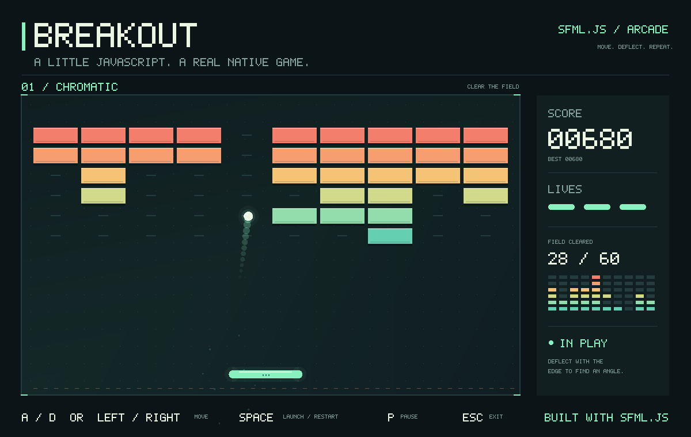

<p align="center">
  
  <picture>
    <source media="(prefers-color-scheme: dark)" srcset="./assets/branding/sfml-js-wordmark-dark.svg" />
    
  </picture>
</p>

<p align="center">
<a href="https://www.sfml-dev.org/documentation/3.1.0/">SFML 3.1.0</a> を基盤とする、Node.js 向けのネイティブウィンドウ、2D グラフィックス、オーディオ。
</p>

<p align="center">
<a href="https://www.npmjs.org/package/sfml.js">
  
</a>
<a href="https://www.npmjs.org/package/sfml.js">
  
</a>
<!-- ALL-CONTRIBUTORS-BADGE:START - Do not remove or modify this section -->
<a href="#contributors-"></a>
<!-- ALL-CONTRIBUTORS-BADGE:END -->
<a href="https://github.com/XadillaX/node-sfml">
  
</a>
</p>

[English](README.md) / [简体中文](README.zh-CN.md) / **日本語** / [한국어](README.ko.md)

JavaScript や TypeScript でデスクトップ向けマルチメディアアプリケーションを開発できます。スプライト、図形、テキストの描画、ウィンドウイベントの処理、音声の再生と録音、SFML スタイルのネットワーク API によるデータ交換に対応しています。

[公式サイト](https://sfml.js.org/ja/) · [クイックスタート](docs/getting-started.ja.md) · [ガイド](docs/README.ja.md) · [型リファレンス](https://sfml.js.org/ja/reference/) · [サンプル](examples/README.ja.md)

## 提供する機能

| モジュール | 機能 |
| --- | --- |
| System | 型付きベクトル、角度、時間、クロック、Unicode の変換境界、シーク可能な入力ストリーム |
| Window | ネイティブウィンドウ、型付きイベント、キーボード、マウス、ジョイスティック、クリップボード、OpenGL コンテキスト |
| Graphics | スプライト、図形、Unicode テキスト、カメラ、シェーダー、頂点バッファ、オフスクリーン描画 |
| Audio | 効果音、音楽のストリーミング再生、録音、空間オーディオ、Worker による処理 |
| Network | Node.js のトランスポートを利用した TCP、UDP、パケット、DNS、TLS、HTTP、FTP、SFTP |

TypeScript の型宣言を同梱しています。数値とリソースのビューには型付き配列を使い、描画時には状態のスナップショットを記録してコマンドをまとめて送信します。所有権、非同期読み込み、描画の挙動については[基本概念](docs/concepts.ja.md)を参照してください。

## インストール

```bash
npm install sfml.js
```

インストール時にネイティブアドオンをコンパイルし、対応する SFML ライブラリをダウンロードします。事前に **Python と C++20 ツールチェーン**を用意してください。

| プラットフォーム | ダウンロード対象 | ビルドツール |
| --- | --- | --- |
| macOS 13+ | x64、arm64 | Xcode Command Line Tools |
| Linux | x64 | GCC または Clang、make、X11、OpenGL とオーディオの開発用ライブラリ |
| Windows | x64、ia32 | Visual Studio 2022 C++ Build Tools |

パッケージが宣言する Node.js の対応範囲は `^18.19.0 || >=20.5.0` です。CI は Linux、macOS、Windows の Node.js 20 と 22 向けに設定されています。ダウンロード対象であることは、すべてのアーキテクチャやデバイスでテスト済みであることを意味しません。プラットフォーム別のコマンドは[インストール手順](docs/getting-started.ja.md#requirements)を参照してください。

## 最初のウィンドウ

以下を `hello.cjs` として保存し、`node hello.cjs` で実行します。

```javascript
const sf = require('sfml.js');

const window = new sf.RenderWindow(
  new sf.VideoMode(new sf.Vector2u(800, 600)),
  'Hello, sfml.js',
);
const circle = new sf.CircleShape({ radius: 80 });
circle.setPosition(new sf.Vector2f(320, 220));
circle.setFillColor(new sf.Color(76, 190, 110));
window.setFramerateLimit(60);

function frame() {
  window.handleEvents({
    Closed: () => window.close(),
    KeyPressed: event => {
      if (event.code === sf.Keyboard.Key.Escape) window.close();
    },
  });
  if (!window.isOpen()) return;

  window.clear(new sf.Color(24, 28, 32));
  window.draw(circle);
  window.display();
  setImmediate(frame);
}

frame();
```

このサンプルはネイティブのデスクトップウィンドウを作成します。グラフィカルセッション内で実行してください。`setImmediate()` によって、フレーム間で Node.js が I/O を処理できます。`display()` は同期メソッドであり、フレームレート制限や垂直同期のために待機する場合があります。

TypeScript では `import { RenderWindow, Vector2u } from 'sfml.js'` のように名前付きインポートを使います。ファイルの読み込みには Promise を使用します。

```javascript
async function loadSprite(filename) {
  const texture = new sf.Texture();
  if (!await texture.loadFromFile(filename)) {
    throw new Error(`Cannot load texture: ${filename}`);
  }
  return new sf.Sprite(texture);
}
```

## ドキュメント

README とガイドは英語、簡体字中国語、日本語、韓国語で提供しています。既定の言語は英語です。

| 入口 | 内容 |
| --- | --- |
| [クイックスタート](docs/getting-started.ja.md) | インストール、インポート、最初のウィンドウ |
| [基本概念](docs/concepts.ja.md) | 値、リソースの寿命、Promise、描画スナップショット |
| [API ガイド](docs/api.ja.md) | System、Window、Graphics、Audio、Network への案内 |
| [サンプル](examples/README.ja.md) | 実行可能なプログラムと操作方法 |
| [開発ガイド](docs/development.ja.md) | ビルド、テスト、コントリビュート |

[TypeDoc](https://sfml.js.org/ja/reference/) では、生成されたシグネチャとソースコードのコメントを参照できます。[SFML の C++ ドキュメント](https://www.sfml-dev.org/documentation/3.1.0/)は上流 API を説明しており、このリポジトリのガイドは JavaScript 固有の挙動を説明しています。

## サンプルの実行



[breakout.cjs](examples/breakout.cjs) の実行画面です。図形、キーボード入力、ゲームループを JavaScript で実装しています。左右キーまたは A／D で移動、Space で発射、Esc で終了します。

```bash
git clone https://github.com/XadillaX/node-sfml.git
cd node-sfml
npm ci
node examples/breakout.cjs
node examples/all-types.cjs --frames=120
node examples/network.cjs
```

[機能サンプル](examples/features/README.ja.md) · [公式サンプル](examples/official/README.ja.md) · [ゲームとアプリ](examples/projects/README.ja.md)

[node-sfml-demos](https://github.com/XadillaX/node-sfml-demos) には、sfml.js で実装した Bomberman、Breakout、Tetris、Doodle Jump、Arkanoid が含まれています。インストールと起動の手順は[ゲームプロジェクト](examples/projects/README.ja.md#node-sfml-demos)を参照してください。

[16-sfml.js-games-ported](https://github.com/XadillaX/16-sfml.js-games-ported) は、[jsyqrt/games](https://github.com/jsyqrt/games) の C++ と SFML で作られた全 16 ゲームを、ClojureScript と sfml.js に移植したものです。ゲーム一覧と nbb の起動コマンドは[16 ゲーム](examples/projects/README.ja.md#16-games)を参照してください。

[play-nes](examples/projects/README.ja.md#play-nes) — sfml.js と JSNES で構築されたデスクトップ NES エミュレータ。

## コントリビュート

[開発ガイド](docs/development.ja.md)に従って環境を用意してください。不具合修正、ドキュメント、サンプルのプルリクエストを歓迎します。不具合の報告には、実行可能な再現例と、Node.js のバージョン、OS、アーキテクチャを添えてください。

<a id="contributors-"></a>
<a id="maintenance-XadillaX"></a>

## コントリビューター ✨

以下の皆さんに感謝します（[絵文字の凡例](https://allcontributors.org/docs/en/emoji-key)）。

<!-- ALL-CONTRIBUTORS-LIST:START - Do not remove or modify this section -->
<!-- prettier-ignore-start -->
<!-- markdownlint-disable -->
<table>
  <tr>
    <td align="center"><a href="https://xcoder.in/"><br /><sub><b>Khaidi Chu</b></sub></a><br /><a href="#maintenance-XadillaX" title="Maintenance">🚧</a> <a href="https://github.com/XadillaX/node-sfml/commits?author=XadillaX" title="Code">💻</a></td>
    <td align="center"><a href="https://pokemonworkshop.com/forum"><br /><sub><b>NuriYuri</b></sub></a><br /><a href="https://github.com/XadillaX/node-sfml/commits?author=NuriYuri" title="Code">💻</a></td>
    <td align="center"><a href="https://godot.id"><br /><sub><b>Hanz</b></sub></a><br /><a href="https://github.com/XadillaX/node-sfml/commits?author=HanzCEO" title="Code">💻</a></td>
  </tr>
</table>

<!-- markdownlint-restore -->
<!-- prettier-ignore-end -->
<!-- ALL-CONTRIBUTORS-LIST:END -->

このプロジェクトは [all-contributors](https://github.com/all-contributors/all-contributors) の仕様に従っています。どのような形での貢献も歓迎します。

## ライセンス

[MIT](LICENSE)。
