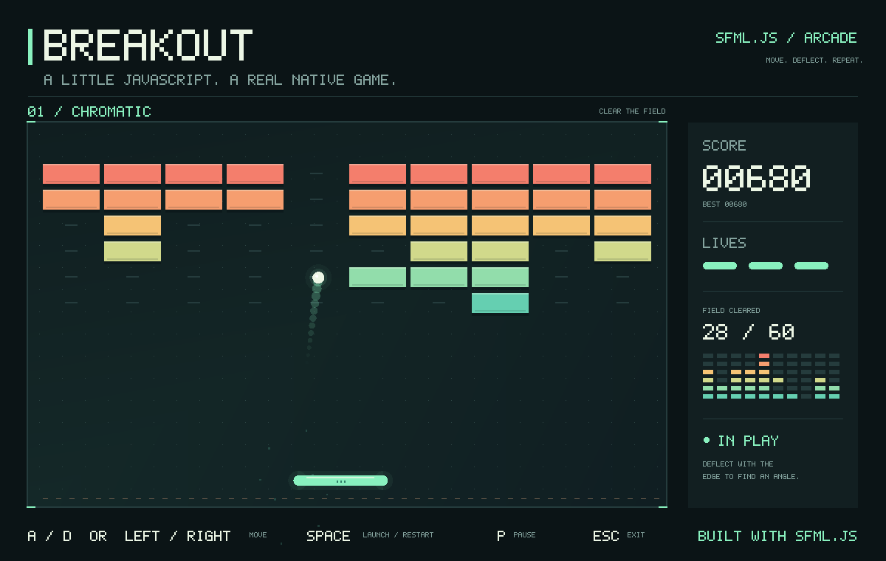

<p align="center">
  
  <picture>
    <source media="(prefers-color-scheme: dark)" srcset="packages/sfml.js/assets/branding/sfml-js-wordmark-dark.svg" />
    
  </picture>
</p>

<p align="center">
<a href="https://www.sfml-dev.org/documentation/3.1.0/">SFML 3.1.0</a> 上に構築された、Node.js のネイティブウィンドウ・2D グラフィックス・オーディオ・Dear ImGui。
</p>

<p align="center">
<a href="https://www.npmjs.org/package/sfml.js">
  
</a>
<a href="https://www.npmjs.org/package/sfml.js-imgui">
  
</a>
<!-- ALL-CONTRIBUTORS-BADGE:START - Do not remove or modify this section -->
<a href="#contributors-"></a>
<!-- ALL-CONTRIBUTORS-BADGE:END -->
</p>

[English](README.md) · [简体中文](README.zh-CN.md) · **日本語** · [한국어](README.ko.md)

[Web サイト](https://sfml.js.org/ja/) · [コアガイド](docs/sfml/README.ja.md) · [ImGui ガイド](docs/imgui/README.ja.md) · [ネイティブ拡張](docs/interop/README.ja.md) · [API リファレンス](https://sfml.js.org/ja/reference/)

## パッケージ

このリポジトリは、公開パッケージとその共有ネイティブレイヤーのための Rush モノレポです。

| パッケージ | 役割 |
| --- | --- |
| [`sfml.js`](packages/sfml.js) | Node.js にネイティブウィンドウ、型付きイベント、2D グラフィックス、オーディオ、SFML 流のネットワーク機能を提供します。 |
| [`sfml.js-imgui`](packages/sfml.js-imgui) | [imgui-sfml](https://github.com/SFML/imgui-sfml) 3.0 に沿った、sfml.js のための [Dear ImGui](https://github.com/ocornut/imgui) 1.91.9b 連携。ネイティブウィンドウにデバッグパネル、シーンインスペクター、エディターコントロールを構築できます。 |
| [`sfml.js-interop`](packages/sfml.js-interop) | バインディングとサードパーティのネイティブ拡張が使う共有ヘッダーと SFML SDK パス。アプリが直接依存する必要はありません。 |

コアモジュールは System、Window、Graphics、Audio、Network をカバーし、TypeScript 型宣言を同梱します。数値とリソースビューには型付き配列を使い、描画は状態のスナップショットを記録してコマンドをまとめて送信します。所有権、非同期ロード、描画の振る舞いは[コアコンセプト](docs/sfml/concepts.ja.md)を参照してください。

## インストール

```sh
npm install sfml.js sfml.js-imgui
```

ImGui が不要なら `sfml.js` だけをインストールしてください。インストール時にネイティブアドオンのコンパイルと対応する SFML ライブラリのダウンロードが行われるため、事前に **Python と C++20 ツールチェーン**を用意してください。

| プラットフォーム | ターゲット | ビルドツール |
| --- | --- | --- |
| macOS 13+ | x64、arm64 | Xcode Command Line Tools |
| Linux | x64 | GCC または Clang、make、X11、OpenGL、オーディオ開発ライブラリ |
| Windows | x64、ia32 | Visual Studio 2022 C++ Build Tools |

パッケージが宣言する Node.js 範囲は `^18.19.0 || >=20.5.0` です。CI は Linux、macOS、Windows 上の Node.js 20 と 22 で実行しています。各プラットフォームのコマンドは[プラットフォーム要件](docs/sfml/getting-started.ja.md#requirements)を参照してください。

## 最初のウィンドウ

`hello.cjs` として保存し、グラフィカルセッションで `node hello.cjs` を実行します。

```javascript
const sf = require('sfml.js');

const window = new sf.RenderWindow(
  new sf.VideoMode(new sf.Vector2u(800, 600)),
  'Hello, sfml.js',
);
const circle = new sf.CircleShape({ radius: 80 });
circle.setPosition(new sf.Vector2f(320, 220));
circle.setFillColor(new sf.Color(76, 190, 110));
window.setFramerateLimit(60);

function frame() {
  window.handleEvents({
    Closed: () => window.close(),
    KeyPressed: event => {
      if (event.code === sf.Keyboard.Key.Escape) window.close();
    },
  });
  if (!window.isOpen()) return;

  window.clear(new sf.Color(24, 28, 32));
  window.draw(circle);
  window.display();
  setImmediate(frame);
}

frame();
```

`setImmediate()` によりフレーム間で Node.js が I/O を処理できます。`display()` は同期で、フレーム制限や垂直同期を待つことがあります。ファイルの読み込みは Promise を使います。その他のパターンは[コアパッケージ README](packages/sfml.js/README.ja.md)と[クイックスタート](docs/sfml/getting-started.ja.md)を参照してください。

## ImGui パネルを追加する

`sfml.js-imgui` は `sfml.js` のピア依存パッケージです。すべてのウィンドウイベントを転送し、ウィジェットは `SFML.Update` と `SFML.Render` の間で宣言します。

```javascript
const sf = require('sfml.js');
const { ImGui, SFML } = require('sfml.js-imgui');

const window = new sf.RenderWindow(
  new sf.VideoMode(new sf.Vector2u(800, 600)),
  'ImGui counter',
);
window.setFramerateLimit(60);
const clock = new sf.Clock();
let clicks = 0;

SFML.Init(window);
try {
  while (window.isOpen()) {
    let event;
    while ((event = window.pollEvent()) !== undefined) {
      SFML.ProcessEvent(window, event);
      if (event.is('Closed')) window.close();
    }

    SFML.Update(window, clock.restart().asSeconds());
    if (ImGui.Begin('Controls')) {
      if (ImGui.Button('Count')) clicks++;
      ImGui.TextUnformatted(`Clicks: ${clicks}`);
    }
    ImGui.End();

    window.clear(sf.Color.Black);
    SFML.Render(window);
    window.display();
  }
} finally {
  SFML.Shutdown(window);
  window.close();
}
```

シーンへの入力を制御するには `SFML.GetIO().wantCaptureMouse` と `wantCaptureKeyboard` を使います。フレームループ全体、入力の振り分け、安全な終了については [ImGui クイックスタート](docs/imgui/getting-started.ja.md)で説明しています。

## サンプル



図形、キーボード入力、JavaScript のゲームループを使った遊べる[ブロック崩し](packages/sfml.js/examples/breakout.cjs)です。

```sh
git clone https://github.com/XadillaX/sfml.js.git
cd sfml.js
node tools/bootstrap.cjs
node packages/sfml.js/examples/breakout.cjs
node packages/sfml.js-imgui/examples/demo.cjs
```

- コア：[機能サンプル](packages/sfml.js/examples/features/README.ja.md)、[公式サンプル](packages/sfml.js/examples/official/README.ja.md)、[ゲームとアプリケーション](packages/sfml.js/examples/projects/README.ja.md)
- ImGui：[ウィジェットデモ、シーンインスペクター、workbench](packages/sfml.js-imgui/examples/README.ja.md)

外部プロジェクト：[node-sfml-demos](https://github.com/XadillaX/node-sfml-demos)（Bomberman、Breakout、Tetris など）、[16-sfml.js-games-ported](https://github.com/XadillaX/16-sfml.js-games-ported)、sfml.js で作られたデスクトップ NES エミュレーター [play-nes](https://github.com/XadillaX/play-nes)。

## ドキュメント

リポジトリのガイドは英語、簡体字中国語、日本語、韓国語で提供しています。

| トピック | ガイド |
| --- | --- |
| コアバインディング | [クイックスタート](docs/sfml/getting-started.ja.md) · [コアコンセプト](docs/sfml/concepts.ja.md) · [API ガイド](docs/sfml/api.ja.md) · [開発ガイド](docs/sfml/development.ja.md) |
| ImGui | [クイックスタート](docs/imgui/getting-started.ja.md) · [ウィジェットと状態](docs/imgui/widgets.ja.md) · [レイアウト](docs/imgui/layout.ja.md) · [テーブル、メニュー、モーダル](docs/imgui/README.ja.md) |
| ネイティブ拡張 | [相互運用契約](docs/interop/README.ja.md) |

[Web サイト](https://sfml.js.org/ja/)では、これらのガイドに加えて [sfml.js](https://sfml.js.org/ja/reference/) と [sfml.js-imgui](https://sfml.js.org/ja/reference/imgui/) の TypeDoc シグネチャを 4 言語で公開しています。パッケージ README：[sfml.js](packages/sfml.js/README.ja.md)（[English](packages/sfml.js/README.md) · [简体中文](packages/sfml.js/README.zh-CN.md) · [한국어](packages/sfml.js/README.ko.md)）。

## 開発

[プラットフォーム要件](docs/sfml/getting-started.ja.md#requirements)に従って Node.js 20 または 22、Python、C++20 ツールチェーンを用意してください。クローン後に実行します。

```sh
node tools/bootstrap.cjs
```

このコマンドは固定バージョンの Rush/pnpm 依存関係のインストール、ネイティブライブラリのダウンロード、パッケージと Web サイトのビルド、ルートの clangd コンパイルデータベースの生成を行います。Web サイトは `site` のプライベート Rush プロジェクトです。

```sh
npm --prefix site run dev
node common/scripts/install-run-rush.js build --to sfml-js-site
npm --prefix site test
```

本番サイトは `site/build/site` に生成されます。API コメントと実行可能サンプルは所有するパッケージが管理します。

## コントリビューション

[開発ガイド](docs/sfml/development.ja.md)に従って環境を準備してください。修正、ドキュメント、サンプルの PR を歓迎します。バグ報告には再現可能なコードと、Node.js バージョン、OS、アーキテクチャを添えてください。

<a id="contributors-"></a>
<a id="maintenance-XadillaX"></a>

## コントリビューター ✨

すばらしい貢献者の皆さんに感謝します（[絵文字の意味](https://allcontributors.org/docs/en/emoji-key)）。

<!-- ALL-CONTRIBUTORS-LIST:START - Do not remove or modify this section -->
<!-- prettier-ignore-start -->
<!-- markdownlint-disable -->
<table>
  <tr>
    <td align="center"><a href="https://xcoder.in/"><br /><sub><b>Khaidi Chu</b></sub></a><br /><a href="#maintenance-XadillaX" title="Maintenance">🚧</a> <a href="https://github.com/XadillaX/sfml.js/commits?author=XadillaX" title="Code">💻</a></td>
    <td align="center"><a href="https://pokemonworkshop.com/forum"><br /><sub><b>NuriYuri</b></sub></a><br /><a href="https://github.com/XadillaX/sfml.js/commits?author=NuriYuri" title="Code">💻</a></td>
    <td align="center"><a href="https://godot.id"><br /><sub><b>Hanz</b></sub></a><br /><a href="https://github.com/XadillaX/sfml.js/commits?author=HanzCEO" title="Code">💻</a></td>
  </tr>
</table>

<!-- markdownlint-restore -->
<!-- prettier-ignore-end -->
<!-- ALL-CONTRIBUTORS-LIST:END -->

このプロジェクトは [all-contributors](https://github.com/all-contributors/all-contributors) 仕様に従います。あらゆる種類の貢献を歓迎します。

## ライセンス

[MIT](packages/sfml.js/LICENSE)。
