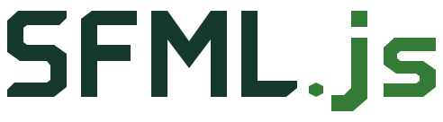
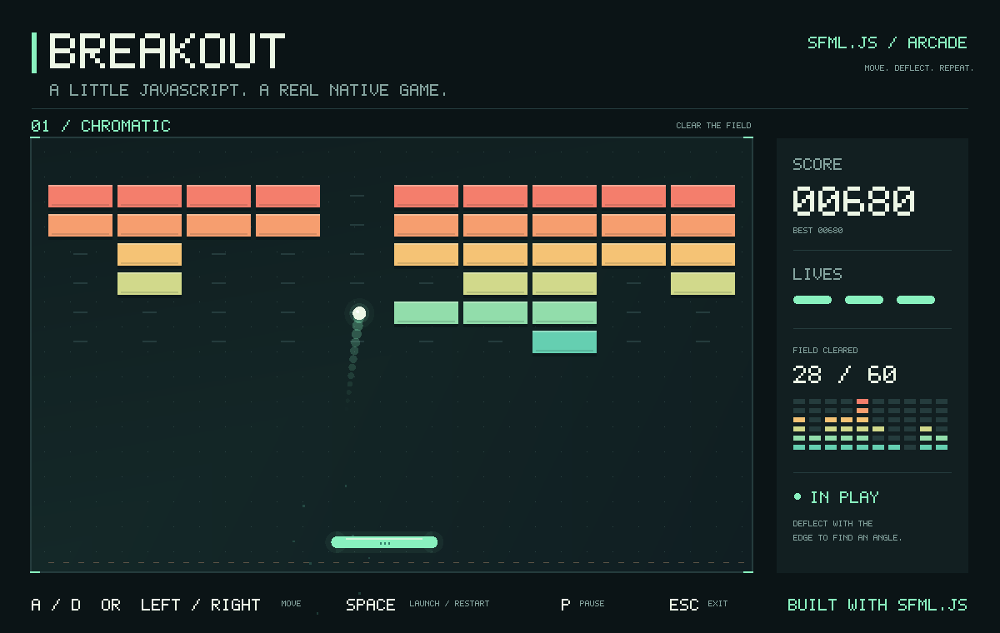

<p align="center">
  
  <picture>
    <source media="(prefers-color-scheme: dark)" srcset="packages/sfml.js/assets/branding/sfml-js-wordmark-dark.svg" />
    
  </picture>
</p>

<p align="center">
<a href="https://www.sfml-dev.org/documentation/3.1.0/">SFML 3.1.0</a> 기반의 Node.js 네이티브 창, 2D 그래픽, 오디오, Dear ImGui.
</p>

<p align="center">
<a href="https://www.npmjs.org/package/sfml.js">
  
</a>
<a href="https://www.npmjs.org/package/sfml.js-imgui">
  
</a>
<!-- ALL-CONTRIBUTORS-BADGE:START - Do not remove or modify this section -->
<a href="#contributors-"></a>
<!-- ALL-CONTRIBUTORS-BADGE:END -->
</p>

[English](README.md) · [简体中文](README.zh-CN.md) · [日本語](README.ja.md) · **한국어**

[웹사이트](https://sfml.js.org/ko/) · [핵심 가이드](docs/sfml/README.ko.md) · [ImGui 가이드](docs/imgui/README.ko.md) · [네이티브 확장](docs/interop/README.ko.md) · [API 레퍼런스](https://sfml.js.org/ko/reference/)

## 패키지

이 저장소는 공개 바인딩과 공유 네이티브 계층을 위한 Rush 모노레포입니다.

| 패키지 | 용도 |
| --- | --- |
| [`sfml.js`](packages/sfml.js) | Node.js용 네이티브 창, 타입화된 이벤트, 2D 그래픽, 오디오, SFML 스타일 네트워킹. |
| [`sfml.js-imgui`](packages/sfml.js-imgui) | [imgui-sfml](https://github.com/SFML/imgui-sfml) 3.0을 따르는 sfml.js용 [Dear ImGui](https://github.com/ocornut/imgui) 1.91.9b 연동. 네이티브 창에 디버그 패널, 장면 검사기, 에디터 컨트롤을 만듭니다. |
| [`sfml.js-interop`](packages/sfml.js-interop) | 바인딩과 서드파티 네이티브 확장이 사용하는 공유 헤더와 SFML SDK 경로. 앱은 직접 의존할 필요가 없습니다. |

핵심 모듈은 System, Window, Graphics, Audio, Network를 다루며 TypeScript 타입 선언이 포함됩니다. 숫자와 리소스 뷰는 타입 배열을 사용하고, 렌더링은 상태 스냅샷을 기록해 명령을 일괄 제출합니다. 소유권, 비동기 로드, 렌더링 동작은 [핵심 개념](docs/sfml/concepts.ko.md)을 참고하세요.

## 설치

```sh
npm install sfml.js sfml.js-imgui
```

ImGui가 필요 없으면 `sfml.js`만 설치하세요. 설치 과정에서 네이티브 애드온을 컴파일하고 맞는 SFML 라이브러리를 다운로드하므로 먼저 **Python과 C++20 도구 모음**을 준비하세요.

| 플랫폼 | 대상 아키텍처 | 빌드 도구 |
| --- | --- | --- |
| macOS 13+ | x64, arm64 | Xcode Command Line Tools |
| Linux | x64 | GCC 또는 Clang, make, X11, OpenGL, 오디오 개발 라이브러리 |
| Windows | x64, ia32 | Visual Studio 2022 C++ Build Tools |

패키지가 선언하는 Node.js 범위는 `^18.19.0 || >=20.5.0`입니다. CI는 Linux, macOS, Windows에서 Node.js 20과 22를 실행합니다. 플랫폼별 명령은 [플랫폼 요구 사항](docs/sfml/getting-started.ko.md#requirements)을 참고하세요.

## 첫 창

`hello.cjs`로 저장하고 그래픽 세션에서 `node hello.cjs`를 실행하세요.

```javascript
const sf = require('sfml.js');

const window = new sf.RenderWindow(
  new sf.VideoMode(new sf.Vector2u(800, 600)),
  'Hello, sfml.js',
);
const circle = new sf.CircleShape({ radius: 80 });
circle.setPosition(new sf.Vector2f(320, 220));
circle.setFillColor(new sf.Color(76, 190, 110));
window.setFramerateLimit(60);

function frame() {
  window.handleEvents({
    Closed: () => window.close(),
    KeyPressed: event => {
      if (event.code === sf.Keyboard.Key.Escape) window.close();
    },
  });
  if (!window.isOpen()) return;

  window.clear(new sf.Color(24, 28, 32));
  window.draw(circle);
  window.display();
  setImmediate(frame);
}

frame();
```

`setImmediate()`는 프레임 사이에 Node.js가 I/O를 처리하게 합니다. `display()`는 동기 호출이며 프레임 제한이나 수직 동기화를 기다릴 수 있습니다. 파일 로드는 Promise를 사용합니다. 더 많은 패턴은 [핵심 패키지 README](packages/sfml.js/README.ko.md)와 [빠른 시작](docs/sfml/getting-started.ko.md)을 참고하세요.

## ImGui 패널 추가

`sfml.js-imgui`는 `sfml.js`의 피어 의존성입니다. 모든 창 이벤트를 전달하고 위젯은 `SFML.Update`와 `SFML.Render` 사이에서 선언합니다.

```javascript
const sf = require('sfml.js');
const { ImGui, SFML } = require('sfml.js-imgui');

const window = new sf.RenderWindow(
  new sf.VideoMode(new sf.Vector2u(800, 600)),
  'ImGui counter',
);
window.setFramerateLimit(60);
const clock = new sf.Clock();
let clicks = 0;

SFML.Init(window);
try {
  while (window.isOpen()) {
    let event;
    while ((event = window.pollEvent()) !== undefined) {
      SFML.ProcessEvent(window, event);
      if (event.is('Closed')) window.close();
    }

    SFML.Update(window, clock.restart().asSeconds());
    if (ImGui.Begin('Controls')) {
      if (ImGui.Button('Count')) clicks++;
      ImGui.TextUnformatted(`Clicks: ${clicks}`);
    }
    ImGui.End();

    window.clear(sf.Color.Black);
    SFML.Render(window);
    window.display();
  }
} finally {
  SFML.Shutdown(window);
  window.close();
}
```

장면 입력을 제한하려면 `SFML.GetIO().wantCaptureMouse`와 `wantCaptureKeyboard`를 사용하세요. 전체 프레임 루프, 입력 전달, 안전한 종료 규칙은 [ImGui 빠른 시작](docs/imgui/getting-started.ko.md)에서 설명합니다.

## 예제



도형, 키보드 입력, JavaScript 게임 루프로 만들어진 플레이 가능한 [벽돌깨기](packages/sfml.js/examples/breakout.cjs)입니다.

```sh
git clone https://github.com/XadillaX/sfml.js.git
cd sfml.js
node tools/bootstrap.cjs
node packages/sfml.js/examples/breakout.cjs
node packages/sfml.js-imgui/examples/demo.cjs
```

- 핵심: [기능 예제](packages/sfml.js/examples/features/README.ko.md), [공식 예제](packages/sfml.js/examples/official/README.ko.md), [게임과 애플리케이션](packages/sfml.js/examples/projects/README.ko.md)
- ImGui: [위젯 데모, 장면 검사기, 워크벤치](packages/sfml.js-imgui/examples/README.ko.md)

외부 프로젝트: [node-sfml-demos](https://github.com/XadillaX/node-sfml-demos)(Bomberman, Breakout, Tetris 등), [16-sfml.js-games-ported](https://github.com/XadillaX/16-sfml.js-games-ported), sfml.js로 만든 데스크톱 NES 에뮬레이터 [play-nes](https://github.com/XadillaX/play-nes).

## 문서

저장소의 가이드는 영어, 간체 중국어, 일본어, 한국어로 제공됩니다.

| 주제 | 가이드 |
| --- | --- |
| 핵심 바인딩 | [빠른 시작](docs/sfml/getting-started.ko.md) · [핵심 개념](docs/sfml/concepts.ko.md) · [API 가이드](docs/sfml/api.ko.md) · [개발 안내](docs/sfml/development.ko.md) |
| ImGui | [빠른 시작](docs/imgui/getting-started.ko.md) · [위젯과 상태](docs/imgui/widgets.ko.md) · [레이아웃](docs/imgui/layout.ko.md) · [테이블, 메뉴, 모달](docs/imgui/README.ko.md) |
| 네이티브 확장 | [상호 운용 계약](docs/interop/README.ko.md) |

[웹사이트](https://sfml.js.org/ko/)는 이 가이드와 함께 [sfml.js](https://sfml.js.org/ko/reference/), [sfml.js-imgui](https://sfml.js.org/ko/reference/imgui/)의 TypeDoc 시그니처를 4개 언어로 제공합니다. 패키지 README: [sfml.js](packages/sfml.js/README.ko.md)([English](packages/sfml.js/README.md) · [简体中文](packages/sfml.js/README.zh-CN.md) · [日本語](packages/sfml.js/README.ja.md)).

## 개발

[플랫폼 요구 사항](docs/sfml/getting-started.ko.md#requirements)에 따라 Node.js 20 또는 22, Python, C++20 도구 모음을 준비하세요. 클론 후 실행합니다.

```sh
node tools/bootstrap.cjs
```

이 명령은 고정된 Rush/pnpm 의존성 설치, 네이티브 라이브러리 다운로드, 패키지와 웹사이트 빌드, 루트 clangd 컴파일 데이터베이스 생성을 수행합니다. 웹사이트는 `site`의 비공개 Rush 프로젝트입니다.

```sh
npm --prefix site run dev
node common/scripts/install-run-rush.js build --to sfml-js-site
npm --prefix site test
```

프로덕션 웹사이트는 `site/build/site`에 생성됩니다. API 주석과 실행 예제는 해당 패키지가 소유합니다.

## 기여

[개발 안내](docs/sfml/development.ko.md)에 따라 환경을 준비하세요. 수정, 문서, 예제 PR을 환영합니다. 버그 보고에는 재현 가능한 코드와 Node.js 버전, 운영체제, 아키텍처를 함께 알려주세요.

<a id="contributors-"></a>
<a id="maintenance-XadillaX"></a>

## 기여자 ✨

멋진 기여자들에게 감사드립니다([이모지 의미](https://allcontributors.org/docs/en/emoji-key)).

<!-- ALL-CONTRIBUTORS-LIST:START - Do not remove or modify this section -->
<!-- prettier-ignore-start -->
<!-- markdownlint-disable -->
<table>
  <tr>
    <td align="center"><a href="https://xcoder.in/"><br /><sub><b>Khaidi Chu</b></sub></a><br /><a href="#maintenance-XadillaX" title="Maintenance">🚧</a> <a href="https://github.com/XadillaX/sfml.js/commits?author=XadillaX" title="Code">💻</a></td>
    <td align="center"><a href="https://pokemonworkshop.com/forum"><br /><sub><b>NuriYuri</b></sub></a><br /><a href="https://github.com/XadillaX/sfml.js/commits?author=NuriYuri" title="Code">💻</a></td>
    <td align="center"><a href="https://godot.id"><br /><sub><b>Hanz</b></sub></a><br /><a href="https://github.com/XadillaX/sfml.js/commits?author=HanzCEO" title="Code">💻</a></td>
  </tr>
</table>

<!-- markdownlint-restore -->
<!-- prettier-ignore-end -->
<!-- ALL-CONTRIBUTORS-LIST:END -->

이 프로젝트는 [all-contributors](https://github.com/all-contributors/all-contributors) 명세를 따르며 모든 형태의 기여를 환영합니다.

## 라이선스

[MIT](packages/sfml.js/LICENSE).
