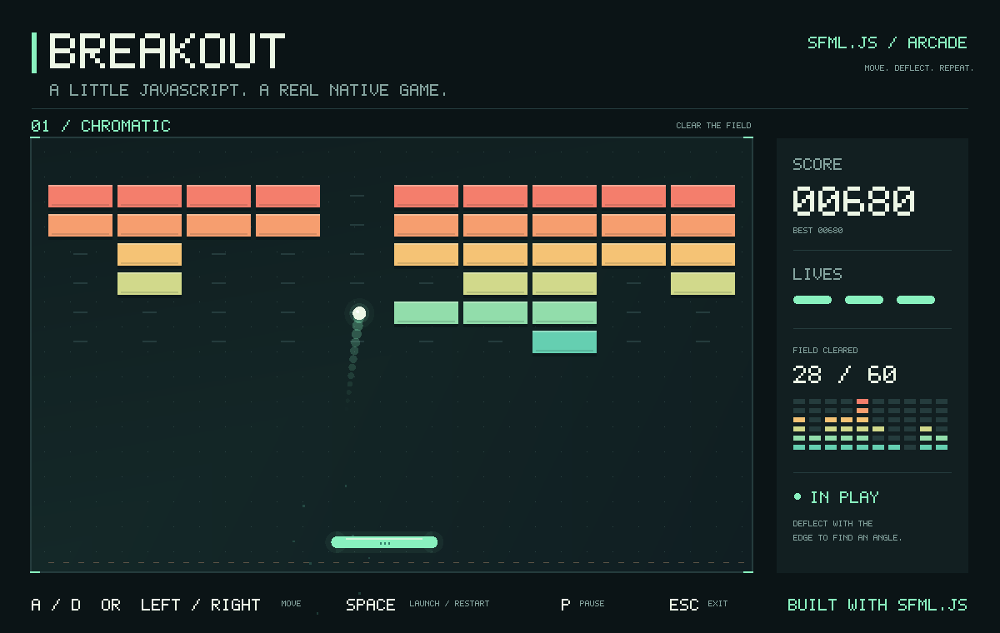

<p align="center">
  
  <picture>
    <source media="(prefers-color-scheme: dark)" srcset="packages/sfml.js/assets/branding/sfml-js-wordmark-dark.svg" />
    
  </picture>
</p>

<p align="center">
Native windows, 2D graphics, audio and Dear ImGui for Node.js, built on <a href="https://www.sfml-dev.org/documentation/3.1.0/">SFML 3.1.0</a>.
</p>

<p align="center">
<a href="https://www.npmjs.org/package/sfml.js">
  
</a>
<a href="https://www.npmjs.org/package/sfml.js-imgui">
  
</a>
<!-- ALL-CONTRIBUTORS-BADGE:START - Do not remove or modify this section -->
<a href="#contributors-"></a>
<!-- ALL-CONTRIBUTORS-BADGE:END -->
</p>

**English** · [简体中文](README.zh-CN.md) · [日本語](README.ja.md) · [한국어](README.ko.md)

[Website](https://sfml.js.org/) · [Core guides](docs/sfml/README.md) · [ImGui guide](docs/imgui/README.md) · [Native extensions](docs/interop/README.md) · [API reference](https://sfml.js.org/reference/)

## Packages

This repository is a Rush monorepo for the published bindings and their shared native layer:

| Package | Purpose |
| --- | --- |
| [`sfml.js`](packages/sfml.js) | Native windows, typed events, 2D graphics, audio and SFML-style networking for Node.js. |
| [`sfml.js-imgui`](packages/sfml.js-imgui) | [Dear ImGui](https://github.com/ocornut/imgui) 1.91.9b integration for sfml.js, following [imgui-sfml](https://github.com/SFML/imgui-sfml) 3.0: debug panels, scene inspectors and editor controls in a native window. |
| [`sfml.js-interop`](packages/sfml.js-interop) | Shared native headers and SFML SDK paths, consumed by the bindings and by third-party native extensions. Applications do not need it directly. |

The core modules cover System, Window, Graphics, Audio and Network; TypeScript declarations are included. Numeric values and resource views use typed arrays, and rendering records state snapshots and submits commands in batches. See [core concepts](docs/sfml/concepts.md) for ownership, asynchronous loading and rendering behavior.

## Installation

```sh
npm install sfml.js sfml.js-imgui
```

Install only `sfml.js` if you do not need ImGui. Installation compiles native addons and downloads the matching SFML libraries, so prepare **Python and a C++20 toolchain** first:

| Platform | Targets | Build tools |
| --- | --- | --- |
| macOS 13+ | x64, arm64 | Xcode Command Line Tools |
| Linux | x64 | GCC or Clang, make, X11, OpenGL and audio development libraries |
| Windows | x64, ia32 | Visual Studio 2022 C++ Build Tools |

The packages declare Node.js `^18.19.0 || >=20.5.0`; CI runs Node.js 20 and 22 on Linux, macOS and Windows. See the [platform requirements](docs/sfml/getting-started.md#requirements) for exact commands.

## Your first window

Save this as `hello.cjs` and run `node hello.cjs` in a graphical session:

```javascript
const sf = require('sfml.js');

const window = new sf.RenderWindow(
  new sf.VideoMode(new sf.Vector2u(800, 600)),
  'Hello, sfml.js',
);
const circle = new sf.CircleShape({ radius: 80 });
circle.setPosition(new sf.Vector2f(320, 220));
circle.setFillColor(new sf.Color(76, 190, 110));
window.setFramerateLimit(60);

function frame() {
  window.handleEvents({
    Closed: () => window.close(),
    KeyPressed: event => {
      if (event.code === sf.Keyboard.Key.Escape) window.close();
    },
  });
  if (!window.isOpen()) return;

  window.clear(new sf.Color(24, 28, 32));
  window.draw(circle);
  window.display();
  setImmediate(frame);
}

frame();
```

`setImmediate()` lets Node.js process I/O between frames; `display()` is synchronous and can wait for the frame limit or vertical sync. File loading uses promises. More patterns are in the [core package README](packages/sfml.js/README.md) and the [quick start](docs/sfml/getting-started.md).

## Add an ImGui panel

`sfml.js-imgui` is a peer of `sfml.js`. Forward every window event, then declare widgets between `SFML.Update` and `SFML.Render`:

```javascript
const sf = require('sfml.js');
const { ImGui, SFML } = require('sfml.js-imgui');

const window = new sf.RenderWindow(
  new sf.VideoMode(new sf.Vector2u(800, 600)),
  'ImGui counter',
);
window.setFramerateLimit(60);
const clock = new sf.Clock();
let clicks = 0;

SFML.Init(window);
try {
  while (window.isOpen()) {
    let event;
    while ((event = window.pollEvent()) !== undefined) {
      SFML.ProcessEvent(window, event);
      if (event.is('Closed')) window.close();
    }

    SFML.Update(window, clock.restart().asSeconds());
    if (ImGui.Begin('Controls')) {
      if (ImGui.Button('Count')) clicks++;
      ImGui.TextUnformatted(`Clicks: ${clicks}`);
    }
    ImGui.End();

    window.clear(sf.Color.Black);
    SFML.Render(window);
    window.display();
  }
} finally {
  SFML.Shutdown(window);
  window.close();
}
```

Use `SFML.GetIO().wantCaptureMouse` and `wantCaptureKeyboard` to gate scene input. The full frame loop, input routing and shutdown rules are explained in the [ImGui quick start](docs/imgui/getting-started.md).

## Examples



Playable [breakout](packages/sfml.js/examples/breakout.cjs) using shapes, keyboard input and a JavaScript game loop:

```sh
git clone https://github.com/XadillaX/sfml.js.git
cd sfml.js
node tools/bootstrap.cjs
node packages/sfml.js/examples/breakout.cjs
node packages/sfml.js-imgui/examples/demo.cjs
```

- Core: [feature examples](packages/sfml.js/examples/features/README.md), [official examples](packages/sfml.js/examples/official/README.md), [games and applications](packages/sfml.js/examples/projects/README.md)
- ImGui: [widget demo, scene inspector and workbench](packages/sfml.js-imgui/examples/README.md)

External projects: [node-sfml-demos](https://github.com/XadillaX/node-sfml-demos) (Bomberman, Breakout, Tetris and more), [16-sfml.js-games-ported](https://github.com/XadillaX/16-sfml.js-games-ported) and [play-nes](https://github.com/XadillaX/play-nes), a desktop NES emulator built with sfml.js.

## Documentation

Guides ship in the repository in English, Simplified Chinese, Japanese and Korean:

| Topic | Guides |
| --- | --- |
| Core binding | [Quick start](docs/sfml/getting-started.md) · [Core concepts](docs/sfml/concepts.md) · [API guide](docs/sfml/api.md) · [Development](docs/sfml/development.md) |
| ImGui | [Quick start](docs/imgui/getting-started.md) · [Widgets](docs/imgui/widgets.md) · [Layout](docs/imgui/layout.md) · [Tables, menus and modals](docs/imgui/README.md) |
| Native extensions | [Interop contract](docs/interop/README.md) |

The [website](https://sfml.js.org/) publishes these guides plus TypeDoc signatures for [sfml.js](https://sfml.js.org/reference/) and [sfml.js-imgui](https://sfml.js.org/reference/imgui/) in all four languages. Package READMEs: [sfml.js](packages/sfml.js/README.md) ([简体中文](packages/sfml.js/README.zh-CN.md) · [日本語](packages/sfml.js/README.ja.md) · [한국어](packages/sfml.js/README.ko.md)).

## Develop

Prepare Node.js 20 or 22, Python and a C++20 toolchain using the [platform requirements](docs/sfml/getting-started.md#requirements). From a clone, run:

```sh
node tools/bootstrap.cjs
```

This installs the pinned Rush/pnpm dependencies, downloads native libraries, builds the packages and website, and generates the root clangd compilation database. The website is a private Rush project in `site`:

```sh
npm --prefix site run dev
node common/scripts/install-run-rush.js build --to sfml-js-site
npm --prefix site test
```

The production website is generated in `site/build/site`. API comments and runnable examples stay in their owning packages.

## Contributing

Use the [development guide](docs/sfml/development.md) to prepare your environment. Pull requests for fixes, documentation and examples are welcome. Include a runnable reproduction with bug reports, together with the Node.js version, operating system and architecture.

<a id="contributors-"></a>
<a id="maintenance-XadillaX"></a>

## Contributors ✨

Thanks goes to these wonderful people ([emoji key](https://allcontributors.org/docs/en/emoji-key)):

<!-- ALL-CONTRIBUTORS-LIST:START - Do not remove or modify this section -->
<!-- prettier-ignore-start -->
<!-- markdownlint-disable -->
<table>
  <tr>
    <td align="center"><a href="https://xcoder.in/"><br /><sub><b>Khaidi Chu</b></sub></a><br /><a href="#maintenance-XadillaX" title="Maintenance">🚧</a> <a href="https://github.com/XadillaX/sfml.js/commits?author=XadillaX" title="Code">💻</a></td>
    <td align="center"><a href="https://pokemonworkshop.com/forum"><br /><sub><b>NuriYuri</b></sub></a><br /><a href="https://github.com/XadillaX/sfml.js/commits?author=NuriYuri" title="Code">💻</a></td>
    <td align="center"><a href="https://godot.id"><br /><sub><b>Hanz</b></sub></a><br /><a href="https://github.com/XadillaX/sfml.js/commits?author=HanzCEO" title="Code">💻</a></td>
  </tr>
</table>

<!-- markdownlint-restore -->
<!-- prettier-ignore-end -->
<!-- ALL-CONTRIBUTORS-LIST:END -->

This project follows the [all-contributors](https://github.com/all-contributors/all-contributors) specification. Contributions of any kind welcome!

## License

[MIT](packages/sfml.js/LICENSE).
