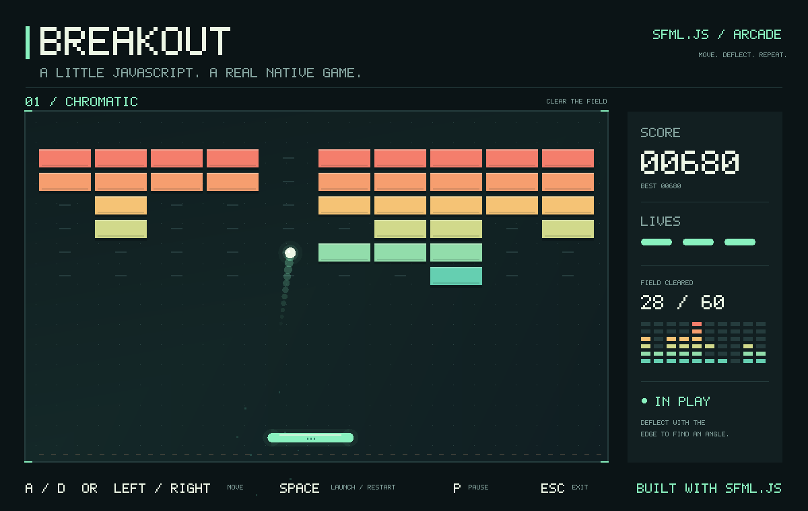

<p align="center">
  
  <picture>
    <source media="(prefers-color-scheme: dark)" srcset="packages/sfml.js/assets/branding/sfml-js-wordmark-dark.svg" />
    
  </picture>
</p>

<p align="center">
基于 <a href="https://www.sfml-dev.org/documentation/3.1.0/">SFML 3.1.0</a>，为 Node.js 提供原生窗口、二维图形、音频与 Dear ImGui。
</p>

<p align="center">
<a href="https://www.npmjs.org/package/sfml.js">
  
</a>
<a href="https://www.npmjs.org/package/sfml.js-imgui">
  
</a>
<!-- ALL-CONTRIBUTORS-BADGE:START - Do not remove or modify this section -->
<a href="#contributors-"></a>
<!-- ALL-CONTRIBUTORS-BADGE:END -->
</p>

[English](README.md) · **简体中文** · [日本語](README.ja.md) · [한국어](README.ko.md)

[官网](https://sfml.js.org/zh/) · [核心指南](docs/sfml/README.zh-CN.md) · [ImGui 指南](docs/imgui/README.zh-CN.md) · [原生扩展](docs/interop/README.zh-CN.md) · [API 参考](https://sfml.js.org/zh/reference/)

## 软件包

本仓库是一个 Rush monorepo，包含已发布的绑定包及其共享原生层：

| 软件包 | 用途 |
| --- | --- |
| [`sfml.js`](packages/sfml.js) | 为 Node.js 提供原生窗口、类型化事件、二维图形、音频和 SFML 风格的网络能力。 |
| [`sfml.js-imgui`](packages/sfml.js-imgui) | 面向 sfml.js 的 [Dear ImGui](https://github.com/ocornut/imgui) 1.91.9b 集成，遵循 [imgui-sfml](https://github.com/SFML/imgui-sfml) 3.0：在原生窗口中构建调试面板、场景检查器和编辑器控件。 |
| [`sfml.js-interop`](packages/sfml.js-interop) | 共享原生头文件和 SFML SDK 路径，供绑定包和第三方原生扩展使用。应用无需直接依赖。 |

核心模块覆盖 System、Window、Graphics、Audio 和 Network，并包含 TypeScript 类型声明。数值和资源视图使用类型化数组；绘制记录状态快照并批量提交命令。所有权、异步加载与绘制行为见 [核心概念](docs/sfml/concepts.zh-CN.md)。

## 安装

```sh
npm install sfml.js sfml.js-imgui
```

不需要 ImGui 时只安装 `sfml.js`。安装过程会编译原生扩展并下载匹配的 SFML 库，请先准备 **Python 和 C++20 工具链**：

| 平台 | 目标架构 | 构建工具 |
| --- | --- | --- |
| macOS 13+ | x64、arm64 | Xcode Command Line Tools |
| Linux | x64 | GCC 或 Clang、make、X11、OpenGL 和音频开发库 |
| Windows | x64、ia32 | Visual Studio 2022 C++ Build Tools |

软件包声明的 Node.js 范围为 `^18.19.0 || >=20.5.0`；CI 在 Linux、macOS 和 Windows 上运行 Node.js 20 和 22。各平台命令见 [平台要求](docs/sfml/getting-started.zh-CN.md#requirements)。

## 第一个窗口

保存为 `hello.cjs`，在图形会话中执行 `node hello.cjs`：

```javascript
const sf = require('sfml.js');

const window = new sf.RenderWindow(
  new sf.VideoMode(new sf.Vector2u(800, 600)),
  'Hello, sfml.js',
);
const circle = new sf.CircleShape({ radius: 80 });
circle.setPosition(new sf.Vector2f(320, 220));
circle.setFillColor(new sf.Color(76, 190, 110));
window.setFramerateLimit(60);

function frame() {
  window.handleEvents({
    Closed: () => window.close(),
    KeyPressed: event => {
      if (event.code === sf.Keyboard.Key.Escape) window.close();
    },
  });
  if (!window.isOpen()) return;

  window.clear(new sf.Color(24, 28, 32));
  window.draw(circle);
  window.display();
  setImmediate(frame);
}

frame();
```

`setImmediate()` 让 Node.js 在帧间处理 I/O；`display()` 是同步操作，可能等待帧率限制或垂直同步。文件加载使用 Promise。更多模式见 [核心包 README](packages/sfml.js/README.zh-CN.md) 和 [快速开始](docs/sfml/getting-started.zh-CN.md)。

## 添加 ImGui 面板

`sfml.js-imgui` 是 `sfml.js` 的对等依赖。转发每一个窗口事件，并在 `SFML.Update` 和 `SFML.Render` 之间声明控件：

```javascript
const sf = require('sfml.js');
const { ImGui, SFML } = require('sfml.js-imgui');

const window = new sf.RenderWindow(
  new sf.VideoMode(new sf.Vector2u(800, 600)),
  'ImGui counter',
);
window.setFramerateLimit(60);
const clock = new sf.Clock();
let clicks = 0;

SFML.Init(window);
try {
  while (window.isOpen()) {
    let event;
    while ((event = window.pollEvent()) !== undefined) {
      SFML.ProcessEvent(window, event);
      if (event.is('Closed')) window.close();
    }

    SFML.Update(window, clock.restart().asSeconds());
    if (ImGui.Begin('Controls')) {
      if (ImGui.Button('Count')) clicks++;
      ImGui.TextUnformatted(`Clicks: ${clicks}`);
    }
    ImGui.End();

    window.clear(sf.Color.Black);
    SFML.Render(window);
    window.display();
  }
} finally {
  SFML.Shutdown(window);
  window.close();
}
```

用 `SFML.GetIO().wantCaptureMouse` 和 `wantCaptureKeyboard` 控制场景输入是否响应。完整的帧循环、输入路由和退出规则见 [ImGui 快速开始](docs/imgui/getting-started.zh-CN.md)。

## 示例



可玩的 [打砖块](packages/sfml.js/examples/breakout.cjs)，使用形状、键盘输入和 JavaScript 游戏循环：

```sh
git clone https://github.com/XadillaX/sfml.js.git
cd sfml.js
node tools/bootstrap.cjs
node packages/sfml.js/examples/breakout.cjs
node packages/sfml.js-imgui/examples/demo.cjs
```

- 核心：[功能示例](packages/sfml.js/examples/features/README.zh-CN.md)、[官方示例](packages/sfml.js/examples/official/README.zh-CN.md)、[游戏与应用](packages/sfml.js/examples/projects/README.zh-CN.md)
- ImGui：[控件演示、场景检查器和工作台](packages/sfml.js-imgui/examples/README.zh-CN.md)

外部项目：[node-sfml-demos](https://github.com/XadillaX/node-sfml-demos)（Bomberman、Breakout、Tetris 等）、[16-sfml.js-games-ported](https://github.com/XadillaX/16-sfml.js-games-ported)，以及基于 sfml.js 的桌面 NES 模拟器 [play-nes](https://github.com/XadillaX/play-nes)。

## 文档

仓库内指南提供英文、简体中文、日文和韩文版本：

| 主题 | 指南 |
| --- | --- |
| 核心绑定 | [快速开始](docs/sfml/getting-started.zh-CN.md) · [核心概念](docs/sfml/concepts.zh-CN.md) · [API 指南](docs/sfml/api.zh-CN.md) · [开发指南](docs/sfml/development.zh-CN.md) |
| ImGui | [快速开始](docs/imgui/getting-started.zh-CN.md) · [控件与状态](docs/imgui/widgets.zh-CN.md) · [布局](docs/imgui/layout.zh-CN.md) · [表格、菜单与弹窗](docs/imgui/README.zh-CN.md) |
| 原生扩展 | [互操作契约](docs/interop/README.zh-CN.md) |

[官网](https://sfml.js.org/zh/) 发布上述指南，以及 [sfml.js](https://sfml.js.org/zh/reference/) 和 [sfml.js-imgui](https://sfml.js.org/zh/reference/imgui/) 的 TypeDoc 签名，四种语言齐全。包 README：[sfml.js](packages/sfml.js/README.zh-CN.md)（[English](packages/sfml.js/README.md) · [日本語](packages/sfml.js/README.ja.md) · [한국어](packages/sfml.js/README.ko.md)）。

## 开发

按 [平台要求](docs/sfml/getting-started.zh-CN.md#requirements) 准备 Node.js 20 或 22、Python 和 C++20 工具链。克隆仓库后执行：

```sh
node tools/bootstrap.cjs
```

该命令安装固定版本的 Rush/pnpm 依赖、下载原生库、构建软件包和网站，并生成根目录的 clangd 编译数据库。网站是 `site` 中的私有 Rush 项目：

```sh
npm --prefix site run dev
node common/scripts/install-run-rush.js build --to sfml-js-site
npm --prefix site test
```

生产网站生成在 `site/build/site`。API 注释和可运行示例归各自的软件包所有。

## 参与贡献

请按 [开发指南](docs/sfml/development.zh-CN.md) 准备环境。欢迎提交修复、文档与示例的 PR。反馈问题时，请提供可运行的复现程序，以及 Node.js 版本、操作系统和架构。

<a id="contributors-"></a>
<a id="maintenance-XadillaX"></a>

## 贡献者 ✨

感谢以下贡献者（[表情含义](https://allcontributors.org/docs/en/emoji-key)）：

<!-- ALL-CONTRIBUTORS-LIST:START - Do not remove or modify this section -->
<!-- prettier-ignore-start -->
<!-- markdownlint-disable -->
<table>
  <tr>
    <td align="center"><a href="https://xcoder.in/"><br /><sub><b>Khaidi Chu</b></sub></a><br /><a href="#maintenance-XadillaX" title="Maintenance">🚧</a> <a href="https://github.com/XadillaX/sfml.js/commits?author=XadillaX" title="Code">💻</a></td>
    <td align="center"><a href="https://pokemonworkshop.com/forum"><br /><sub><b>NuriYuri</b></sub></a><br /><a href="https://github.com/XadillaX/sfml.js/commits?author=NuriYuri" title="Code">💻</a></td>
    <td align="center"><a href="https://godot.id"><br /><sub><b>Hanz</b></sub></a><br /><a href="https://github.com/XadillaX/sfml.js/commits?author=HanzCEO" title="Code">💻</a></td>
  </tr>
</table>

<!-- markdownlint-restore -->
<!-- prettier-ignore-end -->
<!-- ALL-CONTRIBUTORS-LIST:END -->

本项目遵循 [all-contributors](https://github.com/all-contributors/all-contributors) 规范，欢迎各种形式的贡献。

## 许可证

[MIT](packages/sfml.js/LICENSE)。
