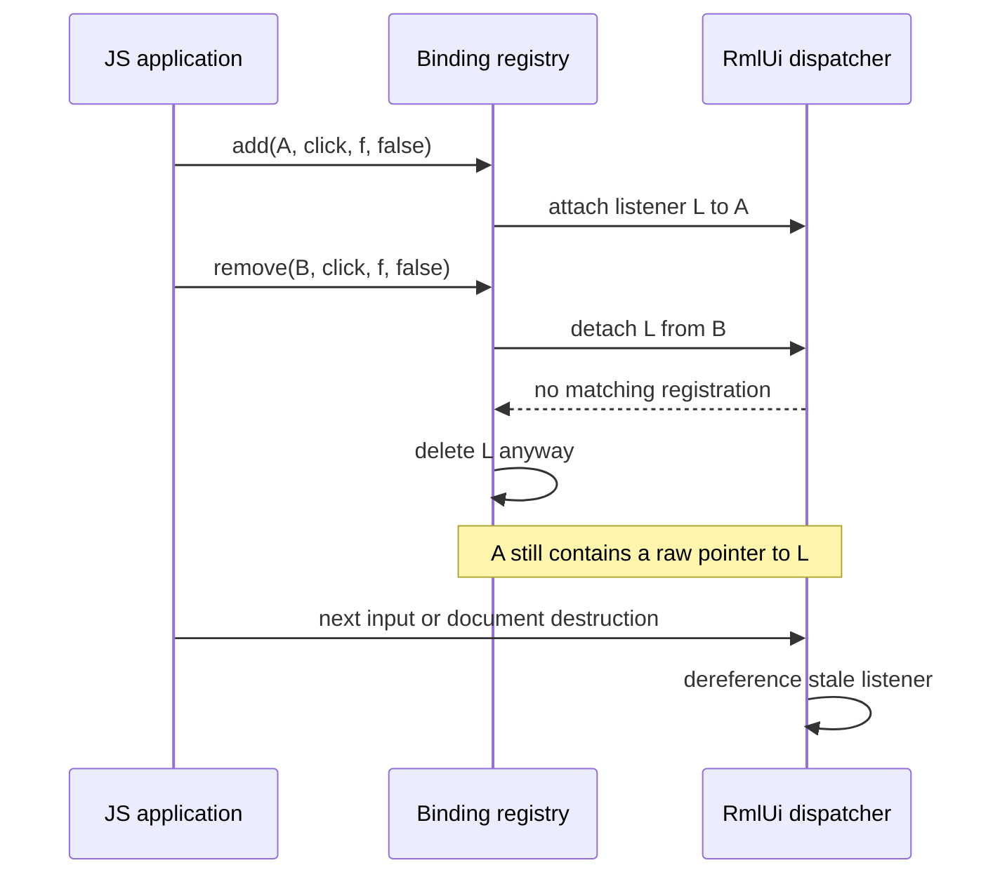

# RmlUi 6.3 Core Coverage Review

> **Source correction during Task 3 implementation:** `Core/Core.h` documents
> index clamping for `GetContext(int)`, but pinned `Source/Core/Core.cpp:319-332`
> returns null when `index < 0 || index >= GetNumContexts()`. The binding and A5
> acceptance follow the implementation: out-of-range indices return null.
> `Context::GetDimensions` is public; its owned shared mirror must observe
> resize callbacks and invalidate on destruction. Historical tables below
> retain the original baseline, not current implementation acceptance.
>
> **Completion-scope correction:** historical `X` labels on
> `GetComputedValues`, value helpers and customization interfaces do not close
> the current completion task. The implementation plan requires checked
> consumer equivalents, including public setters and construction paths.
> Parsed effect-list metadata is only partial coverage of writable declaration
> structs; FontEffect glyph methods, setters and instancer adapters remain open.

> **Verdict: not complete, not ready for full Core acceptance.** The binding has a small usable document/element subset, not full application-facing RmlUi coverage. There are confirmed lifetime and listener-registration defects. The inventory below distinguishes implemented interfaces from partial adaptations, missing interfaces, and explicitly reviewed exclusions.
>
> This is a source-level, read-only review of the existing uncommitted implementation. No implementation changes, commits, builds, runtime tests, clones, worktrees, isolated environments, or subagents were used by this reviewer. The parent reports that the three current baseline runtime files pass; this review did not rerun them. Acceptance scenarios below are requirements to execute later, not passing test results.

## Baseline And Method

- Repository: `/Users/bytedance/Workspace/github/sfml.js`.
- Package: `packages/sfml.js-rmlui`, currently untracked as a directory in the existing worktree. This is an inventory of its complete current source, not a tracked-files-only diff review.
- Authority: the supplied `third_party/rmlui` tree. Its [CMakeLists.txt:4-11](file:///Users/bytedance/Workspace/github/sfml.js/packages/sfml.js-rmlui/third_party/rmlui/CMakeLists.txt#L4-L11) declares version `6.3`; the dependency downloader also pins `6.3`. No external release or remembered API was substituted for these files.
- Intent: expose the upstream application-facing API through TypeScript and a native addon, retaining RmlUi ownership, input, DOM, and event semantics.
- Scope: `Include/RmlUi/Core.h`, `Core/Core.h`, `Context.h`, `Element.h`, `ElementDocument.h`, `Event.h`, all seven `Core/Elements/*.h`, `ElementText.h`, `ElementUtilities.h`, `StyleSheet.h`, connected `StyleSheetContainer.h`, and global resource APIs.
- Every public declaration group in those headers is accounted for below, including advanced functions and explicit exclusions. Overloads are grouped but their omissions are named. Inherited Element methods apply to documents and specialized elements without being counted again.
- Cross-check authority: the [libclang inventory](upstream-api.json), with normalized `Rml::` names and exact `signature`/`type` fields. It records 122 header entries, 121 parsed non-vendor headers, zero diagnostics, and 3,926 declarations. The unparsed entry is the vendor container header, not a silently omitted app API.
- This review's 16 declaration-bearing headers contain 549 declaration records, including 378 function/method/template records, 15 constructors and 14 destructors. These are parser record counts, **not a coverage percentage**. The other records include forward declarations, RTTI aliases, enums and fields. All 16 current header SHA-256 values were checked against the inventory and matched. The umbrella `Core.h` contributes includes, not its own callable declarations.
- All scoped method signatures were cross-checked, including macro-generated RTTI and inline/template accessors. Exact-signature records in the JSON remain the machine-readable companion; the tables provide semantic status and binding evidence. Header defaults and lifetime comments remain authoritative because clang display signatures omit default arguments.
- Parent ownership update: the parent owns the wider utility, packaging and CI audit. The originally requested ElementUtilities baseline remains listed here for coordination, without expanding into the other utility families. No renderer or plugin implementation audit was added.
- We read the TypeScript implementation, the native binding implementations and registration lists, the SFML input bridge, upstream ownership/event/widget implementations, and all three package runtime test sources. Findings received an inline second pass against upstream implementation evidence.
- No claim is made about runtime pass/fail, binary freshness, render backend correctness, optional module correctness, or whole-library method coverage beyond the scope ledger.

### Status And References

- **E (existing):** callable through the public JS surface and implemented natively for the named operation. This does not mean tested or lifetime-safe.
- **P (partial):** the public group is present but loses an overload, option, type, ownership, or event behavior.
- **M (missing):** no corresponding callable public wrapper/native binding. RML markup or generic attributes enabling related behavior does not make the dedicated API implemented.
- **X (reviewed exclusion):** not part of ordinary application-facing binding acceptance, with the exact reason stated. X is not E.
- **Indirect:** the upstream engine can perform behavior behind markup or generic APIs, without the requested dedicated binding. This is recorded separately from E.

Paths beginning `H/` mean `packages/sfml.js-rmlui/third_party/rmlui/Include/RmlUi/`; `U/` means its `Source/`; `J/` and `N/` mean package `src/` and `native/`. All line numbers refer to the files read in this review.

Binding evidence anchors:

| ID | TypeScript surface | Native implementation and export evidence |
|---|---|---|
| B-Core | [core.ts:114-211](file:///Users/bytedance/Workspace/github/sfml.js/packages/sfml.js-rmlui/src/core.ts#L114-L211), version at line 17 | [rmlui-core.cc:27-88](file:///Users/bytedance/Workspace/github/sfml.js/packages/sfml.js-rmlui/native/rmlui-core.cc#L27-L88), registrations 92-97 |
| B-Context | [context.ts:94-183](file:///Users/bytedance/Workspace/github/sfml.js/packages/sfml.js-rmlui/src/context.ts#L94-L183), methods 202-224, 246-312, 333-366 | [rmlui-context.cc:34-111](file:///Users/bytedance/Workspace/github/sfml.js/packages/sfml.js-rmlui/native/rmlui-context.cc#L34-L111), methods 114-160, registrations 165-178 |
| B-Document | [document.ts:23-121](file:///Users/bytedance/Workspace/github/sfml.js/packages/sfml.js-rmlui/src/document.ts#L23-L121) | [rmlui-document.cc:25-97](file:///Users/bytedance/Workspace/github/sfml.js/packages/sfml.js-rmlui/native/rmlui-document.cc#L25-L97), methods 99-124, registrations 128-138 |
| B-Element | [element.ts:81-178](file:///Users/bytedance/Workspace/github/sfml.js/packages/sfml.js-rmlui/src/element.ts#L81-L178), methods 193-265, 278-325 | [rmlui-element.cc:19-95](file:///Users/bytedance/Workspace/github/sfml.js/packages/sfml.js-rmlui/native/rmlui-element.cc#L19-L95), methods 97-189, complete registration list 194-210 |
| B-Event | [element.ts:361-394](file:///Users/bytedance/Workspace/github/sfml.js/packages/sfml.js-rmlui/src/element.ts#L361-L394), [types.ts:33-81](file:///Users/bytedance/Workspace/github/sfml.js/packages/sfml.js-rmlui/src/types.ts#L33-L81) | [rmlui-events.cc:27-108](file:///Users/bytedance/Workspace/github/sfml.js/packages/sfml.js-rmlui/native/rmlui-events.cc#L27-L108), registration/removal 117-157 |
| B-Exports | [index.ts:3](file:///Users/bytedance/Workspace/github/sfml.js/packages/sfml.js-rmlui/src/index.ts#L3), [core.ts:213-222](file:///Users/bytedance/Workspace/github/sfml.js/packages/sfml.js-rmlui/src/core.ts#L213-L222) | [addon.cc:17-24](file:///Users/bytedance/Workspace/github/sfml.js/packages/sfml.js-rmlui/native/addon.cc#L17-L24), [internal/native.ts:9-90](file:///Users/bytedance/Workspace/github/sfml.js/packages/sfml.js-rmlui/src/internal/native.ts#L9-L90) |

The complete registration and export lists above are the negative evidence for M entries: there are no hidden form, text, utility, stylesheet, data-model, or resource bindings in these layers. Linking the upstream implementation does not expose it to JS.

## Findings

### F1: P1, Listener Removal Can Leave A Dangling Registration

**Evidence:** [N/rmlui-events.cc:143-147](file:///Users/bytedance/Workspace/github/sfml.js/packages/sfml.js-rmlui/native/rmlui-events.cc#L143-L147); `Matches` at 56-59 checks only callback and type. It does not check element, capture phase, or environment.

**Trigger:** register `(A, "click", f, false)` and `(B, "click", f, false)`, then remove the B registration. The first matching registry object belongs to A. RmlUi is asked to detach that object from B, finds no such entry, and does nothing. The registry nevertheless deletes it, leaving A's dispatcher with a freed listener pointer. The same defect needs only one registration if removal supplies the wrong capture flag or a different element.

**Upstream confirmation:** [U/Core/EventDispatcher.cpp:54-61](file:///Users/bytedance/Workspace/github/sfml.js/packages/sfml.js-rmlui/third_party/rmlui/Source/Core/EventDispatcher.cpp#L54-L61) removes an exact `(event id, listener pointer, capture)` match. Its persistent entries are raw listener pointers; collection dereferences them at 201-218, and destruction calls `OnDetach` at 33-38. Observer pointers protect an already-collected dispatch list, not a stale persistent registration. This is a concrete use-after-free path, not just an incorrect callback count.

**Recommendation:** use per-environment registration records keyed by stable element identity, event identity, callback identity, and capture. An unmatched removal must do nothing. Detach exactly the registered pointer before releasing ownership. Reuse a registration for duplicate identical adds, matching upstream deduplication rather than allocating a fresh native listener each time. Use an explicit removal/detach state to avoid double release from `OnDetach`.

**Acceptance:** A and B may share one function safely. Removing B leaves A working; wrong element/phase/type is a no-op; double removal is a no-op; duplicate identical add fires once. Also remove the current and a later listener during dispatch, and verify the upstream ordering/observer behavior without a crash.

### F2: P1, Borrowed Handles Never Become Invalid

**Evidence:** [N/rmlui-state.h:35-57](file:///Users/bytedance/Workspace/github/sfml.js/packages/sfml.js-rmlui/native/rmlui-state.h#L35-L57) stores a raw context and wraps elements in no-op-deleter `shared_ptr`s. [N/rmlui-context.cc:59-75](file:///Users/bytedance/Workspace/github/sfml.js/packages/sfml.js-rmlui/native/rmlui-context.cc#L59-L75) neither invalidates the context nor checks its liveness. [N/rmlui-element.cc:97-119](file:///Users/bytedance/Workspace/github/sfml.js/packages/sfml.js-rmlui/native/rmlui-element.cc#L97-L119) replaces children and subsequently dereferences borrowed element pointers without a validity check.

**Triggers:** hold a child wrapper, replace the parent's `innerRML`, then call `child.id`; or `document.close(); context.update(); document.title`; or remove/shutdown a context and call a method on an old wrapper. All aliases remain structurally valid SharedHandles while the pointed-to object has been destroyed. A removed context wrapper can also remove a newly created context with the same name, because removal is name-only and does not bind the wrapper to a generation.

**Upstream confirmation:** document destruction is deferred to `Context::Update` (`H/Core/Context.h:80-86`); `U/Core/Context.cpp:1557-1568` detaches listeners and destroys pending documents. Shutdown clears contexts at `U/Core/Core.cpp:162-168`. Element already provides `EnableObserverPtr<Element>` (`H/Core/Element.h:47`).

The current JS comments explicitly prohibit stale use. That documents the hazard; it does not provide safe JS lifetime semantics. This finding is a binding acceptance/safety gap, not a claim that upstream promises raw C++ pointers remain valid.

**Recommendation:** replace borrowed element ownership with shared wrapper state containing an `ObserverPtr<Element>` and runtime generation, while keeping detached newly created nodes in an owning `ElementPtr`. All entrypoints must validate state before dereference. Contexts need a runtime-managed live token since they do not expose Element's observer facility. Invalidate all aliases on actual destruction/removal/shutdown; preserve safe access during synchronous `unload` callbacks and the documented deferred phase. Keep stale context tokens from addressing same-name replacements. Clear observer state before upstream observer-pool shutdown.

**Acceptance:** stale calls fail with a deterministic JS error, never native undefined behavior; safe wrapper GC does not destroy document-owned nodes. Verify child replacement, close/update, unload/update, context removal, shutdown/reinitialisation, and same-name context replacement. A retained dimensions view must not expose freed memory or silently masquerade as a live context.

### F3: P1, Destroying Documents Does Not Release JS Callbacks

**Evidence:** [N/rmlui-events.cc:106-115](file:///Users/bytedance/Workspace/github/sfml.js/packages/sfml.js-rmlui/native/rmlui-events.cc#L106-L115) retains callbacks in a static owning registry; there is no `OnDetach` override or environment cleanup hook. [N/rmlui-core.cc:64-74](file:///Users/bytedance/Workspace/github/sfml.js/packages/sfml.js-rmlui/native/rmlui-core.cc#L64-L74) shuts RmlUi down without clearing that registry.

**Trigger:** load a view, register a closure, unload it, and repeat. Native nodes disappear, but closures and everything reachable from them remain rooted in V8. This also happens on `innerRML` replacement. The resources test registers an anonymous callback (`test/resources.test.cjs:43-45`) and unloads it at 75 without explicit removal; the density test does the same at 46 and 107.

**Upstream confirmation:** `EventListener::OnDetach` is the intended lifetime notification (`H/Core/EventListener.h:26-27`); document cleanup calls `DetachAllEvents` (`U/Core/Context.cpp:1565-1567`). The base implementation is a no-op, so upstream cannot free the JS registry for this binding.

**Recommendation:** automatically release registration records and persistent callbacks on detach, with reentrancy-safe ownership. Clear registries during orderly shutdown and environment cleanup while the isolate is alive. Do not rely on a static C++ destructor as Node environment cleanup. Coordinate this with F1 and F4.

**Acceptance:** repeated document creation/destruction returns live-registration counters to baseline without manual listener enumeration. Cover anonymous callbacks, subtree replacement, explicit removal, document unload, context removal, and shutdown/reinitialisation. Check retained closures with controlled GC or binding diagnostics, not only RSS or successful exit.

### F4: P1, Worker-Enabled Addon Shares Runtime And V8 Callbacks Across Environments

**Evidence:** [N/addon.cc:34](file:///Users/bytedance/Workspace/github/sfml.js/packages/sfml.js-rmlui/native/addon.cc#L34) uses `NAN_MODULE_WORKER_ENABLED`; `State()` is process-static (`N/rmlui-core.cc:20-23`) and `Registry()` is process-static (`N/rmlui-events.cc:112-115`). Neither records the owning environment or serializes access.

**Trigger:** a second Node environment calls exported `shutdown()` while another owns live contexts, destroying the first environment's native state. Listener matching/dispatch can also reconstruct a persistent function created by a different isolate. SharedHandle's environment-local template cache does not protect these separate global variables.

**Recommendation:** for this single-runtime/SFML integration, first enforce one owning Node environment and thread, and reject foreign-environment runtime operations before touching RmlUi or V8 handles. Cleanup must occur in that owner. Do not claim multi-environment support until an explicit cross-environment architecture exists; merely putting a mutex around V8 calls is insufficient.

**Acceptance:** main/worker attempts to initialise, mutate, remove, or shut down another environment's runtime produce a defined error without affecting the owner. Owner teardown clears callbacks. If imports remain allowed in workers, importing/version lookup alone must not acquire or destroy the runtime.

### F5: P2, Event Snapshots Cannot Implement RmlUi Event Semantics

**Evidence:** [N/rmlui-events.cc:34-53](file:///Users/bytedance/Workspace/github/sfml.js/packages/sfml.js-rmlui/native/rmlui-events.cc#L34-L53) delivers only `type`, `targetId`, and converted parameters. [H/Core/Event.h:37-64](file:///Users/bytedance/Workspace/github/sfml.js/packages/sfml.js-rmlui/third_party/rmlui/Include/RmlUi/Core/Event.h#L37-L64) additionally requires phase, current/target elements, id, interruption, and propagation state.

Two id-less targets both become `targetId: ""`; duplicate ids are also ambiguous. A delegated handler cannot reliably identify its target/current element or stop propagation. Returning false from the JS callback has no effect. Drag parameters contain a native element pointer (`U/Core/Context.cpp:1552-1555`), which the generic string fallback cannot turn into a usable Element. INT64/UINT64 also lose precision by conversion to JS number (`N/rmlui-events.cc:72-75`).

**Recommendation:** expose a dispatch-scoped Event facade with stable element wrappers, phase/id/state accessors, `stopPropagation()`, `stopImmediatePropagation()`, and unprojected mouse position. Invalidate native event access after the synchronous callback, while optionally retaining explicitly copied data. Use a shared, explicit Variant conversion policy, including BigInt for 64-bit values and schema-aware conversion for known `drag_element` pointers; never reinterpret arbitrary `void*` as Element.

**Acceptance:** nested capture/target/bubble order, duplicate/id-less targets, both stop methods, uninterruptible events, nested dispatch, retained event use after callback, drag source identity, and mouse coordinates under transforms. Match upstream: `StopPropagation` finishes listeners at the current propagation level, then suppresses later propagation/default actions; `StopImmediatePropagation` also stops remaining listeners there. There is no upstream `preventDefault()` in this Event API; do not invent browser parity.

### F6: P2, Input Forwarding Discards Supplied Modifier State And Keys

**Evidence:** [N/rmlui-platform-sfml.cc:44-49](file:///Users/bytedance/Workspace/github/sfml.js/packages/sfml.js-rmlui/native/rmlui-platform-sfml.cc#L44-L49) ignores key-event modifiers and polls physical keyboard state. The bridge did read and preserve `alt/control/shift/system` (`N/rmlui-event-bridge.cc:172-205`). `GetKeyModifierState` sets only Shift/Ctrl/Alt (`N/rmlui-platform-sfml.cc:223-237`). `ConvertKey` falls through to unknown for PageUp/PageDown and several SFML keys (`N/rmlui-platform-sfml.cc:55-220`).

**Trigger:** submit a synthetic or queued key event with `shift: true` while the physical key is not down. The RmlUi event sees shift false. PageDown cannot trigger the upstream text widget's page movement, which explicitly handles `KI_NEXT` (`U/Core/Elements/WidgetTextInput.cpp:556-559`).

**Recommendation:** add direct Context input methods with explicit RmlUi modifiers. For SFML key forwarding, derive the snapshot modifiers from the supplied event, including System/Meta, and document any separately sampled lock states. Complete the SFML-to-RmlUi mapping where SFML represents the key; do not pretend SFML can represent every upstream identifier. Keep vector wheel signs and propagation return values.

**Acceptance:** recorded/synthetic Shift selection and Ctrl actions work independently of current hardware state; System/Meta is represented; PageUp/PageDown reach the expected identifiers. Exercise horizontal/vertical wheel, mouse leave/reactivation, Unicode text, explicit touch lists, and consumed/unconsumed return values.

### Additional Boundary Recommendations

- `DocumentOf` uses an unchecked downcast of any Element SharedHandle (`N/rmlui-document.cc:16-23`). Constructors/handles are marked internal, so this is not counted as an ordinary typed-call regression. Before adding typed element wrappers, make document/subclass native unwrapping verify dynamic type and liveness; internal TypeScript annotations are not runtime checks.
- Guard `loadFontFace` with runtime state. It currently forwards directly (`N/rmlui-core.cc:80-88`); upstream dereferences `font_interface` (`U/Core/Core.cpp:338-350`), which is null outside the initialized lifetime. The documented initialise-first precondition should produce a JS error, not a native crash.
- Handle callback exceptions deliberately. `Nan::Call`'s result is ignored at `N/rmlui-events.cc:53`. Establish an exception policy and test throwing callbacks plus reentrant removal/shutdown. This review does not claim a particular unexecuted crash sequence.

## Global Core Inventory

Authority: [H/Core/Core.h:23-98](file:///Users/bytedance/Workspace/github/sfml.js/packages/sfml.js-rmlui/third_party/rmlui/Include/RmlUi/Core/Core.h#L23-L98) and [100-172](file:///Users/bytedance/Workspace/github/sfml.js/packages/sfml.js-rmlui/third_party/rmlui/Include/RmlUi/Core/Core.h#L100-L172).

| Upstream methods and lines | Status | Binding evidence and required completion |
|---|---|---|
| `Initialise` 24; `Shutdown` 26; `GetVersion` 30 | P; P; E | B-Core: SFML/window-specific initialise and version exist. Runtime teardown/liveness/environment semantics need F2-F4. Keep repeat-initialise behavior explicit. |
| `SetSystemInterface`, `GetSystemInterface` 36-38 | X | SFML system adapter injection/retrieval is host integration, not an ordinary Core object API. Fixed native setup exists at N/rmlui-core.cc:52-59; no JS interface customization. |
| `SetRenderInterface`, `GetRenderInterface` 45-47 | X | Render backend extension boundary explicitly excluded by request. Fixed native installation is not public binding coverage. |
| `SetFileInterface`, `GetFileInterface` 53-55 | P | `initialise({fileRoot})` configures one native file interface; cannot supply/retrieve callbacks or virtual files. Add an owned JS adapter contract or explicitly seek a narrower accepted resource contract. |
| `SetFontEngineInterface`, `GetFontEngineInterface` 61-63 | X | Font-engine implementation injection, not font-face/resource application APIs; font loading/releasing remains in scope below. |
| `SetTextInputHandler`, `GetTextInputHandler` 69-71 | M | Add an explicit handler/IME bridge with lifecycle retention; not supplied by the plain SFML `TextEntered` route. |
| `CreateContext` 82-83 | P | B-Core/B-Context expose name and dimensions only. Missing per-context text handler. Custom render interface argument is X, separately, not an excuse to omit the text handler. |
| `RemoveContext` 87 | P | `Context.remove()` only, returns void instead of success boolean; F2 identity/liveness issue. Support name-based result or a safe equivalent. |
| `GetContext(String)`, `GetContext(int)` 91-95; `GetNumContexts` 98 | M | Add lookup/enumeration using canonical live wrapper state; name miss is null; index semantics must match upstream. |
| `LoadFontFace(path, fallback, weight, face_index)` 108-109 | P | B-Core exposes only path/fallback. Add weight and collection face index without changing default semantics. |
| `LoadFontFace(path, family, style, weight, fallback, face_index)` 122-123 | M | Add family/style override path overload. Do not confuse this with the memory overload. |
| `LoadFontFace(Span<byte>, family, style, weight, fallback, face_index)` 135-136 | M | Add byte-buffer loading with stable native storage or retained backing storage until shutdown, including detached/resizable-buffer protection. |
| `RegisterPlugin`, `UnregisterPlugin` 139-142 | X | Generic native plugin lifecycle extension; no JS plugin bridge. Optional plugin modules are not audited. |
| `RegisterEventType` 150-151 | M | Expose interruptible, bubbles, default-action phase, returned EventId, and upstream custom-vs-built-in replacement rules. |
| `GetTextureSourceList` 154 | M | Add string-array snapshot. This is app resource introspection, not backend rendering. |
| `ReleaseTextures` 157; `ReleaseTexture` 162 | M | Add global release and source-specific boolean result. Optional custom-render-interface selector is X; default/all-interface operation remains in scope. |
| `ReleaseCompiledGeometry` 165 | M | Add global resource invalidation entrypoint; do not audit backend compilation here. |
| `ReleaseFontResources` 168 | M | Add explicit release and document invalidation of font face handles. |
| `ReleaseRenderManagers` 172 | M | Add global unused-manager release with prerequisite checks for exposed user resources; also invalidates font resources. Not silently excluded because its name contains “Render”. |

## Context Inventory

Authority: [H/Core/Context.h:29-128](file:///Users/bytedance/Workspace/github/sfml.js/packages/sfml.js-rmlui/third_party/rmlui/Include/RmlUi/Core/Context.h#L29-L128), [130-230](file:///Users/bytedance/Workspace/github/sfml.js/packages/sfml.js-rmlui/third_party/rmlui/Include/RmlUi/Core/Context.h#L130-L230), [232-294](file:///Users/bytedance/Workspace/github/sfml.js/packages/sfml.js-rmlui/third_party/rmlui/Include/RmlUi/Core/Context.h#L232-L294).

| Upstream methods and lines | Status | Existing route or required completion |
|---|---|---|
| Constructor/destructor 34-36 | X | Upstream says use `CreateContext`; destruction goes through runtime ownership. JS handle constructor is not an upstream Context constructor. |
| `GetName` 40 | M | Native state already retains name; expose a validated getter. |
| `SetDimensions`, `GetDimensions` 44-47 | E / P | Set exists; getter is a cached NumericFields view, not direct upstream reading (B-Context). `GetDimensions` is public. N/rmlui-state.h:38-39 incorrectly calls it private. Reconcile cache with upstream and define readonly/expired-view behavior. |
| `SetDensityIndependentPixelRatio`, `GetDensityIndependentPixelRatio` 51-54 | M / E | Getter and automatic window synchronization exist. Add an explicit override/auto policy; unconditional UpdateDensity would otherwise overwrite a new setter each update. |
| `Update`, `Render` 58-60 | E | B-Context direct calls. Rendering implementation not audited. `true` is not an activity indication; do not use it as an on-demand-rendering signal. |
| `CreateDocument` 65 | M | Empty named-instancer document creation, default `"body"`. |
| `LoadDocument(path)`, `LoadDocument(Stream*)`, `LoadDocumentFromMemory` 70-79 | E / M / E | B-Document. Path/memory convert failure to JS error. Add a stream/source adapter, or explicitly accept an equivalent bytes/source URL API; memory string is not stream overload coverage. |
| `UnloadDocument`, `UnloadAllDocuments` 83-86 | P / M | `Document.unload()` exists instead of context method; safe deferred lifetime remains incomplete. Add unload-all. |
| `EnableMouseCursor` 91 | E | B-Context. Host cursor implementation not audited. |
| `ActivateTheme`, `IsThemeActive` 96-100 | E | B-Context; current resource test exercises media theme behavior. |
| `GetDocument(id)`, `GetDocument(index)`, `GetNumDocuments` 105-111 | M | Add nullable typed lookup and count, with canonical aliases and exact invalid-index semantics. |
| `GetHoverElement`, `GetFocusElement`, `GetRootElement` 115-121 | M | Return safe typed wrappers or null. Root access also enables context-level delegation. |
| `GetElementAtPoint` 128 | M | Add point hit testing and ignore-subtree parameter. The third traversal-root argument is documented “used internally”; X for ordinary public JS options, not for the hit-test operation. |
| `PullDocumentToFront`, `PushDocumentToBack`, `UnfocusDocument` 132-138 | M | Add same-context-validated document operations and focus-history behavior. |
| `AddEventListener`, `RemoveEventListener` 144-149 | M | Add root listener delegation using the corrected event registry. Element listeners alone do not cover this public route. |
| `ProcessKeyDown`, `ProcessKeyUp` 156-162 | P | Only SFML `processEvent`; no direct identifiers/modifiers. F6 applies. |
| `ProcessTextInput(Character)`, `(char)`, `(String)` 167-173 | P | SFML single-codepoint route exists, filtering controls and translating CR to LF. Direct UTF-8 string and char forms missing. |
| `ProcessMouseMove`, `ProcessMouseButtonDown`, `ProcessMouseButtonUp` 181-193 | P | Indirect SFML routes exist; no direct methods/explicit modifiers. |
| `ProcessMouseWheel(float)` 196; `(Vector2f)` 202 | P | Vector SFML wheel forwarding exists. Direct vector input absent. Scalar form is deprecated: either provide a compatibility adapter or explicitly deprecate its JS equivalent; do not count it as E. |
| `ProcessMouseLeave` 207 | P | SFML MouseLeft maps to this call; direct route absent. |
| `ProcessTouchMove`, `ProcessTouchStart`, `ProcessTouchEnd`, `ProcessTouchCancel` 214-230 | M | No touch construction or forwarding in B-Context/N/rmlui-event-bridge.cc:89-209. Add touch-list entrypoints and, separately, SFML touch adaptation. |
| `IsMouseInteracting` 237 | M | Expose actual interaction hint, not inferred opacity/background or last event return. |
| `SetDefaultScrollBehavior` 242 | M | Add behavior enum and strictly positive speed factor. |
| `GetRenderManager` 245 | X | Raw render-manager extension surface, explicitly outside backend scope. |
| `GetTextInputHandler` 248 | M | Application IME handler access, paired with handler creation/lifetime above. |
| `SetInstancer` 252 | X | Native construction/destruction extension hook. |
| `CreateDataModel`, `GetDataModel`, `GetDataModels`, `RemoveDataModel` 261-275 | M | Core application data binding, not an optional rendering module. Add constructor/handle bridge, named binding/dirty APIs, enumeration, `allow_missing_variables`, and invalidation on remove. See scope ledger for dependent type depth. |
| `SetDocumentsBaseTag`, `GetDocumentsBaseTag` 279-282 | M | Expose base-tag configuration and default `"body"`. |
| `RequestNextUpdate`, `GetNextUpdateDelay` 288-294 | M | Required for on-demand operation; preserve zero, finite delays, and infinity. |

## Element Inventory

Authority: [H/Core/Element.h](file:///Users/bytedance/Workspace/github/sfml.js/packages/sfml.js-rmlui/third_party/rmlui/Include/RmlUi/Core/Element.h). Line spans below identify individual declaration groups. Public ordinary operations end at 557; the header explicitly labels 562-591 “Internal Functions”.

| Upstream methods and lines | Status | Existing route or required completion |
|---|---|---|
| Constructor/destructor 53-54 | X | Factory/DOM ownership, not direct JS instantiation of the C++ base. |
| `Clone` 57 | M | Return an owned detached node; no-op-deleter borrowed handles cannot own it. |
| `SetClass`, `IsClassSet` 65-69 | E | B-Element at J:121-141 / N:48-66. |
| `SetClassNames`, `GetClassNames` 72-75 | M | Add class-list replacement/readback; generic `"class"` attribute is indirect only. |
| `GetStyleSheet` 80 | M | Safe compiled stylesheet access; dependent invalidation described below. |
| `GetAddress` 86 | M | Preserve include-pseudo-classes/include-parents options. |
| `SetOffset`, `GetRelativeOffset`, `GetAbsoluteOffset` 92-102 | M | Offset parent, fixed flag and BoxArea-aware vector results. |
| `SetClipArea`, `GetClipArea` 106-109 | M | DOM clipping-box configuration, not a backend implementation audit. |
| `SetScrollableOverflowRectangle` 115 | M | Preserve explicit clamping option. |
| `SetBox`, `AddBox`, `GetBox()`/`GetBox(index, offset)`, `GetNumBoxes` 118-138 | M | Advanced layout API; add Box values/snapshots and multi-box offset output. Do not expose writable dangling references. |
| `GetRenderBox` 135 | M | Geometric value query is in scope; renderer use/mesh generation is not. Return a typed snapshot. |
| `GetBaseline`, `GetIntrinsicDimensions`, `IsReplaced` 142-151 | M | Preserve intrinsic success boolean, dimensions and ratio in one result. |
| `IsPointWithinElement`, `IsVisible`, `GetZIndex` 156-164 | M | Point test; ancestor visibility flag defaults false; numeric z-index. |
| `GetFontFaceHandle` 168 | X | Raw font-engine handle is a native engine extension token; font loading/releasing and string measurement remain in scope. |
| `SetProperty(String,String)` 177; `(PropertyId,Property)` 182 | E / M | String parsing exists at B-Element J:163/N:68-77. Typed id/property form absent. |
| `RemoveProperty(String)` 185; `(PropertyId)` 186 | E / M | String form exists at B-Element J:178/N:88-95; id form absent. |
| `GetProperty(String)`/`(PropertyId)`/templated 193-199 | M | Add resolved property value/unit snapshots plus documented typed conversions; not the attribute API. |
| `GetLocalProperty(String)`/`(PropertyId)` 204-205; `GetLocalStyleProperties` 208; `IterateLocalProperties` 257 | M | Distinguish local from cascaded values; expose stable iteration snapshots and inheritance filter semantics. |
| `ResolveLength`, `ResolveNumericValue` 214-220 | M | NumericValue/unit-aware conversion, explicit base for percentages. |
| `GetContainingBlock`, `GetPosition`, `GetFloat`, `GetDisplay`, `GetLineHeight` 223-231 | M | Layout vector, style enums and numeric line height; not generic string attributes. |
| `Project` 236 | M | Return success plus projected point, preserving singular-transform failure. |
| `Animate` string/id overloads 242-245; `AddAnimationKey` string/id overloads 250-251 | M | Typed target property, duration, Tween, iterations, alternate direction, delay, optional start value; append-key boolean result. CSS animations in RML are indirect only. |
| `SetPseudoClass`, `IsPseudoClassSet`, `ArePseudoClassesSet`, `GetActivePseudoClasses` 266-277 | M | Full pseudo-class mutation/query/list, distinct from ordinary classes. |
| `SetAttribute<T>` 287 | P | B-Element J:246-251/N:122-141 accepts string/number/boolean, not full supported Variant types. |
| `GetAttribute` mutable/const/templated-with-default 291-298 | P | J:227/N:106-120 returns string or null only; native typed values/default conversion lost. |
| `HasAttribute` 302 | M | Nullable string lookup can infer presence, but the dedicated public API is absent. |
| `RemoveAttribute` 305 | E | B-Element J:263/N:143-150. |
| `SetAttributes`, inline `GetAttributes`, `GetNumAttributes` 308-314 | M | Bulk assignment, typed dictionary snapshot and count. Inline getter must not be overlooked. |
| `GetFocusLeafNode`, `GetContext` 319-323 | M | Safe owning-context/focused-descendant wrappers. |
| `GetRenderManager` 326 | X | Raw backend manager surface. |
| `GetTagName`, `GetId`, `SetId` 334-341 | E | `tagName`/`id` (B-Element J:278-309/N:152-177). |
| `GetAbsoluteLeft`, `GetAbsoluteTop` 345-348 | M | Numeric layout queries after update. |
| `GetClientLeft`, `GetClientTop`, `GetClientWidth`, `GetClientHeight` 353-363 | M | Numeric client-box metrics. |
| `GetOffsetParent`, `GetOffsetLeft`, `GetOffsetTop`, `GetOffsetWidth`, `GetOffsetHeight` 367-379 | M | Nullable offset-parent wrapper plus metrics. |
| `GetScrollLeft`, `SetScrollLeft`, `GetScrollTop`, `SetScrollTop`, `GetScrollWidth`, `GetScrollHeight` 383-398 | M | Fractional/clamped scroll behavior delegated to upstream. |
| `GetStyle` 402 | M | No ElementStyle bridge. A safe style facade/snapshot is required for this application property surface; raw internal pointer exposure is not a solution. |
| `GetOwnerDocument` 406 | E | `getOwnerDocument`, B-Element J:323-325/N:179-189; aliases still have F2 hazards. |
| `GetParentNode`, `Closest`, `GetNextSibling`, `GetPreviousSibling` 410-422 | M | Tree traversal and ancestor selector query with null results. |
| `GetFirstChild`, `GetLastChild`, `GetChild`, `GetNumChildren` 426-438 | M | Preserve non-DOM child inclusion option and native invalid-index behavior. |
| `GetInnerRML(out)`/`GetInnerRML()`, `SetInnerRML` 442-448 | E | JS `innerRML` adequately replaces C++ output-string overload; replacement lifetime defect remains F2/F3. |
| `Focus`, `Blur`, `Click` 459-463 | M | Add focus-visible option, boolean focus result and native click/default behavior. |
| `AddEventListener(String)`/`(EventId)` 471-475; `RemoveEventListener(String)`/`(EventId)` 480-482 | P | String callbacks exist but F1/F3; EventId overloads absent. |
| `DispatchEvent(type,parameters)`, `(type,parameters,interruptible,bubbles)`, `(id,parameters)` 487-491 | M | Add custom/registered dispatch and boolean propagation result; preserve deprecated explicit-flags overload as an explicit compatibility decision. |
| `ScrollIntoView(options)`/`(bool)` 495-499; `ScrollTo` 504 | M | Expose ScrollBehavior, Alignment, Parentage and upstream defaults; do not reduce options to a top/bottom boolean. |
| `AppendChild`, `InsertBefore`, `ReplaceChild`, `RemoveChild` 509-523 | M | Ownership-transfer APIs, not markup-string emulations. Replace/remove return owned detached nodes; append returns inserted pointer; preserve `dom_element`. |
| `HasChildNodes` 526 | M | Add DOM-aware predicate. |
| `GetElementById` 531 | E | B-Element J:81/N:19-31. Upstream searches owning document and supports `#self/#document/#parent`, not merely descendants. |
| `GetElementsByTagName`, `GetElementsByClassName` 535-539 | M | Return safe arrays of wrappers with upstream traversal semantics. |
| `QuerySelector` 544 | E | B-Element J:101/N:33-46; nullable descendant match. |
| `QuerySelectorAll`, `Matches`, `Contains` 549-557 | M | Arrays, selector predicate, containment predicate. |
| `GetEventDispatcher`, `GetEventDispatcherSummary`, `GetElementBackgroundBorder`, `GetElementScroll` 566-572 | X | Explicit upstream “Internal Functions” section; dispatcher/paint/scroll implementation objects and debug summary, not ordinary app API. No wrappers. |
| `GetClosestScrollableContainer`, `GetTransformState`, `GetDataModel` 574-578 | X | Also explicitly internal in this header. Public scrolling/projection/Context data-model operations remain M above; not used to erase those gaps. |
| `SetInstancer`, `ProcessDefaultAction`, `GetComputedValues` 583-591 | X | Explicit internal section: allocation hook, default-action implementation hook, internal computed state. Public resolved property getters remain M. |

## Document Inventory

Authority: [H/Core/ElementDocument.h:15-113](file:///Users/bytedance/Workspace/github/sfml.js/packages/sfml.js-rmlui/third_party/rmlui/Include/RmlUi/Core/ElementDocument.h#L15-L113), `UpdateDocument` at 118. Inherited Element inventory also applies.

| Upstream methods and lines | Status | Existing route or required completion |
|---|---|---|
| Constructor/destructor 42-43; `ProcessHeader` 46 | X | Factory/parser construction and header-processing hook, not ordinary loaded-document manipulation. |
| `GetContext` 49 | M | Return canonical live Context. |
| `SetTitle`, `GetTitle`, `GetSourceURL` 52-57 | E | B-Document title setter/getter/sourceURL; title is not the SFML window title. |
| `GetStyleSheet` 61; `ReloadStyleSheet` 65 | M | Compiled snapshot/validated view plus source reload. Pointer can change on media reevaluation. |
| `GetStyleSheetContainer`, `SetStyleSheetContainer` 68-70 | M | Shared native ownership; retain assigned container and invalidate obsolete compiled views. |
| `PullToFront`, `PushToBack` 73-75 | M | Native document-stack operations. |
| `Show` 81 | P | Boolean modal only (B-Document J:23/N:73-81). Missing ModalFlag.Keep, all FocusFlag choices and ScrollFlag choices. Upstream defaults Auto focus/scroll currently apply implicitly. |
| `Hide`, `Close` 83-86 | E / P | Calls exist; close/deferred lifetime handling incomplete (F2/F3). |
| `CreateElement`, `CreateTextNode` 90-93 | M | Detached owning wrappers, typed element dispatch and safe text (not RML parsing). |
| `IsModal` 97 | M | Modal state query, independent of visibility. |
| `FindNextTabElement` 104 | M | Current node, direction and wrap flag; nullable result. |
| `LoadInlineScript`, `LoadExternalScript` 110-113 | X | Upstream base implementation does nothing; intended script-plugin hooks. Do not claim JS execution or add automatic eval. Optional Lua/script integration is outside this audit. |
| `UpdateDocument` 118 | M | Needed for explicit synchronous layout before metrics; full Context.update is only a coarser workaround. |

## Event Inventory

Authority: [H/Core/Event.h:15-88](file:///Users/bytedance/Workspace/github/sfml.js/packages/sfml.js-rmlui/third_party/rmlui/Include/RmlUi/Core/Event.h#L15-L88).

| Upstream methods and lines | Status | Existing route or required completion |
|---|---|---|
| Constructors/destructor 26-35 | X | Factory-dispatched native event lifetime; JS should obtain a scoped event or dispatch through Element. |
| `GetPhase` 38 | M | Expose EventPhase. |
| `SetPhase`, `SetCurrentElement` 40-43 | X | Dispatch machinery owns current phase/element; arbitrary app mutation would corrupt dispatch state. Read access remains required. |
| `GetCurrentElement`, `GetTargetElement` 45-47 | M / P | Current absent; target reduced to id string (B-Event). Must return typed safe identity. |
| `GetType` 50 | E | Copied `type` string. |
| `GetId` 52 | M | Expose EventId. |
| `StopPropagation`, `StopImmediatePropagation` 55-57 | M | Synchronous control, F5. |
| `IsInterruptible`, `IsPropagating`, `IsImmediatePropagating` 60-64 | M | Live dispatch-state getters. |
| `operator==(String)`, `operator==(EventId)` 69-71 | E / M equivalent | JS `event.type === name` covers string comparison; absent EventId prevents id comparison. No need to bind C++ operators literally. |
| `GetParameter<T>(key,default)`, `GetParameters` 78-84 | P | Object lookup exists, but typed/default conversion, full Variant representation and explicit precision semantics are incomplete. |
| `GetUnprojectedMouseScreenPos` 88 | M | Mouse parameters may already be projected for current element; preserve separate screen-space query. |

`EventPhase`, `DefaultActionPhase`, EventId, and corresponding methods are absent from public exports. Browser `preventDefault`, `currentTarget` naming, or callback-return-false behavior must not be assumed from upstream; any aliases need documented mapping.

## Specialized Elements

Authority: [H/Core/Elements](file:///Users/bytedance/Workspace/github/sfml.js/packages/sfml.js-rmlui/third_party/rmlui/Include/RmlUi/Core/Elements). All seven headers were reviewed. **No dedicated class, cast, method, or native registration is exported for any of them.** Existing RML parsing still creates the upstream native types; JS queries always instantiate plain Element (J/element.ts:81-104).

| Header, declarations and lines | Status | Exact gap / indirect behavior |
|---|---|---|
| `ElementForm.h`: `Submit(name="",submit_value="")` 24 | M | Button-driven submission exists inside upstream; no programmatic submit wrapper. Must delegate native control collection and emitted dictionary. |
| `ElementFormControl.h`: `GetName`, `SetName` 25-28; `GetValue`, `SetValue` 32-35; `IsSubmitted` 38; `IsDisabled`, `SetDisabled` 42-45 | M | Name/disabled/value attributes are indirect paths, not a typed form-control interface. Value/submission is virtual and type-specific. `SetDisabled(false)` removes the attribute, not `setAttribute("disabled", false)`. |
| `ElementFormControlInput.h`: `GetValue`, `SetValue`, `IsSubmitted` 26-32 | M | Setter indirect via attribute; getter/submission delegate InputType. Do not substitute generic attribute text for type-specific semantics. |
| Same: `Select`, `SetSelectionRange`, `GetSelection`, `SetCompositionRange` 36-53 | M | Text/password-only selection/composition APIs; output start/end/selected text. No equivalent generic attribute mutation. |
| `ElementFormControlSelect.h`: `GetValue`, `SetValue`, `SetSelection`, `GetSelection` 26-36 | M | Typed value/selection methods absent. `SetValue` calls `MoveChildren()` before applying the attribute (U/Core/Elements/ElementFormControlSelect.cpp:26-31); generic attributes cannot be assumed equivalent before first update. |
| Same: `GetOption`, `GetNumOptions` 41-44; `Add(rml,value,before,selectable)`, `Add(ElementPtr,before)` 53-58; `Remove`, `RemoveAll` 61-64 | M | Option indexing/insertion/ownership and removal APIs absent. Preserve defaults `before=-1`, `selectable=true`. |
| Same: `ShowSelectBox`, `HideSelectBox`, `CancelSelectBox`, `IsSelectBoxVisible` 67-73 | M | Popup open/commit/cancel/visibility are distinct native operations, not CSS visibility aliases. |
| `ElementFormControlTextArea.h`: `GetValue`, `SetValue` 27-30 | M | Attributes provide indirect value access; typed wrapper absent. |
| Same: `SetNumColumns`, `GetNumColumns`, `SetNumRows`, `GetNumRows` 35-45 | M | Native setters clamp to at least 1; defaults 20 columns/2 rows. |
| Same: `SetMaxLength`, `GetMaxLength`, `SetWordWrap`, `GetWordWrap` 50-60 | M | Negative max means unlimited; native wrapping uses/removes `"wrap"="nowrap"` and updates layout properties. |
| Same: `Select`, `SetSelectionRange`, `GetSelection`, `SetCompositionRange` 63-77 | M | Add character-range and text result; preserve Unicode semantics instead of assuming UTF-16 indexes. |
| Same: `GetIntrinsicDimensions` 81 | M | Public override of missing Element query; return dimensions/ratio/success. |
| `ElementProgress.h`: `GetValue`, `SetValue`, `GetMax`, `SetMax` 41-48; `GetIntrinsicDimensions` 51 | M | Attributes enable indirect updates; native getters/clamps/defaults are not generic string reads. |
| `ElementTabSet.h`: `SetTab(index,rml)`, `SetPanel(index,rml)` 22-26; `SetTab(index,ElementPtr)`, `SetPanel(index,ElementPtr)` 31-35 | M | String and ownership-transfer overloads absent. |
| Same: `RemoveTab`, `GetNumTabs`, `SetActiveTab`, `GetActiveTab` 39-51 | M | Runtime tab management/active state absent; preserve native `tabchange` behavior. |
| Same: public `ProcessDefaultAction` 54 | X | Native control default-action hook, not an application event-dispatch substitute. |
| Constructors/destructors in all seven headers | X | Native factory ownership; provide document factories and type-aware wrappers instead. Base ElementFormControl is abstract. |
| Protected overrides in Input, Select, TextArea, Progress, TabSet, FormControl | X | Engine update/render/layout/attribute callbacks, not callable public app methods. Input/Select protected intrinsic overrides remain reachable through the public base query once implemented. |

Required wrapper dispatch: all paths that return elements must share a type-aware wrapper factory, including selectors, traversal, event target/current element, document creation, clone, removed nodes, and select options. Native subtype checks must use actual upstream runtime type, not tag-name guessing. Unimplemented custom elements may fall back to Element.

## ElementText And Utilities

Authority: [H/Core/ElementText.h:9-59](file:///Users/bytedance/Workspace/github/sfml.js/packages/sfml.js-rmlui/third_party/rmlui/Include/RmlUi/Core/ElementText.h#L9-L59), [H/Core/ElementUtilities.h:19-109](file:///Users/bytedance/Workspace/github/sfml.js/packages/sfml.js-rmlui/third_party/rmlui/Include/RmlUi/Core/ElementUtilities.h#L19-L109).

| API group and lines | Status | Required completion / exclusion reason |
|---|---|---|
| ElementText `SetText`, `GetText` 17-19 | M | Raw text API, not `SetInnerRML`. Handle `<`, `&`, whitespace and Unicode as text. |
| `GenerateLine` 35-36 | M | Advanced public text-layout operation: return completion boolean, line string, consumed source length and width; preserve all width/trim/decode/allow-empty flags. |
| `ClearLines`, `AddLine` 39-43 | M | Advanced public line management, not covered by rendering text markup. |
| `SuppressAutoLayout` 46 | M | Explicit layout suppression behavior. |
| `GetLines` 59; public Line/LineList 49-56 | M | Snapshot text/position/width; no reference into mutable native vector. |
| ElementText constructor/destructor 13-14; Line constructor 50 | X | Factory ownership/value construction; not separate standalone JS engine constructors. |
| ElementUtilities `GetElementById`, `GetElementsByTagName`, `GetElementsByClassName` 36-47 | M | Root-scoped utility traversal; tag search includes `stop_tag`. Element.getElementById's owner-document scope is not equivalent. |
| `GetDensityIndependentPixelRatio`, `GetStringWidth` 52-58 | M | Element-context density (1 without context); native font measurement with prior-character kerning. |
| `GetClippingRegion` 66-67 | M; clip-mask output X | App clipping rectangle/presence/force-self query required; native clip-mask geometry list crosses excluded rendering boundary. |
| `SetClippingRegion` 72 | X | Mutates renderer clip state; excluded backend/custom rendering integration. |
| `GetBoundingBox` 79 | M | Return success and transformed bounding rectangle for BoxArea, including Auto semantics. |
| `FormatElement`, `BuildBox`, `PositionElement` 85-99 | M | Advanced but public layout utilities. Preserve containing block, inline flag, PositionAnchor bits and result booleans. |
| `ApplyTransform` 104 | X | Submits renderer state, outside this review. |
| `ApplyDataViewsControllers` 109 | M | Public data-binding utility; cannot be claimed supported until a data model exists. |

Advanced text/layout functions above remain M, not silently X, even though most ordinary applications use automatic layout. PositionAnchor's TOP/BOTTOM/LEFT/RIGHT and four combined corners are also absent.

## StyleSheet And Resources

Authority: [H/Core/StyleSheet.h:28-58](file:///Users/bytedance/Workspace/github/sfml.js/packages/sfml.js-rmlui/third_party/rmlui/Include/RmlUi/Core/StyleSheet.h#L28-L58), [H/Core/StyleSheetContainer.h:16-37](file:///Users/bytedance/Workspace/github/sfml.js/packages/sfml.js-rmlui/third_party/rmlui/Include/RmlUi/Core/StyleSheetContainer.h#L16-L37).

| API group and lines | Status | Required completion / exclusion reason |
|---|---|---|
| StyleSheet `CombineStyleSheet`, `MergeStyleSheet` 33-35 | M | Owned merged sheet results and mutation semantics; native const document sheets must not be cast away to permit mutation. |
| `BuildNodeIndex` 38 | M | Advanced public operation after combining; either expose or integrate explicitly into a documented safe wrapper operation. |
| `GetNamedDecorator`, `GetKeyframes`, `GetSprite` 41-51 | M | Metadata queries with null on miss; use snapshots or generation-validated views. No new decorator renderer is required for metadata coverage. |
| `GetElementDefinition` 54 | M | Advanced public resolved-definition query; typed snapshot/facade, not an unowned raw pointer. |
| `InstanceDecorators` 57-58 | X | Render-manager-dependent decorator instancing is excluded backend/renderer extension work. |
| StyleSheet destructor 30 | X | Native ownership. Constructor is private at 61: do not invent a public native `new StyleSheet()` or nonexistent `StyleSheet.Load` method. |
| StyleSheetContainer constructor/destructor 18-19 | M / X | Owned container creation required; destruction automatic. |
| `LoadStyleSheetContainer(Stream*,begin_line_number)` 22 | M | Add RCSS stream/bytes adapter with line-origin reporting; loading a document's `<style>` is indirect only. |
| `UpdateCompiledStyleSheet` 28; `GetCompiledStyleSheet` 31 | M | Context-driven media compilation and boolean changed result; invalidates prior compiled sheet views. |
| `CombineStyleSheetContainer`, `MergeStyleSheetContainer` 34-37 | M | Preserve media blocks, precedence and shared ownership. |
| Global texture, geometry, font, manager resource methods | M | Listed individually in Global Core inventory; none in B-Exports. They remain in scope despite internal backend effects. |

`ElementDocument::GetStyleSheet` explicitly warns that media changes regenerate the sheet (`H/Core/ElementDocument.h:59-61`); keyframes/sprites share that lifetime (`H/Core/StyleSheet.h:43-51`). A document owner reference alone does not keep a previous compiled sheet alive. Choose copied metadata or compiled-generation checks; test resize, theme activation, reload, assignment and unload.

## Scope Ledger

This ledger accounts for the umbrella `H/Core.h` imports rather than silently treating every included C++ type as an implemented JS API.

| Reviewed surface | Disposition and reason |
|---|---|
| All requested object headers; all seven Elements headers; StyleSheetContainer dependency | Full public declaration-group inventory above. E/P/M/X distinctions are explicit; no render implementation was needed. |
| `Core/DataModelHandle.h`, `DataTypeRegister.h`, `DataTypes.h`, `DataVariable.h` included by umbrella | Context entrypoints are M, not optional. Detailed method-by-method audit of these dependent type headers is outside the named-header baseline; implementing Context data models requires a separate dependency-complete inventory before claiming data-binding acceptance. No completeness claim for these types. |
| `Core/Box.h`, `ComputedValues.h`, `DecorationTypes.h`, `NumericValue.h`, `Property.h`, `PropertyDictionary.h`, `PropertyDefinition.h`, `PropertiesIteratorView.h`, `PropertyIdSet.h`, `StyleTypes.h`, `Spritesheet.h`, `Transform.h`, `TransformPrimitive.h`, `Tween.h`, `Unit.h`, `ID.h`, `Input.h` | Value/enum dependencies for missing API groups are identified. No separate full inventory of every value helper/operator. They must be represented safely when parent APIs are added; declaring an `unknown` or exposing a pointer is not completion. Internal GetComputedValues remains X specifically because Element labels it internal. |
| `Core/CallbackTexture.h`, `CompiledFilterShader.h`, `ConvolutionFilter.h`, `Decorator.h`, `Filter.h`, `FontEffect.h`, `Geometry.h`, `Mesh.h`, `MeshUtilities.h`, `RenderInterface.h`, `RenderManager.h`, `Texture.h`, `UniqueRenderResource.h`, `Vertex.h` | Render implementation/extension/resource object internals X by explicit user ownership boundary. Global resource management functions were still inventoried and are M. |
| `Core/ContextInstancer.h`, `ElementInstancer.h`, `EventInstancer.h`, `EventListenerInstancer.h`, `Factory.h`, `Plugin.h` | Native object/plugin extension machinery X. Existing public app factories and event registration are inventoried separately. Factory internals, including its wider cache surface, are not part of the named-header method audit. |
| `Core/EventListener.h`, inherited `ScriptInterface.h`, `ObserverPtr.h` | Listener attach/detach and observer semantics inspected to validate F1-F3 and recommendations. Generic C++ ScriptInterface cast/release and observer operators are not separate JS API requirements. |
| `Core/FileInterface.h`, `SystemInterface.h`, `FontEngineInterface.h`, `FontGlyph.h`, `TextShapingContext.h` | Global setters/getters classified above. Adapter implementation details and font-engine internals X. A configurable file interface is only P, not claimed complete by `fileRoot`. Text input handler APIs remain M. |
| `Core/Animation.h`, `ElementScroll.h`, `EffectSpecification.h`, `PropertyParser.h`, `PropertySpecification.h`, `StyleSheetSpecification.h` | Supporting animation/scroll state and native parser/registration extension APIs outside the named-header method inventory. Public Element animation/scroll/property operations remain M. Do not infer custom parser/RCSS extension support from string property parsing. |
| `Core/Debug` facilities, `Header.h`, `Log.h`, `Math.h`, `StringUtilities.h`, `TypeConverter.h`, `Types.h`, `XMLNodeHandler.h`, `XMLParser.h` | C++ infrastructure, math/string helpers, diagnostics and parser extension machinery, not separate application-facing JS object groups in this request. Variant conversion was inspected only as relevant to the binding; public value/parameter loss is recorded. |
| Lua, Debugger module, SVG, Lottie, backend-specific integrations and optional font shaping modules | X by user instruction. Presence/configuration noted, not implementation-audited; no quality or completeness verdict. |
| `N/render-interface-sfml.*`, shaders, system/file adapter internals, macOS density implementation | Not audited for rendering/platform correctness; other owners' work. Public initialization, Context density/input contracts, and resource surface only were read where needed. |
| Protected/private methods in the named headers | X as non-public implementation callbacks/state. Public methods placed in “Internal Functions” were individually listed above. Public advanced layout/text functions were kept M rather than silently discarded. |

### XML extension follow-up

The broader accepted completion scope includes XML extensions. The original
scope table above retains its baseline review boundary; it is not a current
feature exclusion. [XML contracts](xml-native-contracts.md) now reconcile
49 original declarations through native Base/XML parsers, checked node handlers,
copied headers/frames and internal shutdown support. Local evidence includes
four native groups, 17 XML scenarios and a complete 114-file/1,148-PASS package
run. This does not establish the complete nineteen-group Core acceptance matrix.

### Macro And Value Declarations

The libclang inventory expands `RMLUI_RTTI_DeclareWithParent` into three additional public methods per class: `GetClassIdentifier() -> Rml::ClassId () const`, `GetStaticClassIdentifier() -> Rml::ClassId ()`, and `IsClass(Rml::ClassId) -> bool (Rml::ClassId) const`. These 30 records are **X**, native RTTI infrastructure, not ordinary app object operations. They do matter to implementing safe subtype dispatch. The corresponding `RttiClassType`/`RttiParentClassType` aliases are X as C++ type infrastructure.

Exact macro locations: `Element.h:49`, `ElementDocument.h:40`, `ElementText.h:11`, `Elements/ElementForm.h:14`, `ElementFormControl.h:14`, `ElementFormControlInput.h:16`, `ElementFormControlSelect.h:16`, `ElementFormControlTextArea.h:16`, `ElementProgress.h:33`, `ElementTabSet.h:14`. This explicitly includes `IsClass`, which is not `IsClassSet`.

The following value declarations are **M** as public JS values alongside their parent operations:

- `ModalFlag::{None, Modal, Keep}`, `FocusFlag::{None, Document, Keep, Auto}`, `ScrollFlag::{None, Auto}` at `ElementDocument.h:16-32`.
- `EventPhase::{None, Capture, Target, Bubble}` and `DefaultActionPhase::{None, Target, TargetAndBubble}` at `Event.h:15-16`.
- `ElementUtilities::PositionAnchor::{TOP, BOTTOM, LEFT, RIGHT, TOP_LEFT, TOP_RIGHT, BOTTOM_LEFT, BOTTOM_RIGHT}` at `ElementUtilities.h:21-30`.
- `ElementText::Line` fields `text: String`, `position: Vector2f`, `width: int` and `LineList` at `ElementText.h:49-59`; return copied values, not references into native storage.

Forward declarations of classes/structs and `EventId`, `DefaultActionPhase`, `NavigationSearchDirection` are not additional concrete APIs to bind at their forward-declaration sites. The concrete EventId dependency is tracked in the event inventory. `DecoratorPtrList` at `StyleSheet.h:21` supports excluded renderer instancing and is X. This closes the scoped parser-record ledger without treating forward declarations or C++ aliases as missing standalone classes.

### Signature Checks

The following exact clang signatures are particularly important for implementation; return types, ownership and constness must not be inferred from method names:

| Qualified API | Exact signature / function type from inventory |
|---|---|
| `Rml::LoadFontFace`, Core.h:108 | `LoadFontFace(const String &, bool, Style::FontWeight, int)`; `bool (const String &, bool, Style::FontWeight, int)` |
| `Rml::LoadFontFace`, Core.h:122 | `LoadFontFace(const String &, const String &, Style::FontStyle, Style::FontWeight, bool, int)`; `bool (const String &, const String &, Style::FontStyle, Style::FontWeight, bool, int)` |
| `Rml::LoadFontFace`, Core.h:135 | `LoadFontFace(Span<const byte>, const String &, Style::FontStyle, Style::FontWeight, bool, int)`; `bool (Span<const byte>, const String &, Style::FontStyle, Style::FontWeight, bool, int)` |
| `Rml::Context::CreateDataModel` | `CreateDataModel(const String &, DataTypeRegister *, bool)`; `DataModelConstructor (const String &, DataTypeRegister *, bool)` |
| `Rml::Element::GetProperty`, Element.h:199 | `GetProperty(const String &)`; template function type `T (const String &)` |
| `Rml::Element::GetAttribute`, Element.h:298 | `GetAttribute(const String &, const T &)`; template function type `T (const String &, const T &) const` |
| `Rml::Element::GetBox`, Element.h:130 | `GetBox(int, Vector2f &)`; `const Box &(int, Vector2f &)` |
| `Rml::Element::AppendChild` | `AppendChild(ElementPtr, bool)`; `Element *(ElementPtr, bool)` |
| `Rml::Element::InsertBefore` | `InsertBefore(ElementPtr, Element *)`; `Element *(ElementPtr, Element *)` |
| `Rml::Element::ReplaceChild` | `ReplaceChild(ElementPtr, Element *)`; `ElementPtr (ElementPtr, Element *)` |
| `Rml::Element::RemoveChild` | `RemoveChild(Element *)`; `ElementPtr (Element *)` |
| `Rml::Element::Project` | `Project(Vector2f &)`; `bool (Vector2f &) const noexcept` |
| `Rml::ElementDocument::Show` | `Show(ModalFlag, FocusFlag, ScrollFlag)`; `void (ModalFlag, FocusFlag, ScrollFlag)` |
| `Rml::ElementDocument::SetStyleSheetContainer` | `SetStyleSheetContainer(SharedPtr<StyleSheetContainer>)`; `void (SharedPtr<StyleSheetContainer>)` |
| `Rml::ElementFormControlInput::GetSelection` and TextArea equivalent | `GetSelection(int *, int *, String *)`; `void (int *, int *, String *) const` |
| `Rml::ElementFormControlSelect::Add`, select header:53 | `Add(const String &, const String &, int, bool)`; `int (const String &, const String &, int, bool)` |
| `Rml::ElementFormControlSelect::Add`, select header:58 | `Add(ElementPtr, int)`; `int (ElementPtr, int)` |
| `Rml::ElementText::GenerateLine` | `GenerateLine(String &, int &, float &, int, float, float, bool, bool, bool)`; `bool (String &, int &, float &, int, float, float, bool, bool, bool)` |
| `Rml::StyleSheet::CombineStyleSheet` | `CombineStyleSheet(const StyleSheet &)`; `UniquePtr<StyleSheet> (const StyleSheet &) const` |
| `Rml::StyleSheetContainer::CombineStyleSheetContainer` | `CombineStyleSheetContainer(const StyleSheetContainer &)`; `SharedPtr<StyleSheetContainer> (const StyleSheetContainer &) const` |

## Implementation Recommendations

These are recommendations only. No implementation approval is inferred from the review request.

1. **Fix ownership and registration before widening the API.** Introduce runtime/environment state, context generations, live element observers, detached-node ownership, and a reentrant-safe listener registry. Centralize native unwrap validation. Do not add dozens of new raw-pointer wrappers on the current lifetime model.
2. **Introduce one type-aware wrapper factory.** Preserve Document/form/input/select/textarea/progress/tabset/text identity across every return path. Cache shared native wrapper state, even if JS wrapper object caching is weak. Reject incompatible native subtype access.
3. **Define value conversion once.** Support safe structured values for attributes, event dictionaries, Property/Unit/NumericValue, vectors, Box/RenderBox, styles and enums; represent 64-bit integer values exactly. Document absent-vs-null/default behavior. Copy mutable metadata or validate generations, not native references.
4. **Complete event and input semantics together.** Add Event facade, EventId registration/dispatch, context listeners and explicit input entrypoints. Test upstream interruption and default actions before relying on synthetic clicks alone.
5. **Add Context, DOM and document groups.** Implement tree ownership operations and factories before control option/node APIs. Preserve deferred close, modal/focus/scroll flags, nullable queries, dimension/density policy and scheduling.
6. **Add specialized controls and raw text.** Use upstream subclass methods rather than rebuilding their semantics with attributes or RML strings. Add selection/composition with documented codepoint conventions and safe output objects.
7. **Add stylesheets and global resources.** Use owned containers, compiled-generation validation and copied metadata; retain font byte storage through the upstream lifetime. Keep global resource calls separate from excluded backend implementation work.
8. **Track dependent scope explicitly.** Data-model handles, text-input handlers, style/value facades, and stream adaptation require follow-on interface inventories. A row becomes E only after both public and native layers implement its complete accepted contract; X requires explicit scope agreement, not a private completion shortcut.

## Acceptance Matrix

All behaviors below are **not executed in this review**. They describe the minimum acceptance work needed, including edge cases that the current tests do not cover.

| ID | Required observable behavior |
|---|---|
| A1 Runtime/lifetime | Version is the reviewed baseline, not merely any dotted number. Pre-init and post-shutdown operations reject safely. All aliases become invalid at the defined destruction point. Repeated remove/shutdown is defined. Reinitialisation and same-name contexts cannot revive old handles. One environment cannot destroy another's runtime. |
| A2 Listener ownership | Shared function on multiple elements/phases works; wrong-tuple removal does nothing; duplicate add is deduplicated; callback/self/later-listener removal during dispatch is safe. Anonymous callbacks are released on subtree/document/context/runtime destruction. |
| A3 Event semantics | Verify native capture/target/bubble order and callback ordering against an upstream oracle, not browser assumptions. Assert target/current identity with missing/duplicate ids, EventId, both stop functions, interruptible=false, default-action behavior, nested dispatch, thrown callbacks and expired event access. |
| A4 Event values | Round-trip supported booleans/numbers/strings/vectors/structured values and exact 64-bit integers. Missing parameters use documented defaults. Drag event yields the correct safe source Element. Transformed targets distinguish projected parameter coordinates from unprojected screen position. |
| A5 Context registry/documents | Name lookup miss is null; index lookup uses actual upstream clamp behavior; counts follow create/remove. Duplicate create failure is defined. Create empty documents, path/memory/stream loads with relative source resolution, document enumeration, unload-one/all and deferred destruction. Context document lookup's invalid index returns null, distinct from global GetContext's clamp. |
| A6 Context state/input | Name/dimensions/density getters match upstream after set/resize/update; manual density override has an explicit auto-mode policy. Test root/focus/hover, ignored-subtree hit testing, document front/back/unfocus, context listeners. Key modifier snapshots and Page keys, UTF-8 string/codepoint input, wheel axes, mouse leave and touch move/start/end/cancel preserve identifiers and return semantics. |
| A7 Scheduling/scroll | RequestNextUpdate uses the earliest deadline; GetNextUpdateDelay preserves zero/finite/infinity. Mouse-interaction query respects pointer-events independently of paint opacity. Smooth/instant/auto scrolling, positive speed validation, all ScrollIntoView alignments and ancestor parentage behave like upstream. |
| A8 DOM ownership | Create/clone/text nodes are owned while detached; append/insert transfer once; remove/replace return valid owned nodes; reinsert works. Wrong-parent/cross-context/cycle inputs cannot double-own/free nodes. Non-DOM children obey count/traversal options. All return paths preserve native subtype. |
| A9 DOM queries/state | Class-list replacement, pseudo-class sets, attribute presence/bulk/typed/default behavior, id mutation, owner/context/parent/sibling/child traversal, Closest/Matches/Contains and collection queries match upstream. Explicitly distinguish whole-document GetElementById from utility-root lookup and descendant selectors. |
| A10 Geometry/style | After UpdateDocument, assert absolute/client/offset/scroll metrics, boxes and additional offsets, visibility ancestors, point/project success/failure, intrinsic dimensions, containing block, clipping and transformed bounding box. Check local versus resolved properties, inheritance-filtered snapshots and NumericValue resolution. Test animation options and key sequences via property observations/events. |
| A11 Document controls | All ModalFlag/FocusFlag/ScrollFlag combinations; hide/show with Keep modal/focus, autofocus and no-scroll; front/back ordering; IsModal and tab traversal with wrap on/off; title/source and explicit layout refresh. Closing fires unload under a safe deferred-lifetime contract. |
| A12 Forms/input | Submit(name,value) produces native parameters: disabled/unnamed/non-submitted controls skipped; duplicate names joined by `", "`; default submit key honored. Exercise checkbox/radio/text/password submission, input type changes, disabled=false removal, focus effects and change events. Do not impose browser form-array semantics on RmlUi. |
| A13 Selection/textarea | Text/password selection only where upstream supports it; select-all, reversed/clamped ranges, empty selection and Unicode characters; composition visual range without conflating it with committing text. Textarea rows/columns clamp to 1; defaults 2/20; negative maxlength unlimited; wrapping/default/raw-value behavior match native methods. |
| A14 Select/progress/tabs | Select add both overloads before first update; insertion order/index defaults, disabled/nonselectable options, removal of selected option, remove-all, value/selection synchronization, popup hide vs cancel, visibility and emitted change. Progress default/max/clamped getters. Tab string/owned-node replacements, active/removal behavior and native tabchange count. |
| A15 Raw text/utilities | CreateTextNode/SetText preserve literal markup characters; GetText returns raw source despite rendering whitespace normalization. GenerateLine consumed length/width/completion and flags, ClearLines/AddLine/GetLines snapshots, suppression/manual layout. Utility root/stop-tag traversal, no-context density=1, string kerning, clipping/bounds, FormatElement/BuildBox/PositionElement and data-controller application. |
| A16 Stylesheets | Parse RCSS with source/line errors; combine/merge precedence and media blocks; BuildNodeIndex/resolved definition; missing decorator/keyframes/sprite returns null. Resize/theme/reload/assignment invalidate old compiled views safely. Reload rereads style tags/external files while preserving inline style attributes as upstream specifies. |
| A17 Resources/fonts | All three LoadFontFace overloads, family/style/weight/face-index/fallback behavior; memory survives caller GC and buffer lifecycle. Texture source snapshots, release-existing/missing boolean, release-all/compiled geometry/font resources, then subsequent UI use reloads/regenerates as expected. ReleaseRenderManagers only releases unused managers and honors resource preconditions. No backend implementation verdict is implied. |
| A18 Data/IME dependencies | Define and test constructor/handle binding, dirty updates, model retrieval/enumeration/removal invalidation, late variables and data controllers; exercise per-runtime/per-context text handler ownership and composition lifecycle. These need a dependent-interface review before “full data binding/IME” can be accepted. |
| A19 Public API contract | Compile positive and negative TypeScript usage for each accepted overload and enum. Confirm runtime exports match declarations. Numeric shared views use owned backing storage and correct readonly/live semantics. Every inventory row has a test or an explicitly approved exclusion, not just a documentation entry. |

### Existing Tests Are Not This Acceptance Matrix

Parent-reported execution evidence: all three existing baseline runtime files currently pass. The source findings below explain why those passes do not establish full interface coverage; they do not dispute the reported execution result. This reviewer inspected their assertions but did not independently run them.

- `test/basic.test.cjs:7` accepts any dotted version. Lines 16-80 cover dimensions, a document, id/tag/class/attribute basics, one click and explicit listener removal. Lines 85-123 exercise render/filter smoke paths outside this Core completeness decision.
- `test/resources.test.cjs:35-88` covers rooted document/RCSS loading, title, theme activation, custom-property override/removal, one font path and reinitialisation. It does not exercise global resource-release APIs, missing font overloads, or listener retention.
- `test/density.test.cjs:9-118` covers density/input/resize/font rendering; rendering correctness is another owner's scope. Its anonymous listener lifecycle is not asserted.
- `test/tsconfig.json` includes source plus `test/**/*.ts`; the inspected test directory has no `.ts` API acceptance fixture. Compiling the implementation alone does not validate the intended public surface.
- Missing areas include safe invalidation, registration identity, event phase/control, typed values, all dedicated controls/text, DOM ownership, stylesheet lifetimes, global resources, context scheduling, explicit input/touch, data models and IME.
- Therefore the parent-reported successful execution of the three scripts does not establish the requested Core baseline acceptance. No additional or independently rerun pass result is claimed here.

## Second-Pass Notes

- Confirmed F1 against exact upstream detach matching and raw persistent entries; did not incorrectly assume observer protection repairs a dangling registry entry.
- Confirmed F2 against deferred document deletion and shutdown; explicitly acknowledged existing borrowed-lifetime warnings.
- Confirmed F3 against upstream OnDetach notifications and the absence of binding cleanup. Native element deletion does not by itself delete binding-owned callback records.
- Confirmed F4 against process globals and worker-enabled registration, not against unrelated interop template storage.
- Confirmed F5 against the actual RmlUi Event API. No `preventDefault` completion requirement was invented.
- Confirmed F6 against preserved event fields, discarded modifiers, missing Page key mapping and upstream widget handling.
- Rejected “GetElementById must be descendant-only” as a finding: native Element lookup intentionally uses owning-document scope (`U/Core/Element.cpp:1514-1528`).
- Rejected “Context.update/render true indicates activity” as an acceptance criterion: use the missing scheduling APIs.
- Rejected “successful generic attribute writes mean all form APIs are present”: setters may share implementation, but virtual getters, selection, submission and ownership operations are separate interfaces.
- Rejected a direct `StyleSheet::Load`/public constructor requirement: the supplied 6.3 interface loads through StyleSheetContainer.
- Cross-checked all scoped libclang method records and overload signatures. Added the otherwise hidden RTTI macro methods as explicit X entries; verified current upstream header hashes against the parent inventory.
- No binary crash reproduction, build result, test execution, performance result, or independent reviewer consensus is represented by this source-level second pass.

## Conclusion

The existing implementation is a partial integration with useful basic document operations. It cannot support a “full RmlUi 6.3 Core app-facing coverage” completion claim. Fix F1-F4 before expanding borrowed handles and listeners; complete or explicitly accept every P/M contract, then execute the corresponding acceptance matrix. Backend and optional-module exclusions must remain visible and separately owned.
