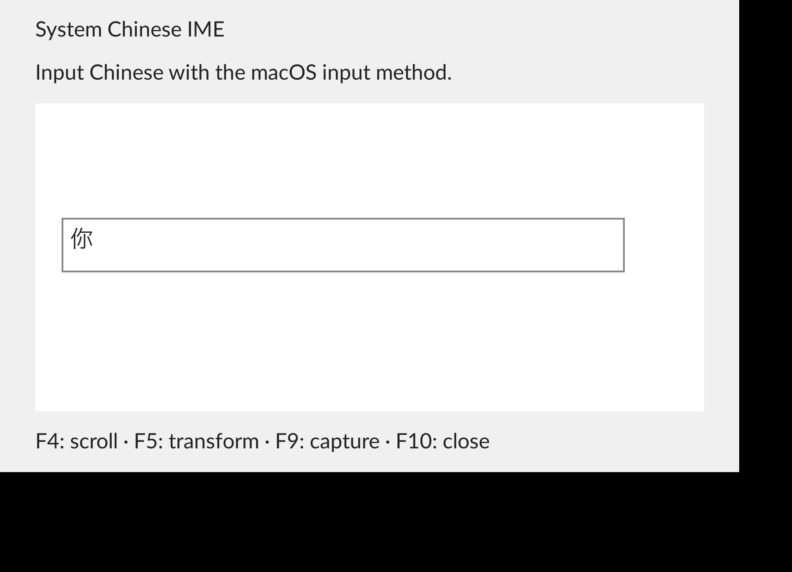

# macOS system input method acceptance

> **Closed by user acceptance.** The user explicitly accepted this input-method
> item with “你就当它完成了吧”. The desktop record sets `accepted: true` and
> `accepted_by_user: true`. Actual test results remain recorded separately:
> Chinese preedit, commit, cancellation, and caret coordinates were observed;
> reliable repeats, hardware input, and the candidate panel were not verified.

The observer runs the built `sfml.js` and `sfml.js-rmlui` packages in an SFML
window launched through a task-owned application bundle. The installed input
source is `com.sogou.inputmethod.sogou.pinyin`. Computer Use presses the physical
key names `n`, `i`, and `space` through the operating system. No Chinese text is
injected by a text tool or a direct `insertText` probe.

The [desktop record](desktop-ime-attempt.json) separates observed engine behavior,
synthetic contracts, and reliable acceptance. It embeds the exact successful
preedit, commit, cancellation, coordinate, and focus states alongside the repeat
failure. The [initial unfocused attempt](desktop-ime-initial-attempt.json) remains
historical evidence.

A native `NSTextView` in the same process provided an independent control:
the key sequence committed `你`. A later native control also received English
`insertText` callbacks while the actual selected source was Sogou. Neither
control result establishes a defect in RmlUi, the bridge, or the engine alone.

Selecting the source through the current `NSTextInputContext` during a Cocoa
event produced a successful complete sequence. The tracing subclass only logs
and forwards the existing methods. A fresh observer with no client method
overrides still produced unmarked `ni` with Sogou selected, window focus, and
the current input context. Both global TIS selection and context selection
therefore have inconsistent observations. Source identity does not establish
that Chinese conversion is active.

Temporary synchronous key handling did not establish a repair. Window
reactivation also did not resolve the English-only response. These diagnostic
changes are absent from the production client. System source changes were
observed between automated operations, but their origin is not established.
A timed `CGEventPostToPid` control did not deliver any native key events;
it is excluded from engine conclusions.

SFML's first responder now exposes the installed text client's input context.
An explicitly claimed Cocoa key bypasses SFML's hidden text interpreter while
preserving its public `KeyPressed` event. The client queues RmlUi mutations until
the runtime boundary. The persistent
`sfml.js-interop/tools/patches/sfml-macos-text-owner.patch` installs both changes.
Five executable SFML Window contracts cover ownership, ordinary fallback,
disabled/enabled repeat, and input-context forwarding.

Real Escape input exposed a zero-length preedit state incorrectly reported as
marked text. The native contract reproduces the empty `setMarkedText` callback
and compares `hasMarkedText` with an actual `NSTextView`. The correction requires
a nonempty marked range, retaining the zero-length range and transaction
rollback. The regression failed before that correction and passed afterward.

The observed scroll is 100 backing pixels on a surface with scale factor 2.
The system caret rectangle moves 50 screen points vertically. Applying
translation and rotation changes both the screen position and projected caret
width. Clicking outside the widget restores the previously committed text.
These observations establish the coordinates supplied to the system; they do
not establish where the separately owned candidate panel was displayed.

The input-source guardian preserves the original source. Independent post-run
inventories for the closed observations verify the selected ABC source and
enabled-source list byte for byte after foreground restoration. The final
observer stopped normally at `2026-11-19T11:46:47.894Z`. Its independent post-run
inventory also matches the original ABC source and enabled-source list.

The completed native run includes 73 widget/platform/Cocoa contracts. The latest
full package run exited zero with 1,601 PASS markers and no FAIL markers. This
diagnostic stage changes no production code and does not repeat that package run.
The desktop record includes the log and binary fingerprints.

The user's decision waives further desktop checks for hardware keyboard input,
reliable fresh-process repeats, and the separately owned candidate panel.
It does not change their recorded verification results. Linux/Windows execution
and the independent whole-change review remain unverified.

