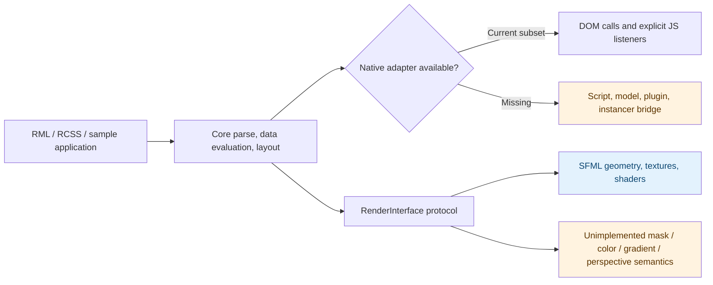
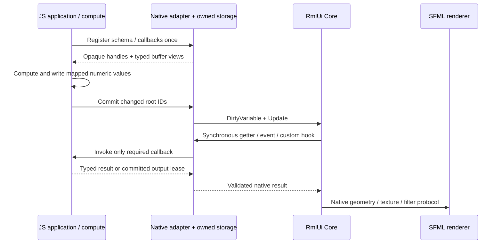

# RmlUi 6.3 Modules and Official Samples: Baseline Coverage Review

> **Verdict: not ready for full upstream module or sample acceptance.** The package compiles Core and the default FreeType engine, exposes a small JS subset, and provides four partial official sample adapters. The pinned tree defines **20 sample executables**, **one shared shell library**, and a separate **113-page VisualTests corpus**. Completion requires the interface, build, runtime, and sample acceptance work below, not a fixed six-item list.

## Scope and Evidence

- Reviewed repository: `/Users/bytedance/Workspace/github/sfml.js`.
- Package: `packages/sfml.js-rmlui`, currently untracked/uncommitted. Unrelated dirty files were left untouched.
- `P` below means `/Users/bytedance/Workspace/github/sfml.js/packages/sfml.js-rmlui`; `U` means `P/third_party/rmlui`. The reference is not a repository-root `third_party/rmlui`.
- Baseline: `U/CMakeLists.txt:5-6` declares 6.3; `P/tools/deps_downloader.cjs:11-14` pins RmlUi 6.3 and FreeType 2.13.3; installed marker is `6.3-2.13.3`.
- Source review included all 24 `Samples/**/CMakeLists.txt` files, module CMake files, public module headers, Lua registration tables, relevant sample application code, generated GYP source inventory, native registration, TS exports, renderer, and package tests.
- Cross-checked the [compiler inventory](upstream-api.json): version 6.3, libclang parser, zero diagnostics, 122 recorded headers, 3,926 declaration records. All 122 header SHA256 values match this local tree. Declaration records include templates and repeated declarations/definitions; this is not a count of distinct bindable methods. The parent supplied Lua 5.4.8 headers under `/tmp/rmlui-lua-api-headers` solely for parsing; that does not mean this package builds or ships Lua 5.4.8.
- Ownership split: the parent owns the inventory utility, general utility-category classification, CI, and packaging. Build/dependency and release gates here are interface/sample prerequisites for that parent work, not a separate CI/packaging implementation or exhaustive general-utility audit.
- Generated inventory contains **191 Core C++ sources and 41 FreeType C unity roots**. Read-only `nm -C build/Release/rmlui.node` confirms native `Context::CreateDataModel`, `DataVariable`, and Factory registration symbols; the same inspection finds no Debugger/Lua/SVG/Lottie namespace symbols. The binary is corroborating evidence, not proof that it matches every current source edit.
- No build, dependency installation, test execution, graphical launch, implementation, or commit was performed. Existing build/test artifacts do not establish fresh runtime acceptance.
- Only this report is written, in `/tmp`. No repository copies, subagents, worktrees, or isolated build/test environments. **禁止使用 `using-git-worktrees`，禁止创建 worktree，禁止为构建或测试创建隔离环境，在现有工作目录完成任务。**
- The requested review skills were read. Findings received an inline second pass, not independent subagent validation. Proposed API names below are recommendations, not claims of existing exports.

## Findings

Severity here measures impact against the user's full-coverage goal. An acknowledged unsupported feature is still an acceptance gap; it is not automatically an accidental implementation bug.

| ID | Priority | Finding and consequence | Required disposition | Current evidence |
| --- | --- | --- | --- | --- |
| F01 | P1 | Optional module build inputs are absent. Copying headers or adding TS names cannot enable Debugger, Lua, SVG, or Lottie. | Integrate selected source groups, dependencies, definitions, initialization, and capability reporting. | [downloader:117-123](file:///Users/bytedance/Workspace/github/sfml.js/packages/sfml.js-rmlui/tools/deps_downloader.cjs#L117-L123), [GYP:12-44](file:///Users/bytedance/Workspace/github/sfml.js/packages/sfml.js-rmlui/binding.gyp#L12-L44) |
| F02 | P1 | Native data binding exists but no JS model, constructor, variable, or type-register API exists. This blocks `data_binding`, `tree_view`, `effects`, and SVG's interactive sample. | Expose the full data contract and native-owned storage, including custom definitions and shared type registers. | [native TS interface:10-38](file:///Users/bytedance/Workspace/github/sfml.js/packages/sfml.js-rmlui/src/internal/native.ts#L10-L38), `U/Include/RmlUi/Core/Context.h:255-275` |
| F03 | P1 | Scripting is limited to explicitly attached callbacks. RML scripts and `on*` listener instancing have no Node bridge. Upstream Lua is also not built. | Add Node document/script and listener instancers; classify Lua compatibility separately. | [addon:19-24](file:///Users/bytedance/Workspace/github/sfml.js/packages/sfml.js-rmlui/native/addon.cc#L19-L24), `U/Source/Core/ElementDocument.cpp:463-465`, `U/Source/Lua/LuaPlugin.cpp` |
| F04 | P1 | Generic Plugin and all nine Factory instancer categories lack JS exposure. The custom game element/decorators cannot be ported faithfully using the present API. | Provide native adapters, ownership tokens, properties, and callback contracts for every category in the inventory. | [native interface:10-89](file:///Users/bytedance/Workspace/github/sfml.js/packages/sfml.js-rmlui/src/internal/native.ts#L10-L89), `U/Include/RmlUi/Core/Factory.h:44-178` |
| F05 | P1 | Font-engine selection is absent. HarfBuzz 6.3 is a sample replacement engine, not an ordinary plugin; bitmap fonts need the same selection boundary. | Own and install the selected engine before `Rml::Initialise`; retain it through shutdown. | [initialization:50-60](file:///Users/bytedance/Workspace/github/sfml.js/packages/sfml.js-rmlui/native/rmlui-core.cc#L50-L60), `U/Samples/basic/harfbuzz/src/main.cpp:78-92` |
| F06 | P1 | Returned mask filters are never applied; all eight basic color-filter names are rejected. Effects/backdrop/mask pages cannot be accepted. | Implement the actual 6.3 filter protocol through SFML shaders and correct layer snapshots. | [mask bypass:464-468](file:///Users/bytedance/Workspace/github/sfml.js/packages/sfml.js-rmlui/native/render-interface-sfml.cc#L464-L468), [filter dispatch:628-651](file:///Users/bytedance/Workspace/github/sfml.js/packages/sfml.js-rmlui/native/render-interface-sfml.cc#L628-L651) |
| F07 | P1 | `CompileShader` requires `vertex_shader`/`fragment_shader`; upstream passes named gradient dictionaries or `shader` with `value`/`dimensions`. The built-in decorator protocol is not implemented. | Dispatch upstream names/parameters; retain custom shader support as a distinct extension. | [shader compilation:667-677](file:///Users/bytedance/Workspace/github/sfml.js/packages/sfml.js-rmlui/native/render-interface-sfml.cc#L667-L677), `U/Source/Core/DecoratorShader.cpp:35`, `U/Source/Core/DecoratorGradient.cpp:252,422,619` |
| F08 | P1 | `SetTransform` reduces the 4x4 matrix to affine XY components and fixes the last row. Perspective rendering does not match upstream. | Carry the full matrix through SFML vertex shaders, including mask geometry. | [transform:269-278](file:///Users/bytedance/Workspace/github/sfml.js/packages/sfml.js-rmlui/native/render-interface-sfml.cc#L269-L278), `U/Samples/basic/transform/src/main.cpp` |
| F09 | P1 | Missing DOM creation/reparenting, event target/current target/cancellation, typed controls, animation, and stylesheet APIs block additional samples. `basic/demo` is not principally a data-model sample. | Add the sample-driven Core surface below; do not substitute static RML previews. | [Element wrappers:323-365](file:///Users/bytedance/Workspace/github/sfml.js/packages/sfml.js-rmlui/src/element.ts#L323-L365), `U/Samples/basic/demo/src/DemoWindow.cpp`, `DemoEventListener.cpp`, `U/Samples/basic/drag/src/DragListener.cpp` |
| F10 | P2 | Custom logging, text input/IME, filesystem enumeration, and shell shortcuts lack full host equivalents. SFML text-entered events alone do not implement composition. | Add host adapters and explicit platform capability/acceptance states. | [SystemInterface:23-38](file:///Users/bytedance/Workspace/github/sfml.js/packages/sfml.js-rmlui/native/system-interface-sfml.h#L23-L38), `U/Include/RmlUi/Core/TextInputContext.h`, `U/Samples/basic/ime/CMakeLists.txt` |
| F11 | P2 | Only four sample entries exist; tutorial drag is not basic drag. VisualTests navigation is not the official assertion/capture harness. | Account for all 20 executables individually and keep tests separate. | [sample registry:13-34](file:///Users/bytedance/Workspace/github/sfml.js/packages/sfml.js-rmlui/examples/official.cjs#L13-L34), `U/Samples/basic/CMakeLists.txt`, `U/Tests/Source/VisualTests/CMakeLists.txt` |
| F12 | P2 | Current tests exercise smoke/resource/density behavior, not module or complete sample contracts. The type-test glob has no `.ts` fixtures in `test/`. | Add module, negative lifetime, type, protocol, visual, and per-sample acceptance cases. | [smoke rendering:68-78](file:///Users/bytedance/Workspace/github/sfml.js/packages/sfml.js-rmlui/test/basic.test.cjs#L68-L78), [type config](file:///Users/bytedance/Workspace/github/sfml.js/packages/sfml.js-rmlui/test/tsconfig.json) |
| F13 | P2 | Borrowed handles and callback lifetime restrictions are too narrow for the proposed extensibility contract. Listener registration is process-global, explicitly requires unique callback references/manual removal, and is not cleared by shutdown. | Add runtime ownership, invalidation, callback release, and same-environment enforcement before exposing more native callbacks. | [borrowed handles:44-59](file:///Users/bytedance/Workspace/github/sfml.js/packages/sfml.js-rmlui/native/rmlui-state.h#L44-L59), [listener registry:110-148](file:///Users/bytedance/Workspace/github/sfml.js/packages/sfml.js-rmlui/native/rmlui-events.cc#L110-L148), [documented restrictions:337-358](file:///Users/bytedance/Workspace/github/sfml.js/packages/sfml.js-rmlui/src/element.ts#L337-L358) |

Second-pass qualification: F13 is not reported as an undocumented promise that callbacks can be reused or stale handles can be called. Current TS documentation explicitly restricts those operations. They remain requirements for a robust expanded bridge. No runtime crash or leak reproduction is claimed here.

## Build and Optional Modules

### Exact 6.3 Build Classification

| Facility | Upstream switch / target / source set | Dependency and integration point | Current package |
| --- | --- | --- | --- |
| Core + default font engine | `RMLUI_FONT_ENGINE=freetype`; `rmlui_core` / `RmlUi::Core`; `Source/Core` plus its default engine | `Freetype::Freetype`; `RMLUI_FONT_ENGINE_FREETYPE`; default chosen during Core initialization | Compiled. FreeType 2.13.3 is pinned; engine-selection API absent. |
| Debugger | Separate `rmlui_debugger` / `RmlUi::Debugger`; **9 `.cpp` files** in `Source/Debugger` | Links Core; no additional external library. Built unconditionally by `Source/CMakeLists.txt`, included in umbrella `RmlUi::RmlUi`; not controlled by `NDEBUG` or a 6.3 `RMLUI_DEBUGGER` option | Not compiled/exposed. |
| Lua | `RMLUI_LUA_BINDINGS`; `rmlui_lua` / `RmlUi::Lua`; **37 `.cpp` files**, including `Source/Lua/Elements` | `RmlUi::External::Lua` aliases `Lua::Lua` or `LuaJIT::LuaJIT`; `RMLUI_LUA_BINDINGS_LIBRARY=lua`, `lua_as_cxx`, or `luajit`; `lua_as_cxx` adds `RMLUI_LUA_AS_CXX` | No runtime, sources, or bridge. Node scripting does not require this dependency. |
| SVG | `RMLUI_SVG_PLUGIN`; **5 `.cpp` files**: `DecoratorSVG`, `ElementSVG`, `SVGCache`, `SVGPlugin`, `XMLNodeHandlerSVG` | Incorporated directly into Core, not a separate CMake module target; link `lunasvg::lunasvg`, define `RMLUI_SVG_PLUGIN`; Core calls `SVG::Initialise()` | Neither sources nor dependency/definition present. |
| Lottie | `RMLUI_LOTTIE_PLUGIN`; **2 `.cpp` files**: `ElementLottie`, `LottiePlugin` | Incorporated directly into Core; link `rlottie::rlottie`, define `RMLUI_LOTTIE_PLUGIN`; Core calls `Lottie::Initialise()` | Neither sources nor dependency/definition present. |
| HarfBuzz engine sample | `RMLUI_HARFBUZZ_SAMPLE`; `rmlui_sample_harfbuzz`; **11 engine `.cpp` files plus `main.cpp`** | Links `rmlui_shell`, `Freetype::Freetype`, `harfbuzz::harfbuzz`; includes **private `Source/Core` headers**; requires default FreeType selection in upstream CMake; Windows shared-library build rejected | Engine sources/dependency/selection absent. **Not a 6.3 `Source/HarfBuzz` plugin.** |
| Bitmap font engine sample | `rmlui_sample_bitmap_font`; **2 engine `.cpp` files plus `main.cpp`** | No FreeType requirement; `.fnt` and atlas assets; replace `FontEngineInterface` before initialization | Not compiled/selectable. |
| Tracy instrumentation | `RMLUI_TRACY_PROFILING`, memory/configuration suboptions; `Tracy::TracyClient` | Native profiling hooks; `Dependencies/tracy` fallback when target unavailable | No package option or instrumentation wiring; not a runtime RmlUi plugin. |
| Native compile configuration | `RMLUI_THIRDPARTY_CONTAINERS`, `RMLUI_MATRIX_ROW_MAJOR`, custom configuration/include/link options, PCH/warnings/shared-library options | ABI/build-time choices, not JS APIs. Upstream font choices are only `none` and `freetype` | GYP does not run upstream CMake. Do not claim these switches work merely because the source tree contains them. |

Source authority: `U/CMakeLists.txt`, `U/CMake/Dependencies.cmake`, `U/CMake/OptionsLists.cmake`, `U/Source/CMakeLists.txt`, each module CMake file, `U/Source/Core/CMakeLists.txt:398-427`, and both font-engine sample CMake files.

**Dependency precision:** RmlUi and FreeType are the only versions pinned by this package. The pinned 6.3 dependency CMake files do not select exact Lua/LuaJIT, rlottie, HarfBuzz, or LunaSVG releases. `Findlunasvg.cmake` supports the 3.0+ config package, vcpkg alias, existing target, and manual library discovery; SVG's channel conversion explicitly assumes **LunaSVG 2.3.2 or newer**. No unverified dependency version should be advertised as accepted.

For reproducible optional builds, record each selected dependency's exact release/commit, archive digest, static/shared mode, compile options, transitive link dependencies, and runtime library packaging. HarfBuzz must provide its **FreeType integration** (`hb_ft_font_create_referenced`, `hb_ft_font_set_funcs`, `hb-ft.h`), not just `hb.h`. Upstream has version-guarded HarfBuzz features at 3.4.0 and 5.1.0; these are not blanket minimum-version declarations. Transitive dependencies must come from the selected library's actual build manifest, not guessed link flags.

### Build Acceptance

1. Preserve the base build and add independently selectable Debugger, SVG, Lottie, HarfBuzz, and explicit Lua compatibility. A Node script bridge is package code, not the Lua build flag.
2. Source selection must respect `fontEngine=none`: the current recursive Core scan includes `FontEngineDefault`, so simply dropping the FreeType macro is insufficient. Keep all library source groups explicit or compare generated lists against pinned CMake manifests; never link sample `main.cpp` into the addon.
3. Keep all modules on the same Core instance and configuration. Reuse the package FreeType for HarfBuzz rather than introducing a second incompatible font runtime.
4. Build and verify base, each module separately, all optional modules together, bitmap without FreeType, and HarfBuzz plus Debugger. Verify Lua modes only when advertised. Reuse each platform's existing checkout/build directory; no isolated environment is required.
5. For every feature verify native compilation, linker inputs, exported capability, TS types, initialization, one real behavioral test, repeated shutdown/reinitialization, and package runtime dependency resolution. Test enabled-with-missing-dependency as a clear build failure, and disabled-feature invocation as a clear runtime error.
6. Exercise macOS, Linux, and Windows builds. Current platform GYP clauses alone are not acceptance evidence. Preserve static/shared restrictions and runtime DLL/rpath handling. A capability record should separate `built`, `available`, and platform limitations.
7. Add optional dependency choices/digests to the installed identity. The current identity only includes RmlUi and FreeType, so it cannot validate future module configurations.

## Complete Optional Interface Inventory

### Debugger

The public 6.3 API is exactly `Initialise(hostContext) -> bool`, `Shutdown()`, `SetContext(context) -> bool`, `SetVisible(bool)`, and `IsVisible() -> bool`, in `U/Include/RmlUi/Debugger/Debugger.h`.

Recommended JS namespace: `Debugger.initialise`, `shutdown`, `setContext`, `setVisible`, `isVisible`. Keep host context and inspected context distinct. Initialize after Core and context creation. Host destruction releases the debugger; early shutdown permits a different host. Core shutdown must still clean it up. The default font engine supports the debugger's embedded in-memory fonts; custom font engines must handle that contract.

Acceptance: F8 visibility; inspect a target in a different context; element/property inspection; logs; data-model inspector with reflected struct members; target/host removal; early shutdown and reinitialization; render/input at multiple density ratios; no retained JS callbacks after runtime destruction.

### Scripting: Node Bridge Versus Lua

**Current boundary:** external JS can initialize, update/render, manipulate a limited DOM, and attach a listener to an existing element. This is not equivalent to upstream document scripting. `ElementDocument::LoadInlineScript` and `LoadExternalScript` are empty in Core; Lua supplies a document subclass and replaces the `body` instancer and `EventListenerInstancer`.

Recommended Node integration:

- Native `JsDocument` overrides `LoadInlineScript(content, sourcePath, sourceLine)` and `LoadExternalScript(sourcePath)`. Register it before document loading; expose/select document base tags for per-context script modes.
- A Node-side script host evaluates explicitly opted-in, trusted scripts with `document`, `context`, event bindings, and caller-provided modules. Compile/cache handlers; retain source names and line offsets for exceptions. Do not claim `node:vm` is a security boundary or silently execute untrusted RML with Node privileges.
- `EventListenerInstancer(value, element)` handles original `on*` attributes. Support a named-handler registry without arbitrary code execution, and an explicitly enabled inline-JS mode when requested.
- Script parse/load order and immediate event decisions remain synchronous. Preload external scripts/resources asynchronously before loading a document if needed; do not return a Promise from an upstream synchronous virtual method.
- Return callback-scoped `Event` operations and safe `Element` identities, not just `targetId`. Include stop propagation/immediate propagation with upstream semantics; do not invent a browser `preventDefault` equivalent without matching RmlUi's default-action phases.
- Upstream Lua and Node adapters otherwise both overwrite the same global listener instancer and `body` tag. Use separate selected script modes or a documented dispatcher and distinct base tags. Do not initialize both independently and rely on registration order.

The following table inventories Lua's registered language-level surface from `U/Source/Lua/*` and `Elements/*`. It defines the semantic comparison set, not a claim that Lua itself binds every Core C++ function.

| Lua surface | 6.3 operations / properties | Required JS equivalent or explicit treatment |
| --- | --- | --- |
| `rmlui` | `CreateContext`, `LoadFontFace` including face index, `RegisterTag`; `contexts`, `key_identifier`, `key_modifier` | Context registry, font options, tag instancers, enums. Present package exposes only partial context/font operations. |
| `Context` | `AddEventListener`, `CreateDocument`, `LoadDocument`, `Render`, `UnloadAllDocuments`, `UnloadDocument`, `Update`, `OpenDataModel`, `CloseDataModel` | Typed methods; model opening maps to full native model API, not JS-side interpolation. |
| Context input | `ProcessMouseMove`, `ProcessMouseButtonDown/Up`, `ProcessMouseWheel`, `ProcessMouseLeave`, `IsMouseInteracting`, `ProcessKeyDown/Up`, `ProcessTextInput` | Preserve `processEvent` convenience; expose direct input/control methods and return semantics. |
| Context properties | `dimensions` and `dp_ratio` read/write; `documents`, `focus_element`, `hover_element`, `name`, `root_element` read | Safe handles/collections and controlled density override. Current update always reapplies window density, so a manual override needs policy. |
| `Document` | `PullToFront`, `PushToBack`, `Show`, `Hide`, `Close`, `CreateElement`, `CreateTextNode`; title read/write, context read | Native-owned DOM construction and z-order; preserve show/focus/modal options rather than only a boolean modal wrapper. |
| `Element` methods | `AddEventListener`, `AppendChild`, `Blur`, `Click`, `DispatchEvent`, `Focus`, `GetAttribute`, `GetElementById`, `GetElementsByTagName`, `QuerySelector`, `QuerySelectorAll`, `Matches`, `HasAttribute`, `HasChildNodes`, `InsertBefore`, `IsClassSet`, `RemoveAttribute`, `RemoveChild`, `ReplaceChild`, `ScrollIntoView`, `SetAttribute`, `SetClass` | Preserve mutation identity and move ownership. Existing JS implements only a subset and additionally explicit listener removal. |
| Element collections/identity | `attributes`, `child_nodes`, `class_name`, `first_child`, `id`, `inner_rml`, `last_child`, `next_sibling`, `owner_document`, `parent_node`, `previous_sibling`, `style`, `tag_name` | Typed collections/proxies; writable class name, id, inner RML. Lua table indexing must become documented JS zero-based indexing. |
| Element layout/scroll | `client_left/height/top/width`; `offset_height/left/parent/top/width`; `scroll_height/left/top/width`; left/top scroll setters | Batched/read-only layout snapshot and native setters for scrolling. |
| `ElementText` / owned element pointer | `text` read/write; `ElementPtr` ownership support | Text node wrapper and native detached-node ownership token; no raw pointer in JS. |
| `Event` | `StopPropagation`, `StopImmediatePropagation`; `current_element`, `type`, `target_element`, parameter proxy | Borrowed dispatch-scoped facade; persistent copy only for value data. Typed known element-valued parameters, especially `drag_element`. |
| `ElementInstancer` | Assignable `InstanceElement` callback; `RegisterTag` | Native subclass/trampoline with explicit retained callback and release lifecycle. |
| Form / generic control | `Submit`; `disabled`, `name`, `value` read/write | Typed form/control wrappers; attribute strings alone do not cover the full live control contract. |
| Input | `Select`, `SetSelection`, `GetSelection`; `checked`, `maxlength`, `size`, `max`, `min`, `step` read/write | Typed methods/properties and selection indices. |
| Select | `Add`, `Remove`, `RemoveAll`; options proxy; selection read/write | Native option handles/list snapshot and selection operations. |
| Textarea | `Select`, `SetSelection`, `GetSelection`; `cols`, `maxlength`, `rows`, `wordwrap` read/write | Typed textarea API. |
| Tab set | `SetPanel`, `SetTab`; `active_tab` read/write, `num_tabs` read | Native tab/panel manipulation. |
| Vector/color values | `Vector2i`, `Vector2f`, `Colourb`, `Colourf`; components, magnitude, RGBA; float-vector dot/normalize/rotate; Lua arithmetic/metamethod behavior | Reuse compatible SFML values or typed native views; provide ordinary JS methods/operators explicitly, not Lua metatables. |
| Logging | `Log.Message`, `Log.logtype` (`always`, `error`, `warning`, `info`, `debug`); overridden Lua `print` | Structured log sink and caller-owned console mapping. |
| Proxy infrastructure | Context documents, RmlUi contexts, attributes, children, style, event parameters, select options, iteration/metamethods | JS iterables/proxies with valid lifetime and explicit index conventions; no hidden raw userdata. |

**Lua C++ embedding API, explicitly unsupported in current JS:** `Rml::Lua::Initialise()` / `Initialise(lua_State*)`; `Interpreter::GetLuaState`, `LoadFile`, `DoString`, `LoadString`, `BeginCall`, `ExecuteCall`, `EndCall`; `LuaType<T>::Register`, `push`, `check`, `thunk`, `tostring`, `gc_T`, `tostring_T`, `eq_T`, `index`, `newindex`, `_regfunctions`, and associated macros/type traits. `Lua/Utilities.h` supplies `PushVariant`, `GetVariant`, `PushIndex`, `GetIndex`, `CastFromElementTo`, and `AddTypeToElementAsTable` in the `Rml::Lua` namespace, plus older-Lua compatibility helpers. A caller-owned `lua_State` must outlive `Rml::Shutdown`; an internally created state is closed by the plugin.

Recommended equivalent: Node `ScriptHost` methods and typed converters, without exposing `lua_State*`, Lua stack indices, member pointers, or template instantiation. If **unchanged Lua sample execution** is required, retain a separate optional Lua runtime adapter, opaque managed Lua-state ownership, and the sample's `Game` host API. A JS translation of `lua_invaders` is a semantic port, not execution of the original Lua files.

Scripting acceptance: inline and external scripts; relative source paths; handler `this`/document/event context; load order; callback return/error handling; live propagation cancellation; handlers on dynamically inserted elements; callback detach; script mode conflicts; trusted-script opt-in; no callback after document/context teardown. Lua parity additionally requires actual `.lua` execution and `Game` binding calls, not just successful Lua linking.

### DataModel, DataVariable, and DataTypeRegister

These are **Core facilities**, already compiled, not optional external dependencies.

| Upstream contract | Required bridge |
| --- | --- |
| `Context::CreateDataModel(name, DataTypeRegister* = nullptr, allow_missing_variables = false)`, `GetDataModel`, `GetDataModels`, `RemoveDataModel` | `create/get/list/removeDataModel`; optional shared type-register handle; preserve late-bound-variable semantics and invalidate every dependent handle on removal. |
| `DataModelHandle::{IsVariableDirty,DirtyVariable,DirtyAllVariables}`, boolean validity | `isVariableDirty`, `dirtyVariable`, `dirtyAllVariables`, checked validity; distinguish model from constructor. Dirty names identify root variables. |
| `DataModelConstructor::GetModelHandle`, `Bind<T>`, `BindFunc(get,set?)`, `BindEventCallback`, `BindCustomDataVariable`, validity | Native storage bindings, computed accessor bindings, typed event callback, advanced custom variable binding. |
| `RegisterScalar<T>`, `RegisterStruct<T>`, `RegisterArray<Container>`, `RegisterCustomDataVariableDefinition<T>`, `RegisterTransformFunc`, `GetDataTypeRegister` | Schema-based scalar/struct/array/custom definitions and transform registry with native ownership. Changes normally apply across models using the same register, not only one model. |
| `StructHandle<T>::RegisterMember` for data member, getter returning reference/pointer/value, getter/setter scalar pair | Schema members with offset/type or managed accessor identity; read-only getter semantics; native-backed references rather than copied transient objects. |
| `DataTypeRegister::RegisterDefinition(FamilyId, UniquePtr<VariableDefinition>)`, `GetDefinition<T>`, `GetTransformFuncRegister` | Stable bridge type IDs, owned definitions, lookup/reflection; never reinterpret arbitrary JS IDs as C++ `Family<T>` IDs. |
| `TransformFuncRegister::{Register,Call}` and `DataTransformFunc -> Variant` from `VariantList` | Register/call transform; pipe input/arguments and typed return conversion; cache only with explicit dependency and purity rules. |
| `DataVariable::{Get,Set,Size,Child,Type}`, boolean validity | Typed scalar read/write, array size, child by name/index, `Scalar/Array/Struct`, invalid-child behavior; no bare `void*`. |
| `VariableDefinition::{Get,Set,Size,Child,ReflectMemberNames}`, immutable type category | Native adapter supporting advanced custom behavior; reflection is necessary for Debugger data-model inspection. |
| `ScalarDefinition`, `FuncDefinition`, `ScalarFuncDefinition`, `StructDefinition::AddMember`, `ArrayDefinition`, `BasePointerDefinition`, `PointerDefinition`, member-object/getter/get-set definitions; `MakeLiteralIntVariable` | Native implementations behind schema/variable handles. Pointer templates become managed nullable references; literal integers become typed read-only values. |
| `DataGetFunc`, `DataSetFunc`, `DataEventFunc`, `DataTransformFunc`, typed scalar functions, `DataAddressEntry`, `DataAddress`, dirty-variable set | Explicit callback types, string/index path representation, dirty-root mapping. `DataSetFunc` is void in upstream; custom `VariableDefinition::Set` returns success. Do not conflate those contracts. |

Public authority: `U/Include/RmlUi/Core/{DataModelHandle,DataTypeRegister,DataVariable,DataStructHandle,DataTypes}.h`. Internal `DataModel`, `DataExpression`, `DataViews`, and `DataControllers` implementations live under `Source/Core`; do not mislabel private internals as a stable public JS ABI.

Default view coverage from `U/Source/Core/Factory.cpp:235-253`: `attr`, `attrif`, `class`, `if`, `visible`, `rml`, `style`, `text`, `value`, `checked`, `alias`, structural `for`; controllers `checked`, `event`, `value`. Each needs an acceptance fixture. Keep upstream expression parsing/evaluation in native Core; a JS template engine is not an equivalent implementation.

Acceptance: all four `data_binding` models (`basics`, `events`, `invaders`, `forms`); numeric/bool/string/enum conversion; nested structs and arrays; resize/removal and `.size`; invalid indices; nullable references; dirty/no-dirty behavior; two-way form updates; getters without setters; custom transforms; callback event/arguments; late-bound variables; shared registers across models/contexts; duplicate model/type errors; reflection; model-removal invalidation; exceptions and JS GC.

Local acceptance update, 2026-11-16: `test/data-defaults.test.cjs` exercises all
twelve views and three controllers through native Core. It covers alias
shadowing, nested loops, late binding, value/checked ordering, ordinary and
override change values, synchronous data-event resize, old buffers, invalid
paths, first-error propagation and value/nested-callback mutation guards.
`test/official-data.test.cjs` runs the four models against the original
`data_binding.rml` plus a controlled real directory fixture for `tree_view`.
The `examples/official.cjs` launcher exposes `data-binding` and `tree-view`;
their application modules live in `examples/official/`.
The original forms `onsubmit="submit_form"` has no upstream host handler and
is preserved; native form submission is tested through an attached listener.
The gallery contains actual captured frames.
[Data scale measurements](data-performance.md) now verify actual 1k/10k/100k
bound rows, no-dirty/1%-dirty/all-dirty behavior and scoped native work.
Broader A08 performance, full platform acceptance and complete module closure
remain pending.

### Plugin and Factory Extension Points

`Rml::RegisterPlugin` / `UnregisterPlugin` use a native `Plugin` object. `GetEventClasses` returns the mask `EVT_BASIC`, `EVT_DOCUMENT`, `EVT_ELEMENT`, `EVT_DATA_MODEL`, or `EVT_ALL`.

The complete notification set is `OnInitialise`, `OnShutdown`, `OnContextCreate`, `OnContextDestroy`, `OnDocumentOpen`, `OnDocumentLoad`, `OnDocumentUnload`, `OnElementCreate`, `OnElementDestroy`, `OnDataModelCreate`, and `OnDataModelDestroy`. Registration after Core initialization triggers initialization immediately. Data-model destruction notification occurs while the model is still accessible, then the model becomes invalid.

Recommended `registerPlugin(callbacks, eventClasses)` returns a native-owned registration token. Do not turn destruction notifications into strong ownership of a dying object. Disallow unsafe unregister/destruction in active native callbacks or defer it to a documented safe point without reordering upstream notifications.

| Factory category | Native interface and related contract | JS equivalent / integration |
| --- | --- | --- |
| Context instancer | `RegisterContextInstancer`; `InstanceContext(name, RenderManager*, TextInputHandler*) -> ContextPtr`; `ReleaseContext` | Native context factory adapter with supported lifecycle hooks; renderer and text-input objects remain opaque native handles. |
| Element instancer | `RegisterElementInstancer`, `GetElementInstancer`; `InstanceElement(parent, instancer, tag, attributes) -> ElementPtr`; `ReleaseElement` | Named native `JsElement` adapters; own detached nodes; register tag properties/hooks and release callbacks. `ElementInstancerGeneric<T>` is a C++ template, not a JS constructor trampoline by itself. |
| Event instancer | `RegisterEventInstancer`; `InstanceEvent(target,id,type,parameters,interruptible) -> EventPtr`; `ReleaseEvent` | Managed custom event metadata/type registration; native event allocation and callback-scoped JS access. |
| Event listener instancer | `RegisterEventListenerInstancer`; `InstanceEventListener(value, element)` | Named/inline handler compiler for RML `on*`; `ProcessEvent`, `OnAttach`, `OnDetach` lifecycle. Own listeners until detach and callback completion. |
| Decorator instancer | Register/get; `InstanceDecorator(name, properties, DecoratorInstancerInterface)` | Native decorator with `GenerateElementData`, `ReleaseElementData`, `RenderElement`; property schema, texture/sprite lookup, paint area, mesh command buffer. |
| Filter instancer | Register/get; `InstanceFilter`; filter `CompileFilter(element)` and `ExtendInkOverflow` | Native filter descriptions/handles, explicit overflow output, SFML shader-backed renderer protocol. |
| Font-effect instancer | Register/get; `InstanceFontEffect`; effect `HasUniqueTexture`, `GetGlyphMetrics`, `GenerateGlyphTexture`; color/layer/fingerprint properties | Native atlas/glyph buffers with JS computation on typed views; preserve stride, premultiplication, cached fingerprint, back/front layer. |
| Data-view instancer | `RegisterDataViewInstancer(type,is_structural_view)`, `InstanceDataView`; structural lookup/list | Adapter to private `Source/Core/DataView.h`: `Initialize`, `Update`, `GetVariableNameList`, attached-element validity and sort order. Structural views receive raw inner RML. Pin the private dependency to 6.3. |
| Data-controller instancer | `RegisterDataControllerInstancer`, `InstanceDataController` | Adapter to private `Source/Core/DataController.h`: initialize against model/element/expression/modifier; manage listeners and cleanup. |

There are **nine registration categories**: context, element, decorator, filter, font effect, event, event listener, data view, and data controller. This matches the parent compiler inventory's `Factory::Register*Instancer` declarations.

Additional Factory operations must not disappear from the audit: `InstanceElementText`, `InstanceElementStream`, `InstanceDocumentStream`, stylesheet construction from string/file/stream, `ClearStyleSheetCache`, `ClearTemplateCache`, structural-view attribute lookup, and Factory initialization/shutdown. Recommend RML string/native asset APIs and managed stylesheet handles; keep Factory initialization/shutdown internal to the runtime rather than letting JS corrupt a live global factory.

Other associated public extension points: `XMLParser::RegisterNodeHandler`, `GetNodeHandler`, `RegisterPersistentCDATATag`, handler release; `XMLNodeHandler::{ElementStart,ElementEnd,ElementData}`; `StyleSheetSpecification` parser/property/shorthand registration and lookup; `PropertyParser::ParseValue`; `EffectSpecification` property/shorthand definitions; custom event type registration. Use typed schemas/callback adapters; explicit unsupported status is required until implemented. These are not all separate binary modules.

Custom element hooks include intrinsic dimensions/baseline/hit testing; `ProcessDefaultAction`; update/render/resize/layout/density/stylesheet notifications; attribute/property/pseudo-class changes; child add/remove; dirty-layout and RML access. Expose intentional hooks in a native subclass, including `super` behavior where upstream requires it; arbitrary C++ inheritance/vtable replacement from JS is unsupported.

Acceptance: invoke every registration category; default and custom property parsing; registration order and replacement; instancer lifetime through Core shutdown; normal/error release exactly once; custom element update/render/order/clipping; decorator resources and glyph stride; structural view parsing; controller detach; plugin event-mask filtering and documented notification order; no callback after environment teardown. `invaders` validates only some of these categories, so it is not sufficient alone.

### SVG

Public specialized class: `ElementSVG`, with `GetIntrinsicDimensions`, `EnsureSourceLoaded`, overridden `GetInnerRML` and `SetInnerRML`; inherited `Element` methods remain relevant. Build-time registration installs `svg` element and decorator instancers, XML node handling, and persistent CDATA handling.

User-visible inputs include file `src`, inline XML, `width`/`height`, `crop-to-content`, image color/opacity, and RCSS `svg` decorator with `source` and `crop` (`crop-none` / `crop-to-content`). Setting inline RML while file `src` is nonempty does not replace the file source. No public 6.3 umbrella `SVG.h` or general JS-style `SVG.load()` exists.

Native path: FileInterface or inline data -> LunaSVG document/cache -> native bitmap -> channel conversion -> `CallbackTextureInterface::GenerateTexture` -> existing SFML texture/geometry. Do not route pixels through JS or replace SVG with placeholder raster images.

Acceptance: all three sample documents, file/inline/decorator modes, the three dynamic update methods in `svg_inline.rml`, crop, tint/opacity, resize/density, malformed/missing sources, shared cache release, channel order and premultiplied alpha.

### Lottie

Public specialized class: `ElementLottie`, `GetIntrinsicDimensions`, `EnsureSourceLoaded`; inherited attributes/properties. Its `src` loads JSON via FileInterface; document-relative directory is supplied to rlottie for associated resources. Native `OnUpdate` requests another update; `OnRender` selects a time-based frame and generates texture only when frame/size changed.

The pinned implementation has **no public play/pause/seek/speed/loop-control methods**. It automatically loops using elapsed time. Such controls would be package extensions, not missing upstream method bindings.

Native path: rlottie `Animation::loadFromData` -> native `rlottie::Surface` -> `renderSync` -> BGRA-to-RGBA swizzle -> callback texture -> SFML. Keep decoding/rasterization native. Do not double-premultiply generated texture bytes.

Acceptance: sample JSON and relative assets, frame progression and looping, same-frame texture reuse, visibility scheduling, source replacement, resize/density, transparent edges, invalid animation, repeated unload/reload with no retained native pixel buffers.

### Font Engines and IME

The full `FontEngineInterface` contract is `Initialize`, `Shutdown`, three `LoadFontFace` overloads (path; path with family/style; memory), `GetFontFaceHandle`, `PrepareFontEffects`, `GetFontMetrics`, `GetStringWidth`, `GenerateString`, `GetVersion`, and `ReleaseFontResources`. The memory overload is used for debugger fonts. Resource release invalidates all face/effect handles.

Recommended native engine selection: `freetype`, `harfbuzz`, `bitmap`, or a managed custom adapter, chosen before initialization. Expose font loading with family, style, weight, fallback, face index, and owned memory input. Retain byte storage for engines that borrow it. Keep shaping, atlases, glyph lifetimes, and SFML upload native; allow optional JS custom shaping/metrics/glyph computation through the callback buffer design below.

HarfBuzz's extra public method is `RegisterLanguage(bcp47, iso15924Script, TextFlowDirection)`. Its engine implementation is the entire sample engine set, not merely the interface `.cpp`: FontEngineInterfaceHarfBuzz, FontFace, FontFaceHandleHarfBuzz, FontFaceLayer, FontFamily, FontProvider, FreeTypeInterface, TextureLayout, TextureLayoutRectangle, TextureLayoutRow, and TextureLayoutTexture. Retain private-Core dependency and release ordering. Use LatoLatin, Cairo, and Poppins assets for the sample. Do not promise a complete mixed-direction Unicode bidi implementation solely because HarfBuzz shaping exists.

The bitmap engine uses `FontEngineBitmap.cpp` and `FontEngineInterfaceBitmap.cpp` plus Comfortaa `.fnt`/atlas assets. Its upstream implementation does not render font effects and only special-cases embedded debugger font loading, substituting its own font. Record these as **upstream sample limitations**, not binding omissions to conceal or unsupported promises to invent.

IME is a host/platform integration, not a font plugin. `TextInputHandler` supplies `OnActivate`, `OnDeactivate`, `OnDestroy`. `TextInputContext` supplies bounding box, selection range get/set, caret position, text replacement, composition range, and composition commit. Adapt platform composition to those native interfaces; handle Unicode code-point versus JS UTF-16 indices explicitly. Also account for SystemInterface virtual keyboard activation/deactivation.

Acceptance: HarfBuzz Latin/Arabic/Hindi selection, ligatures/mark placement/direction, width/mesh agreement, fallback, font collection/weights, density changes, language overrides, atlas invalidation, Debugger coexistence; bitmap text/kerning/atlas and its documented limitations; IME composition/selection/cancel/commit, candidate bounds, focus loss, element destruction, and each advertised OS. Current upstream SFML backend does not qualify for the official IME sample gate.

## Native Memory and JS Compute Design

This is a recommended bridge contract, not implemented work.

1. **Ownership stays native.** Native runtime owns models, dynamic type definitions, buffers, geometry, textures, instancers, font state, and lifecycle registries. JS holds opaque generation-checked handles. Node GC must not destroy an object while RmlUi still retains its pointer.
2. **Map only ABI-defined POD storage.** Use the existing interop `SharedHandle`/`NumericFields` ownership pattern for fixed numeric fields. Publish layout/version/type/offset/stride metadata once and cache TypedArray/DataView wrappers. Never map `std::string`, `Rml::Variant`, `std::vector` internals, smart pointers, or vtables as a JS struct.
3. **Data schemas replace templates.** Bridge-owned scalar/struct/array `VariableDefinition` adapters resolve stable native storage records. Strings use native storage with explicit mutation or UTF-8 handles; arrays use size/capacity/generation and stable storage owners. `BindCustomDataVariable` provides a real integration route without trying to instantiate arbitrary JS types as C++ templates.
4. **Writes are batched and dirtied explicitly.** JS compute writes numeric views directly; `commit` submits changed root IDs/ranges once per application update. A path update such as `$.items[3].health` resolves to native storage and dirties upstream root `items`. Buffer writes alone do not notify RmlUi. Do not serialize an entire model to JSON each frame.
5. **Pull callbacks retain exact timing.** `BindFunc`, custom variable lookup, transforms, intrinsic sizing, and event cancellation may be synchronous and reentrant. Call JS when required and return the native result immediately; no Promise or worker rendezvous. Offer cached native-backed computed fields updated once per frame when callers can declare dependencies, but do not silently memoize side-effecting getters.
6. **Use callback-scoped native buffer leases.** Native allocates inputs/outputs for geometry, glyphs, metrics, and pixels; JS computes using cached typed views. A lease owns its backing store until every exposed JS view is unreachable or explicitly detached. Reallocation must publish a new generation without freeing memory still viewed by JS. Closed handles reject new operations; retained old buffers must not mutate current live state.
7. **Render callbacks produce data, not GL commands.** A custom element/decorator receives layout/time/state plus native mesh/command storage. JS computes transforms, vertices, colors, indices, and texture-handle references; native validates ranges and issues draws via `Rml::RenderManager` and the SFML renderer. No GL context IDs, GLuints, `gl*` entry points, or direct state manipulation.
8. **Snapshot at submission.** JS changes after commit cannot alter a recorded draw. Hold an immutable storage generation until execution completes; use bounded native staging or copy changed ranges when necessary. Current SFML compilation de-indexes into a static VertexBuffer once per compiled geometry. Dynamic custom meshes must release/recompile or use an explicit new dynamic path, not mutate a supposedly immutable compiled handle.
9. **Honor callback ordering.** Built-in static RmlUi geometry stays entirely native with zero JS per-vertex traffic. Batch custom numeric work per instance or compatible group; do not flatten render order, clipping, or lifecycle callbacks to achieve a misleading "one callback per frame" claim. Glyph callbacks operate on glyph spans/stride, never one JS call per pixel.
10. **One active owner environment.** `RmlState` and listener registry are process-global while addon registration is worker-enabled. Enforce active owner isolate/thread and environment cleanup, or design an explicit serialized owner service. Never dereference a persistent callback from a different isolate. Worker math, if later supported, must use immutable snapshots and commit on the owner thread.
11. **Errors and destruction are bounded.** Catch JS exceptions at native boundaries; fail the native operation with diagnostics and a well-defined JS error result. Keep callback targets alive until return; defer destructive operations that would invalidate the active native stack. Detach events/instancers before releasing callbacks and font/runtime state. No callback may run during V8 teardown.
12. **Measure the claimed efficiency.** Instrument JS/native crossings, allocations, copied bytes, native live buffers, geometry uploads, and callback count. Unchanged frames should not marshal whole models or reallocate views. Benchmark numeric arrays at 1k/10k/100k elements, sparse dirties, nested lists, font glyph generation, and native custom geometry. Report p50/p95 times and bytes/calls; no invented latency threshold or zero-copy claim for unavoidable GPU uploads/de-indexing.

## Complete Official Sample Hierarchy

`U/Samples/CMakeLists.txt` sets sample target prefix `rmlui_sample_`; tutorial targets use `rmlui_tutorial_`. There are **16 basic + 2 tutorial + 2 game executable definitions**. This is a source inventory, not a claim all 20 are enabled for every CMake configuration.

Shared prerequisites for the table: window/event loop, native renderer, rooted resource access, shutdown ordering, original assets, and source-specific fonts. All executable CMake targets link `rmlui_shell`; Lua Invaders additionally links Lua, and HarfBuzz additionally links FreeType and HarfBuzz. Most sample mains initialize Debugger. The JS equivalents should preserve source application behavior and expose missing features rather than relabel a document preview as a port.

Gates: `F` = `RMLUI_FONT_ENGINE_ENABLED`; every executable also requires `RMLUI_SAMPLES`. `B` status = not implemented as an official package adapter; `P` = partial adapter exists but full parity not accepted.

| # | Upstream path / target suffix | Additional gate / dependencies | Current | Required behavior and acceptance |
| --- | --- | --- | --- | --- |
| 1 | `basic/bitmap_font` / `bitmap_font` | No default font engine needed; custom bitmap engine, Comfortaa `.fnt` and atlas | B | Select replacement engine before initialization; render text, scaling and kerning using atlas; account for limited upstream debugger font/effect behavior. |
| 2 | `basic/animation` / `animation` | F | B | Translate all scripted animations, `Animate`/`AddAnimationKey`, tween/direction/iterations/alternate/delay/start value; key events, animation-end callbacks, FPS/app loop; include 3D transforms where source uses them. |
| 3 | `basic/benchmark` / `benchmark` | F | B | Preserve 50 generated rows, separate DOM-regeneration and update/render toggles, Space/Down/Right/Enter control behavior, event instancer and FPS sampling. Do not replace with a static timing label. |
| 4 | `basic/custom_log` / `custom_log` | F; custom SystemInterface log sink | B | Route parser/load diagnostics to severity-prefixed timestamped output; exercise invalid and valid document loads; flush/close sink. Log output must use a designated temporary/output directory, not repository-root `log.txt`. |
| 5 | `basic/data_binding` / `data_binding` | F; native models/schema/callbacks | B | All four models: basics, events, invaders, forms; lists/vectors, computed booleans, struct/array registration, scalar color getter, transform, event argument handling, two-way controls, add/remove operations. |
| 6 | `basic/demo` / `demo` | F; typed controls, event instancer, animation, dynamic stylesheet/DOM | B | Form submit/progress, rating controls, tween functions/durations, animated color/movement, RML/RCSS sandbox, document reparenting, select cancel on Escape. **No `CreateDataModel` requirement in this sample's application code.** `examples/demo.cjs` is not this upstream sample. |
| 7 | `basic/drag` / `drag` | F; `drag_element`, target/current target, sibling traversal, detach/insert | B | Transfer/reorder inventory icons within/across containers using original drop logic; preserve node identity, ordering, contents and events. |
| 8 | `basic/effects` / `effects` | F; backend name matches `(GL3|DX11|DX12)$`; native data model | B | Menus/reset; opacity, sepia, grayscale, saturation, brightness, contrast, hue rotation, invert, blur/drop shadow; transform/perspective controls and nested/backdrop rendering. Gate's log text mentions GL3, but the actual condition also accepts DX11/DX12. A complete SFML port is an adaptation beyond that upstream backend gate. |
| 9 | `basic/load_document` / `load_document` | F; `Samples/assets/demo.rml` and its assets/templates | P: `load-document` | Correct template/texture/font load, original document behavior, F8/debugger and shell shortcuts, resize/input/teardown; test actual rendering, not load return only. |
| 10 | `basic/transform` / `transform` | F | B | Orthographic and perspective windows, continuous 50 degrees/second rotation, Space pause, Escape handling, transformed rendering and hit tests. |
| 11 | `basic/tree_view` / `tree_view` | F; native model + directory/file enumeration | B | Flat list of File structs with visible/directory/collapsed/depth/name, recursive tree population and expand/collapse; stable ordering and identity; no data loss on repeated toggling. Use a controlled filesystem fixture. |
| 12 | `basic/variables` / `variables` | F | P: `variables` | Original theme/variable interactions, scoped overrides/reset and source-faithful layout. Current adapter adds its own keys and rewrites inline stylesheet `px` to `dp`; record that as an adaptation, not an unchanged-source parity claim. |
| 13 | `basic/harfbuzz` / `harfbuzz` | F + `RMLUI_HARFBUZZ_SAMPLE`; default FreeType required; private Core includes; Windows shared builds disallowed | B | Install full HarfBuzz engine; register en/Latn, ar/Arab, hi/Deva; load LatoLatin/Cairo/Poppins; buttons switch language; verify shaping/measurement/debugger/shutdown. |
| 14 | `basic/lottie` / `lottie` | F + `RMLUI_LOTTIE_PLUGIN`; rlottie, JSON/assets | B | Actual native animated frames, resize/tint/transparency/source handling and time scheduling; no invented upstream playback controls. |
| 15 | `basic/svg` / `svg` | F + `RMLUI_SVG_PLUGIN`; LunaSVG; native model/event | B | Load **three** documents: `svg_element.rml`, `svg_decorator.rml`, `svg_inline.rml`; exercise file SVG, decorator SVG, all three inline-data mutation methods and toggle colors. |
| 16 | `basic/ime` / `ime` | F; Win32 backend, or SDL backend **and** `RMLUI_IME_SAMPLE_USE_NOTO_FONTS`; system fonts or five pinned external Noto files | B | Full composition and selection semantics, multilingual input, candidate positioning and focus lifecycle. SFML is excluded upstream; needs a deliberate platform adapter, not just font loading. |
| 17 | `tutorial/drag` / `rmlui_tutorial_drag` | F; Inventory helper behavior | P: `drag` | Two movable/resizable windows, source item creation and titles/positions; acceptance is distinct from `basic/drag` icon-reordering logic. DOM factory calls may use equivalent JS construction while preserving behavior. |
| 18 | `tutorial/template` / `rmlui_tutorial_template` | F; template/nine-slice assets | P: `template` | Template includes, nine-slice decoration, resize behavior, input, font scaling, debugger/shell behavior. |
| 19 | `invaders` / `invaders` | F; custom element and two decorators, listener instancer, game state/assets | B | Game element lifecycle; starfield/defender decorators; game simulation/input, pause/options/difficulty/color, menus, high score entry, sprite geometry. Native owns render/storage; JS may compute game state. |
| 20 | `lua_invaders` / `lua_invaders` | F + `RMLUI_LUA_BINDINGS`; Lua runtime and sample-specific `Game` bindings | B | Same playable behavior plus actual Lua UI/script execution and Game.Shutdown/SetPaused/SetDifficulty/SetDefenderColour/SubmitHighScore/SetHighScoreName. A Node translation must be labeled semantic port; strict Lua compatibility remains separately unaccepted until executed. |

`Samples/shell` is **not a sample executable**. `rmlui_shell` builds PlatformExtensions, RendererExtensions, Shell, and ShellFileInterface. It links the chosen backend, Core, Debugger, Windows Shlwapi or macOS Cocoa as applicable. JS equivalents are asset-root setup/font loading, filesystem listing, platform/window integration, and common input shortcuts. Preserve F8, Ctrl+0/1/-/+, and Ctrl+R stylesheet reload with priority/propagation semantics.

The shell's upstream screenshot implementation uses raw GL for GL2/GL3. **Do not copy it into this package.** Implement capture through public SFML texture/image facilities or the project's existing capture path.

`Samples/assets` contains shared resources, not another executable. `Samples/tutorial` and `Samples/basic` are grouping CMake directories. The `samples-all` preset enables four optional switches, but does not override platform/IME/effects/font gates; it does not guarantee all 20 executables.

IME external font source details are already pinned in `U/Samples/basic/ime/CMakeLists.txt`: Google Fonts commit `47831f08ec6d6d7ad6b465f23dc9f9a890a2a04b`, with SHA256 for Noto Sans SC, JP, KR, Thai, and Arabic. Preserve those exact files/digests when using that option. Do not run its configure-time download in a read-only review.

## Core Integration Required by Samples

This is the additional sample-enabling surface, not a claim of exhaustive method-by-method coverage of all unrelated Core classes.

| Area | Missing or partial contract to implement/accept |
| --- | --- |
| Context/document management | Context lookup/count/name/root/focus/hover/documents; create document; unload all; document context, z-order, reload/update and base-tag choice; show/focus flags. |
| DOM ownership | Create element/text; append/insert/remove/replace; children/parent/siblings; clone where exposed; preserve native ownership on detach/reparent and reject cross-runtime handles. |
| Element state/layout | Typed/computed property reads, attribute presence, selector collections/matches, class list/name, pseudo-class APIs, box/client/offset/scroll metrics, focus/blur/click/scroll. |
| Events | Typed target/current target, phase and propagation controls; dispatch and custom type registration; native element-valued parameters; callback removal by complete registration identity; detach lifecycle. `INT64/UINT64` currently become doubles, so use BigInt or checked conversion where precision matters. |
| Controls | Form submit, generic control value/name/disabled, input and textarea selection, select options/selection/visibility/cancel, tab panel manipulation; typed behavior must use actual control implementations. |
| Animation/styles | `Animate`, `AddAnimationKey`, Property/Unit/Tween representation; stylesheet parse/load/combine/set/reload, stream-source URL, cache clearing; keep native animation semantics. |
| System/file integration | Logging and translation hooks, path join, timer override for deterministic tests, clipboard/cursor, keyboard activation; FileInterface open/close/read/seek/tell/length/load behavior and native memory assets. Retain current filesystem defaults. |
| Scheduling | `RequestNextUpdate`/`GetNextUpdateDelay`, manual density policy; do not change original sample frame sequencing solely to add a helper abstraction. |
| Native rendering resources | Opaque Geometry/Mesh/Texture/CallbackTexture/CompiledFilter/CompiledShader/RenderManager access for extensions, resource release/invalidation; no pointer arithmetic exposed to JS. |

### Renderer Protocol Acceptance

- Required ordinary operations: compile/render/release geometry; load/generate/release texture; scissor; full transform; clip-mask enable/set/set-inverse/intersect; push/composite/pop layers; layer texture/mask capture; filter compile/release; shader compile/render/release.
- Implement basic filters `opacity`, `brightness`, `contrast`, `grayscale`, `invert`, `saturate`, `sepia`, `hue-rotate` alongside blur/drop-shadow. Keep regular opacity properties distinct from `filter: opacity(...)`.
- Support named `linear-gradient`, `radial-gradient`, `conic-gradient`, including repeating variants and stops; distinguish the old vertex-color gradient decorators which do not use that shader path.
- Follow upstream `shader` dictionary (`value`, `dimensions`) semantics and supported named effects; raw custom GLSL parameters alone do not satisfy it.
- Apply mask alpha with correct bounds/coordinates and snapshot lifetime. Implement backdrop source semantics; current base-layer compositing is explicitly rejected, so merely improving a filter function cannot prove all backdrop cases work.
- Full 4x4 transform must also affect stencil geometry and maintain perspective-correct texture interpolation. Use SFML shader uniforms and vertex shaders, not raw GL.
- Verify premultiplied alpha, texture UV normalization, nested scissor/stencil, layer pool resize, self-composite snapshots, filter order, transparent padding, capture origin, shader-unavailable behavior, and large blur radii. Current radius cap 24 and sigma-under-0.5 shortcut require visual comparison, not an assumption of exact upstream filtering.
- Package-native source search found no direct `gl*()` calls. Linking OpenGL through SFML and GLSL shader built-ins does not violate the no-raw-GL boundary.

## C++-Only Facilities and Recommended JS Equivalents

Three boundaries must remain explicit:

- **Direct runtime bindings:** non-template public operations can be exposed with typed marshaling and ownership checks.
- **JS customization through a fixed native adapter:** JS can compute data, geometry, glyph pixels, event actions, and lifecycle results only where a compiled native subclass/definition provides that hook. This requires implementing the adapter first; no such general adapter exists today.
- **Pure C++ customization:** introducing an arbitrary native class/template specialization, changing native container/type configuration, consuming an external C++ ABI/pointer, replacing unsupported virtual behavior, or writing a new renderer/font/IME backend outside the adapter contract requires C++ implementation and a rebuild. JS schemas do not instantiate arbitrary C++ types, and JS class inheritance does not create native virtual overrides.

| Native facility not directly representable in JS | Explicit disposition |
| --- | --- |
| Arbitrary `T`, `Family<T>::Id`, `RegisterStruct<T>`, container templates and member pointers | Not directly bindable. Offer registered runtime schemas, stable native type IDs, field layouts, and accessors; validate recursive types and registration ordering. |
| Native pointer/smart-pointer data binding and `PointerTraits` | No addresses or raw pointer writes. Use checked nullable native object references with owned lifetimes; support only documented reference shapes. |
| `UniquePtr` move ownership, `ElementPtr`, `ContextPtr`, `EventPtr`, shared definition/stylesheet objects | Native handle registry with explicit attach/detach/transfer semantics; JS GC alone cannot mirror upstream ownership. |
| C++ virtual inheritance and `ElementInstancerGeneric<T>` | Fixed native adapter subclasses with documented JS callback interfaces; arbitrary subclass ABI remains unavailable. |
| Private DataModel/DataView/DataController/DataExpression internals | Pin adapter code to 6.3 and test it. Public facade exposes equivalent view/controller behavior; do not publish private C++ layouts as stable API. |
| HarfBuzz sample's private Core dependencies | Native implementation detail pinned to 6.3; no accidental promise of a stable upstream HarfBuzz plugin ABI. |
| `lua_State*`, stack operations, LuaType macros/templates | Node ScriptHost and typed conversions for Node users; managed optional Lua adapter for strict compatibility; no raw state pointer exposure. |
| Font glyph/mesh/output reference parameters and pixel pointers | Native-owned buffer leases, typed metadata, validated returned counts/metrics and stride; whole-span JS computation rather than per-value marshaling. |
| Property/Variant unions, dictionaries, StringView, native streams | Tagged JS values and native-backed asset/stream handles. Preserve string ownership, integer width, enum units, and native object identity. |
| Compile-time configuration, matrix layout, third-party containers, PCH, Tracy memory hooks | Build configuration and documented ABI/instrumentation features, not pretend runtime switches. Keep layout definitions consistent across all modules. |
| Other C++ backends, shell platform code, raw GL capture | SFML/Node/platform equivalents for this package; list platform limitations explicitly. Do not claim to ship all upstream renderer backends. |

These dispositions preserve functional acceptance obligations. "C++ only" must not remove an item from the completion matrix; each needs either the stated JS equivalent or an explicit documented unsupported result. User approval to close all gaps does not authorize silently downgrading strict Lua/IME/rendering acceptance to a static preview.

## Test Acceptance and Completion Gate

### Existing Evidence

`P/test/basic.test.cjs` covers simple DOM/events, a shared dimensions view, and render smoke loops for blur/drop-shadow/box-shadow. It does not compare those effect pixels. `resources.test.cjs` tests resource roots/themes/font loading; `density.test.cjs` covers density-related behavior. `test/tsconfig.json` includes TS test files but none exist in the directory. These tests are useful but not module or full-sample parity evidence. They were **read, not run**, during this review.

### Required Acceptance Matrix

| ID | Gate | Concrete evidence required |
| --- | --- | --- |
| A01 | Source/build completeness | Manifest for every optional source group and every one of the 20 sample definitions; count/compare against pinned CMake hierarchy. No disabled gate silently counted as passed. |
| A02 | API/type surface | Positive and negative TS fixtures for every public facade, callback signature, variant/schema type, optional module, and ownership restriction; native exports agree with TS. |
| A03 | Optional feature combinations | Base, each module, combined, font-none bitmap, HarfBuzz+Debugger, and advertised Lua modes; missing dependency/feature errors; runtime packaged dependency checks on each supported OS. |
| A04 | Debugger | All five public methods, different host/target contexts, logs and model reflection, destruction/reinitialize and DPI. |
| A05 | Node/Lua scripting | Script source/load ordering, `on*`, dynamic listeners, typed events/cancellation, errors/teardown/mode conflicts; strict Lua sample execution separately reported. |
| A06 | Data contracts | Every row of data API inventory; all default views/controllers; four official data-binding models; custom definitions, pointers-as-handles, type-register sharing and reflection. |
| A07 | All Factory/plugin contracts | All nine instancer categories, every plugin notification/event class, custom schema/parser/node handler, creation/release failures, unregister/replacement/lifetime. |
| A08 | Native compute performance | Crossing/allocation/copied-byte counters; stable view reuse; sparse dirty updates; glyph/mesh buffer leases; benchmark p50/p95 and memory retention. Compare direct-native path with JS compute path. |
| A09 | Font/SVG/Lottie | Exact assets and behavioral cases from module sections, generated texture alpha/channel correctness, caches/resize/shutdown. Bitmap upstream limitations remain visible. |
| A10 | IME/platform integration | Each claimed OS's composition path and fonts, selection/candidate bounds/focus lifecycle; SFML limitation resolved or explicitly unaccepted, not reported as passed. |
| A11 | Rendering | Deterministic native protocol tests plus screenshots/pixel comparisons for gradients, all filters, masks, perspective, nested layers, alpha and mixed SFML/RmlUi draws. Capture via SFML, never raw GL. |
| A12 | Sample behavior | For each of 20 rows, record command/adapter, upstream main/assets, feature gates, scripted interactions, exit/cleanup, screenshot, and pass/fail/blocked with reason. Preserve original structure and behavior; avoid a shared rewritten application that erases distinctions. |
| A13 | Lifetime/error safety | Callback self-removal, document/model removal during callbacks, unload with retained JS views, repeated initialize/shutdown, thrown getter/listener, buffer resize and stale generations, wrong environment/thread, invalid/replaced instancer. |
| A14 | Full visual corpus | Account for all 113 current `Tests/Data/VisualTests/*.rml` pages and their reference/config behavior. Loading each page is only discovery/smoke coverage, not visual acceptance. |
| A15 | Final consistency | Generated capability info, docs, examples list, build configuration and tests agree; every F01-F13 item has evidence or remains openly blocked. No acceptance by function name, source count, screenshot alone, or prior-session claims. |

### Tests Are Not Samples

`U/Tests/Source/CMakeLists.txt` includes `Common`, `Benchmarks`, `UnitTests`, and `VisualTests`. `BUILD_TESTING` enables tests at the upstream top level; `RMLUI_TESTS_ENABLED` adds test code. Test support includes bundled doctest, nanobench, trompeloeil, and lodepng. The visual executable links test-common, Core, shell, and lodepng; it includes `TestSuite`, `TestConfig`, navigator/viewer, XML handlers, and capture logic absent from the simple package preview launcher.

Use pinned unit tests such as `DataModel.cpp`, `DataBinding.cpp`, `DataExpression.cpp`, `PluginDataModel.cpp`, and `Debugger.cpp` as semantic oracles. They do not replace JS interop/lifetime tests. The interactive `basic/benchmark` sample is distinct from native `Tests/Source/Benchmarks`.

### Completion Order

1. Establish runtime lifetime/capability and build-selection contracts.
2. Complete data/schema and scripting/event bridges, then all extension adapters.
3. Integrate Debugger, optional dependencies, native font selection, and platform hooks.
4. Complete renderer semantics and sample-enabling DOM/control/style/animation APIs.
5. Port/accept all 20 samples individually and run the complete module/type/protocol/visual matrix.

This order is a dependency recommendation only. **No implementation is authorized or performed by this read-only review turn.** Strict compatibility cannot be declared complete while Lua execution, IME, an instancer category, or renderer behavior remains unsupported.
