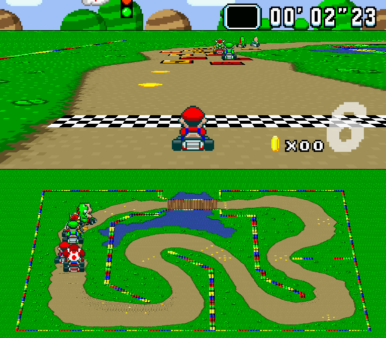
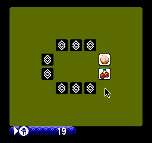

# サンプル

[English](README.md) / [简体中文](README.zh-CN.md) / **日本語** / [한국어](README.ko.md)

ゲームやアプリを動かしてから、それを支える SFML の機能をモジュール別に探せます。

## ここから始める

<div class="example-picks">
  <a class="example-pick" href="projects/README.ja.md#super-mario-kart">
    
    <div class="example-pick-info">
      <h3>Süper Mario Kart</h3>
      <p>Mode 7 描画、8 人のドライバー、5 コースを備えた TypeScript 製カートレース。Grand Prix または単一レースで AI 7 人と競います。</p>
      <span class="example-pick-action">遊び方と起動手順</span>
    </div>
  </a>
  <a class="example-pick" href="projects/README.ja.md#play-nes">
    
    <div class="example-pick-info">
      <h3>play-nes</h3>
      <p>ネイティブ描画と音声を使うデスクトップ NES エミュレーター。同梱の Concentration Room や利用権限のあるローカル ROM を楽しめます。</p>
      <span class="example-pick-action">遊び方と起動手順</span>
    </div>
  </a>
  <a class="example-pick" href="projects/README.ja.md#breakout">
    
    <div class="example-pick-info">
      <h3>Breakout · ブロック崩し</h3>
      <p>このリポジトリに同梱された、衝突判定、3 つのライフ、スコア、一時停止を備えたゲーム。単一の JavaScript ファイル <code>examples/breakout.cjs</code> で全体を読み、実行できます。</p>
      <span class="example-pick-action">遊び方と起動手順</span>
    </div>
  </a>
</div>

## 目的別に探す

<dl class="example-topics">
  <div id="screenshots">
    <dt><a href="features/README.ja.md">機能サンプル</a></dt>
    <dd>
      <p>System、Window、Graphics、Audio、Network を扱う 15 個の機能別サンプル。</p>
      <div class="example-topic-links">
        <a href="features/README.ja.md#render-texture">オフスクリーン描画</a>
        <a href="features/README.ja.md#network">ネットワーク通信</a>
      </div>
    </dd>
  </div>
  <div>
    <dt><a href="official/README.ja.md">公式サンプル</a></dt>
    <dd>
      <p>プラットフォーム要件と出典を記載した 24 個の SFML 移植。</p>
      <div class="example-topic-links">
        <a href="official/README.ja.md#shader">Shader シーン</a>
      </div>
    </dd>
  </div>
  <div id="game-projects">
    <dt><a href="projects/README.ja.md">ゲームとアプリ</a></dt>
    <dd>
      <p>TypeScript、JavaScript、ClojureScript のゲーム。画像、操作方法、ソースを掲載。</p>
      <div class="example-topic-links">
        <a id="breakout" href="projects/README.ja.md#breakout">Breakout</a>
        <a id="16-games" href="projects/README.ja.md#16-games">ClojureScript の 16 ゲーム</a>
      </div>
    </dd>
  </div>
</dl>

## 実行前の準備

> このリポジトリのサンプルはルートで実行します。初回は `npm ci`、ソース変更後は `npm run build` を実行してください。描画には OpenGL ウィンドウに対応するグラフィカルセッションが必要です。独立したプロジェクトには個別の導入手順があります。

```sh
node examples/breakout.cjs
node examples/official/shader/Shader.cjs
node examples/network.cjs
```

[プロジェクトトップ](../README.ja.md) · [クイックスタート](../docs/getting-started.ja.md) · [開発ガイド](../docs/development.ja.md)
