# 機能サンプル

[English](README.md) / [简体中文](README.zh-CN.md) / **日本語** / [한국어](README.ko.md)

> sfml.js リポジトリのルートで実行します。初回は `npm ci`、ソース変更後は `npm run build` が必要です。Network 以外はウィンドウを開くため、ディスプレイと OpenGL のサポートが必要です。

[概要](../README.ja.md) · [公式サンプル](../official/README.ja.md) · [ゲームとアプリ](../projects/README.ja.md)

ビルド後は以下のコマンドを直接実行できます。package.json の `demo:*` は設定に従って再ビルドします。終了するにはウィンドウを閉じてください。フレーム数を指定した入口は自動終了します。画像は特定シーンの描画結果であり、性能やデバイステストの結果ではありません。

公開 API だけを使うアプリは[クイックスタート](../../docs/getting-started.ja.md)から始めてください。補助ファイルは入口に付属し、独立したプログラムとしては扱いません。

<a id="system"></a>

## System

<div class="example-gallery">
  <article class="example-entry" id="sleep-err">
    <a href="../../assets/examples/features/sleep-err.webp">
      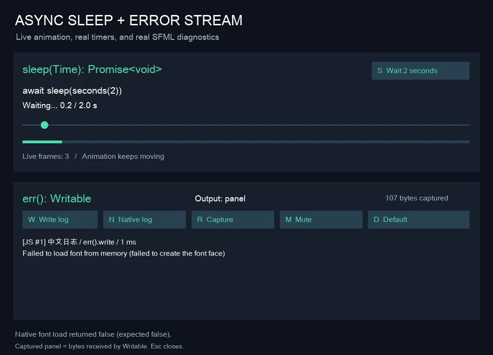
    </a>
    <div class="example-info">
      <p><strong><a href="../sleep-err.cjs">sleep-err.cjs</a></strong></p>
      <p>非同期の待機と SFML のログ出力</p>
      <p><code>node examples/sleep-err.cjs</code></p>
      <p>S で 2 秒待機、W でログ出力、N でネイティブ診断。R でパネルにログを転送、M で抑制、D で stderr に戻します。Esc で終了。</p>
      <p>フレーム数を制限する場合：<code>--frames=120</code>。</p>
      <p><code>npm run demo:sleep-err</code></p>
    </div>
  </article>
  <article class="example-entry" id="vector-scalars">
    <a href="../../assets/examples/features/vector-scalars.webp">
      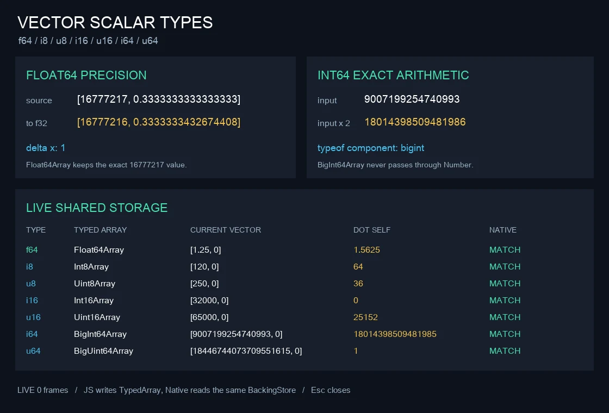
    </a>
    <div class="example-info">
      <p><strong><a href="../vector-scalars.cjs">vector-scalars.cjs</a></strong></p>
      <p>各種数値スカラー型でのベクトル演算</p>
      <p><code>node examples/vector-scalars.cjs</code></p>
      <p>各スカラー型の TypedArray 共有ストレージとネイティブ比較を表示します。Esc で終了。</p>
      <p><code>--frames</code> 非対応。停止するにはウィンドウを閉じてください。</p>
      <p><strong>リポジトリ内の診断用入口：内部のネイティブプレビューや検証 API を使用し、公開 API だけのアプリ雛形ではありません。</strong></p>
    </div>
  </article>
</div>

<a id="window"></a>

## Window

<div class="example-gallery">
  <article class="example-entry" id="window-demo">
    <a href="../../assets/examples/features/window.webp">
      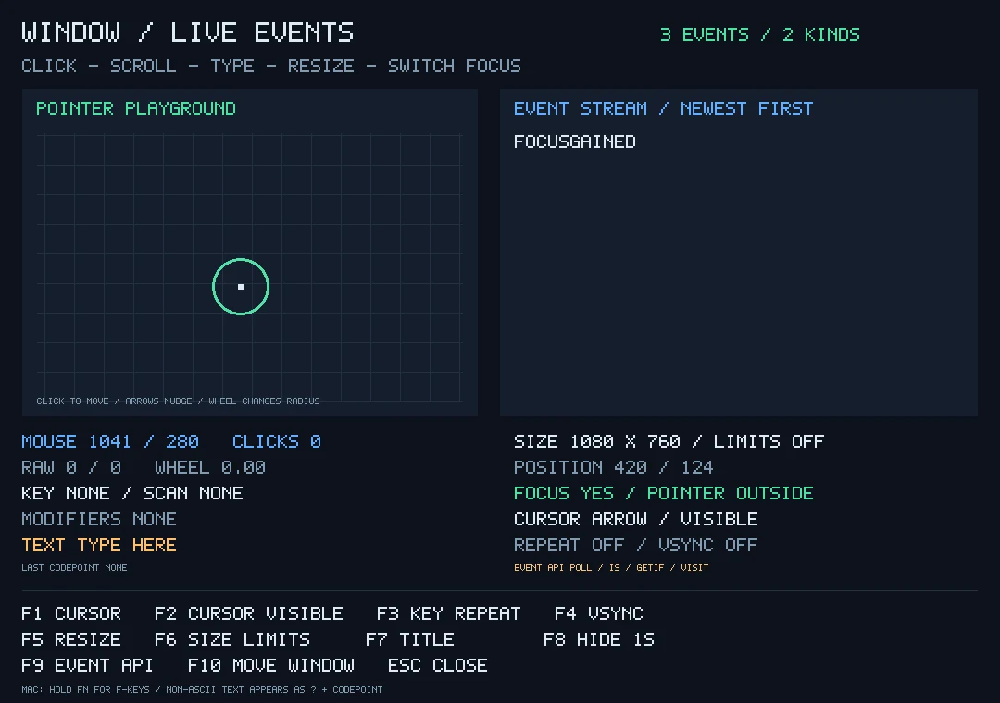
    </a>
    <div class="example-info">
      <p><strong><a href="../window.cjs">window.cjs</a></strong></p>
      <p>ウィンドウイベント、カーソル、入力の診断</p>
      <p><code>node examples/window.cjs</code></p>
      <p>F1 はカーソル切替、F2 は表示切替、F3 はキーリピート、F4 は VSync、F5 はサイズ、F6 はサイズ制限、F7 はタイトル、F8 は一時非表示、F9 はイベント処理方式、F10 はウィンドウ移動。矢印でマーカーを移動し、文字入力と Backspace で編集、Esc で終了。</p>
      <p>フレーム数を制限する場合：<code>--frames=120</code>。</p>
      <p><strong>リポジトリ内の診断用入口：内部のネイティブプレビューや検証 API を使用し、公開 API だけのアプリ雛形ではありません。</strong></p>
      <p>補助ファイル: <a href="../bitmap-label.cjs">bitmap-label.cjs</a></p>
      <p><code>npm run demo:window</code></p>
    </div>
  </article>
  <article class="example-entry" id="system-window">
    <a href="../../assets/examples/features/system-window.webp">
      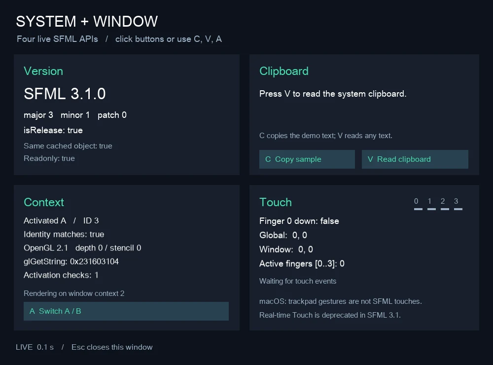
    </a>
    <div class="example-info">
      <p><strong><a href="../system-window.cjs">system-window.cjs</a></strong></p>
      <p>System と Window のインターフェース</p>
      <p><code>node examples/system-window.cjs</code></p>
      <p>C でサンプル文字列をクリップボードに書き込み、V で読み取り、A で OpenGL コンテキストを切替。Esc で終了。Touch は対応機器が必要で、macOS のトラックパッドジェスチャーは SFML のタッチではありません。</p>
      <p>フレーム数を制限する場合：<code>--frames=120</code>。</p>
      <p><code>npm run demo:system-window</code></p>
    </div>
  </article>
</div>

<a id="graphics"></a>

## グラフィックス

<div class="example-gallery">
  <article class="example-entry" id="all-types">
    <a href="../../assets/examples/features/all-types.webp">
      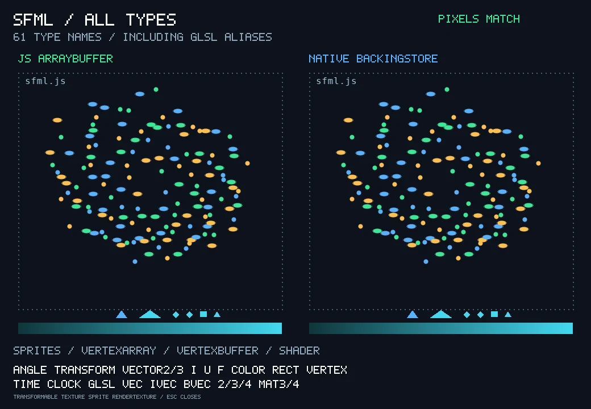
    </a>
    <div class="example-info">
      <p><strong><a href="../all-types.cjs">all-types.cjs</a></strong></p>
      <p>値型、変換、図形、頂点、テキストを組み合わせたシーン</p>
      <p><code>node examples/all-types.cjs</code></p>
      <p>フレーム数を制限する場合：<code>--frames=120</code>。</p>
      <p><strong>リポジトリ内の診断用入口：内部のネイティブプレビューや検証 API を使用し、公開 API だけのアプリ雛形ではありません。</strong></p>
      <p>補助ファイル: <a href="../all-types-scene.cjs">all-types-scene.cjs</a>, <a href="../bitmap-label.cjs">bitmap-label.cjs</a></p>
      <p><code>npm run demo:types</code></p>
    </div>
  </article>
  <article class="example-entry" id="sprites">
    <a href="../../assets/examples/features/sprites.webp">
      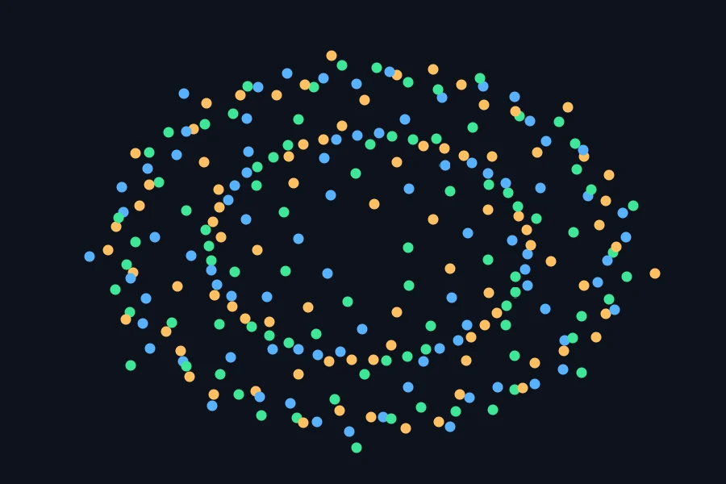
    </a>
    <div class="example-info">
      <p><strong><a href="../sprites.cjs">sprites.cjs</a></strong></p>
      <p>大量のスプライトの描画</p>
      <p><code>node examples/sprites.cjs</code></p>
      <p>256 個の動くスプライト。<code>--uncapped</code> でデモのタイマーを外せます。</p>
      <p><code>--frames</code> 非対応。停止するにはウィンドウを閉じてください。</p>
      <p><strong>リポジトリ内の診断用入口：内部のネイティブプレビューや検証 API を使用し、公開 API だけのアプリ雛形ではありません。</strong></p>
      <p><code>npm run demo</code></p>
    </div>
  </article>
  <article class="example-entry" id="image">
    <a href="../../assets/examples/features/image.webp">
      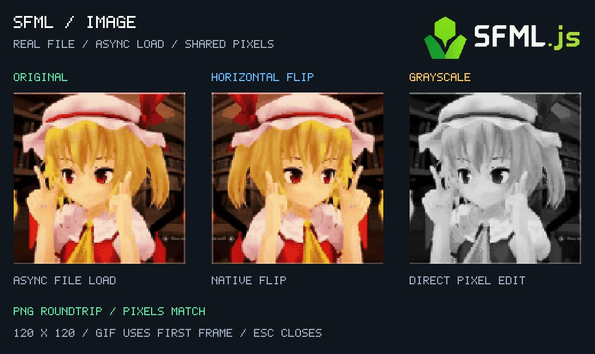
    </a>
    <div class="example-info">
      <p><strong><a href="../image.cjs">image.cjs</a></strong></p>
      <p>ピクセルの編集、コピー、マスク、エンコードとデコード</p>
      <p><code>node examples/image.cjs</code></p>
      <p><code>--file=/path/to/image.png</code> で画像を指定できます。</p>
      <p>フレーム数を制限する場合：<code>--frames=120</code>。</p>
      <p><strong>リポジトリ内の診断用入口：内部のネイティブプレビューや検証 API を使用し、公開 API だけのアプリ雛形ではありません。</strong></p>
      <p>補助ファイル: <a href="../bitmap-label.cjs">bitmap-label.cjs</a></p>
      <p><code>npm run demo:image</code></p>
    </div>
  </article>
  <article class="example-entry" id="texture">
    <a href="../../assets/examples/features/texture.webp">
      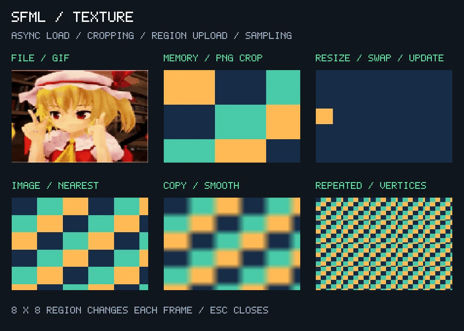
    </a>
    <div class="example-info">
      <p><strong><a href="../texture.cjs">texture.cjs</a></strong></p>
      <p>画像の読み込み、切り出し、部分アップロード、サンプリング</p>
      <p><code>node examples/texture.cjs</code></p>
      <p>フレーム数を制限する場合：<code>--frames=120</code>。</p>
      <p><strong>リポジトリ内の診断用入口：内部のネイティブプレビューや検証 API を使用し、公開 API だけのアプリ雛形ではありません。</strong></p>
      <p>補助ファイル: <a href="../bitmap-label.cjs">bitmap-label.cjs</a></p>
      <p><code>npm run demo:texture</code></p>
    </div>
  </article>
  <article class="example-entry" id="sprite">
    <a href="../../assets/examples/features/sprite.webp">
      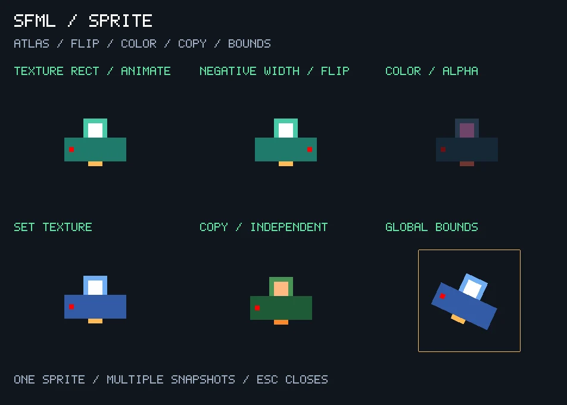
    </a>
    <div class="example-info">
      <p><strong><a href="../sprite.cjs">sprite.cjs</a></strong></p>
      <p>スプライトのアニメーション、反転、色、境界</p>
      <p><code>node examples/sprite.cjs</code></p>
      <p>フレーム数を制限する場合：<code>--frames=120</code>。</p>
      <p><strong>リポジトリ内の診断用入口：内部のネイティブプレビューや検証 API を使用し、公開 API だけのアプリ雛形ではありません。</strong></p>
      <p>補助ファイル: <a href="../bitmap-label.cjs">bitmap-label.cjs</a></p>
      <p><code>npm run demo:sprite</code></p>
    </div>
  </article>
  <article class="example-entry" id="render-texture">
    <a href="../../assets/render-texture.png">
      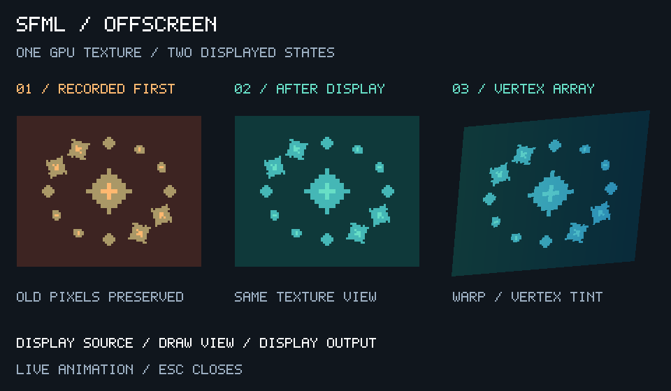
    </a>
    <div class="example-info">
      <p><strong><a href="../render-texture.cjs">render-texture.cjs</a></strong></p>
      <p>オフスクリーン合成、テクスチャビュー、描画スナップショット</p>
      <p><code>node examples/render-texture.cjs</code></p>
      <p>フレーム数を制限する場合：<code>--frames=120</code>。</p>
      <p><strong>リポジトリ内の診断用入口：内部のネイティブプレビューや検証 API を使用し、公開 API だけのアプリ雛形ではありません。</strong></p>
      <p>補助ファイル: <a href="../bitmap-label.cjs">bitmap-label.cjs</a></p>
      <p><code>npm run demo:render-texture</code></p>
    </div>
  </article>
  <article class="example-entry" id="drawable">
    <a href="../../assets/examples/features/drawable.webp">
      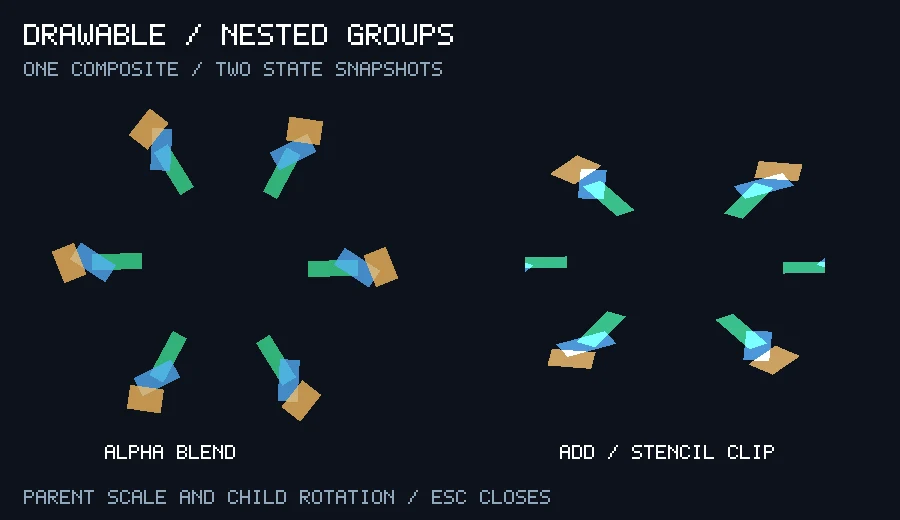
    </a>
    <div class="example-info">
      <p><strong><a href="../drawable.cjs">drawable.cjs</a></strong></p>
      <p>独自の複合オブジェクト、親子の変換、ブレンド、ステンシル</p>
      <p><code>node examples/drawable.cjs</code></p>
      <p>フレーム数を制限する場合：<code>--frames=120</code>。</p>
      <p><strong>リポジトリ内の診断用入口：内部のネイティブプレビューや検証 API を使用し、公開 API だけのアプリ雛形ではありません。</strong></p>
      <p>補助ファイル: <a href="../bitmap-label.cjs">bitmap-label.cjs</a></p>
      <p><code>npm run demo:drawable</code></p>
    </div>
  </article>
  <article class="example-entry" id="vertex-array">
    <a href="../../assets/examples/features/vertex-array.webp">
      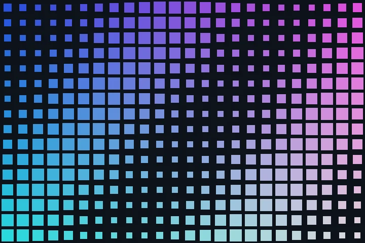
    </a>
    <div class="example-info">
      <p><strong><a href="../vertex-array.cjs">vertex-array.cjs</a></strong></p>
      <p>動的なタイルと連続した頂点</p>
      <p><code>node examples/vertex-array.cjs</code></p>
      <p>フレーム数を制限する場合：<code>--frames=120</code>。</p>
      <p><strong>リポジトリ内の診断用入口：内部のネイティブプレビューや検証 API を使用し、公開 API だけのアプリ雛形ではありません。</strong></p>
      <p><code>npm run demo:vertices</code></p>
    </div>
  </article>
  <article class="example-entry" id="text">
    <a href="../../assets/examples/features/text.webp">
      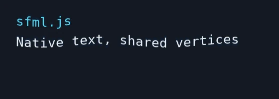
    </a>
    <div class="example-info">
      <p><strong><a href="../text.cjs">text.cjs</a></strong></p>
      <p>テキストのレイアウトと頂点アニメーション</p>
      <p><code>node examples/text.cjs</code></p>
      <p><code>--font=/path/to/font.ttf</code> と <code>--text=日本語</code> でフォントと文字列を指定できます。必要なグリフを持つフォントを選んでください。Esc で終了。</p>
      <p>フレーム数を制限する場合：<code>--frames=120</code>。</p>
      <p><code>npm run demo:text</code></p>
    </div>
  </article>
</div>

<a id="audio"></a>

## オーディオ

<div class="example-gallery">
  <article class="example-entry" id="audio-demo">
    <a href="../../assets/examples/features/audio.webp">
      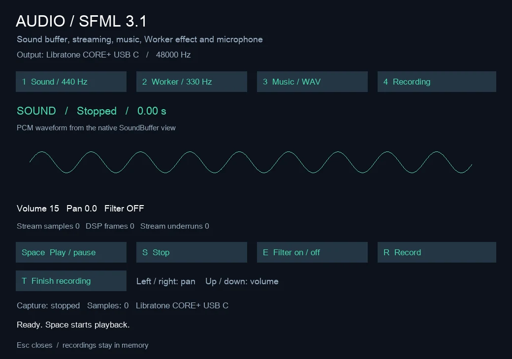
    </a>
    <div class="example-info">
      <p><strong><a href="../audio.cjs">audio.cjs</a></strong></p>
      <p>Sound、Music、Worker によるデータ供給、エフェクト、録音再生</p>
      <p><code>node examples/audio.cjs</code></p>
      <p>1～4 でモード選択、Space で再生／一時停止、S で停止、E でエフェクト切替、R／T で録音開始／終了、矢印でパンと音量を調整、Esc で終了。録音にはマイクと許可が必要で、通常起動時は入力を待ちます。</p>
      <p>フレーム数を制限する場合：<code>--frames=120</code>。</p>
      <p>補助ファイル: <a href="../audio-worker.cjs">audio-worker.cjs</a></p>
      <p><code>npm run demo:audio</code></p>
    </div>
  </article>
</div>

<a id="network"></a>

## ネットワーク

<div class="example-gallery">
  <article class="example-entry" id="network-demo">
    <div class="example-info">
      <p><strong><a href="../network.cjs">network.cjs</a></strong></p>
      <p>ローカルの TCP、Packet、UDP、Selector</p>
      <p><code>node examples/network.cjs</code></p>
      <p>動的に割り当てたループバックポートで TCP、Packet、UDP、SocketSelector を確認するコンソール専用入口。ターミナル 1 つで実行し、終了時にソケットを閉じます。</p>
      <p><code>npm run demo:network</code></p>
    </div>
  </article>
</div>

<a id="screenshots"></a>
## スクリーンショット

`SFML_DEMO_SNAPSHOT` に対応するグラフィックスのサンプルは、実行画面を保存できます。macOS／Linux では、たとえば次のように実行します。

```sh
SFML_DEMO_SNAPSHOT=/tmp/sfml-render-texture.png \
  node examples/render-texture.cjs --frames=2
```

PowerShell の場合：

```powershell
$env:SFML_DEMO_SNAPSHOT = "$env:TEMP/sfml-render-texture.png"
node examples/render-texture.cjs --frames=2
Remove-Item Env:SFML_DEMO_SNAPSHOT
```

内蔵の撮影機能は <code>SFML_DEMO_SNAPSHOT</code> を使います。all-types、sprites、drawable、vertex-array、system-window、sleep-err は拡張子に関係なく PPM を書くため、<code>.ppm</code> を指定してください。image、texture、sprite、render-texture、window、audio は PNG に対応します。text と vector-scalars はこの環境変数に非対応です。両方の画像は一時的な計測コードで撮影しました。

sleep-err は最終フレーム、vertex-array はループ終了後に保存するため、有限のフレーム数を指定してください。system-window、window、audio は最低 2 フレーム必要で、他の内蔵プレビューは最初のフレームを保存する場合があります。sprites は最初のフレームを保存した後も動作し、ウィンドウを閉じるまで終了しません。出典は [sources.json](../../assets/examples/features/sources.json) に記録しています。
