# SFML 공식 예제

[English](README.md) · [简体中文](README.zh-CN.md) · [日本語](README.ja.md) · **한국어**

[SFML/SFML][upstream]의 예제 19개를 JavaScript로 이식했습니다. 기준 커밋은
`14cea1d978b3dce05780b9234925ca8be9373260`입니다. sfml.js에 맞게 수정한 버전이며, 원본의 디렉터리 이름, 장면, 조작법과 리소스를 유지합니다.

[전체 예제](../README.ko.md) · [빌드 요구 사항](../../docs/getting-started.ko.md#requirements)

sfml.js를 빌드한 뒤 저장소 루트에서 공식 예제 디렉터리로 이동하여 실행하세요.

```sh
cd examples/official
node tennis/Tennis.cjs
```

리소스는 각 스크립트 기준의 상대 경로로 불러옵니다. 대화형 예제는 닫을 때까지 실행되며, 다른 예제의 `--frames` 인수를 지원하지 않습니다. 그래픽에는 디스플레이와 OpenGL이, 녹음에는 마이크와 OS 녹음 권한이 필요합니다.

바로가기: [그래픽](#graphics) · [플랫폼 통합](#platform) · [입력과 이벤트](#input) · [오디오](#audio) · [네트워크](#network)

X11 스크린샷은 Linux CI의 Xvfb/Mesa에서, 나머지는 macOS 네이티브 SFML 창에서 캡처했습니다. 이미지를 클릭하면 원본을, 예제 이름을 클릭하면 소스 코드를 볼 수 있습니다.

<a id="graphics"></a>

## 그래픽

<table>
  <thead>
    <tr>
      <th width="44%">실행 화면</th>
      <th>예제와 조작법</th>
    </tr>
  </thead>
  <tbody>
    <tr>
      <td width="44%" valign="top">
        <a href="screenshots/island.png">
          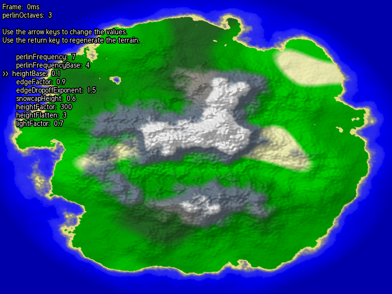
        </a>
      </td>
      <td valign="top">
        <p><strong><a href="island/Island.cjs">Island</a></strong></p>
        <p>지형과 조명</p>
        <p><strong>조작</strong> · 방향키로 매개변수 수정, Enter로 재생성</p>
        <p><code>node island/Island.cjs</code></p>
      </td>
    </tr>
    <tr>
      <td width="44%" valign="top">
        <a href="screenshots/shader.png">
          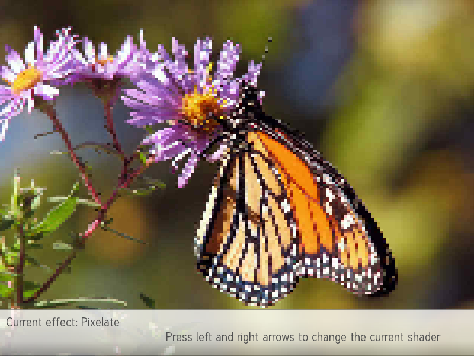
        </a>
      </td>
      <td valign="top">
        <p><strong><a href="shader/Shader.cjs">Shader</a></strong></p>
        <p>셰이더 장면 5개</p>
        <p><strong>조작</strong> · 좌/우로 선택, 마우스로 조절</p>
        <p><code>node shader/Shader.cjs</code></p>
      </td>
    </tr>
    <tr>
      <td width="44%" valign="top">
        <a href="screenshots/tennis.png">
          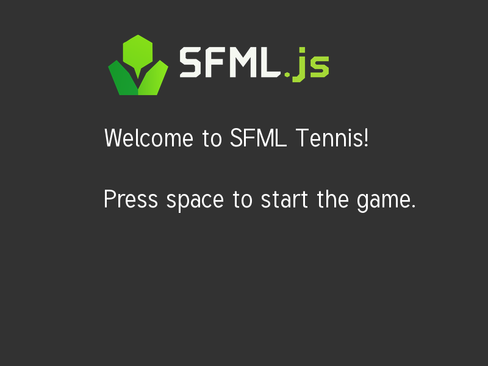
        </a>
      </td>
      <td valign="top">
        <p><strong><a href="tennis/Tennis.cjs">Tennis</a></strong></p>
        <p>Pong</p>
        <p><strong>조작</strong> · Space로 시작, 위/아래로 이동, Esc로 종료. 터치 조작 지원</p>
        <p><code>node tennis/Tennis.cjs</code></p>
      </td>
    </tr>
    <tr>
      <td width="44%" valign="top">
        <a href="screenshots/stencil.png">
          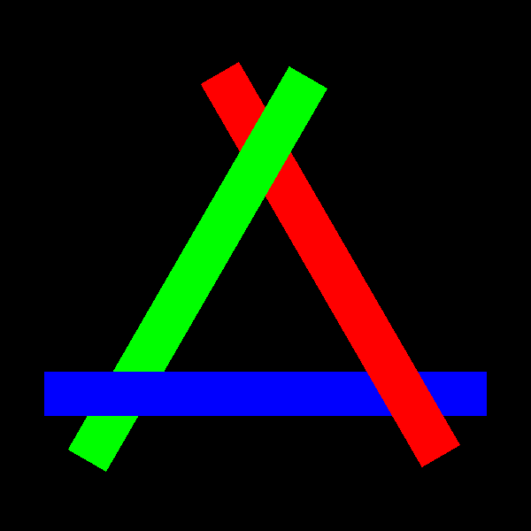
        </a>
      </td>
      <td valign="top">
        <p><strong><a href="stencil/Stencil.cjs">Stencil</a></strong></p>
        <p>스텐실 마스크와 도형 애니메이션</p>
        <p><code>node stencil/Stencil.cjs</code></p>
      </td>
    </tr>
    <tr>
      <td width="44%" valign="top">
        <a href="screenshots/text.png">
          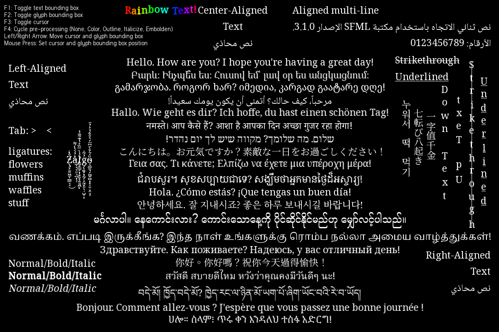
        </a>
      </td>
      <td valign="top">
        <p><strong><a href="text/Text.cjs">Text</a></strong></p>
        <p>다국어 샘플 40개</p>
        <p><strong>조작</strong> · 클릭으로 선택, F1/F2/F3로 경계와 커서, F4로 전처리 전환, 좌/우로 커서 이동</p>
        <p><code>node text/Text.cjs</code></p>
      </td>
    </tr>
  </tbody>
</table>

<a id="platform"></a>

## 플랫폼 통합

X11에는 Linux, X11 디스플레이 서버(또는 XWayland), 데스크톱 OpenGL이 필요합니다. 저장소 루트에서 `npm ci`를 실행하면 개발 의존성 `x11`과 `koffi`를 설치합니다. 별도 예제 모듈을 컴파일할 필요는 없습니다.

<table>
  <thead>
    <tr>
      <th width="44%">실행 화면</th>
      <th>예제와 조작법</th>
    </tr>
  </thead>
  <tbody>
    <tr>
      <td width="44%" valign="top">
        <a href="screenshots/x11.png">
          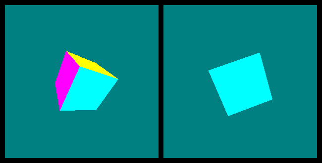
        </a>
      </td>
      <td valign="top">
        <p><strong><a href="X11/X11.cjs">X11</a></strong></p>
        <p>650 × 330 부모 창에 310 × 310 뷰 두 개를 삽입하며 오른쪽 큐브는 왼쪽의 30% 속도로 회전</p>
        <p><strong>조작</strong> · 아무 키, 창 닫기 또는 Ctrl+C로 종료</p>
        <p><code>node X11/X11.cjs</code></p>
      </td>
    </tr>
  </tbody>
</table>

<a id="input"></a>

## 입력과 이벤트

입력 스크린샷은 스크립트 이벤트를 사용하며 조이스틱은 미연결 상태입니다.

<table>
  <thead>
    <tr>
      <th width="44%">실행 화면</th>
      <th>예제와 조작법</th>
    </tr>
  </thead>
  <tbody>
    <tr>
      <td width="44%" valign="top">
        <a href="screenshots/keyboard.png">
          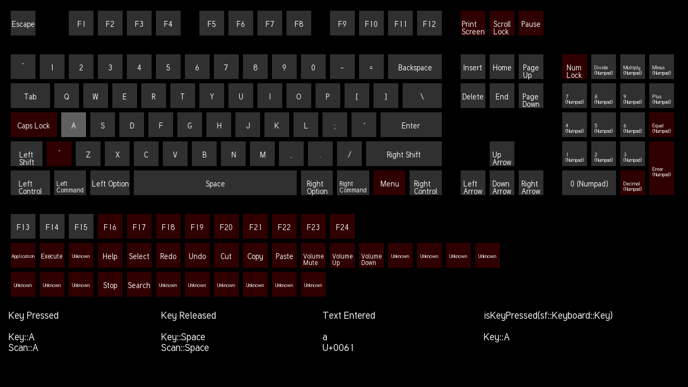
        </a>
      </td>
      <td valign="top">
        <p><strong><a href="keyboard/Keyboard.cjs">Keyboard</a></strong></p>
        <p>물리 키 배치, 키 이벤트, 문자 입력과 효과음</p>
        <p><code>node keyboard/Keyboard.cjs</code></p>
      </td>
    </tr>
    <tr>
      <td width="44%" valign="top">
        <a href="screenshots/event_handling.png">
          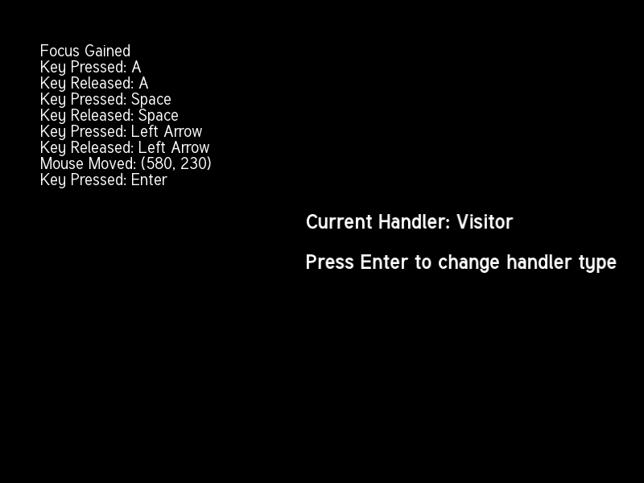
        </a>
      </td>
      <td valign="top">
        <p><strong><a href="event_handling/EventHandling.cjs">Event handling</a></strong></p>
        <p>이벤트 처리 방식 5개</p>
        <p><strong>조작</strong> · Enter로 전환</p>
        <p><code>node event_handling/EventHandling.cjs</code></p>
      </td>
    </tr>
    <tr>
      <td width="44%" valign="top">
        <a href="screenshots/raw_input.png">
          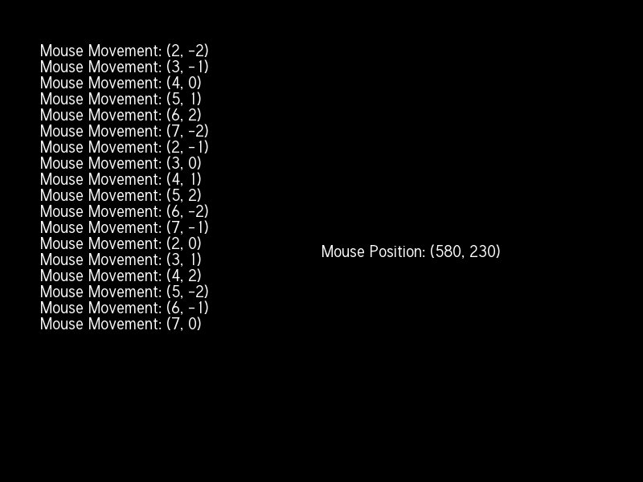
        </a>
      </td>
      <td valign="top">
        <p><strong><a href="raw_input/RawInput.cjs">Raw input</a></strong></p>
        <p>마우스 Raw Input</p>
        <p><code>node raw_input/RawInput.cjs</code></p>
      </td>
    </tr>
    <tr>
      <td width="44%" valign="top">
        <a href="screenshots/joystick.png">
          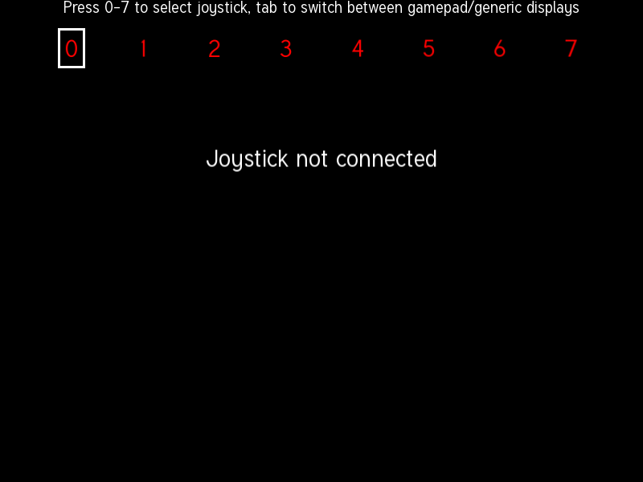
        </a>
      </td>
      <td valign="top">
        <p><strong><a href="joystick/Joystick.cjs">Joystick</a></strong></p>
        <p>축과 버튼</p>
        <p><strong>조작</strong> · 0~7로 장치 선택, Tab으로 일반/게임패드 보기 전환</p>
        <p><code>node joystick/Joystick.cjs</code></p>
      </td>
    </tr>
  </tbody>
</table>

<a id="audio"></a>

## 오디오

오디오 효과 스크린샷은 null 재생 장치로 캡처했습니다.

<table>
  <thead>
    <tr>
      <th width="44%">실행 화면</th>
      <th>예제와 조작법</th>
    </tr>
  </thead>
  <tbody>
    <tr>
      <td width="44%" valign="top">
        <a href="screenshots/sound_effects.png">
          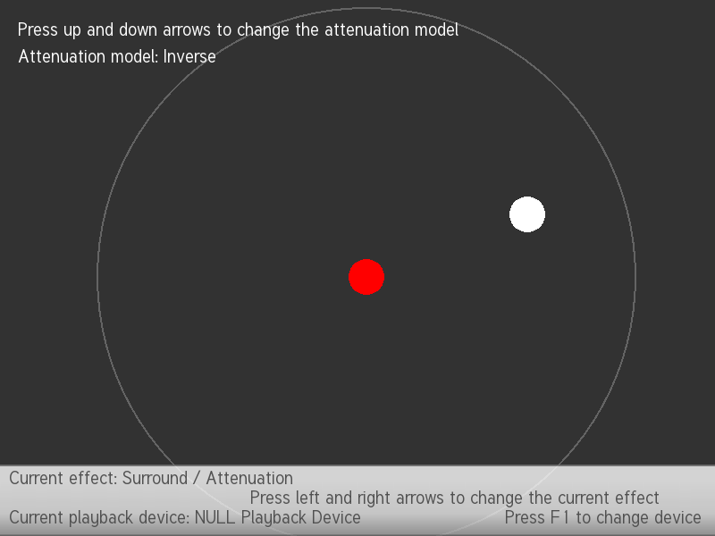
        </a>
      </td>
      <td valign="top">
        <p><strong><a href="sound_effects/SoundEffects.cjs">Sound effects</a></strong></p>
        <p>효과 9개</p>
        <p><strong>조작</strong> · 좌/우로 선택, 마우스로 조절, 위/아래로 감쇠/파형 선택, Space로 DSP 우회, F1로 출력 변경</p>
        <p><code>node sound_effects/SoundEffects.cjs</code></p>
      </td>
    </tr>
  </tbody>
</table>

| 예제와 조작법 | 실행 |
| --- | --- |
| **[Sound](sound/Sound.cjs)**<br>WAV 효과음과 OGG, FLAC, MP3 음악 재생 | `node sound/Sound.cjs` |
| **[Sound capture](sound_capture/SoundCapture.cjs)**<br>장치와 샘플레이트 선택, 녹음 후 재생 또는 저장 | `node sound_capture/SoundCapture.cjs` |
| **[Sound device](sound_device/SoundDevice.cjs)**<br>장치 알림, 자동 라우팅과 장치 연결 해제 복구. Ctrl+C로 종료 | `node sound_device/SoundDevice.cjs` |

<a id="network"></a>

## 네트워크

| 예제와 조작법 | 실행 |
| --- | --- |
| **[HTTP](http/Http.cjs)**<br>리다이렉트를 처리하는 대화형 HTTP GET | `node http/Http.cjs` |
| **[FTP](ftp/Ftp.cjs)**<br>대화형 FTP 클라이언트, 포트 21 | `node ftp/Ftp.cjs` |
| **[SFTP](sftp/Sftp.cjs)**<br>대화형 SFTP. 호스트 지문 확인 후 인증 | `node sftp/Sftp.cjs` |
| **[Sockets](sockets/Sockets.cjs)**<br>TCP, TLS, UDP 메시지 교환, 포트 50001 | `node sockets/Sockets.cjs` |
| **[VoIP](voip/VoIP.cjs)**<br>TCP 음성 녹음, 재생과 다시 듣기, 포트 2435 | `node voip/VoIP.cjs` |

sockets와 VoIP는 터미널 두 개에서 실행하고 각각 서버와 클라이언트를 선택합니다. 로컬 연결에는 `127.0.0.1`을 사용하세요.

FTP/SFTP 다운로드와 녹음 저장 시 임시 디렉터리나 원하는 출력 경로를 입력하세요.

## Node에 맞춘 조정


- 렌더링은 `setImmediate`로 이벤트 루프에 제어권을 반환합니다. 리소스와 통신에는 공개 비동기 API를, 오디오 콜백에는 오디오 Worker를 사용합니다.
- island는 Worker 4개를 재사용하며 원본의 블록 32개와 800 × 600 메시를 유지합니다. Perlin은 원본 표를 사용하고 경계에서는 부호 있는 좌표로 언더플로를 피합니다.
- 텍스트 클러스터 위치는 JavaScript UTF-16 인덱스입니다. Noto 서브셋은 수정하지 않고 복사했습니다. [폰트 설명](text/resources/readme.md)을 참고하세요.
- 바인딩이 제공하는 거리 감쇠는 역거리 모델뿐입니다. Surround는 원본의 네 가지 공식을 JavaScript에서 계산하며 네이티브 공간 패닝을 유지합니다. 생성 음의 주파수가 0이면 무음을 출력합니다.
- TLS는 원본의 공개 데모 키와 DNS/IP SAN이 포함된 새 `localhost` 인증서를 사용합니다. 인증서 검증은 활성 상태입니다. 서로 다른 호스트에서도 이 키와 인증서는 데모 전용입니다.
- X11 창은 외부 패키지 `x11`로, 빌린 창의 OpenGL 컨텍스트는 `sf.Window(BigInt(xid))`로 관리하고 `koffi`로 `libGL.so.1`을 호출합니다. 정점은 Koffi가 할당한 안정적인 메모리에 저장하며 SFML 컨텍스트, 정점, 부모 창, X11 연결 순서로 해제합니다.

나머지 6개 예제(`android`, `cocoa`, `opengl`, `vulkan`, `win32`, `window`)는 플랫폼 UI나 직접 그래픽 컨텍스트 API가 필요하여 아직 이식하지 않았습니다.

검증 범위에는 네이티브 렌더링, 지형 생성, 텍스트/키 입력, 오디오 디코딩, Worker DSP와 로컬 통신이 포함됩니다. 실제 마이크, 스피커, 조이스틱, 장치 연결/해제 및 외부 FTP/SFTP는 대상 환경에서 확인해야 합니다.

[X11 CI](../../.github/workflows/official-x11.yml)는 Ubuntu 24.04, Node.js 22, Xvfb, Mesa 소프트웨어 렌더링으로 창 계층과 크기, 두 큐브 및 애니메이션 차이, 부모/자식 키 종료, SIGINT 정리, `DISPLAY` 미설정 오류를 검사합니다. 스크린샷, 창 트리, 로그는 `official-x11-linux` artifact로 14일간 보관합니다. 실제 GPU와 XWayland는 이 CI에서 검증하지 않습니다.

## 출처와 라이선스

[provenance.json](provenance.json)에 커밋, C++ 소스 해시와 변경하지 않은 리소스 53개의 SHA-256을 기록했습니다.

- SFML 소스: [zlib 라이선스](SFML-LICENSE.md).
- 리소스와 저자: [asset_licenses.md](asset_licenses.md).
- Noto: [SIL Open Font License 1.1](text/resources/OFL.txt). 각 폰트의 저작권 메타데이터를 보존합니다.
- 이식한 stb Perlin: [MIT/퍼블릭 도메인 이중 라이선스](island/stb_perlin.LICENSE).

[upstream]: https://github.com/SFML/SFML/tree/14cea1d978b3dce05780b9234925ca8be9373260/examples
