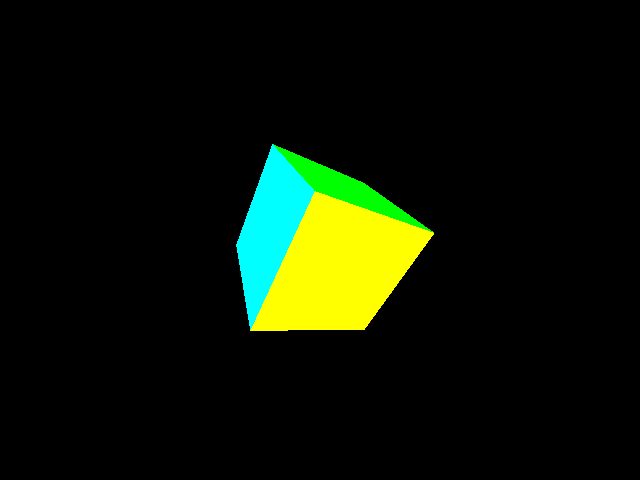
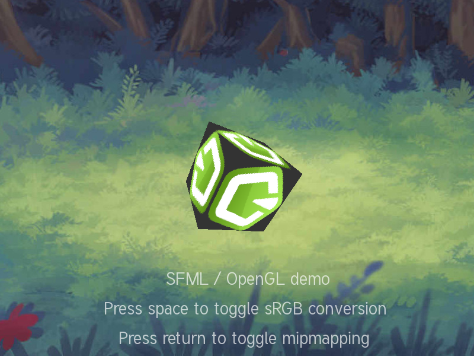
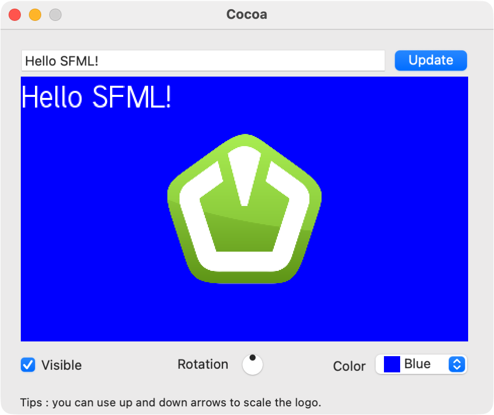
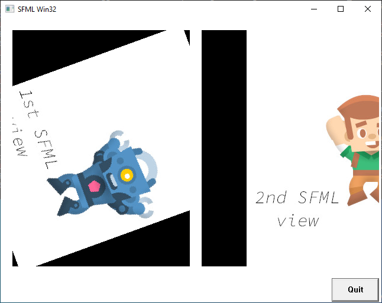

# SFML 官方示例

[English](README.md) · **简体中文** · [日本語](README.ja.md) · [한국어](README.ko.md)

这里将 [SFML/SFML][upstream] 的 23 个示例迁移到 JavaScript，上游固定为 commit
`14cea1d978b3dce05780b9234925ca8be9373260`。这些是适配 sfml.js 的修改版本，保留上游目录、场景、操作方式与资源。

[全部示例](../README.zh-CN.md) · [构建要求](../../docs/getting-started.zh-CN.md#requirements)

构建好 sfml.js 后，从仓库根目录进入官方示例目录运行：

```sh
cd examples/official
node tennis/Tennis.cjs
```

资源路径相对于各脚本解析。交互示例持续运行到关闭，不支持其他示例的 `--frames` 参数。图形示例需要显示服务与 OpenGL；录音需要麦克风及系统录音权限。

浏览：[图形](#graphics) · [平台集成](#platform) · [输入与事件](#input) · [音频](#audio) · [网络](#network)

X11 截图来自 Linux CI 的 Xvfb／Mesa，Win32 截图来自 Windows CI 的 Mesa，其余截图来自 macOS 原生 SFML 窗口。点击预览查看原图，点击示例名称查看源码。

<a id="graphics"></a>

## 图形

<table>
  <thead>
    <tr>
      <th width="44%">运行画面</th>
      <th>示例与操作</th>
    </tr>
  </thead>
  <tbody>
    <tr>
      <td width="44%" valign="top">
        <a href="screenshots/island.png">
          
        </a>
      </td>
      <td valign="top">
        <p><strong><a href="island/Island.cjs">Island</a></strong></p>
        <p>地形与光照</p>
        <p><strong>操作</strong> · 方向键修改参数，Enter 重新生成</p>
        <p><code>node island/Island.cjs</code></p>
      </td>
    </tr>
    <tr>
      <td width="44%" valign="top">
        <a href="screenshots/shader.png">
          
        </a>
      </td>
      <td valign="top">
        <p><strong><a href="shader/Shader.cjs">Shader</a></strong></p>
        <p>五种 shader 场景</p>
        <p><a href="screenshots/shader-edge.png">sfml.js 标识的边缘检测预览</a></p>
        <p><strong>操作</strong> · 左／右切换，鼠标调整参数</p>
        <p><code>node shader/Shader.cjs</code></p>
      </td>
    </tr>
    <tr>
      <td width="44%" valign="top">
        <a href="screenshots/tennis.png">
          
        </a>
      </td>
      <td valign="top">
        <p><strong><a href="tennis/Tennis.cjs">Tennis</a></strong></p>
        <p>乒乓球</p>
        <p><strong>操作</strong> · Space 开始，上／下移动，Esc 退出；保留触摸操作</p>
        <p><code>node tennis/Tennis.cjs</code></p>
      </td>
    </tr>
    <tr>
      <td width="44%" valign="top">
        <a href="screenshots/stencil.png">
          
        </a>
      </td>
      <td valign="top">
        <p><strong><a href="stencil/Stencil.cjs">Stencil</a></strong></p>
        <p>模板遮罩与图形动画</p>
        <p><code>node stencil/Stencil.cjs</code></p>
      </td>
    </tr>
    <tr>
      <td width="44%" valign="top">
        <a href="screenshots/text.png">
          
        </a>
      </td>
      <td valign="top">
        <p><strong><a href="text/Text.cjs">Text</a></strong></p>
        <p>40 个多语言样本</p>
        <p><strong>操作</strong> · 点击选择，F1／F2／F3 切换边框和光标，F4 切换预处理，左／右移动光标</p>
        <p><code>node text/Text.cjs</code></p>
      </td>
    </tr>
  </tbody>
</table>

<a id="platform"></a>

## 平台集成

Cocoa 仅支持 macOS，使用第三方 [objc-js](https://github.com/iamEvanYT/objc-js)。进入 `examples/official` 后安装该示例的局部依赖，使用包内的 Apple Silicon／Intel 预编译模块：

```sh
npm ci --prefix cocoa --ignore-scripts
node cocoa/Cocoa.cjs
```

Win32 需要 Windows x64 和 Node.js 20 或以上版本，使用 [`wndkit`](https://www.npmjs.com/package/wndkit) 0.1.0 自带的 x64 原生模块。在 `examples/official` 中安装该示例的局部依赖：

```sh
npm ci --prefix win32 --ignore-scripts
node win32/Win32.cjs
```

Window、OpenGL 和 X11 使用 [`@wettstein/nodegl`](https://www.npmjs.com/package/@wettstein/nodegl) 调用桌面 OpenGL，由 SFML 管理兼容上下文。仓库根目录的 `npm ci` 会安装 `nodegl` 和 `x11`。

nodegl 1.2.1 在安装时编译，需要 CMake、C++ 工具链和 OpenGL 开发头文件及链接库。macOS SDK 自带 OpenGL；Linux 需要安装 `libgl1-mesa-dev` 等开发包。X11 还需要 Linux 和 X11 显示服务（或 XWayland）。Window 和 OpenGL 已在 macOS、Linux（Xvfb／Mesa）和 Windows（Mesa）验证，X11 原生宿主已在 Linux 验证。

<table>
  <thead>
    <tr>
      <th width="44%">运行画面</th>
      <th>示例与操作</th>
    </tr>
  </thead>
  <tbody>
    <tr>
      <td width="44%" valign="top">
        <a href="screenshots/window.png">
          
        </a>
      </td>
      <td valign="top">
        <p><strong><a href="window/Window.cjs">Window</a></strong></p>
        <p>640 × 480 OpenGL 窗口、24 位深度缓冲与六色立方体</p>
        <p><strong>操作</strong> · 拖动窗口边缘调整大小，Esc 或关闭窗口退出</p>
        <p><code>node window/Window.cjs</code></p>
      </td>
    </tr>
    <tr>
      <td width="44%" valign="top">
        <a href="screenshots/opengl.png">
          
        </a>
      </td>
      <td valign="top">
        <p><strong><a href="opengl/OpenGL.cjs">OpenGL</a></strong></p>
        <p>800 × 600 SFML／OpenGL 混合渲染、纹理立方体与 sRGB</p>
        <p><strong>操作</strong> · 鼠标移动立方体，Enter 切换 mipmap，Space 重建窗口并切换 sRGB，Esc 退出</p>
        <p><code>node opengl/OpenGL.cjs</code></p>
      </td>
    </tr>
    <tr>
      <td width="44%" valign="top">
        <a href="screenshots/cocoa.png">
          
        </a>
      </td>
      <td valign="top">
        <p><strong><a href="cocoa/Cocoa.cjs">Cocoa</a></strong></p>
        <p>485 × 379 原生窗口，嵌入 440 × 260 SFML 视图</p>
        <p><strong>操作</strong> · Update 或 Enter 更新文字，Visible 切换标识显隐，旋钮控制旋转，Color 选择背景色，Up／Down 缩放；关闭窗口、Cmd+Q 或 Ctrl+C 退出</p>
        <p><code>node cocoa/Cocoa.cjs</code>（macOS）</p>
      </td>
    </tr>
    <tr>
      <td width="44%" valign="top">
        <a href="screenshots/win32.png">
          
        </a>
      </td>
      <td valign="top">
        <p><strong><a href="win32/Win32.cjs">Win32</a></strong></p>
        <p>660 × 520 原生窗口内嵌两个 300 × 400 SFML 视图；左图旋转，右图水平移动</p>
        <p><strong>操作</strong> · Quit、关闭窗口或 Ctrl+C 退出</p>
        <p><code>node win32/Win32.cjs</code>（Windows x64）</p>
      </td>
    </tr>
    <tr>
      <td width="44%" valign="top">
        <a href="screenshots/x11.png">
          
        </a>
      </td>
      <td valign="top">
        <p><strong><a href="X11/X11.cjs">X11</a></strong></p>
        <p>650 × 330 父窗口嵌入两个 310 × 310 SFML 视图；右侧立方体以左侧 30% 的速度旋转</p>
        <p><strong>操作</strong> · 任意键、关闭窗口或 Ctrl+C 退出</p>
        <p><code>node X11/X11.cjs</code></p>
      </td>
    </tr>
  </tbody>
</table>

<a id="input"></a>

## 输入与事件

输入截图使用脚本事件；摇杆图展示未连接设备的状态。

<table>
  <thead>
    <tr>
      <th width="44%">运行画面</th>
      <th>示例与操作</th>
    </tr>
  </thead>
  <tbody>
    <tr>
      <td width="44%" valign="top">
        <a href="screenshots/keyboard.png">
          
        </a>
      </td>
      <td valign="top">
        <p><strong><a href="keyboard/Keyboard.cjs">Keyboard</a></strong></p>
        <p>物理键位、按键事件、文字输入与声音反馈</p>
        <p><code>node keyboard/Keyboard.cjs</code></p>
      </td>
    </tr>
    <tr>
      <td width="44%" valign="top">
        <a href="screenshots/event_handling.png">
          
        </a>
      </td>
      <td valign="top">
        <p><strong><a href="event_handling/EventHandling.cjs">Event handling</a></strong></p>
        <p>五种事件分发形式</p>
        <p><strong>操作</strong> · Enter 切换</p>
        <p><code>node event_handling/EventHandling.cjs</code></p>
      </td>
    </tr>
    <tr>
      <td width="44%" valign="top">
        <a href="screenshots/raw_input.png">
          
        </a>
      </td>
      <td valign="top">
        <p><strong><a href="raw_input/RawInput.cjs">Raw input</a></strong></p>
        <p>鼠标原始移动输入</p>
        <p><code>node raw_input/RawInput.cjs</code></p>
      </td>
    </tr>
    <tr>
      <td width="44%" valign="top">
        <a href="screenshots/joystick.png">
          
        </a>
      </td>
      <td valign="top">
        <p><strong><a href="joystick/Joystick.cjs">Joystick</a></strong></p>
        <p>摇杆轴与按键</p>
        <p><strong>操作</strong> · 0～7 选择设备，Tab 切换通用／游戏手柄视图</p>
        <p><code>node joystick/Joystick.cjs</code></p>
      </td>
    </tr>
  </tbody>
</table>

<a id="audio"></a>

## 音频

音效截图使用空播放设备。

<table>
  <thead>
    <tr>
      <th width="44%">运行画面</th>
      <th>示例与操作</th>
    </tr>
  </thead>
  <tbody>
    <tr>
      <td width="44%" valign="top">
        <a href="screenshots/sound_effects.png">
          
        </a>
      </td>
      <td valign="top">
        <p><strong><a href="sound_effects/SoundEffects.cjs">Sound effects</a></strong></p>
        <p>九种音效</p>
        <p><strong>操作</strong> · 左／右切换，鼠标调整，上／下选择衰减模型或波形，Space 旁路 DSP，F1 切换输出设备</p>
        <p><code>node sound_effects/SoundEffects.cjs</code></p>
      </td>
    </tr>
  </tbody>
</table>

| 示例与操作 | 运行 |
| --- | --- |
| **[Sound](sound/Sound.cjs)**<br>播放 WAV 音效及 OGG、FLAC、MP3 音乐 | `node sound/Sound.cjs` |
| **[Sound capture](sound_capture/SoundCapture.cjs)**<br>选择设备与采样率，录音后播放或保存 | `node sound_capture/SoundCapture.cjs` |
| **[Sound device](sound_device/SoundDevice.cjs)**<br>设备通知、自动路由与设备丢失恢复；Ctrl+C 退出 | `node sound_device/SoundDevice.cjs` |

<a id="network"></a>

## 网络

| 示例与操作 | 运行 |
| --- | --- |
| **[HTTP](http/Http.cjs)**<br>带重定向处理的交互式 HTTP GET | `node http/Http.cjs` |
| **[FTP](ftp/Ftp.cjs)**<br>交互式 FTP 客户端，端口 21 | `node ftp/Ftp.cjs` |
| **[SFTP](sftp/Sftp.cjs)**<br>交互式 SFTP 客户端；先确认主机指纹，再登录 | `node sftp/Sftp.cjs` |
| **[Sockets](sockets/Sockets.cjs)**<br>TCP、TLS 或 UDP 消息交换，端口 50001 | `node sockets/Sockets.cjs` |
| **[VoIP](voip/VoIP.cjs)**<br>TCP 语音采集、播放和回放，端口 2435 | `node voip/VoIP.cjs` |

sockets 和 VoIP 各开两个终端，分别选择服务端、客户端；本机测试填写 `127.0.0.1`。

FTP／SFTP 下载和录音保存时，请在提示中输入临时目录或所需的输出路径。

## Node 适配


- 渲染通过 `setImmediate` 让出事件循环；资源加载和网络使用公开异步接口，音频回调在音频 Worker 中运行。
- island 复用四个 Worker，保留原始 32 个地形块和 800 × 600 网格。Perlin 噪声使用上游查找表；边界采样使用有符号坐标，避免无符号下溢。
- 文字簇位置采用 JavaScript 的 UTF-16 下标。上游 Noto 子集字体原样复制，详见 [字体说明](text/resources/readme.md)。
- 当前绑定仅暴露反距离衰减。Surround 场景在 JavaScript 中计算上游四种距离增益公式，保留原生空间声像；生成音调的频率为零时输出静音。
- TLS 保留上游公开的演示密钥，替换为含 DNS／IP SAN 的 `localhost` 证书，继续启用证书校验。该密钥与证书仅用于示例，包括两端位于不同主机的情况。
- X11 使用第三方 `x11` 创建窗口，`sf.Window(BigInt(xid))` 管理借用窗口的 OpenGL 上下文，`nodegl` 调用桌面 GL。零拷贝 Buffer 视图持有顶点数据；先关闭 SFML 上下文，再释放 Buffer 引用、销毁父窗口并断开 X11 连接。

- Window 通过 `nodegl` 调用桌面 OpenGL，保留上游六色顶点、每秒 50／30／90 度的三轴旋转和随窗口尺寸更新的透视投影。窗口关闭后释放顶点 Buffer 引用；零尺寸时暂停绘制。

- OpenGL 通过 `nodegl` 和零拷贝 Buffer 视图绘制上游位置／UV 顶点，SFML 背景和文字分别保存、恢复 GL 状态。Enter 重新加载或生成立方体纹理的 mipmap；Space 按新的 sRGB 设置重建窗口与背景纹理。mipmap 与 sRGB 支持取决于图形驱动。
  立方体贴图采用当前的 [sfml.js 标识](../../assets/branding/sfml-js-symbol-pentagon.svg)，转为 256 × 256 PNG，并保留原贴图的深灰底色。

- Cocoa 通过第三方 [objc-js](https://github.com/iamEvanYT/objc-js) 在 JavaScript 中重建原始 XIB 布局，`sf.RenderWindow(BigInt(NSView*))` 借用原生视图。`NSTimer` 在默认及事件跟踪模式下以 60 Hz 绘制，Node 分派 AppKit 输入。菜单保留退出与标准文字编辑，无需编译 XIB 或打包应用。退出时先停止定时器、关闭 SFML，再关闭 Cocoa 并释放包装对象；objc-js 1.6.0 的类回调会保活 Node，因此独立入口清理后显式退出。

- Win32 使用 `wndkit` 创建父窗口、Quit 按钮和两个原生 `STATIC` 控件，`sf.RenderWindow(BigInt(HWND))` 借用子窗口。`Application.processMessages()` 在帧间分派 Win32 输入，Node 通过 `setImmediate` 让出调度。控件包装对象保留至父窗口销毁；关闭回调同步关闭 SFML，再由 wndkit 销毁 HWND。保留官方固定控件布局和动画公式，窗口边框采用 wndkit 的标准可缩放样式。

其余两个示例（`android`、`vulkan`）暂未迁移。

验证覆盖原生窗口绘制、地形生成、文字／键盘交互、音频解码与 Worker DSP，以及本机网络通信。真实麦克风、扬声器输出、摇杆硬件、设备热插拔及外部 FTP／SFTP 服务仍需在目标环境验证。

nodegl 验收使用 Node.js 22，覆盖 macOS、[Ubuntu 24.04／Xvfb／Mesa 25.2.8][nodegl-linux-ci] 和 [Windows Server 2022／Mesa 26.0.3][nodegl-windows-ci]。Window 和 OpenGL 检查包括原生像素、尺寸调整、mipmap 切换、sRGB 窗口重建、Escape／关闭退出及帧间强制 GC。Linux 的 X11 检查覆盖双子窗口、不同转速、父／子窗口按键退出和原生窗口销毁。macOS 和 Linux 另验证了 SIGINT 清理。

两个 CI 渲染环境均不支持 sRGB framebuffer，已验证回退与窗口重建；实际 sRGB 渲染已在 macOS 验证。其他 GPU 驱动和 XWayland 待验证。

Cocoa 已在 macOS 本机验证原生控件、默认／事件跟踪模式绘制及退出清理，Up／Down 按键由脚本控制。Window 文档截图来自 macOS，使用固定时钟采样。

Win32 已通过 [Windows Server 2022／Node.js 22／Mesa 26.0.3 验收][win32-ci]，覆盖双原生子视图、纹理像素、动画、强制 GC、Quit 与 WM_CLOSE 输入，以及先关闭 SFML 再销毁 HWND 的顺序。截图使用脚本时钟采样，并裁掉不可见的缩放边框。其他 Windows 版本和 GPU 驱动待验证。

## 来源与许可证

[provenance.json](provenance.json) 记录上游 commit、源码／XIB 哈希、59 个未修改资源文件的 SHA-256，以及 Cocoa、Shader、Tennis 和 OpenGL 中 6 个 sfml.js 标识资源的来源和转换方式。这些资源使用项目已确定的品牌素材，保留原贴图尺寸和透明度。

- SFML 源码：[zlib 许可证](SFML-LICENSE.md)。
- 上游素材与作者：[asset_licenses.md](asset_licenses.md)。
- Noto 字体：[SIL Open Font License 1.1](text/resources/OFL.txt)，各字体保留原始内嵌版权信息。
- 移植的 stb Perlin 实现：[MIT／公有领域双许可证](island/stb_perlin.LICENSE)。

[upstream]: https://github.com/SFML/SFML/tree/14cea1d978b3dce05780b9234925ca8be9373260/examples
[nodegl-linux-ci]: https://github.com/XadillaX/sfml.js/actions/runs/39219117768
[nodegl-windows-ci]: https://github.com/XadillaX/sfml.js/actions/runs/39218329674/job/117947399653
[win32-ci]: https://github.com/XadillaX/sfml.js/actions/runs/39233764250
