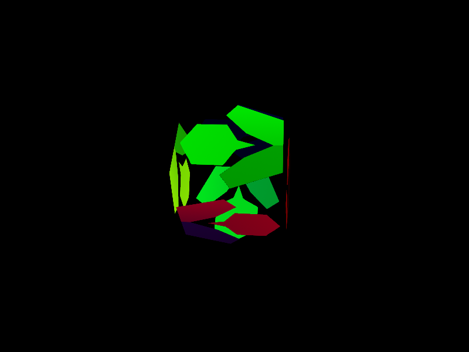

# SFML 官方示例

[English](README.md) · **简体中文** · [日本語](README.ja.md) · [한국어](README.ko.md)

[SFML 官方示例][upstream] 的 JavaScript 移植，包含图形、原生窗口、输入、音频和网络等 24 个示例。[Android](android/README.md) 尚未移植。

[全部示例](../README.zh-CN.md) · [构建要求](../../docs/getting-started.zh-CN.md#requirements) · [功能示例](../features/README.zh-CN.md) · [游戏与应用](../projects/README.zh-CN.md)

## 快速开始

在仓库根目录执行：

```sh
npm ci
cd examples/official
node tennis/Tennis.cjs
```

下文命令均在 `examples/official` 中运行，各脚本会自动加载所需资源。图形示例需要显示服务与 OpenGL 窗口支持。

浏览：[图形](#graphics) · [输入与事件](#input) · [音频](#audio) · [网络](#network) · [平台集成](#platform)

<a id="graphics"></a>

## 图形

<div class="example-gallery">
  <article class="example-entry" id="island">
    <a href="screenshots/island.png">
      
    </a>
    <div class="example-info">
      <p><strong><a href="island/Island.cjs">Island</a></strong></p>
      <p>地形与光照</p>
      <p><strong>操作</strong> · 方向键修改参数，Enter 重新生成</p>
      <p><code>node island/Island.cjs</code></p>
    </div>
  </article>
  <article class="example-entry" id="shader">
    <a href="screenshots/shader.png">
      
    </a>
    <div class="example-info">
      <p><strong><a href="shader/Shader.cjs">Shader</a></strong></p>
      <p>五种 shader 场景</p>
      <p><a href="screenshots/shader-edge.png">sfml.js 标识的边缘检测预览</a></p>
      <p><strong>操作</strong> · 左／右切换，鼠标调整参数</p>
      <p><code>node shader/Shader.cjs</code></p>
    </div>
  </article>
  <article class="example-entry" id="tennis">
    <a href="screenshots/tennis.png">
      
    </a>
    <div class="example-info">
      <p><strong><a href="tennis/Tennis.cjs">Tennis</a></strong></p>
      <p>乒乓球</p>
      <p><strong>操作</strong> · Space 或触摸开始，上／下移动，Esc 退出</p>
      <p><code>node tennis/Tennis.cjs</code></p>
    </div>
  </article>
  <article class="example-entry" id="stencil">
    <a href="screenshots/stencil.png">
      
    </a>
    <div class="example-info">
      <p><strong><a href="stencil/Stencil.cjs">Stencil</a></strong></p>
      <p>模板遮罩与图形动画</p>
      <p><code>node stencil/Stencil.cjs</code></p>
    </div>
  </article>
  <article class="example-entry" id="text">
    <a href="screenshots/text.png">
      
    </a>
    <div class="example-info">
      <p><strong><a href="text/Text.cjs">Text</a></strong></p>
      <p>40 个多语言样本</p>
      <p><strong>操作</strong> · 点击选择，F1／F2／F3 切换边框和光标，F4 切换预处理，左／右移动光标</p>
      <p><code>node text/Text.cjs</code></p>
    </div>
  </article>
</div>

<a id="input"></a>

## 输入与事件

<div class="example-gallery">
  <article class="example-entry" id="keyboard">
    <a href="screenshots/keyboard.png">
      
    </a>
    <div class="example-info">
      <p><strong><a href="keyboard/Keyboard.cjs">Keyboard</a></strong></p>
      <p>物理键位、按键事件、文字输入与声音反馈</p>
      <p><code>node keyboard/Keyboard.cjs</code></p>
    </div>
  </article>
  <article class="example-entry" id="event-handling">
    <a href="screenshots/event_handling.png">
      
    </a>
    <div class="example-info">
      <p><strong><a href="event_handling/EventHandling.cjs">Event handling</a></strong></p>
      <p>五种事件分发形式</p>
      <p><strong>操作</strong> · Enter 切换</p>
      <p><code>node event_handling/EventHandling.cjs</code></p>
    </div>
  </article>
  <article class="example-entry" id="raw-input">
    <a href="screenshots/raw_input.png">
      
    </a>
    <div class="example-info">
      <p><strong><a href="raw_input/RawInput.cjs">Raw input</a></strong></p>
      <p>鼠标原始移动输入</p>
      <p><code>node raw_input/RawInput.cjs</code></p>
    </div>
  </article>
  <article class="example-entry" id="joystick">
    <a href="screenshots/joystick.png">
      
    </a>
    <div class="example-info">
      <p><strong><a href="joystick/Joystick.cjs">Joystick</a></strong></p>
      <p>摇杆轴与按键</p>
      <p><strong>操作</strong> · 0～7 选择设备，Tab 切换通用／游戏手柄视图</p>
      <p><code>node joystick/Joystick.cjs</code></p>
    </div>
  </article>
</div>

<a id="audio"></a>

## 音频

录音示例需要麦克风及系统录音权限。

<div class="example-gallery">
  <article class="example-entry" id="sound-effects">
    <a href="screenshots/sound_effects.png">
      
    </a>
    <div class="example-info">
      <p><strong><a href="sound_effects/SoundEffects.cjs">Sound effects</a></strong></p>
      <p>九种音效</p>
      <p><strong>操作</strong> · 左／右切换，鼠标调整，上／下选择衰减模型或波形，Space 旁路 DSP，F1 切换输出设备</p>
      <p><code>node sound_effects/SoundEffects.cjs</code></p>
    </div>
  </article>
</div>

<div class="example-gallery">
  <article class="example-entry" id="sound">
    <div class="example-info">
      <p><strong><a href="sound/Sound.cjs">Sound</a></strong></p>
      <p>播放 WAV 音效及 OGG、FLAC、MP3 音乐</p>
      <p><code>node sound/Sound.cjs</code></p>
    </div>
  </article>
  <article class="example-entry" id="sound-capture">
    <div class="example-info">
      <p><strong><a href="sound_capture/SoundCapture.cjs">Sound capture</a></strong></p>
      <p>选择设备与采样率，录音后播放或保存</p>
      <p><code>node sound_capture/SoundCapture.cjs</code></p>
    </div>
  </article>
  <article class="example-entry" id="sound-device">
    <div class="example-info">
      <p><strong><a href="sound_device/SoundDevice.cjs">Sound device</a></strong></p>
      <p>设备通知、自动路由与设备丢失恢复；Ctrl+C 退出</p>
      <p><code>node sound_device/SoundDevice.cjs</code></p>
    </div>
  </article>
</div>

<a id="network"></a>

## 网络

<div class="example-gallery">
  <article class="example-entry" id="http">
    <div class="example-info">
      <p><strong><a href="http/Http.cjs">HTTP</a></strong></p>
      <p>带重定向处理的交互式 HTTP GET</p>
      <p><code>node http/Http.cjs</code></p>
    </div>
  </article>
  <article class="example-entry" id="ftp">
    <div class="example-info">
      <p><strong><a href="ftp/Ftp.cjs">FTP</a></strong></p>
      <p>交互式 FTP 客户端，端口 21</p>
      <p><code>node ftp/Ftp.cjs</code></p>
    </div>
  </article>
  <article class="example-entry" id="sftp">
    <div class="example-info">
      <p><strong><a href="sftp/Sftp.cjs">SFTP</a></strong></p>
      <p>交互式 SFTP 客户端；先确认主机指纹，再登录</p>
      <p><code>node sftp/Sftp.cjs</code></p>
    </div>
  </article>
  <article class="example-entry" id="sockets">
    <div class="example-info">
      <p><strong><a href="sockets/Sockets.cjs">Sockets</a></strong></p>
      <p>TCP、TLS 或 UDP 消息交换，端口 50001</p>
      <p><code>node sockets/Sockets.cjs</code></p>
    </div>
  </article>
  <article class="example-entry" id="voip">
    <div class="example-info">
      <p><strong><a href="voip/VoIP.cjs">VoIP</a></strong></p>
      <p>TCP 语音采集、播放和回放，端口 2435</p>
      <p><code>node voip/VoIP.cjs</code></p>
    </div>
  </article>
</div>

sockets 和 VoIP 各开两个终端，分别选择服务端、客户端；本机测试填写 `127.0.0.1`。

<a id="platform"></a>

## 平台集成

编译 nodegl 需要 CMake、C++ 编译器和 OpenGL 开发库，Linux 可安装 `libgl1-mesa-dev`。Vulkan 还需要 Vulkan 加载器和支持 4 倍各向异性过滤的驱动。

<div class="example-gallery">
  <article class="example-entry" id="window">
    <a href="screenshots/window.png">
      
    </a>
    <div class="example-info">
      <p><strong><a href="window/Window.cjs">Window</a></strong></p>
      <p>OpenGL 窗口中的六色旋转立方体</p>
      <p><strong>操作</strong> · 拖动窗口边缘调整大小，Esc 或关闭窗口退出</p>
      <p><code>node window/Window.cjs</code></p>
      <p>macOS、Linux、Windows · 根目录的 <code>npm ci</code> 会安装 <code>@wettstein/nodegl</code></p>
    </div>
  </article>
  <article class="example-entry" id="opengl">
    <a href="screenshots/opengl.png">
      
    </a>
    <div class="example-info">
      <p><strong><a href="opengl/OpenGL.cjs">OpenGL</a></strong></p>
      <p>SFML 背景、文字与 OpenGL 纹理立方体混合绘制</p>
      <p><strong>操作</strong> · 鼠标移动立方体，Enter 切换 mipmap，Space 切换 sRGB，Esc 退出</p>
      <p><code>node opengl/OpenGL.cjs</code></p>
      <p>macOS、Linux、Windows · 根目录的 <code>npm ci</code> 会安装 <code>@wettstein/nodegl</code></p>
    </div>
  </article>
  <article class="example-entry" id="vulkan">
    <a href="screenshots/vulkan.png">
      
    </a>
    <div class="example-info">
      <p><strong><a href="vulkan/Vulkan.cjs">Vulkan</a></strong></p>
      <p>Vulkan 渲染的旋转纹理立方体</p>
      <p><strong>操作</strong> · 鼠标移动立方体，拖动窗口边缘调整大小，Esc 或关闭窗口退出</p>
      <p><code>node vulkan/Vulkan.cjs</code></p>
      <p>Linux x64（X11）或 Windows x64、Node.js 20+ · <code>npm ci --prefix vulkan --ignore-scripts</code></p>
      <p>Vulkan 面向 x64 的 Linux／X11 和 Windows，使用 <code>nvk</code> 0.8.0，需要 Vulkan 加载器及支持 4 倍各向异性过滤的驱动与设备。SFML 负责窗口、事件和 surface，nvk 直接调用 Vulkan，无自定义原生桥接；SFML Graphics 仍使用 OpenGL。SFML 在编译期不支持 macOS Vulkan 集成，仅安装 MoltenVK 无法启用。Linux／X11 和 Windows 的原生绘制及交互验证均已通过。操作与要求见 <a href="#platform">平台集成说明</a>。</p>
    </div>
  </article>
  <article class="example-entry" id="cocoa">
    <a href="screenshots/cocoa.png">
      
    </a>
    <div class="example-info">
      <p><strong><a href="cocoa/Cocoa.cjs">Cocoa</a></strong></p>
      <p>macOS 原生控件与嵌入的 SFML 视图</p>
      <p><strong>操作</strong> · Update 或 Enter 更新文字，Visible 切换标识显隐，旋钮控制旋转，Color 选择背景色，Up／Down 缩放；关闭窗口、Cmd+Q 或 Ctrl+C 退出</p>
      <p><code>node cocoa/Cocoa.cjs</code></p>
      <p>macOS · <code>npm ci --prefix cocoa --ignore-scripts</code></p>
    </div>
  </article>
  <article class="example-entry" id="win32">
    <a href="screenshots/win32.png">
      
    </a>
    <div class="example-info">
      <p><strong><a href="win32/Win32.cjs">Win32</a></strong></p>
      <p>Windows 原生窗口中的两个 SFML 动画视图与 Quit 按钮</p>
      <p><strong>操作</strong> · Quit、关闭窗口或 Ctrl+C 退出</p>
      <p><code>node win32/Win32.cjs</code></p>
      <p>Windows x64、Node.js 20+ · <code>npm ci --prefix win32 --ignore-scripts</code></p>
    </div>
  </article>
  <article class="example-entry" id="x11">
    <a href="screenshots/x11.png">
      
    </a>
    <div class="example-info">
      <p><strong><a href="X11/X11.cjs">X11</a></strong></p>
      <p>两个嵌入的 SFML 窗口，以不同速度旋转的立方体</p>
      <p><strong>操作</strong> · 任意键、关闭窗口或 Ctrl+C 退出</p>
      <p><code>node X11/X11.cjs</code></p>
      <p>带 X11 显示服务的 Linux · 根目录的 <code>npm ci</code> 会安装 <code>x11</code> 和 <code>@wettstein/nodegl</code></p>
    </div>
  </article>
</div>

## 来源与许可证

示例移植自 [SFML][upstream]，源码版本与资源来源记录在 [provenance.json](provenance.json)。

- SFML 源码：[zlib 许可证](SFML-LICENSE.md)。
- 上游素材与作者：[asset_licenses.md](asset_licenses.md)。
- Noto 字体：[SIL Open Font License 1.1](text/resources/OFL.txt)。
- 移植的 stb Perlin 实现：[MIT／公有领域双许可证](island/stb_perlin.LICENSE)。

[upstream]: https://github.com/SFML/SFML/tree/14cea1d978b3dce05780b9234925ca8be9373260/examples
