# ゲームとアプリ

[English](README.md) / [简体中文](README.zh-CN.md) / **日本語** / [한국어](README.ko.md)

> Breakout はこのリポジトリで実行します。他は独立したリポジトリまたは npm パッケージです。各節で示す作業ディレクトリを使ってください。すべてグラフィカルセッションとネイティブビルド要件を満たす環境が必要です。依存バージョンは sfml.js のリリースと独立しています。

[概要](../README.ja.md) · [機能サンプル](../features/README.ja.md) · [公式サンプル](../official/README.ja.md)

<a id="game-projects"></a>

<a id="super-mario-kart"></a>

## Süper Mario Kart

[super-mario-kart-sfml.js](https://github.com/XadillaX/super-mario-kart-sfml.js) は、C++ と SFML 2.5.1 で書かれた [vmbatlle/super-mario-kart](https://github.com/vmbatlle/super-mario-kart) の **TypeScript + sfml.js** 移植版です。54 個の TypeScript モジュールが元のソース構成に対応し、Mode 7 描画、ゲームロジック、AI、素材を引き継いでいます。

プロジェクトを置くディレクトリに独立したリポジトリをクローンし、そのルートでインストールして起動します。

```sh
git clone https://github.com/XadillaX/super-mario-kart-sfml.js.git
cd super-mario-kart-sfml.js
npm install
npm start
```

Node.js 20.5 以降、音声出力のあるグラフィカルデスクトップと[ネイティブビルド要件](../../docs/getting-started.ja.md#requirements)を満たす環境が必要です。依存は `sfml.js@1.0.0-rc.2` と `typescript@7.0.2` に固定されています。`npm start` は `dist/` にコンパイルしてネイティブゲームを起動します。Python のコース制作ツールは任意で、プレイには不要です。

<div class="example-gallery">
  <article class="example-entry" id="super-mario-kart-game">
    <a href="../../assets/examples/projects/super-mario-kart.webp">
      
    </a>
    <div class="example-info">
      <p><strong><a href="https://github.com/XadillaX/super-mario-kart-sfml.js">Süper Mario Kart</a></strong></p>
      <p>8 人のドライバー、5 コース、50cc・100cc・150cc を用意。Grand Prix は全 5 コース、Versus は単一コースで競います。どちらも人間 1 人と AI 7 人の対戦で、ドリフト、ジャンプ、コイン、アイテムを使用できます。</p>
      <p><strong>操作</strong> · X で加速、Z でブレーキ、C でジャンプ／ドリフト、左右で操舵、上下で前方／後方にアイテムを使用。Enter でメニュー決定／コース紹介をスキップ、Esc で一時停止。一時停止メニューで No を選び Enter を押すと再開、Yes でリタイアします。</p>
      <p><code>super-mario-kart-sfml.js/</code> で <code>npm install</code>、続いて <code>npm start</code> を実行します。Controls と Settings メニューでキー、音量、解像度を設定できます。</p>
      <p><a href="https://github.com/XadillaX/super-mario-kart-sfml.js/tree/HEAD/src">TypeScript ソース</a> · <a href="https://github.com/vmbatlle/super-mario-kart">元の C++ ソース</a></p>
    </div>
  </article>
</div>

コースは Donut Plains 1、Mario Circuit 2、Ghost Valley 1、Bowser Castle 1、Rainbow Road です。コードは [GPL v3](https://github.com/XadillaX/super-mario-kart-sfml.js/blob/HEAD/LICENSE)。キャラクター、画像、音楽の権利は Nintendo に帰属します。非公式の教育目的のファンプロジェクトです。

<a id="play-nes"></a>

## play-nes

Node.js 22 を推奨します。ネイティブ拡張には Python と C++20 コンパイラーが必要です。音声出力のあるグラフィカルデスクトップで実行してください。公開済みのプレイヤーを導入し、同梱の Concentration Room または利用権限のあるローカル ROM を開きます。

```sh
npm install -g play-nes
nes croom
nes "/path/to/your game.nes"
```

<div class="example-gallery">
  <article class="example-entry" id="play-nes-player">
    <a href="../../assets/examples/projects/play-nes.webp">
      
    </a>
    <div class="example-info">
      <p><strong><a href="https://github.com/XadillaX/play-nes">play-nes</a></strong></p>
      <p>TypeScript 製のデスクトップ NES エミュレーター。JSNES でエミュレーションし、sfml.js でネイティブ描画と音声を扱います。画像のゲームは Concentration Room です。</p>
      <p><strong>操作</strong> · プレイヤー 1 は WASD、A／B は J／K、Select は右 Shift、Start は Enter。プレイヤー 2 は矢印、A／B はテンキー 5／6、Select／Start はテンキー 8／9。Esc またはウィンドウを閉じて終了。フォーカスを失うと押下状態を解除します。</p>
      <p><code>--scale 3</code> で倍率を変更し、<code>--frameRate 60</code> で通常速度にします。フレームレートは描画だけでなくエミュレーション速度も変えます。全オプションは <code>nes --help</code> を参照してください。</p>
    </div>
  </article>
</div>

<a id="breakout"></a>

## ブロック崩しで遊ぶ

sfml.js リポジトリのルートで初回に `npm ci`、続いて `node examples/breakout.cjs` を実行します。ソース変更後は `npm run build` を実行してください。

<div class="example-gallery">
  <article class="example-entry" id="breakout-game">
    <a href="../../assets/breakout.png">
      
    </a>
    <div class="example-info">
      <p><a href="../breakout.cjs">breakout.cjs</a> は衝突判定、3 つのライフ、スコア、勝敗判定を備えたゲームです。左右キーまたは A／D で移動、Space で発射または再開、P で一時停止、Esc で終了します。操作中にフォーカスを失うと一時停止します。</p>
    </div>
  </article>
</div>

`npm run demo:breakout` でビルドして起動できます。macOS／Linux では次のコマンドで同じゲーム画面を撮影できます。

```sh
SFML_DEMO_SNAPSHOT=/tmp/sfml-breakout.png \
  node examples/breakout.cjs --autoplay --frames=1500
```

最後のフレームの実際の描画結果を保存します。`--autoplay` はパドルを自動操作し、`--frames` は実行フレーム数を制限します。`node examples/breakout.cjs --self-test` はウィンドウを開かずにゲームロジックを検証します。

<a id="node-sfml-demos"></a>

## node-sfml-demos

[node-sfml-demos](https://github.com/XadillaX/node-sfml-demos) には、sfml.js で実装した Bomberman、Breakout、Tetris、Doodle Jump、Arkanoid が含まれています。

プロジェクトを置くディレクトリで、この独立したリポジトリをクローンしてください。各ゲームのディレクトリで依存関係をインストールし、起動します。Bomberman の場合：

```sh
git clone https://github.com/XadillaX/node-sfml-demos.git
cd node-sfml-demos/bomberman
npm install
node index.js
```

ゲームごとのディレクトリ、操作方法、元の C++ ソースコードは[リポジトリの README](https://github.com/XadillaX/node-sfml-demos#readme)を参照してください。[ネイティブビルドの要件](../../docs/getting-started.ja.md#requirements)も適用されます。

Node.js 22、Python 3、C++20 ツールチェーンを使います。各ゲームのディレクトリで `npm install`、続いて `node index.js` を実行してください。一部がフォントと画像を共有するため、リポジトリ全体を保持してください。各ゲームは `sfml.js@1.0.0-rc.2` に固定されており、このページによる更新はありません。すべて閉じるボタンに対応し、Bomberman は音声も使います。Tetris、Doodle Jump、Arkanoid は原型の未完成のゲーム処理を保持しています。

<div class="example-gallery">
  <article class="example-entry" id="demo-bomberman">
    <a href="../../assets/examples/projects/node-sfml-demos/bomberman.webp">
      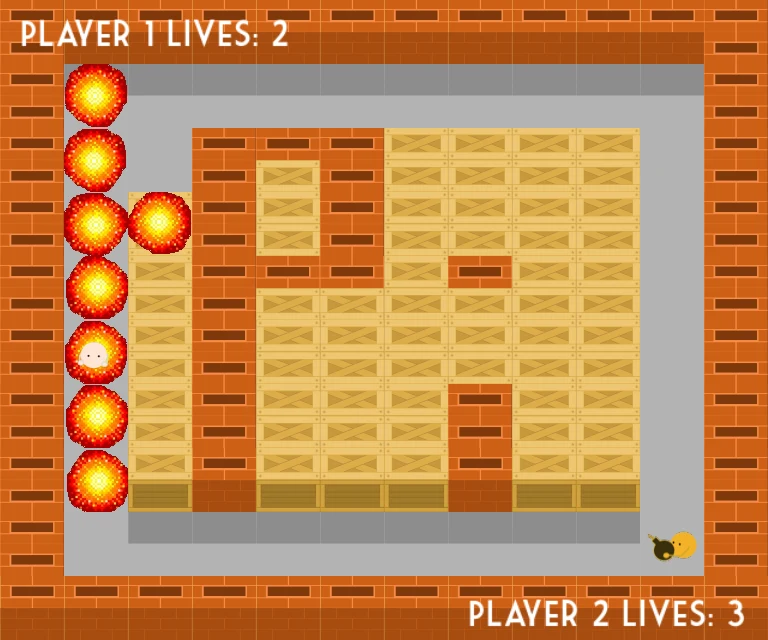
    </a>
    <div class="example-info">
      <p><strong><a href="https://github.com/XadillaX/node-sfml-demos/tree/HEAD/bomberman">Bomberman</a></strong></p>
      <p>タイル状のフィールドで遊ぶ 2 人用 Bomberman。</p>
      <p><strong>操作</strong> · プレイヤー 1 は WASD と左 Ctrl で爆弾、プレイヤー 2 は矢印と Space で爆弾。マウスでメニュー操作、Esc で一時停止／再開。</p>
      <p>実行ディレクトリ: <code>node-sfml-demos/bomberman/</code></p>
      <p><code>npm install</code><br><code>node index.js</code></p>
      <p><a href="https://github.com/PiGames/Bomberman">元の C++ ソース</a></p>
    </div>
  </article>
  <article class="example-entry" id="demo-breakout">
    <a href="../../assets/examples/projects/node-sfml-demos/breakout.webp">
      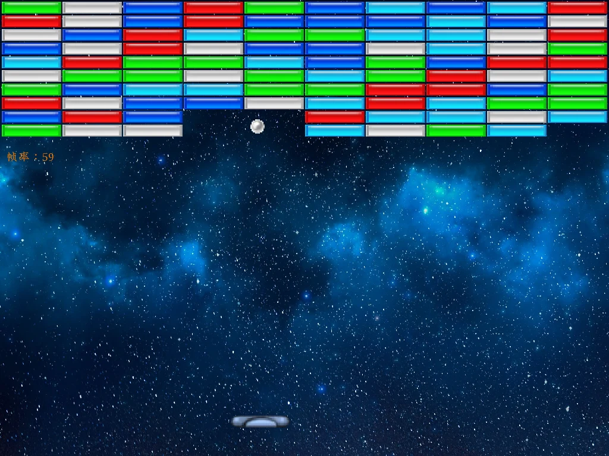
    </a>
    <div class="example-info">
      <p><strong><a href="https://github.com/XadillaX/node-sfml-demos/tree/HEAD/breakout">Breakout</a></strong></p>
      <p>星空を背景にしたブロック崩し。</p>
      <p><strong>操作</strong> · A／D または左右で移動と発射。Space でも発射し、失敗後に Space を離すとリセット。Esc で終了。</p>
      <p>実行ディレクトリ: <code>node-sfml-demos/breakout/</code></p>
      <p><code>npm install</code><br><code>node index.js</code></p>
    </div>
  </article>
  <article class="example-entry" id="demo-tetris">
    <a href="../../assets/examples/projects/node-sfml-demos/tetris.webp">
      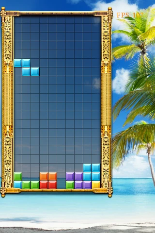
    </a>
    <div class="example-info">
      <p><strong><a href="https://github.com/XadillaX/node-sfml-demos/tree/HEAD/tetris">Tetris</a></strong></p>
      <p>金色の枠の中で落下するブロック。</p>
      <p><strong>操作</strong> · 左右で移動、上で回転、下で落下を加速。</p>
      <p>実行ディレクトリ: <code>node-sfml-demos/tetris/</code></p>
      <p><code>npm install</code><br><code>node index.js</code></p>
      <p><a href="https://github.com/jsyqrt/games/blob/master/01%20Tetris/main.cpp">元の C++ ソース</a></p>
    </div>
  </article>
  <article class="example-entry" id="demo-doodle-jump">
    <a href="../../assets/examples/projects/node-sfml-demos/doodle-jump.webp">
      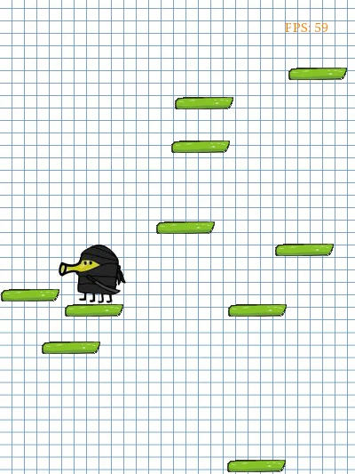
    </a>
    <div class="example-info">
      <p><strong><a href="https://github.com/XadillaX/node-sfml-demos/tree/HEAD/doodle_jump">Doodle Jump</a></strong></p>
      <p>緑の足場の間をジャンプ。</p>
      <p><strong>操作</strong> · 左右で移動。ジャンプは自動。</p>
      <p>実行ディレクトリ: <code>node-sfml-demos/doodle_jump/</code></p>
      <p><code>npm install</code><br><code>node index.js</code></p>
      <p><a href="https://github.com/jsyqrt/games/blob/master/02%20Doodle%20Jump/main.cpp">元の C++ ソース</a></p>
    </div>
  </article>
  <article class="example-entry" id="demo-arkanoid">
    <a href="../../assets/examples/projects/node-sfml-demos/arkanoid.webp">
      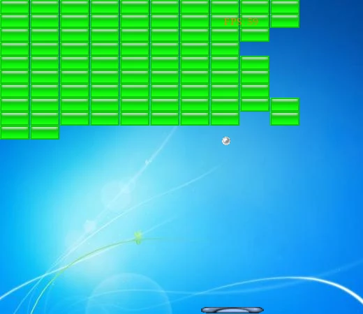
    </a>
    <div class="example-info">
      <p><strong><a href="https://github.com/XadillaX/node-sfml-demos/tree/HEAD/arkanoid">Arkanoid</a></strong></p>
      <p>緑のブロックを崩す小さなゲーム。</p>
      <p><strong>操作</strong> · 左右でパドル移動。ボールは自動で動き始めます。</p>
      <p>実行ディレクトリ: <code>node-sfml-demos/arkanoid/</code></p>
      <p><code>npm install</code><br><code>node index.js</code></p>
      <p><a href="https://github.com/jsyqrt/games/blob/master/03%20Arkanoid/main.cpp">元の C++ ソース</a></p>
    </div>
  </article>
</div>

<a id="16-games"></a>

## ClojureScript で遊ぶ 16 ゲーム

[16-sfml.js-games-ported](https://github.com/XadillaX/16-sfml.js-games-ported) は [jsyqrt/games](https://github.com/jsyqrt/games) のフォークです。元の 16 ゲームは **C++ と SFML** で作られています。このフォークでは全作品を **ClojureScript と sfml.js** に移植し、元のディレクトリ構成、素材、ゲームロジック、操作方法を保持しています。

**nbb** を使って Node.js 上で実行するため、JVM や個別のコンパイルは不要です。プロジェクトを置くディレクトリにゲームリポジトリをクローンし、そのルートから起動してください。

```sh
git clone https://github.com/XadillaX/16-sfml.js-games-ported.git
cd 16-sfml.js-games-ported
npm ci
npx nbb "01 Tetris/main.cljs"
```

Node.js 20.5 以降、[ネイティブビルドの要件](../../docs/getting-started.ja.md#requirements)を満たす環境、OpenGL ウィンドウに対応するグラフィカルセッションが必要です。依存関係は `sfml.js@1.0.0-rc.2` と `nbb@1.6.214` に固定されています。各スクリプトは自身のディレクトリを基準に素材を読み込みます。

<div class="example-gallery">
  <article class="example-entry" id="01-tetris">
    <a href="../../assets/examples/projects/16-games/01-tetris.webp">
      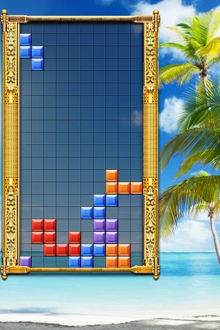
    </a>
    <div class="example-info">
      <p><strong><a href="https://github.com/XadillaX/16-sfml.js-games-ported/blob/HEAD/01%20Tetris/main.cljs">01 · Tetris</a></strong></p>
      <p>落下するブロックとライン消去</p>
      <p><strong>操作</strong> · 左右で移動、上で回転、下で落下を加速</p>
      <p><code>npx nbb &quot;01 Tetris/main.cljs&quot;</code></p>
    </div>
  </article>
  <article class="example-entry" id="02-doodle-jump">
    <a href="../../assets/examples/projects/16-games/02-doodle-jump.webp">
      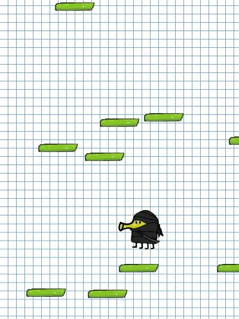
    </a>
    <div class="example-info">
      <p><strong><a href="https://github.com/XadillaX/16-sfml.js-games-ported/blob/HEAD/02%20Doodle%20Jump/main.cljs">02 · Doodle Jump</a></strong></p>
      <p>スクロールする足場の間をジャンプ</p>
      <p><strong>操作</strong> · 左右で移動、ジャンプは自動</p>
      <p><code>npx nbb &quot;02 Doodle Jump/main.cljs&quot;</code></p>
    </div>
  </article>
  <article class="example-entry" id="03-arkanoid">
    <a href="../../assets/examples/projects/16-games/03-arkanoid.webp">
      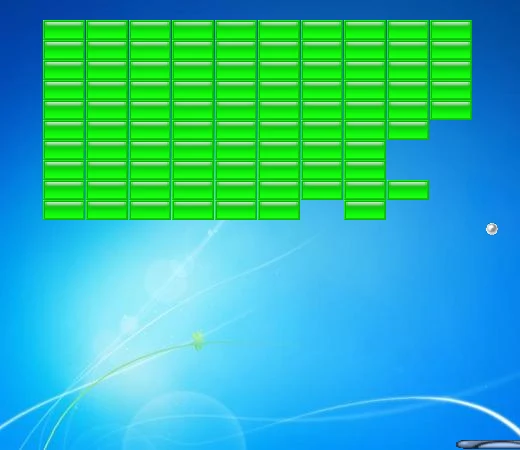
    </a>
    <div class="example-info">
      <p><strong><a href="https://github.com/XadillaX/16-sfml.js-games-ported/blob/HEAD/03%20Arkanoid/main.cljs">03 · Arkanoid</a></strong></p>
      <p>跳ね返るボールでブロックを壊す</p>
      <p><strong>操作</strong> · 左右でパドルを移動</p>
      <p><code>npx nbb &quot;03 Arkanoid/main.cljs&quot;</code></p>
    </div>
  </article>
  <article class="example-entry" id="04-snake">
    <a href="../../assets/examples/projects/16-games/04-snake.webp">
      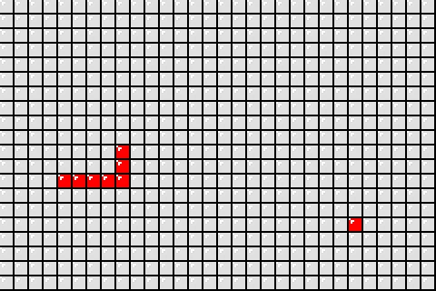
    </a>
    <div class="example-info">
      <p><strong><a href="https://github.com/XadillaX/16-sfml.js-games-ported/blob/HEAD/04%20Snake/main.cljs">04 · Snake</a></strong></p>
      <p>食べ物を集めて成長</p>
      <p><strong>操作</strong> · 矢印キーで方向変更</p>
      <p><code>npx nbb &quot;04 Snake/main.cljs&quot;</code></p>
    </div>
  </article>
  <article class="example-entry" id="05-minesweeper">
    <a href="../../assets/examples/projects/16-games/05-minesweeper.webp">
      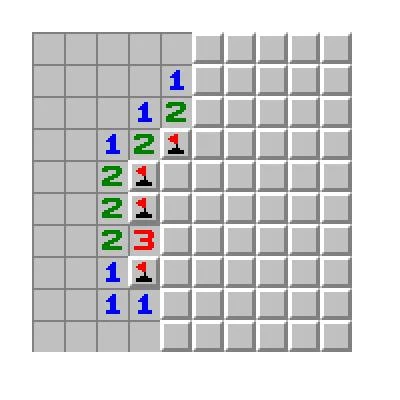
    </a>
    <div class="example-info">
      <p><strong><a href="https://github.com/XadillaX/16-sfml.js-games-ported/blob/HEAD/05%20Minesweeper/main.cljs">05 · Minesweeper</a></strong></p>
      <p>マスを開いて地雷をマーク</p>
      <p><strong>操作</strong> · 左クリックで開く、右クリックで旗</p>
      <p><code>npx nbb &quot;05 Minesweeper/main.cljs&quot;</code></p>
    </div>
  </article>
  <article class="example-entry" id="06-fifteen-puzzle">
    <a href="../../assets/examples/projects/16-games/06-fifteen-puzzle.webp">
      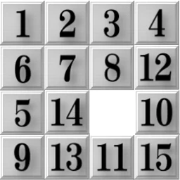
    </a>
    <div class="example-info">
      <p><strong><a href="https://github.com/XadillaX/16-sfml.js-games-ported/blob/HEAD/06%20Fifteen-Puzzle/main.cljs">06 · Fifteen-Puzzle</a></strong></p>
      <p>4 × 4 のスライドパズル</p>
      <p><strong>操作</strong> · 空白に隣接するタイルをクリックして移動</p>
      <p><code>npx nbb &quot;06 Fifteen-Puzzle/main.cljs&quot;</code></p>
    </div>
  </article>
  <article class="example-entry" id="07-racing-top-down">
    <a href="../../assets/examples/projects/16-games/07-racing-top-down.webp">
      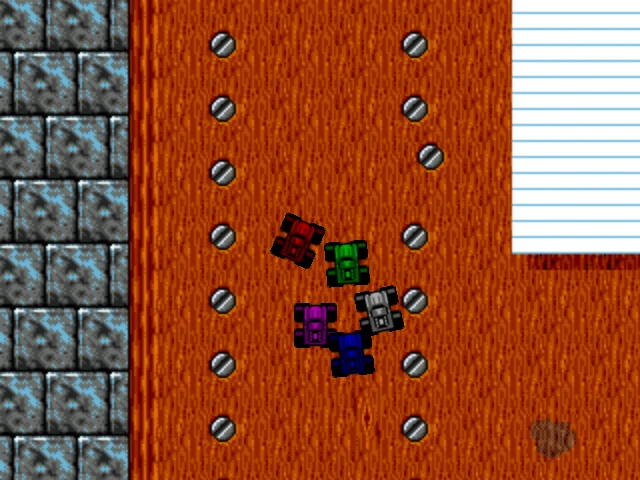
    </a>
    <div class="example-info">
      <p><strong><a href="https://github.com/XadillaX/16-sfml.js-games-ported/blob/HEAD/07%20Racing%20%28Top%20Down%29/main.cljs">07 · Racing (Top Down)</a></strong></p>
      <p>コンピューターの車と競走</p>
      <p><strong>操作</strong> · 上で加速、下でブレーキ／後退、左右で操舵</p>
      <p><code>npx nbb &quot;07 Racing (Top Down)/main.cljs&quot;</code></p>
    </div>
  </article>
  <article class="example-entry" id="08-outrun">
    <a href="../../assets/examples/projects/16-games/08-outrun.webp">
      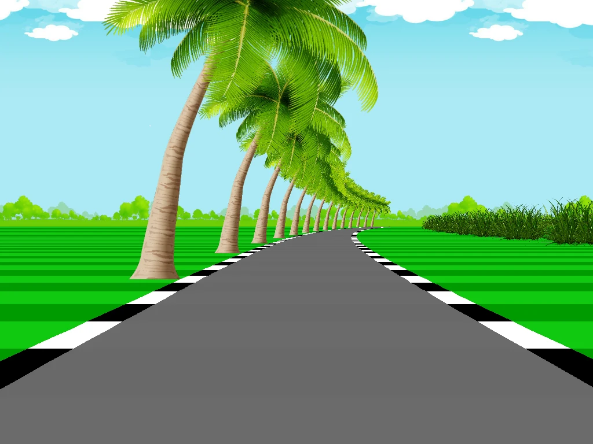
    </a>
    <div class="example-info">
      <p><strong><a href="https://github.com/XadillaX/16-sfml.js-games-ported/blob/HEAD/08%20Outrun/main.cljs">08 · Outrun</a></strong></p>
      <p>遠近感のある道路、カーブと沿道の風景</p>
      <p><strong>操作</strong> · 左右で操舵、上下で前進／後退、Tab で加速、W／S でカメラの高さ変更</p>
      <p><code>npx nbb &quot;08 Outrun/main.cljs&quot;</code></p>
    </div>
  </article>
  <article class="example-entry" id="09-xonix">
    <a href="../../assets/examples/projects/16-games/09-xonix.webp">
      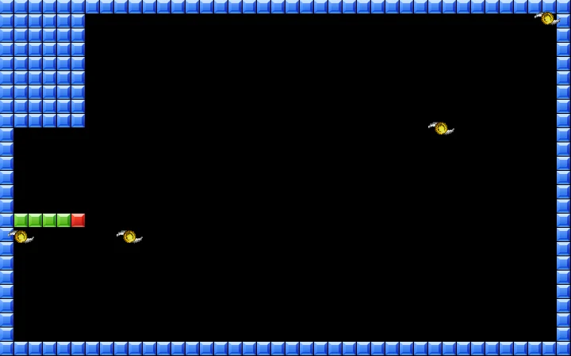
    </a>
    <div class="example-info">
      <p><strong><a href="https://github.com/XadillaX/16-sfml.js-games-ported/blob/HEAD/09%20Xonix/main.cljs">09 · Xonix</a></strong></p>
      <p>敵を避けて領域を囲む</p>
      <p><strong>操作</strong> · 矢印で移動、Esc で盤面をリセット</p>
      <p><code>npx nbb &quot;09 Xonix/main.cljs&quot;</code></p>
    </div>
  </article>
  <article class="example-entry" id="10-bejeweled">
    <a href="../../assets/examples/projects/16-games/10-bejeweled.webp">
      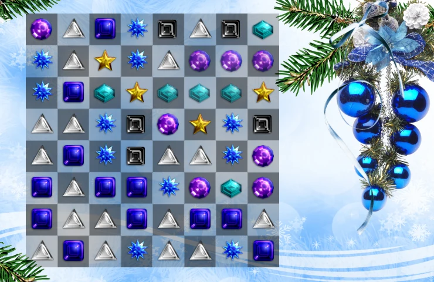
    </a>
    <div class="example-info">
      <p><strong><a href="https://github.com/XadillaX/16-sfml.js-games-ported/blob/HEAD/10%20Bejeweled/main.cljs">10 · Bejeweled</a></strong></p>
      <p>隣り合う宝石を交換して揃える</p>
      <p><strong>操作</strong> · 隣接する 2 つの宝石をクリックして交換</p>
      <p><code>npx nbb &quot;10 Bejeweled/main.cljs&quot;</code></p>
    </div>
  </article>
  <article class="example-entry" id="11-netwalk">
    <a href="../../assets/examples/projects/16-games/11-netwalk.webp">
      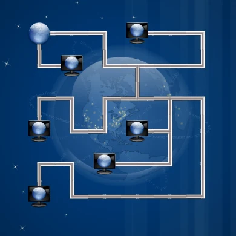
    </a>
    <div class="example-info">
      <p><strong><a href="https://github.com/XadillaX/16-sfml.js-games-ported/blob/HEAD/11%20NetWalk%20%28Pipe%20Puzzle%29/main.cljs">11 · NetWalk (Pipe Puzzle)</a></strong></p>
      <p>コンピューターをサーバーにつなぐ</p>
      <p><strong>操作</strong> · パイプをクリックして回転</p>
      <p><code>npx nbb &quot;11 NetWalk (Pipe Puzzle)/main.cljs&quot;</code></p>
    </div>
  </article>
  <article class="example-entry" id="12-mahjong-solitaire">
    <a href="../../assets/examples/projects/16-games/12-mahjong-solitaire.webp">
      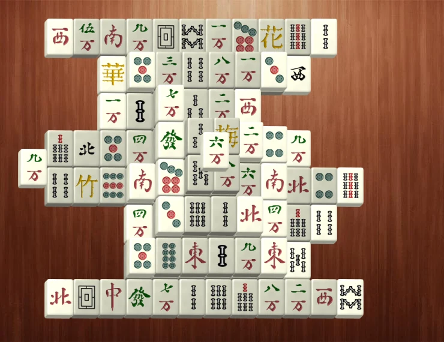
    </a>
    <div class="example-info">
      <p><strong><a href="https://github.com/XadillaX/16-sfml.js-games-ported/blob/HEAD/12%20Mahjong%20Solitaire/main.cljs">12 · Mahjong Solitaire</a></strong></p>
      <p>選択できる同じ牌のペアを取り除く</p>
      <p><strong>操作</strong> · 左クリックでペア選択、右クリックで取り消し</p>
      <p><code>npx nbb &quot;12 Mahjong Solitaire/main.cljs&quot;</code></p>
    </div>
  </article>
  <article class="example-entry" id="13-tron">
    <a href="../../assets/examples/projects/16-games/13-tron.webp">
      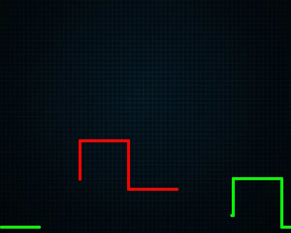
    </a>
    <div class="example-info">
      <p><strong><a href="https://github.com/XadillaX/16-sfml.js-games-ported/blob/HEAD/13%20Tron/main.cljs">13 · Tron</a></strong></p>
      <p>2 人で光の軌跡を競う</p>
      <p><strong>操作</strong> · 赤は矢印キー、緑は W／A／S／D</p>
      <p><code>npx nbb &quot;13 Tron/main.cljs&quot;</code></p>
    </div>
  </article>
  <article class="example-entry" id="14-chess">
    <a href="../../assets/examples/projects/16-games/14-chess.webp">
      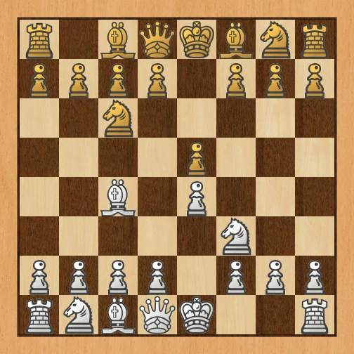
    </a>
    <div class="example-info">
      <p><strong><a href="https://github.com/XadillaX/16-sfml.js-games-ported/blob/HEAD/14%20Chess/main.cljs">14 · Chess</a></strong></p>
      <p>駒をドラッグできる盤面と外部 Stockfish エンジン</p>
      <p><strong>操作</strong> · 駒をドラッグ、Space でエンジンの手を要求、Backspace で取り消し</p>
      <p><code>npx nbb &quot;14 Chess/main.cljs&quot; /path/to/stockfish</code></p>
      <p>OS に合う <a href="https://github.com/official-stockfish/Stockfish/releases">Stockfish 実行ファイル</a>を別途導入し、展開した実行ファイルのパスを渡してください。エンジンは同梱されていません。Windows では main.cljs の隣に stockfish.exe を置くと引数なしでも起動できます。</p>
    </div>
  </article>
  <article class="example-entry" id="15-volleyball">
    <a href="../../assets/examples/projects/16-games/15-volleyball.webp">
      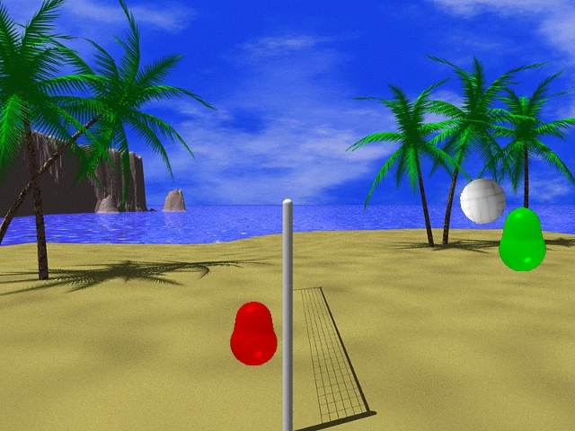
    </a>
    <div class="example-info">
      <p><strong><a href="https://github.com/XadillaX/16-sfml.js-games-ported/blob/HEAD/15%20Volleyball/main.cljs">15 · Volleyball</a></strong></p>
      <p>Box2D 物理を使う 2 人用バレーボール</p>
      <p><strong>操作</strong> · 赤は左右で移動、上でジャンプ。緑は A／D で移動、W でジャンプ</p>
      <p><code>npx nbb &quot;15 Volleyball/main.cljs&quot;</code></p>
      <p>ゲームリポジトリのルートで <code>npm ci</code> を実行すると <code>box2dweb@2.1.0-b</code> が入ります。</p>
    </div>
  </article>
  <article class="example-entry" id="16-asteroids">
    <a href="../../assets/examples/projects/16-games/16-asteroids.webp">
      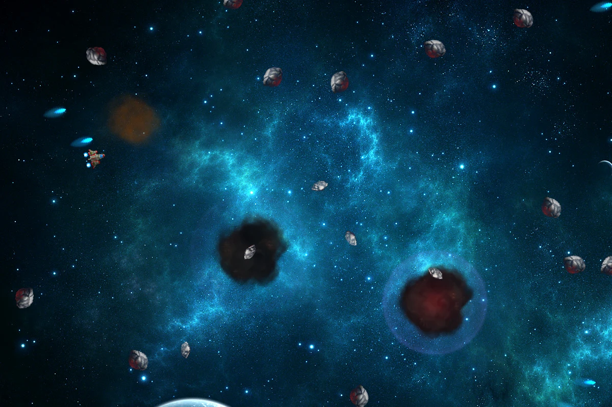
    </a>
    <div class="example-info">
      <p><strong><a href="https://github.com/XadillaX/16-sfml.js-games-ported/blob/HEAD/16%20Asteroids/main.cljs">16 · Asteroids</a></strong></p>
      <p>宇宙船を操作して小惑星を破壊</p>
      <p><strong>操作</strong> · 左右で回転、上で推進、Space で発射</p>
      <p><code>npx nbb &quot;16 Asteroids/main.cljs&quot;</code></p>
    </div>
  </article>
</div>

Chess には、利用する OS 向けの [Stockfish 実行ファイル](https://github.com/official-stockfish/Stockfish/releases)が別途必要です。表のコマンドに実行ファイルのパスを渡してください。Volleyball が使う `box2dweb` は `npm ci` でインストールされます。ウィンドウを閉じるとゲームが終了します。スクリーンショット、ソース、操作方法は[ゲーム一覧](https://github.com/XadillaX/16-sfml.js-games-ported#games)を参照してください。

## 画像の出典

ゲーム素材は出典を明記した元のプロジェクトに由来します。[provenance.json](../../assets/examples/projects/provenance.json) に画像の出典と処理を記録しています。画像は互換性やゲーム動作のテスト報告ではありません。素材の権利は作者に帰属し、画像の掲載でライセンスは変わりません。

元の C++ ゲームとチュートリアルは [jsyqrt/games](https://github.com/jsyqrt/games)、参照移植は [XadillaX/16-sfml.js-games-ported](https://github.com/XadillaX/16-sfml.js-games-ported#sources) を参照してください。[node-sfml-demos](https://github.com/XadillaX/node-sfml-demos#license) と [play-nes](https://github.com/XadillaX/play-nes#readme) は独自のライセンスと出典を記載しています。
