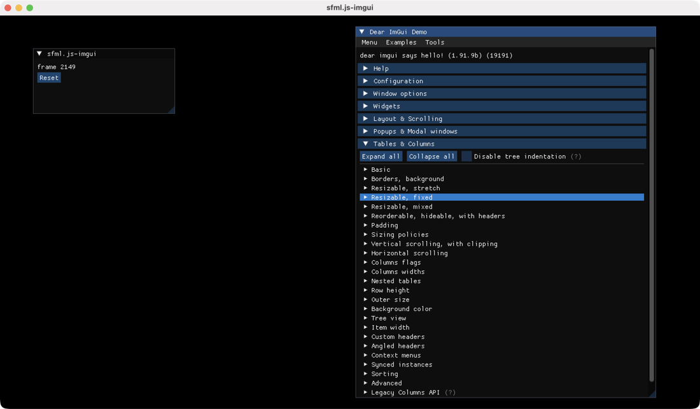

# sfml.js-imgui

[](https://www.npmjs.org/package/sfml.js-imgui)

[English](README.md) · [简体中文](README.zh-CN.md) · [日本語](README.ja.md) · **한국어**

[sfml.js](../sfml.js)를 위한 [Dear ImGui](https://github.com/ocornut/imgui) 1.91.9b 연동. [imgui-sfml](https://github.com/SFML/imgui-sfml) 3.0을 따릅니다. JavaScript 또는 TypeScript로 SFML 창 안에 디버그 패널, 장면 검사기, 네이티브 편집 컨트롤을 만듭니다.

[빠른 시작](../../docs/imgui/getting-started.ko.md) · [예제](examples/README.ko.md) · [API 레퍼런스](https://sfml.js.org/ko/reference/imgui/) · [sfml.js](../sfml.js/README.ko.md)

## 기능

- 버튼, 슬라이더, 색 편집, 텍스트 입력, 테이블, 메뉴, 모달, 그래프 등 Dear ImGui 전체 위젯
- 타입 배열이 네이티브 스칼라 매개변수에 직접 매핑되는 지속 편집 상태
- CJK 지원과 사용자 정의 TTF 폰트를 포함하는 폰트 아틀라스 제어
- 사용자 지정 그리기 목록, 창별 ImGui 컨텍스트와 분리된 리소스 소유권
- 모든 export 함수, 열거 값, 실시간 구조체 뷰의 TypeScript 선언

`ImGui`는 위젯, 열거 값, 콜백 래퍼, 네이티브 핸들 연산을 제공합니다. `SFML`은 창 연동, 이벤트 전달, 프레임 제출을 맡습니다.

## 설치

`sfml.js-imgui`는 `sfml.js`의 피어 의존성입니다. 두 패키지를 함께 설치하세요.

```sh
npm install sfml.js sfml.js-imgui
```

sfml.js와 마찬가지로 설치 시 네이티브 애드온을 컴파일하므로 Python, C++20 도구 모음, 디스플레이, OpenGL이 필요합니다. Node.js `^18.19.0 || >=20.5.0`을 지원합니다. [플랫폼 요구 사항](../../docs/sfml/getting-started.ko.md#requirements)을 참고하세요.

## 카운터 예제

```javascript
const sf = require('sfml.js');
const { ImGui, SFML } = require('sfml.js-imgui');

const window = new sf.RenderWindow(
  new sf.VideoMode(new sf.Vector2u(800, 600)),
  'ImGui counter',
);
window.setFramerateLimit(60);
const clock = new sf.Clock();
let clicks = 0;

SFML.Init(window);
try {
  while (window.isOpen()) {
    let event;
    while ((event = window.pollEvent()) !== undefined) {
      SFML.ProcessEvent(window, event);
      if (event.is('Closed')) window.close();
    }

    SFML.Update(window, clock.restart().asSeconds());
    if (ImGui.Begin('Controls')) {
      if (ImGui.Button('Count')) clicks++;
      ImGui.TextUnformatted(`Clicks: ${clicks}`);
    }
    ImGui.End();

    window.clear(sf.Color.Black);
    SFML.Render(window);
    window.display();
  }
} finally {
  SFML.Shutdown(window);
  window.close();
}
```

## 프레임 수명

| 단계 | 호출 | 책임 |
| --- | --- | --- |
| 입력 수집 | `pollEvent` → `SFML.ProcessEvent` | 텍스트, 포커스, 종료 이벤트를 포함한 모든 이벤트를 전달합니다. |
| 프레임 시작 | `SFML.Update(window, seconds)` | 입력과 타이밍을 갱신하고 ImGui 프레임을 시작합니다. |
| 컨트롤 선언 | 위젯 호출 | 앱 상태를 읽고 갱신합니다. 모든 `Begin`에는 `End`를 짝지으세요. |
| UI 그리기 | `SFML.Render(window)` | 기록된 SFML 그리기를 내보내고 ImGui를 렌더링합니다. |
| 표시 | `window.display()` | 완성된 프레임을 표시합니다. |
| 종료 | `SFML.Shutdown(window)` | 살아 있는 네이티브 창을 닫기 전에 ImGui를 해제합니다. |

시간은 밀리초가 아니라 경과한**초**를 사용하고, 장면 입력 제한에는 `SFML.GetIO().wantCaptureMouse` / `wantCaptureKeyboard`를 사용하세요. `ImGui.NewFrame()`이나 `ImGui.Render()`을 직접 호출하지 마세요. 백엔드가 관리합니다.

## 예제



[`examples`](examples/README.ko.md)에는 실행 가능한 예제 3개가 있습니다. Dear ImGui 위젯 데모, 패널로 SFML 원을 조종하는 장면 검사기, 텍스트 입력·테이블·모달·그래프를 조합한 워크벤치입니다.

```sh
# 모노레포 루트에서 node tools/bootstrap.cjs 실행 후
node packages/sfml.js-imgui/examples/demo.cjs
node packages/sfml.js-imgui/examples/scene-inspector.cjs
node packages/sfml.js-imgui/examples/workbench.cjs
```

## 문서

ImGui 가이드는 영어, 간체 중국어, 일본어, 한국어로 제공됩니다.

| 장 | 내용 |
| --- | --- |
| [빠른 시작](../../docs/imgui/getting-started.ko.md) | 완전한 카운터, 프레임 수명, 입력 캡처, 안전한 종료 |
| [위젯과 상태](../../docs/imgui/widgets.ko.md) | 지속 상태, 고유 ID, 실시간 장면 검사기 |
| [레이아웃](../../docs/imgui/layout.ko.md) | 테이블, 메뉴, 확인 모달, 범위 짝 |
| [텍스트와 콜백](../../docs/imgui/callbacks.ko.md) | UTF-8 편집, 계약, 목록 getter, 그래프 |
| [폰트와 스타일](../../docs/imgui/fonts.ko.md) | 아틀라스, CJK, 간격, 색, DPI |
| [렌더링과 여러 창](../../docs/imgui/rendering.ko.md) | 장면 합성, 그리기 목록, 창별 소유권 |
| [API 가이드](../../docs/imgui/api.ko.md) | 시그니처, 오버로드, 수명 확인 |

## 라이선스

[MIT](../sfml.js/LICENSE).
