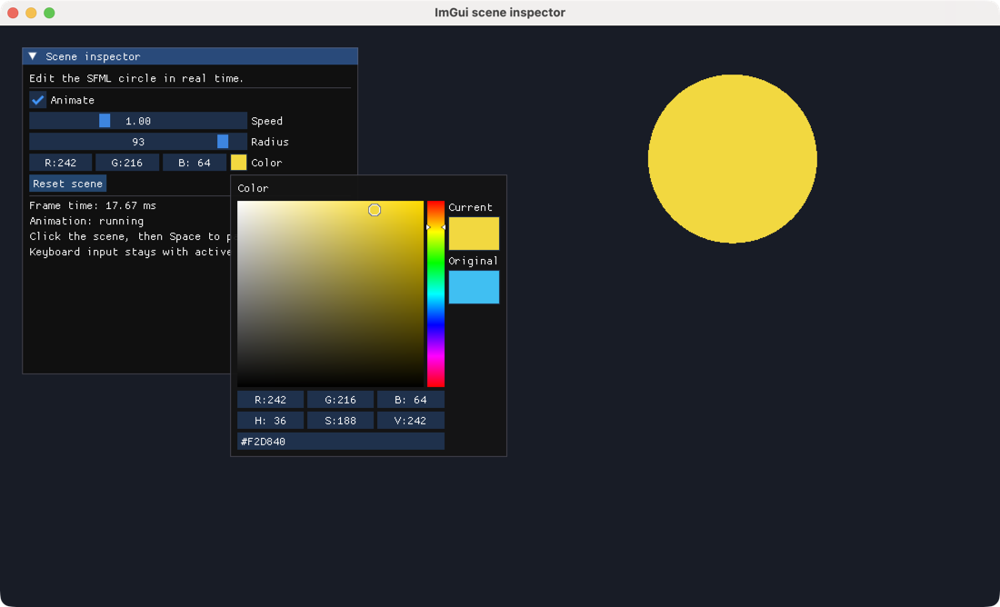
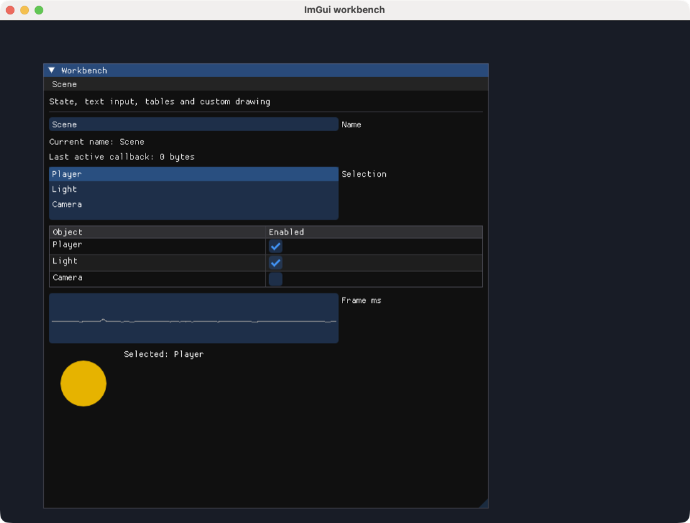

# ImGui サンプル

[English](README.md) · [简体中文](README.zh-CN.md) · **日本語** · [한국어](README.ko.md)

ネイティブの SFML ウィンドウで Dear ImGui のウィジェットを動かします。まずデモを試し、シーンパネルと Workbench で、編集した状態を SFML の描画に反映する方法を確認できます。

## 実行前の準備

以下のコマンドは **monorepo のルート**で実行します。初回に bootstrap で依存関係を導入し、各パッケージをビルドしてください。ディスプレイと OpenGL が必要です。[プラットフォーム要件](../../../docs/sfml/getting-started.ja.md#requirements)も確認してください。

```sh
node tools/bootstrap.cjs
```

ImGui の TypeScript ソースを変更したら、`npm run build:ts --prefix packages/sfml.js-imgui` で再ビルドします。サンプルはローカルでビルドしたパッケージを使います。

## サンプル

<div class="example-gallery">
  <article class="example-entry" id="demo">
    <a href="screenshots/demo.png">
      
    </a>
    <div class="example-info">
      <p><strong><a href="demo.cjs">demo.cjs</a></strong></p>
      <p>Dear ImGui ウィジェットデモ</p>
      <p><code>node packages/sfml.js-imgui/examples/demo.cjs</code></p>
      <p>
        <strong>操作</strong>：内蔵デモのウィジェット、レイアウト、テーブル、
        グラフを展開します。別の sfml.js-imgui パネルにはフレーム数と
        Reset ボタンがあります。ウィンドウを閉じて終了します。
      </p>
    </div>
  </article>

  <article class="example-entry" id="scene-inspector">
    <a href="screenshots/scene-inspector.png">
      
    </a>
    <div class="example-info">
      <p><strong><a href="scene-inspector.cjs">scene-inspector.cjs</a></strong></p>
      <p>ImGui パネルから動く SFML の円を操作する</p>
      <p><code>node packages/sfml.js-imgui/examples/scene-inspector.cjs</code></p>
      <p>
        <strong>操作</strong>：Animate、Speed、Radius、Color でシーンを編集し、
        Reset scene で初期値へ戻します。パネルの外をクリックして Space を押すと、
        操作中のウィジェットに影響せず停止・再開できます。
      </p>
      <p><a href="../../../docs/imgui/widgets.ja.md">ウィジェットと状態</a></p>
    </div>
  </article>

  <article class="example-entry" id="workbench">
    <a href="screenshots/workbench.png">
      
    </a>
    <div class="example-info">
      <p><strong><a href="workbench.cjs">workbench.cjs</a></strong></p>
      <p>テキスト入力、コールバック、テーブル、モーダル、独自描画</p>
      <p><code>node packages/sfml.js-imgui/examples/workbench.cjs</code></p>
      <p>
        <strong>操作</strong>：Name を編集し、オブジェクトを選択し、表の行を
        切り替えます。Scene → Reset… で確認モーダルを開きます。
        コマンドに TTF パスを追加するとラテン文字フォントを試せます。
      </p>
      <p>
        <a href="../../../docs/imgui/layout.ja.md">レイアウト</a> ·
        <a href="../../../docs/imgui/callbacks.ja.md">コールバック</a> ·
        <a href="../../../docs/imgui/rendering.ja.md">描画</a>
      </p>
    </div>
  </article>
</div>

3 つのサンプルはすべてのイベントを転送し、ウィンドウを折りたたんでも `Begin` と `End` を対応させ、型付き配列の状態をフレームループの外に保持し、SFML ウィンドウを閉じる前に ImGui を終了します。スクリーンショットは macOS で実際に動作しているネイティブサンプルから撮影しました。

[全サンプル](../../sfml.js/examples/README.ja.md) · [ImGui クイックスタート](../../../docs/imgui/getting-started.ja.md)
