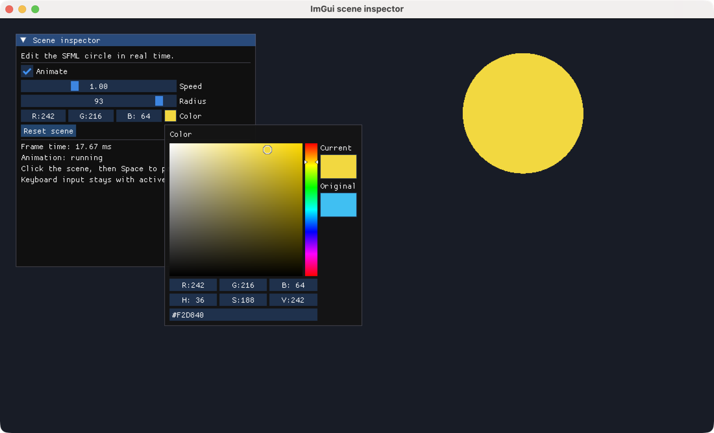
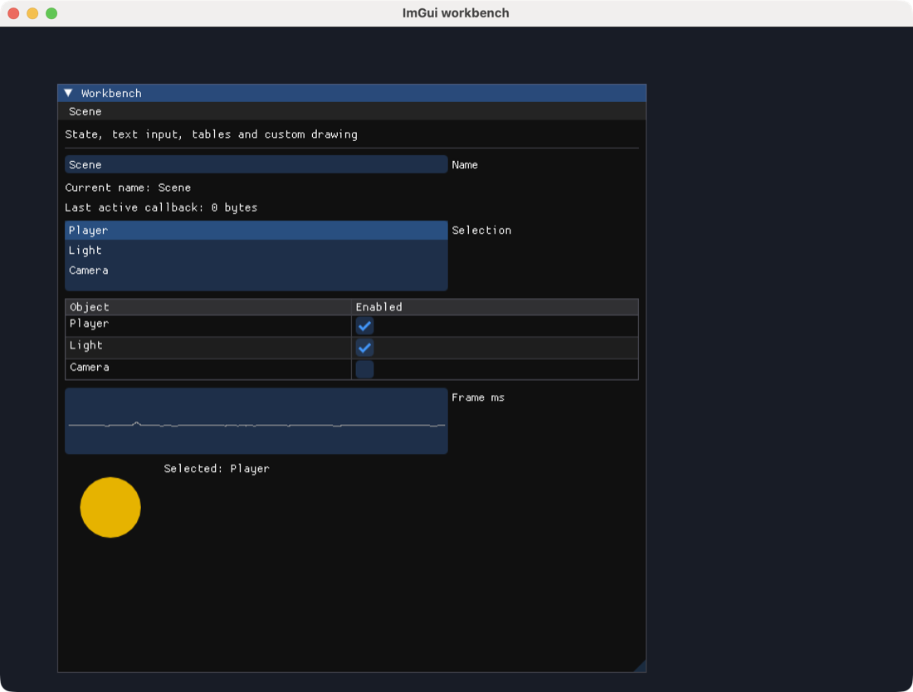

# ImGui 예제

[English](README.md) · [简体中文](README.zh-CN.md) · [日本語](README.ja.md) · **한국어**

네이티브 SFML 창에서 Dear ImGui 위젯을 실행합니다. 위젯 데모를 살펴본 뒤 장면 패널과 Workbench에서 편집한 상태를 SFML 그래픽에 반영하는 방법을 확인하세요.

## 실행 준비

아래 명령은 모두 **monorepo 루트**에서 실행합니다. 최초 실행 시 bootstrap으로 의존성을 설치하고 패키지를 빌드하세요. 디스플레이와 OpenGL이 필요하며 [플랫폼 요구 사항](../../../docs/sfml/getting-started.ko.md#requirements)을 참고하세요.

```sh
node tools/bootstrap.cjs
```

ImGui TypeScript 소스를 변경하면 `npm run build:ts --prefix packages/sfml.js-imgui`로 다시 빌드합니다. 예제는 로컬에서 빌드한 패키지를 사용합니다.

## 예제

<div class="example-gallery">
  <article class="example-entry" id="demo">
    <a href="screenshots/demo.png">
      
    </a>
    <div class="example-info">
      <p><strong><a href="demo.cjs">demo.cjs</a></strong></p>
      <p>Dear ImGui 위젯 데모</p>
      <p><code>node packages/sfml.js-imgui/examples/demo.cjs</code></p>
      <p>
        <strong>조작</strong>: 내장 데모 창에서 위젯, 레이아웃, 테이블,
        그래프를 펼칩니다. 별도의 sfml.js-imgui 패널에는 프레임 수와
        Reset 버튼이 있습니다. 창을 닫아 종료합니다.
      </p>
    </div>
  </article>

  <article class="example-entry" id="scene-inspector">
    <a href="screenshots/scene-inspector.png">
      
    </a>
    <div class="example-info">
      <p><strong><a href="scene-inspector.cjs">scene-inspector.cjs</a></strong></p>
      <p>ImGui 패널로 움직이는 SFML 원 제어</p>
      <p><code>node packages/sfml.js-imgui/examples/scene-inspector.cjs</code></p>
      <p>
        <strong>조작</strong>: Animate, Speed, Radius, Color로 장면을 편집하고
        Reset scene으로 기본값을 복원합니다. 패널 밖을 클릭한 뒤 Space를 누르면
        활성 위젯에 영향을 주지 않고 일시 정지하거나 재개합니다.
      </p>
      <p><a href="../../../docs/imgui/widgets.ko.md">위젯과 상태</a></p>
    </div>
  </article>

  <article class="example-entry" id="workbench">
    <a href="screenshots/workbench.png">
      
    </a>
    <div class="example-info">
      <p><strong><a href="workbench.cjs">workbench.cjs</a></strong></p>
      <p>텍스트 입력, 콜백, 테이블, 모달, 사용자 지정 그리기</p>
      <p><code>node packages/sfml.js-imgui/examples/workbench.cjs</code></p>
      <p>
        <strong>조작</strong>: Name을 편집하고 객체를 선택하며 테이블 행을
        전환합니다. Scene → Reset…으로 확인 모달을 엽니다. 명령 뒤에
        TTF 경로를 추가하면 라틴 폰트를 시험할 수 있습니다.
      </p>
      <p>
        <a href="../../../docs/imgui/layout.ko.md">레이아웃</a> ·
        <a href="../../../docs/imgui/callbacks.ko.md">콜백</a> ·
        <a href="../../../docs/imgui/rendering.ko.md">렌더링</a>
      </p>
    </div>
  </article>
</div>

세 예제는 모든 이벤트를 전달하고, 패널을 접어도 `Begin`과 `End`를 짝지으며, 형식화 배열 상태를 프레임 루프 밖에 유지하고, SFML 창을 닫기 전에 ImGui를 종료합니다. 스크린샷은 macOS에서 실제로 실행 중인 네이티브 예제에서 캡처했습니다.

[전체 예제](../../sfml.js/examples/README.ko.md) · [ImGui 빠른 시작](../../../docs/imgui/getting-started.ko.md)
