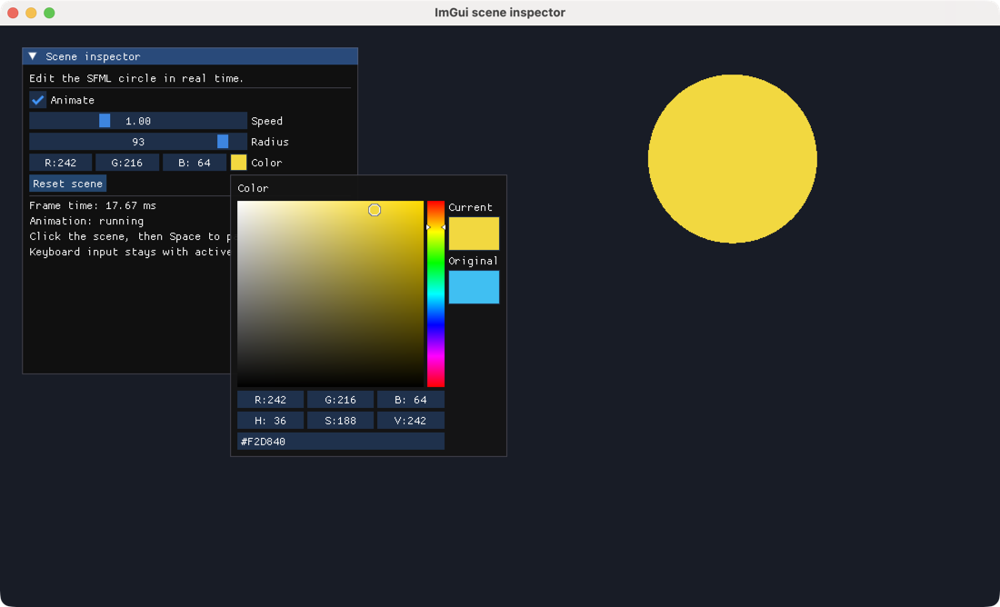
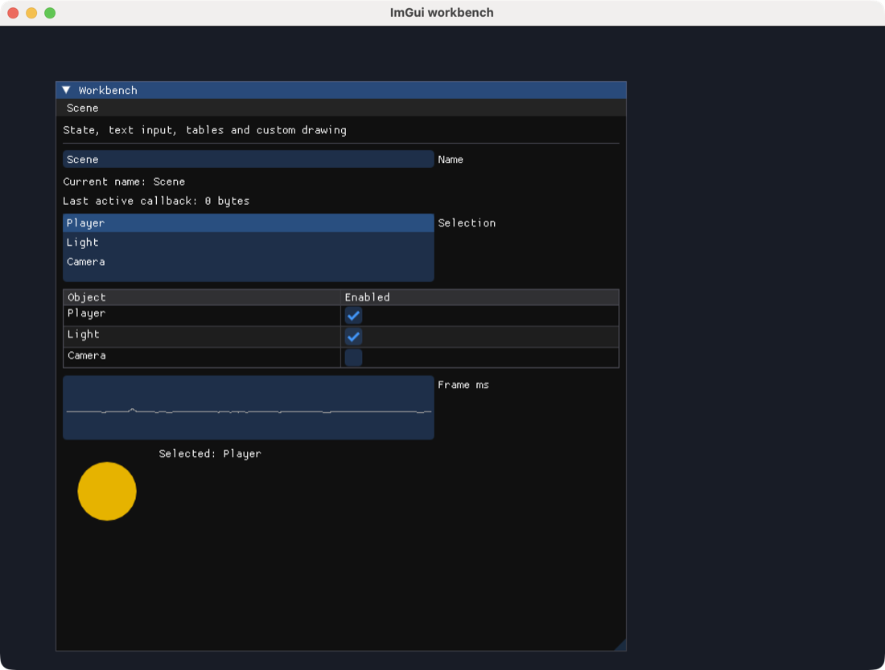

# ImGui examples

**English** · [简体中文](README.zh-CN.md) · [日本語](README.ja.md) · [한국어](README.ko.md)

Run Dear ImGui controls in a native SFML window. Start with the widget demo, then connect editable panel state to SFML graphics in the scene inspector and workbench.

## Before running

Run these commands from the **monorepo root**. Run the bootstrap once to install dependencies and build the packages. A display and OpenGL are required; see the [platform requirements](../../../docs/sfml/getting-started.md#requirements).

```sh
node tools/bootstrap.cjs
```

After changing ImGui TypeScript sources, rebuild with `npm run build:ts --prefix packages/sfml.js-imgui`. The examples use the locally built package.

## Examples

<div class="example-gallery">
  <article class="example-entry" id="demo">
    <a href="screenshots/demo.png">
      
    </a>
    <div class="example-info">
      <p><strong><a href="demo.cjs">demo.cjs</a></strong></p>
      <p>Dear ImGui widget demo</p>
      <p><code>node packages/sfml.js-imgui/examples/demo.cjs</code></p>
      <p>
        <strong>Controls</strong> · expand widgets, layouts, tables and
        plots in the built-in demo window. The separate sfml.js-imgui panel
        has a frame counter and Reset button. Close the window to exit.
      </p>
    </div>
  </article>

  <article class="example-entry" id="scene-inspector">
    <a href="screenshots/scene-inspector.png">
      
    </a>
    <div class="example-info">
      <p><strong><a href="scene-inspector.cjs">scene-inspector.cjs</a></strong></p>
      <p>Control a moving SFML circle from an ImGui panel</p>
      <p><code>node packages/sfml.js-imgui/examples/scene-inspector.cjs</code></p>
      <p>
        <strong>Controls</strong> · Animate, Speed, Radius and Color edit the
        scene; Reset scene restores defaults. Click outside the panel, then
        press Space to pause or resume without triggering active widgets.
      </p>
      <p><a href="../../../docs/imgui/widgets.md">Widgets and state</a></p>
    </div>
  </article>

  <article class="example-entry" id="workbench">
    <a href="screenshots/workbench.png">
      
    </a>
    <div class="example-info">
      <p><strong><a href="workbench.cjs">workbench.cjs</a></strong></p>
      <p>Text input, callbacks, tables, modals and custom drawing</p>
      <p><code>node packages/sfml.js-imgui/examples/workbench.cjs</code></p>
      <p>
        <strong>Controls</strong> · edit Name, select an object, toggle its
        table row and use Scene → Reset… for the confirmation modal. A TTF
        path can be appended for a custom Latin font.
      </p>
      <p>
        <a href="../../../docs/imgui/layout.md">Layout</a> ·
        <a href="../../../docs/imgui/callbacks.md">Callbacks</a> ·
        <a href="../../../docs/imgui/rendering.md">Rendering</a>
      </p>
    </div>
  </article>
</div>

All three examples forward every event, pair `Begin` with `End` even when collapsed, keep typed-array state outside the frame loop, and shut down ImGui before closing the SFML window. The screenshots were captured from the running native examples on macOS.

[All examples](../../sfml.js/examples/README.md) · [ImGui quick start](../../../docs/imgui/getting-started.md)
