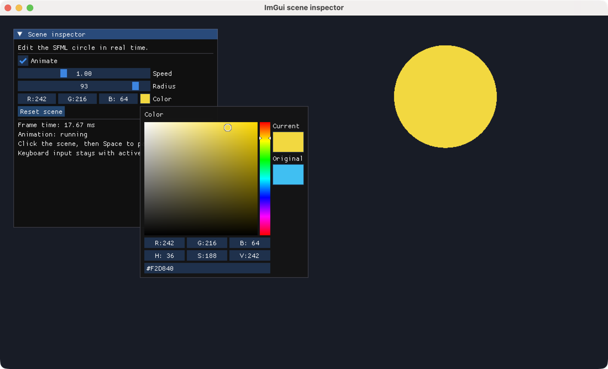
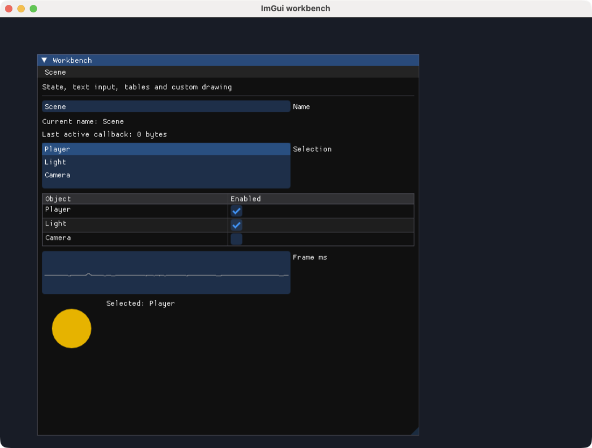

# ImGui 示例

[English](README.md) · **简体中文** · [日本語](README.ja.md) · [한국어](README.ko.md)

在原生 SFML 窗口中运行 Dear ImGui 控件。先体验控件演示，再通过场景面板和综合工作台，了解控件状态如何驱动 SFML 图形。

## 运行准备

以下命令均在 **monorepo 根目录**执行。首次运行 bootstrap 安装依赖并构建各包。需要显示环境和 OpenGL，详见[平台要求](../../../docs/sfml/getting-started.zh-CN.md#requirements)。

```sh
node tools/bootstrap.cjs
```

修改 ImGui TypeScript 源码后，执行 `npm run build:ts --prefix packages/sfml.js-imgui`。示例使用本地构建的包。

## 示例

<div class="example-gallery">
  <article class="example-entry" id="demo">
    <a href="screenshots/demo.png">
      
    </a>
    <div class="example-info">
      <p><strong><a href="demo.cjs">demo.cjs</a></strong></p>
      <p>Dear ImGui 控件演示</p>
      <p><code>node packages/sfml.js-imgui/examples/demo.cjs</code></p>
      <p>
        <strong>操作</strong>：展开内置演示窗口中的控件、布局、表格和曲线。
        独立的 sfml.js-imgui 面板显示帧计数和 Reset 按钮。关闭窗口退出。
      </p>
    </div>
  </article>

  <article class="example-entry" id="scene-inspector">
    <a href="screenshots/scene-inspector.png">
      
    </a>
    <div class="example-info">
      <p><strong><a href="scene-inspector.cjs">scene-inspector.cjs</a></strong></p>
      <p>用 ImGui 面板控制运动中的 SFML 圆形</p>
      <p><code>node packages/sfml.js-imgui/examples/scene-inspector.cjs</code></p>
      <p>
        <strong>操作</strong>：用 Animate、Speed、Radius 和 Color 修改场景，
        Reset scene 恢复默认值。点击面板外再按空格，可在不影响活动控件的情况下暂停或恢复。
      </p>
      <p><a href="../../../docs/imgui/widgets.zh-CN.md">控件与状态</a></p>
    </div>
  </article>

  <article class="example-entry" id="workbench">
    <a href="screenshots/workbench.png">
      
    </a>
    <div class="example-info">
      <p><strong><a href="workbench.cjs">workbench.cjs</a></strong></p>
      <p>文本输入、回调、表格、弹窗与自定义绘制</p>
      <p><code>node packages/sfml.js-imgui/examples/workbench.cjs</code></p>
      <p>
        <strong>操作</strong>：编辑 Name，选择对象，切换表格行，并通过
        Scene → Reset… 打开确认弹窗。可在命令后追加 TTF 路径加载自定义拉丁字体。
      </p>
      <p>
        <a href="../../../docs/imgui/layout.zh-CN.md">布局</a> ·
        <a href="../../../docs/imgui/callbacks.zh-CN.md">回调</a> ·
        <a href="../../../docs/imgui/rendering.zh-CN.md">渲染</a>
      </p>
    </div>
  </article>
</div>

三个示例都会转发全部事件；即使窗口折叠，`Begin` 与 `End` 也始终配对；类型化数组状态保留在帧循环外；退出时先关闭 ImGui，再关闭 SFML 窗口。截图均来自 macOS 上实际运行的原生示例。

[全部示例](../../sfml.js/examples/README.zh-CN.md) · [ImGui 快速开始](../../../docs/imgui/getting-started.zh-CN.md)
