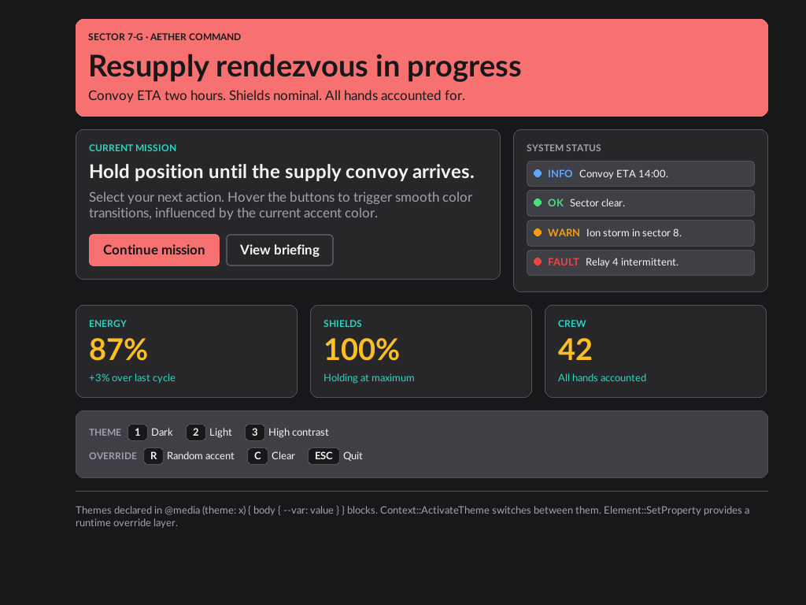

# sfml.js-rmlui

[English](README.md) · **简体中文** · [日本語](README.ja.md) · [한국어](README.ko.md)

面向 [sfml.js](../sfml.js) 的 [RmlUi](https://github.com/mikke89/RmlUi) 6.3 集成，通过 SFML 3.1 渲染。使用 RML 文档和 RCSS 样式定义原生界面，再用 JavaScript 或 TypeScript 连接元素与应用逻辑。

[快速开始](../../docs/rmlui/getting-started.zh-CN.md) · [示例](examples/README.zh-CN.md) · [API 参考](https://sfml.js.org/zh/reference/rmlui/) · [sfml.js](../sfml.js/README.zh-CN.md)

Native 绑定和 TypeScript 接口按职责组织；模块与工具归属见[源码目录](../../docs/rmlui/source-layout.zh-CN.md)。

## 功能

- 加载外部或内存中的 RML，查询元素并修改类、属性、样式和标记。
- 注册 JavaScript 事件监听器，在运行时切换 RCSS 主题。
- 使用[原生 Debugger](../../docs/rmlui/debugger.zh-CN.md) 检查元素、日志与数据模型，宿主和目标可使用不同上下文。
- 几何数据保留在原生内存中，通过 SFML 顶点缓冲、纹理和着色器绘制。
- 支持模板裁剪、图层合成、模糊和投影。
- 支持 macOS Retina 表面、物理像素输入和使用 `dp` 的密度无关布局。
- API 文档提供英文、简体中文、日文和韩文。

RmlUi 使用自己的标记和样式语言。本包提供[原生数据模型](../../docs/rmlui/data-models.zh-CN.md)、[Node／Lua 文档脚本](../../docs/rmlui/scripts.zh-CN.md)、原生 Debugger、[SVG／Lottie 元素](../../docs/rmlui/vector-elements.zh-CN.md)和原生 [FreeType、HarfBuzz、位图字体](../../docs/rmlui/fonts.zh-CN.md)；不提供浏览器 DOM API 或任意浏览器 CSS。渐变、图片遮罩、颜色／背景滤镜及 3D 变换已实现，详见[渲染器覆盖](../../docs/rmlui/rendering.zh-CN.md#renderer-coverage)。

RmlUi 运行测试已在 macOS、Linux 和 Windows 通过。原生 SFML／GL3 像素对照
套件在 macOS 执行；完整 VisualTests 和应用验收的覆盖范围另见
[示例验证说明](examples/README.zh-CN.md#coverage-and-verification)。

## 构建与运行

以下命令面向当前 monorepo 源码。Node.js、Python、C++20 工具链、显示环境和 OpenGL 的要求见[平台要求](../../docs/sfml/getting-started.zh-CN.md#requirements)。

```sh
# From the monorepo root, install and build once.
node tools/bootstrap.cjs
cd packages/sfml.js-rmlui
npm run demo
npm run examples -- variables
npm run examples -- --list
```

工作区已准备好时，先构建 `sfml.js-interop` 和 `sfml.js`，再在本包执行 `npm run build`。macOS 需要 Xcode Command Line Tools 和 CMake。依赖步骤复用 `sfml.js-interop/third_party` 下的 SFML 源码、构建目录及版本匹配的带补丁 Window 库。

RmlUi 6.3、FreeType 2.13.3、rlottie 0.2 和 HarfBuzz 15.1.0 的编译源码随包放在 `vendor/`，安装时在本地校验固定版本、源码摘要和适用补丁。Lua 和 LunaSVG 保留下载步骤。内置源码保留字体后端、Debugger、Lua、SVG、Lottie、官方应用及 GL3 对照源码。

在本包执行 `npm run update:rmlui`、`npm run update:freetype`、`npm run update:rlottie` 或 `npm run update:harfbuzz` 可刷新对应源码；附加 `-- --version X.Y.Z` 可指定上游版本，解析 GitHub 版本需要 `gh`；附加 `-- --archive /path/to/upstream.tar.gz` 可复用本地归档。更新脚本校验归档，筛选编译所需文件、应用兼容补丁，并同步更新源码与依赖清单。

切换 RmlUi、FreeType 或 rlottie 的版本或提交时，更新器从官方归档获取摘要，并据此校验提供的本地归档。刷新现有固定版本时，`--archive` 无需下载。

示例字体、贴图、RML／RCSS、Lua 脚本和视觉测试数据通过 `npm run download:examples` 单独准备。启动示例或运行时测试会自动准备资源；`npm run examples -- --list` 无需下载素材。资源保存在 `third_party/rmlui`，复用已有缓存，保留额外 IME 字体和用户修改。`npm run download:ime-fonts` 准备原始 IME 示例的可选字体。

## 帧生命周期

| 阶段 | 调用 | 契约 |
| --- | --- | --- |
| 初始化 | `initialise(window)` | 将一个已打开的 `RenderWindow` 绑定到进程级运行时。 |
| 准备 | `loadFontFace`、`createContext`、`loadDocument`、`show` | 先加载字体再加载文档；初始化后读取上下文尺寸。 |
| 输入 | `context.processEvent(event)` | 直接转发所有 SFML 事件，false 表示已消费。 |
| 布局 | `context.update()` | 更新布局、动画和显示密度。 |
| 绘制 | `window.clear`、场景绘制、`window.flush`、`context.render` | 在 UI 绘制前提交待执行的 SFML 命令。 |
| 呈现 | `window.display()` | 显示完整帧。 |
| 退出 | 移除监听器、`context.remove`、`shutdown`、`window.close` | 窗口仍存活时释放 RmlUi。 |

RmlUi 6.3 的 `update()` 和 `render()` 返回 true，空上下文也如此。它们的返回值不表示布局发生变化或存在可见几何。

## 示例



[计数器](examples/README.zh-CN.md#demo)的 Increment 按钮具有实际交互。官方 [variables](examples/README.zh-CN.md#variables) 页面展示主题和悬停样式，任务按钮在上游没有点击行为。启动器还支持文档加载、模板、拖动教程及 113 个 VisualTests 页面。

```sh
npm run examples -- drag
npm run examples -- template
npm run examples -- visual/clip_mask
```

## 文档与检查

| 指南 | 内容 |
| --- | --- |
| [快速开始](../../docs/rmlui/getting-started.zh-CN.md) | 构建、资源和帧循环 |
| [文档与事件](../../docs/rmlui/documents.zh-CN.md) | 元素修改、监听器和所有权 |
| [渲染与 Retina](../../docs/rmlui/rendering.zh-CN.md) | 坐标、`dp`、模板缓冲和渲染覆盖范围 |
| [字体](../../docs/rmlui/fonts.zh-CN.md) | 原生引擎、整形、图集限制与能力查询 |
| [API 指南](../../docs/rmlui/api.zh-CN.md) | 精确签名、默认值与返回值 |

执行 `npm test` 检查 lint、原生／TypeScript 构建、类型和运行时回归。macOS 下，`npm --prefix ../sfml.js-interop run test:high-dpi` 检查原生表面、像素截图和光标坐标。跨物理显示器移动窗口仍需设备测试。

## 许可证

[MIT](../sfml.js/LICENSE)。
