# RmlUi サンプル

[English](README.md) · [简体中文](README.zh-CN.md) · **日本語** · [한국어](README.ko.md)

ネイティブ SFML ウィンドウで RmlUi 文書を実行します。カウンターから始めて、テーマ、移動可能なウィンドウ、テンプレート、視覚テストへ進みます。

## 前提条件

すべてのコマンドは **monorepo のルート**で実行します。bootstrap は依存関係を導入し、各パッケージをビルドします。画面と OpenGL が必要です。macOS のビルドには Xcode Command Line Tools と CMake も必要です。[クイックスタート](../../../docs/rmlui/getting-started.ja.md)を参照してください。

```sh
node tools/bootstrap.cjs
```

RmlUi の TypeScript ソースを変更したら、`npm run build:ts --prefix packages/sfml.js-rmlui` を実行します。サンプルはローカルでビルドしたパッケージを使います。

ランチャーはパッケージの `third_party/rmlui` にある RmlUi 6.3 同梱素材を読み込みます。全項目を一覧表示するには：

```sh
node packages/sfml.js-rmlui/examples/official.cjs --list
```

## サンプル一覧

<div class="example-gallery">
  <article class="example-entry" id="demo">
    <a href="screenshots/demo.png">
      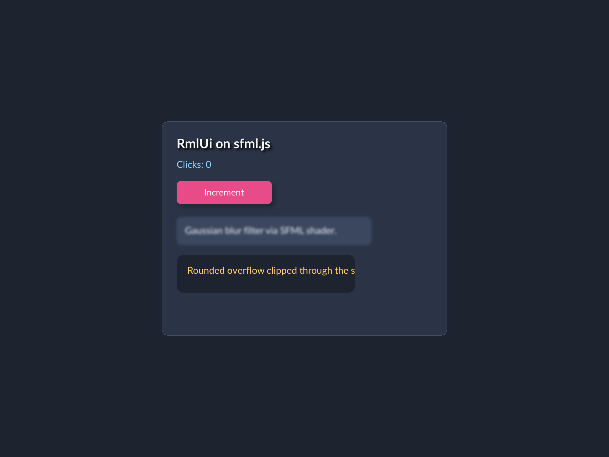
    </a>
    <div class="example-info">
      <p><strong><a href="demo.cjs">カウンター</a></strong></p>
      <p>JavaScript リスナー、外部 RML、ぼかし、シャドウ、角丸クリッピング</p>
      <p><code>node packages/sfml.js-rmlui/examples/demo.cjs</code></p>
      <p><strong>操作</strong>：Increment で値を更新します。ウィンドウを閉じると終了します。</p>
      <p><a href="assets/tutorial.rml">RML</a> · <a href="assets/tutorial.rcss">RCSS</a></p>
    </div>
  </article>

  <article class="example-entry" id="variables">
    <a href="screenshots/variables.png">
      
    </a>
    <div class="example-info">
      <p><strong><a href="official/basic/variables/main.cjs">テーマと変数</a></strong></p>
      <p>テーマ切り替え、アクセントカラー、ホバースタイル</p>
      <p><code>node packages/sfml.js-rmlui/examples/official.cjs variables</code></p>
      <p>
        <strong>操作</strong>：1 はダーク、2 はライト、3 は高コントラスト、
        R はランダムなアクセント、C はアクセントのリセットです。Escape で終了します。
        ミッションボタンはホバー表示のみで、上流にはクリック処理がありません。
      </p>
      <p>
        元のスタイルシートは固定の <code>px</code> 長を使います。
        <code>highDpi: false</code> により Retina でも 1024 × 768 の
        フレームバッファーを保持し、上流のウィンドウサイズに合わせます。
        F8 で Debugger を切り替え、Ctrl +/-/0 で Shell の表示密度を調整します。
      </p>
      <p><a href="https://github.com/mikke89/RmlUi/blob/6.3/Samples/basic/variables/data/variables.rml">上流 RML</a></p>
    </div>
  </article>

  <article class="example-entry" id="drag">
    <a href="screenshots/drag.png">
      
    </a>
    <div class="example-info">
      <p><strong><a href="official/tutorial/drag/main.cjs">ドラッグチュートリアル</a></strong></p>
      <p>移動・リサイズ可能なインベントリウィンドウ</p>
      <p><code>node packages/sfml.js-rmlui/examples/official.cjs drag</code></p>
      <p><strong>操作</strong>：マウスで 2 つのウィンドウを移動・リサイズします。Escape で終了します。</p>
      <p>チュートリアルのウィンドウ設定を移植したもので、上流の <code>basic/drag</code> アプリとは別です。</p>
      <p><a href="https://github.com/mikke89/RmlUi/blob/6.3/Samples/tutorial/drag/data/inventory.rml">上流 RML</a></p>
    </div>
  </article>

  <article class="example-entry" id="template">
    <a href="screenshots/template.png">
      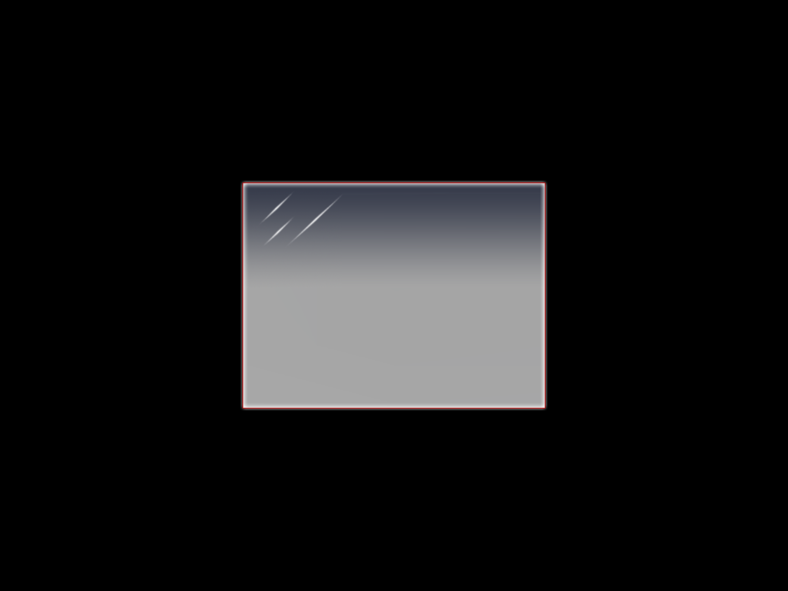
    </a>
    <div class="example-info">
      <p><strong><a href="official/tutorial/template/main.cjs">テンプレートチュートリアル</a></strong></p>
      <p>9 分割テクスチャと外部テンプレート</p>
      <p><code>node packages/sfml.js-rmlui/examples/official.cjs template</code></p>
      <p><strong>操作</strong>：装飾されたウィンドウを確認します。Escape で終了します。</p>
      <p><a href="https://github.com/mikke89/RmlUi/blob/6.3/Samples/tutorial/template/data/tutorial.rml">上流 RML</a></p>
    </div>
  </article>

  <article class="example-entry" id="load-document">
    <a href="screenshots/load-document.png">
      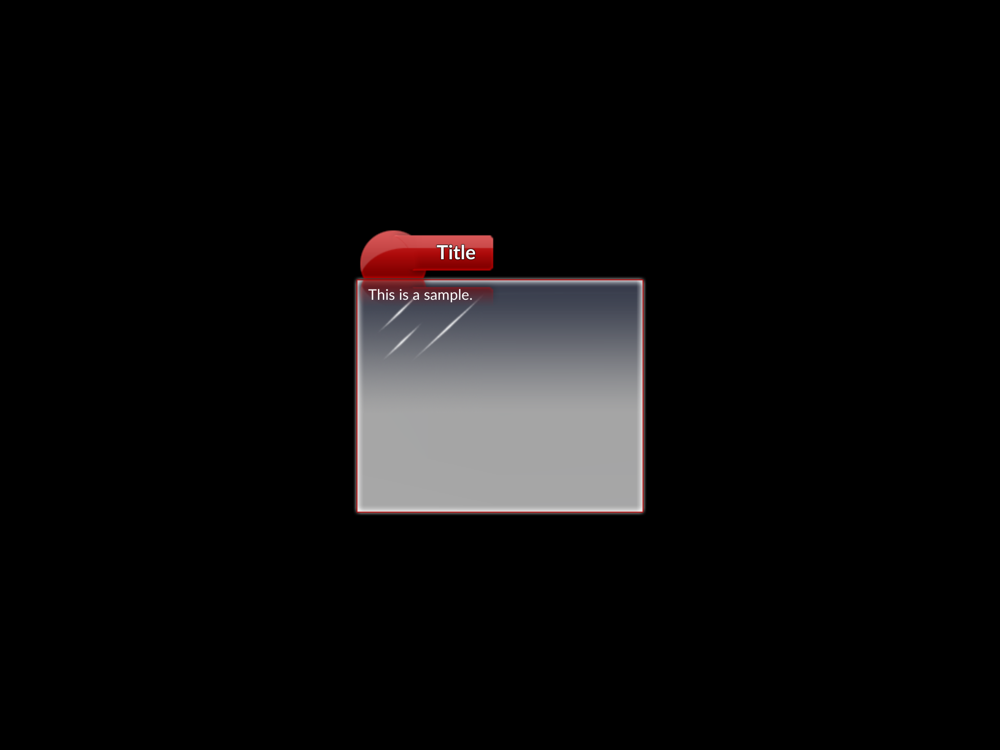
    </a>
    <div class="example-info">
      <p><strong><a href="official/basic/load_document/main.cjs">文書の読み込み</a></strong></p>
      <p>元のテンプレート、フォント、テクスチャとともに上流の文書を読み込む</p>
      <p><code>node packages/sfml.js-rmlui/examples/official.cjs load-document</code></p>
      <p><strong>操作</strong>：読み込んだ文書を確認します。Escape で終了します。他の上流デモのアプリ操作は接続していません。</p>
      <p><a href="https://github.com/mikke89/RmlUi/blob/6.3/Samples/assets/demo.rml">上流 RML</a></p>
    </div>
  </article>

  <article class="example-entry" id="font-effect">
    <a href="screenshots/font-effect.png">
      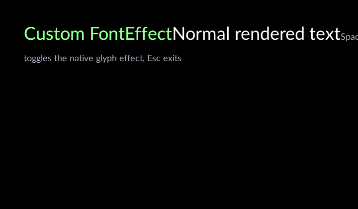
    </a>
    <div class="example-info">
      <p><strong><a href="font-effect.cjs">カスタムフォント効果</a></strong></p>
      <p>JavaScript の FontEffectInstancer とネイティブのグリフテクスチャコールバック</p>
      <p><code>node packages/sfml.js-rmlui/examples/font-effect.cjs</code></p>
      <p><strong>操作</strong>：Space でグロー効果を切り替え、Escape で終了します。</p>
      <p>有限スモーク実行：<code>--frames N</code>、<code>--screenshot path.png</code> で最終フレームを保存します。</p>
    </div>
  </article>

  <article class="example-entry" id="streams">
    <a href="screenshots/streams.png">
      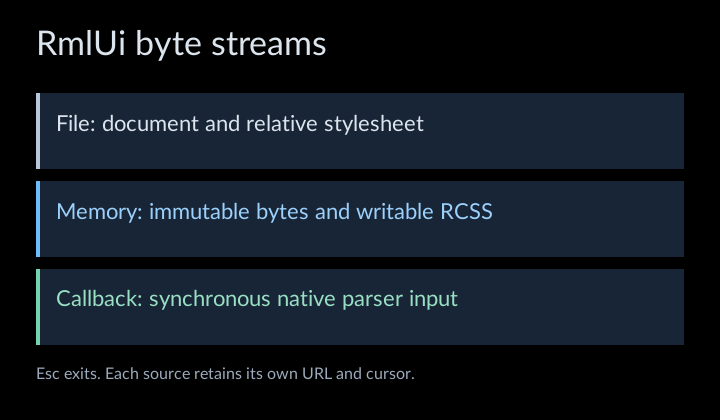
    </a>
    <div class="example-info">
      <p><strong><a href="streams.cjs">バイトストリーム</a></strong></p>
      <p>ファイル文書、ネイティブメモリコピー、同期コールバックの RCSS 入力</p>
      <p><code>node packages/sfml.js-rmlui/examples/streams.cjs</code></p>
      <p><strong>操作</strong>：Escape で終了。<code>--frames N --screenshot path.png</code> で有限フレームを保存します。</p>
      <p><a href="../../../docs/rmlui/streams.ja.md">Stream API とライフサイクル</a></p>
    </div>
  </article>

  <article class="example-entry" id="element-utilities">
    <a href="screenshots/element-utilities.png">
      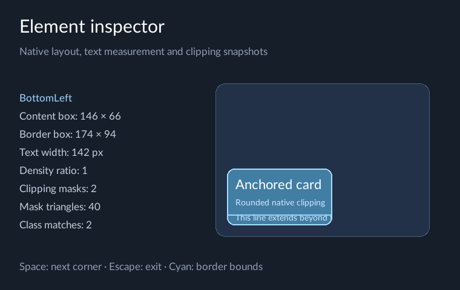
    </a>
    <div class="example-info">
      <p><strong><a href="element-utilities.cjs">要素インスペクター</a></strong></p>
      <p>四隅の配置、文字幅、投影境界、所有クリップジオメトリ</p>
      <p><code>node packages/sfml.js-rmlui/examples/element-utilities.cjs</code></p>
      <p><strong>操作</strong>：Space で次の隅、Escape で終了。</p>
      <p><code>--frames 6 --exercise --screenshot path.png</code> で四隅を検証して撮影します。</p>
      <p><a href="../../../docs/rmlui/element-utilities.ja.md">要素ユーティリティとコピーの所有権</a></p>
      <p><a href="../../../docs/rmlui/render-state.ja.md">ネイティブジオメトリのクリップと描画状態復元</a></p>
    </div>
  </article>

  <article class="example-entry" id="render-layers">
    <a href="screenshots/render-layers.png">
      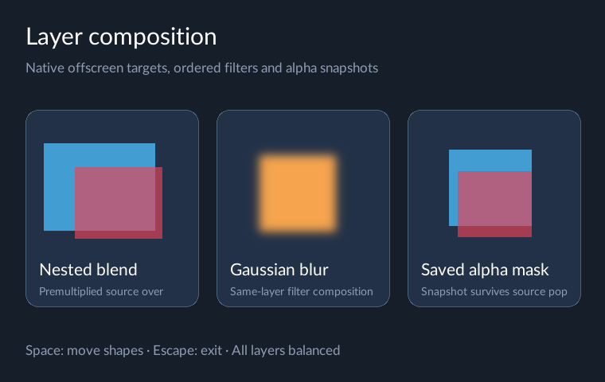
    </a>
    <div class="example-info">
      <p><strong><a href="render-layers.cjs">レイヤー合成</a></strong></p>
      <p>均衡したネイティブ層、乗算済みアルファ、自己合成フィルター、保存マスク</p>
      <p><code>node packages/sfml.js-rmlui/examples/render-layers.cjs</code></p>
      <p><strong>操作</strong>：Space で図形を移動、Escape で終了。</p>
      <p><code>--frames 6 --exercise --screenshot path.png</code> で二つの位置と最終フレームを確認できます。</p>
      <p><a href="../../../docs/rmlui/render-state.ja.md#render-layers">レイヤーハンドル、フィルター所有権、マスク</a></p>
    </div>
  </article>

  <article class="example-entry" id="callback-textures">
    <a href="screenshots/callback-textures.png">
      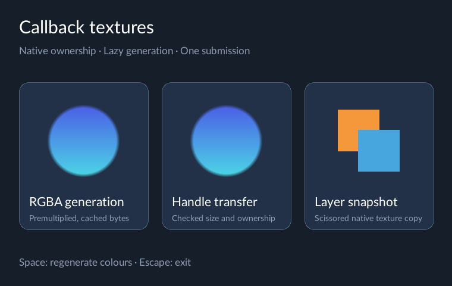
    </a>
    <div class="example-info">
      <p><strong><a href="callback-textures.cjs">コールバックテクスチャ</a></strong></p>
      <p>遅延乗算済みバイト生成、所有ハンドル転送、シザー領域のレイヤー保存</p>
      <p><code>node packages/sfml.js-rmlui/examples/callback-textures.cjs</code></p>
      <p><strong>操作</strong>：Space で色を再生成。Escape で終了。</p>
      <p><code>--frames 6 --exercise --screenshot path.png</code> でキャッシュと再生成を確認し、最終フレームを保存します。</p>
      <p><a href="../../../docs/rmlui/render-state.ja.md#callback-textures">提出方法、寿命、所有権</a></p>
    </div>
  </article>

  <article class="example-entry" id="factory-elements">
    <a href="screenshots/factory-elements.png">
      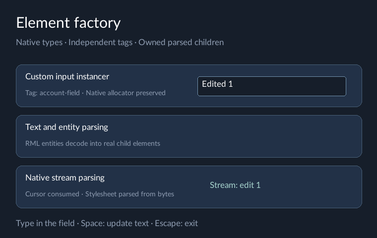
    </a>
    <div class="example-info">
      <p><strong><a href="factory-elements.cjs">要素ファクトリー</a></strong></p>
      <p>カスタムコンテキストと入力の生成・解放、所有文書ストリーム、独立タグと Factory キャッシュ</p>
      <p><code>node packages/sfml.js-rmlui/examples/factory-elements.cjs</code></p>
      <p><strong>操作</strong>：入力欄を編集、Space で更新、Escape で終了。</p>
      <p><code>--frames 6 --exercise --screenshot path.png</code> で編集を検証し、最終フレームを撮影します。</p>
      <p><a href="../../../docs/rmlui/resources.ja.md#factory-の解析とキャッシュ">Factory の解析とキャッシュ</a></p>
      <p><a href="../../../docs/rmlui/resources.ja.md#要素生成器">要素生成器の所有権</a></p>
    </div>
  </article>

  <article class="example-entry" id="data-models">
    <a href="screenshots/data-models.png">
      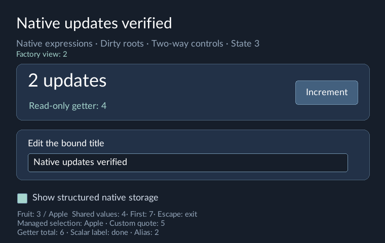
    </a>
    <div class="example-info">
      <p><strong><a href="data-models.cjs">ネイティブデータモデル</a></strong></p>
      <p>ネイティブスカラー、再帰 data-for、共有配列、部分更新、getter と変換、自作 Factory ビューと既定双方向コントローラーの委譲</p>
      <p><code>node packages/sfml.js-rmlui/examples/data-models.cjs</code></p>
      <p><strong>操作</strong>：Increment で計数更新、タイトル編集、詳細切替、Escape で終了。</p>
      <p><code>--frames 6 --exercise --screenshot path.png</code> でバインドを検証し、最終フレームを撮影します。</p>
      <p><a href="../../../docs/rmlui/data-models.ja.md">データモデル契約と残りの範囲</a></p>
    </div>
  </article>

  <article class="example-entry" id="data-binding">
    <a href="screenshots/data-binding-events.png">
      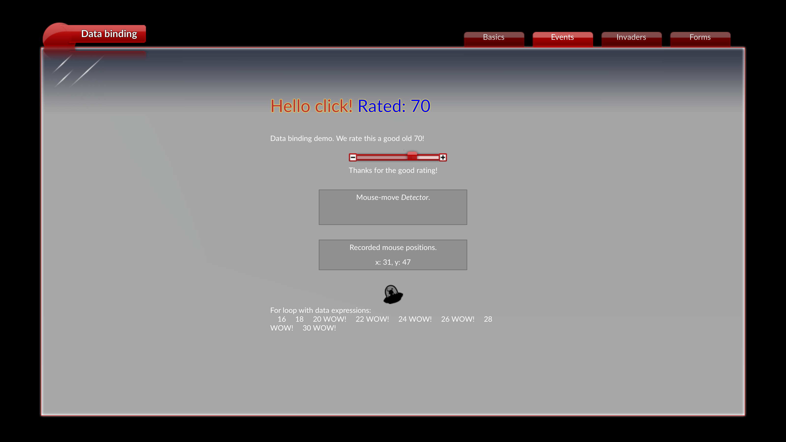
    </a>
    <div class="example-info">
      <p><strong><a href="official/basic/data_binding/main.cjs">公式データバインディング</a></strong></p>
      <p>Basics、Events、Invaders、Forms の四モデルで、ネイティブ式と同期配列変更を実行</p>
      <p><code>node packages/sfml.js-rmlui/examples/official.cjs data-binding</code></p>
      <p><strong>操作</strong>：タブ切り替え、入力、マウス座標の記録と消去、項目の追加と削除、ゲーム開始と射撃。Escape で終了。</p>
      <p><code>--frames 45 --exercise --panel invaders --screenshot path.png</code> は状態を検証し、選択したタブを撮影します。</p>
      <p><a href="screenshots/data-binding-basics.png">Basics</a> · <a href="screenshots/data-binding-invaders.png">Invaders</a> · <a href="screenshots/data-binding-forms.png">Forms</a></p>
      <p><a href="https://github.com/mikke89/RmlUi/blob/6.3/Samples/basic/data_binding/src/main.cpp">上流アプリケーション</a></p>
    </div>
  </article>

  <article class="example-entry" id="basic-demo">
    <a href="screenshots/basic-demo-sandbox.png">
      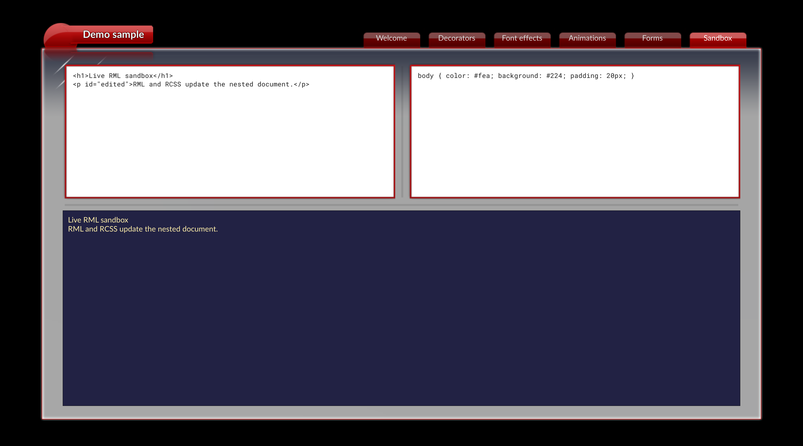
    </a>
    <div class="example-info">
      <p><strong><a href="official/basic/demo/main.cjs">公式コントロールとサンドボックス</a></strong></p>
      <p>元の六タブ、デコレーターと色の補間、フォーム、四秒の送信アニメーション、ライブ RML/RCSS エディター</p>
      <p><code>node packages/sfml.js-rmlui/examples/official.cjs basic-demo</code></p>
      <p><strong>操作</strong>：タブ切り替え、補間設定、フォーム送信、サンドボックス編集。Escape は開いた選択欄を取消し、それ以外は終了します。F8 で Debugger を切り替えます。</p>
      <p><code>--panel sandbox --frames 8 --exercise --screenshot path.png</code> は両エディターを検証し、サンドボックスを撮影します。パネル：welcome、decorators、font-effects、animations、controls、sandbox。</p>
      <p><a href="screenshots/basic-demo-controls.png">フォーム</a> · <a href="official/basic/demo/DemoWindow.cjs">ウィンドウ処理</a> · <a href="official/basic/demo/DemoEventListener.cjs">イベントリスナー</a></p>
      <p><a href="https://github.com/mikke89/RmlUi/blob/6.3/Samples/basic/demo/src/main.cpp">上流アプリケーション</a></p>
    </div>
  </article>

  <article class="example-entry" id="tree-view">
    <a href="screenshots/tree-view.png">
      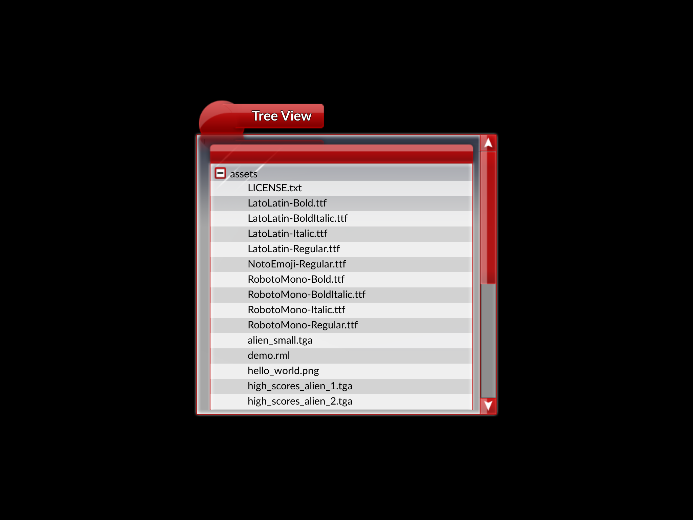
    </a>
    <div class="example-info">
      <p><strong><a href="official/basic/tree_view/main.cjs">公式ツリービュー</a></strong></p>
      <p>サンプルディレクトリーを走査し、FileBrowser の規則で子孫の表示を切り替え</p>
      <p><code>node packages/sfml.js-rmlui/examples/official.cjs tree-view</code></p>
      <p><strong>操作</strong>：矢印をクリックして展開と折りたたみ。Escape で終了。</p>
      <p><code>--frames 12 --exercise --screenshot path.png</code> は実ディレクトリーの切り替えを検証します。</p>
      <p><a href="https://github.com/mikke89/RmlUi/blob/6.3/Samples/basic/tree_view/src/FileBrowser.cpp">上流アプリケーション</a></p>
    </div>
  </article>

  <article class="example-entry" id="animation">
    <a href="screenshots/animation.png">
      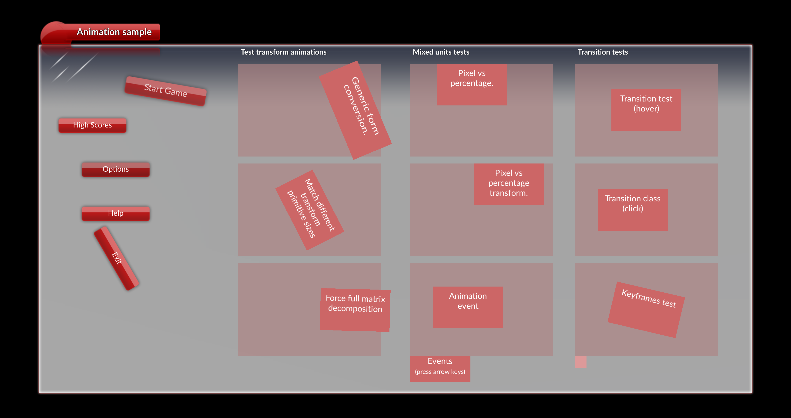
    </a>
    <div class="example-info">
      <p><strong><a href="official/basic/animation/main.cjs">公式アニメーション</a></strong></p>
      <p>元の変換列、色のキー、フェード周期、遷移とアニメーションイベント</p>
      <p><code>node packages/sfml.js-rmlui/examples/official.cjs animation</code></p>
      <p><strong>操作</strong>：Space で停止、Return で一回実行、+/- で微調整、矢印でアニメーション、F8 で Debugger、Escape で終了。</p>
      <p><code>--frames 8 --exercise --screenshot path.png</code> は停止、一回実行、クリックを検証して撮影します。</p>
      <p><a href="https://github.com/mikke89/RmlUi/blob/6.3/Samples/basic/animation/src/main.cpp">上流アプリケーション</a></p>
    </div>
  </article>

  <article class="example-entry" id="benchmark">
    <a href="screenshots/benchmark.png">
      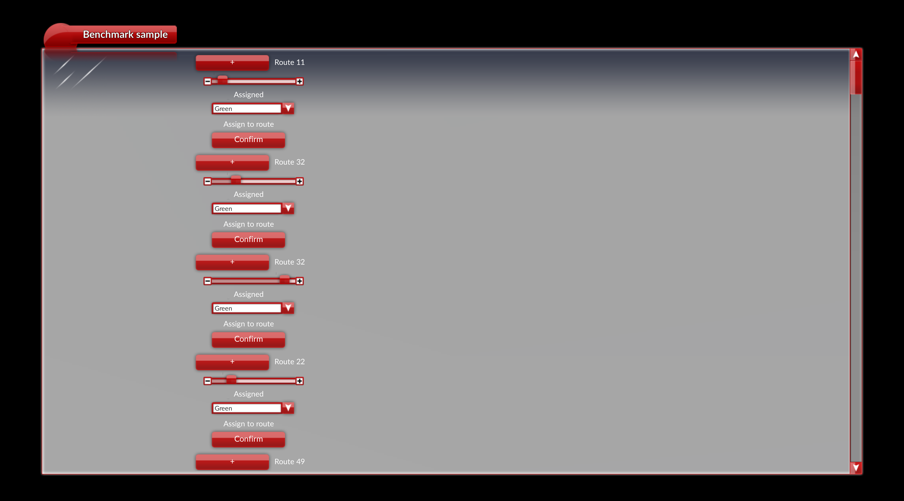
    </a>
    <div class="example-info">
      <p><strong><a href="official/basic/benchmark/main.cjs">公式ベンチマーク</a></strong></p>
      <p>更新ごとに元の 50 行を再生成し、独立した描画と 200 項目の FPS リングを維持</p>
      <p><code>node packages/sfml.js-rmlui/examples/official.cjs benchmark</code></p>
      <p><strong>操作</strong>：Space で描画停止、Down で一回描画、Return で行更新停止、Right で一回更新、F8 で Debugger、Escape で終了。</p>
      <p><code>--frames 3 --screenshot path.png</code> はフレーム数を限定して撮影します。</p>
      <p><a href="https://github.com/mikke89/RmlUi/blob/6.3/Samples/basic/benchmark/src/main.cpp">上流アプリケーション</a></p>
    </div>
  </article>

  <article class="example-entry" id="basic-drag">
    <a href="screenshots/basic-drag.png">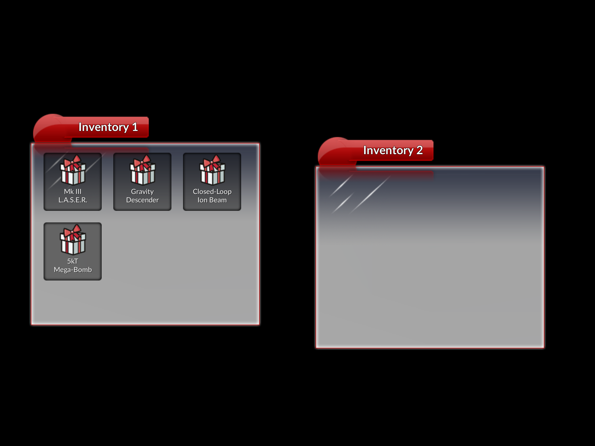</a>
    <div class="example-info">
      <p><strong><a href="official/basic/drag/main.cjs">公式ドラッグ</a></strong></p>
      <p>ネイティブ所有のアイコンをウィンドウ間で移動し、順序を変更します。</p>
      <p><code>node packages/sfml.js-rmlui/examples/official.cjs basic-drag</code></p>
      <p>アイコンを別のウィンドウや前のアイコンにドラッグします。Escape で終了します。</p>
      <p><a href="https://github.com/mikke89/RmlUi/tree/6.3/Samples/basic/drag">上流のアプリケーション</a></p>
    </div>
  </article>

  <article class="example-entry" id="effects">
    <a href="screenshots/effects.png">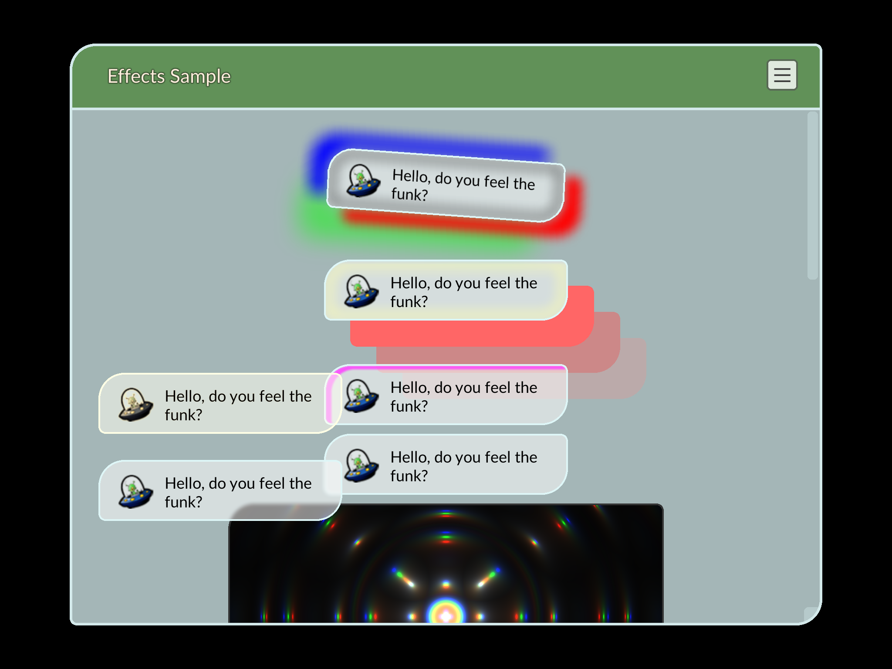</a>
    <div class="example-info">
      <p><strong><a href="official/basic/effects/main.cjs">公式エフェクト</a></strong></p>
      <p>元の色フィルター、ぼかし、影、変換、不透明度を調整します。</p>
      <p><code>node packages/sfml.js-rmlui/examples/official.cjs effects</code></p>
      <p>メニューを開き、スライダーを調整するか設定をリセットします。Escape で終了します。</p>
      <p><a href="https://github.com/mikke89/RmlUi/tree/6.3/Samples/basic/effects">上流のアプリケーション</a></p>
    </div>
  </article>

  <article class="example-entry" id="transform">
    <a href="screenshots/transform.png">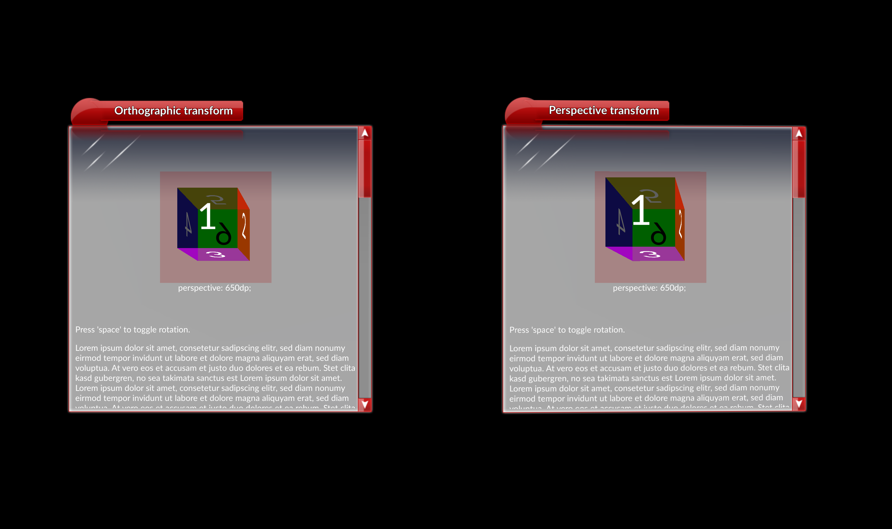</a>
    <div class="example-info">
      <p><strong><a href="official/basic/transform/main.cjs">公式変換</a></strong></p>
      <p>元の文書を正投影と透視投影で回転させます。</p>
      <p><code>node packages/sfml.js-rmlui/examples/official.cjs transform</code></p>
      <p>Space で回転を一時停止し、Escape で終了します。</p>
      <p><a href="https://github.com/mikke89/RmlUi/tree/6.3/Samples/basic/transform">上流のアプリケーション</a></p>
    </div>
  </article>

  <article class="example-entry" id="svg">
    <a href="screenshots/svg.png">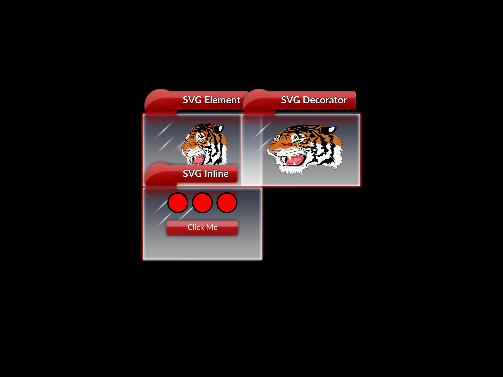</a>
    <div class="example-info">
      <p><strong><a href="official/basic/svg/main.cjs">公式 SVG</a></strong></p>
      <p>元の SVG 要素、デコレーター、インライン更新を描画します。</p>
      <p><code>node packages/sfml.js-rmlui/examples/official.cjs svg</code></p>
      <p>元の更新コントロールを操作します。Escape で終了します。</p>
      <p><a href="https://github.com/mikke89/RmlUi/tree/6.3/Samples/basic/svg">上流のアプリケーション</a></p>
    </div>
  </article>

  <article class="example-entry" id="lottie">
    <a href="screenshots/lottie.png">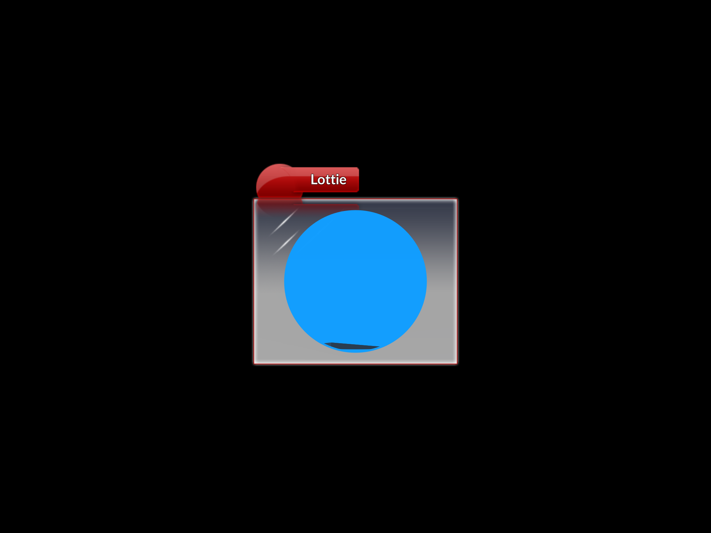</a>
    <div class="example-info">
      <p><strong><a href="official/basic/lottie/main.cjs">公式 Lottie</a></strong></p>
      <p>ネイティブのフレーム時刻とラスタライズで元の山のアニメーションを再生します。</p>
      <p><code>node packages/sfml.js-rmlui/examples/official.cjs lottie</code></p>
      <p>アニメーションは自動でループします。Escape で終了します。</p>
      <p><a href="https://github.com/mikke89/RmlUi/tree/6.3/Samples/basic/lottie">上流のアプリケーション</a></p>
    </div>
  </article>

  <article class="example-entry" id="bitmap-font">
    <a href="screenshots/bitmap-font.png">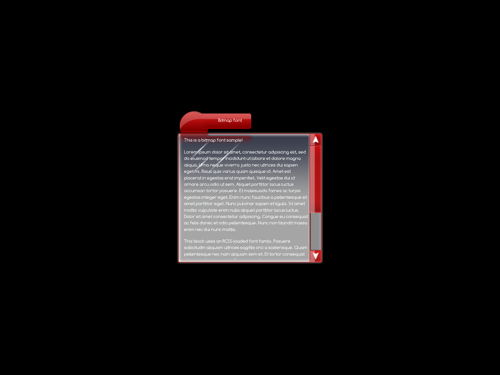</a>
    <div class="example-info">
      <p><strong><a href="official/basic/bitmap_font/main.cjs">公式ビットマップフォント</a></strong></p>
      <p>元の FNT の送り幅、カーニング、ネイティブのアトラステクスチャを使います。</p>
      <p><code>node packages/sfml.js-rmlui/examples/official.cjs bitmap-font</code></p>
      <p>元の三つの段落を確認します。Escape で終了します。</p>
      <p><a href="https://github.com/mikke89/RmlUi/tree/6.3/Samples/basic/bitmap_font">上流のアプリケーション</a></p>
    </div>
  </article>

  <article class="example-entry" id="harfbuzz">
    <a href="screenshots/harfbuzz.png">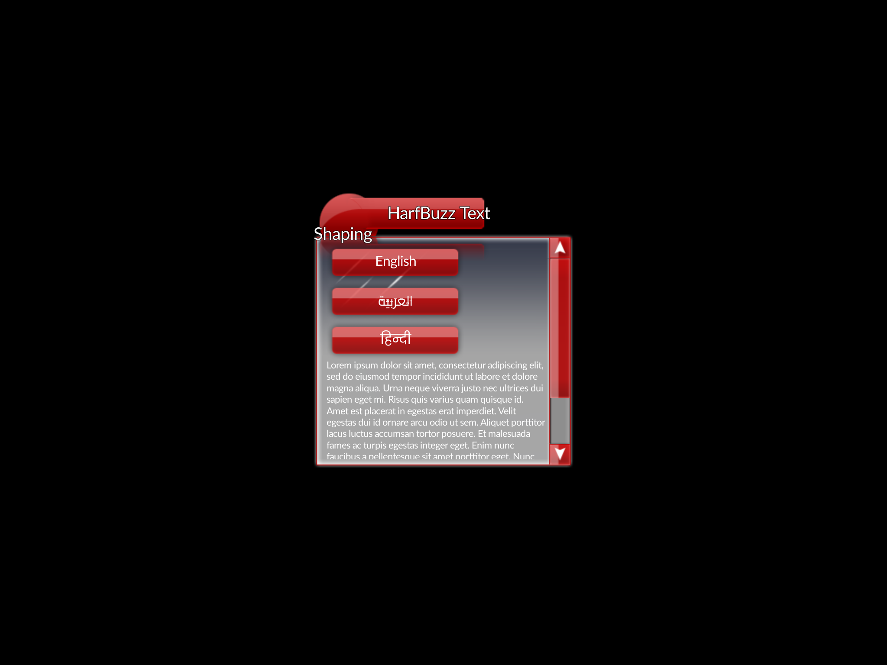</a>
    <div class="example-info">
      <p><strong><a href="official/basic/harfbuzz/main.cjs">公式 HarfBuzz</a></strong></p>
      <p>元のフォントで英語、アラビア語、ヒンディー語の段落をシェーピングします。</p>
      <p><code>node packages/sfml.js-rmlui/examples/official.cjs harfbuzz</code></p>
      <p>言語ボタンで段落を切り替えます。Escape で終了します。</p>
      <p><a href="https://github.com/mikke89/RmlUi/tree/6.3/Samples/basic/harfbuzz">上流のアプリケーション</a></p>
    </div>
  </article>

  <article class="example-entry" id="custom-log">
    <a href="screenshots/custom-log.png">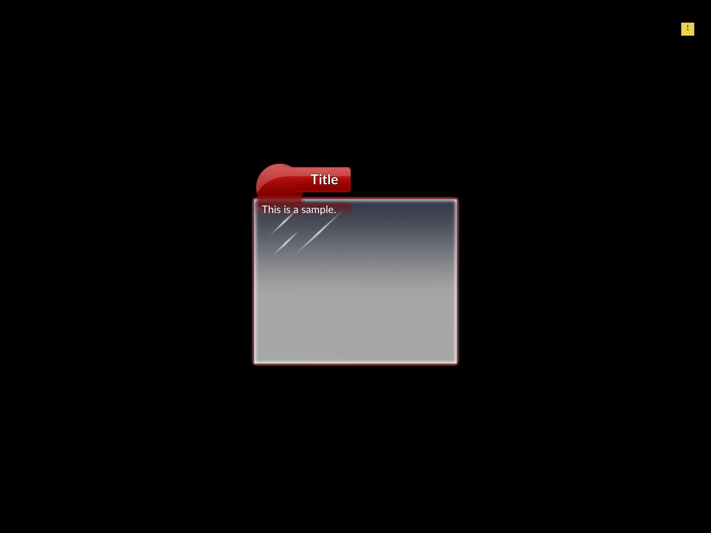</a>
    <div class="example-info">
      <p><strong><a href="official/basic/custom_log/main.cjs">公式カスタムログ</a></strong></p>
      <p>元のネイティブログメッセージとレベル接頭辞を指定ファイルに書き込みます。</p>
      <p><code>node packages/sfml.js-rmlui/examples/official.cjs custom-log --log-file /tmp/rmlui-log.txt</code></p>
      <p>既定のログはシステムの一時ディレクトリに保存します。Escape で終了します。</p>
      <p><a href="https://github.com/mikke89/RmlUi/tree/6.3/Samples/basic/custom_log">上流のアプリケーション</a></p>
    </div>
  </article>

  <article class="example-entry" id="ime">
    <a href="screenshots/ime.png">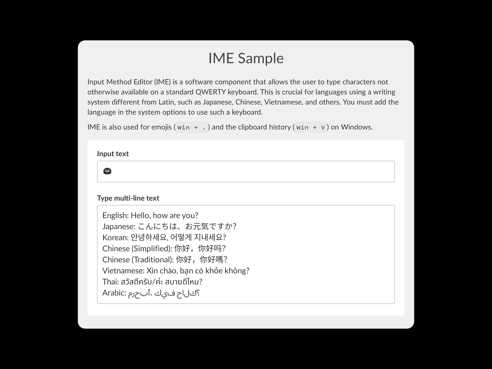</a>
    <div class="example-info">
      <p><strong><a href="official/basic/ime/main.cjs">公式 IME</a></strong></p>
      <p>元の十個のフォントを読み込み、ネイティブの入力欄とテキストエリアを開きます。</p>
      <p>初回に五個の追加 Noto フォントを準備します（38 MB、SHA-256 検証）：<code>npm run download:ime-fonts --prefix packages/sfml.js-rmlui</code>。検証済みのキャッシュは再利用されます。</p>
      <p><code>node packages/sfml.js-rmlui/examples/official.cjs ime</code></p>
      <p>システムの入力方式を選び、入力欄にフォーカスします。Escape で終了します。</p>
      <p><a href="https://github.com/mikke89/RmlUi/tree/6.3/Samples/basic/ime">上流のアプリケーション</a></p>
    </div>
  </article>

  <article class="example-entry" id="invaders">
    <a href="screenshots/invaders.png">
      
    </a>
    <div class="example-info">
      <p><strong><a href="official/invaders/main.cjs">Invaders</a></strong></p>
      <p>元の C++ ゲーム、メニュー、デコレーターとハイスコアモデルを実行します。</p>
      <p><code>node packages/sfml.js-rmlui/examples/official.cjs invaders</code></p>
      <p>左右キーで移動、Space で発射、Escape で一時停止メニュー、F8 で Debugger を切り替えます。元のメニューから再開や終了を選択します。</p>
      <p>先にパッケージをビルドしてください。ゲームモジュールは同じビルドディレクトリで生成され、読み込み時にコンパイラーは不要です。macOS は検証済み、Linux と Windows の実行は未検証です。</p>
      <p>スコアはアプリのデータ領域に保存します。<code>--scores-file /absolute/path/scores.txt</code> は既存の親ディレクトリーを指定します。<code>--frames 8 --exercise</code> でフレーム数を制限して開始します。</p>
      <p><a href="official/invaders/native/application.cc">ネイティブ登録</a> · <a href="https://github.com/mikke89/RmlUi/tree/6.3/Samples/invaders">上流アプリ</a></p>
    </div>
  </article>

  <article class="example-entry" id="lua-invaders">
    <a href="screenshots/lua-invaders.png">
      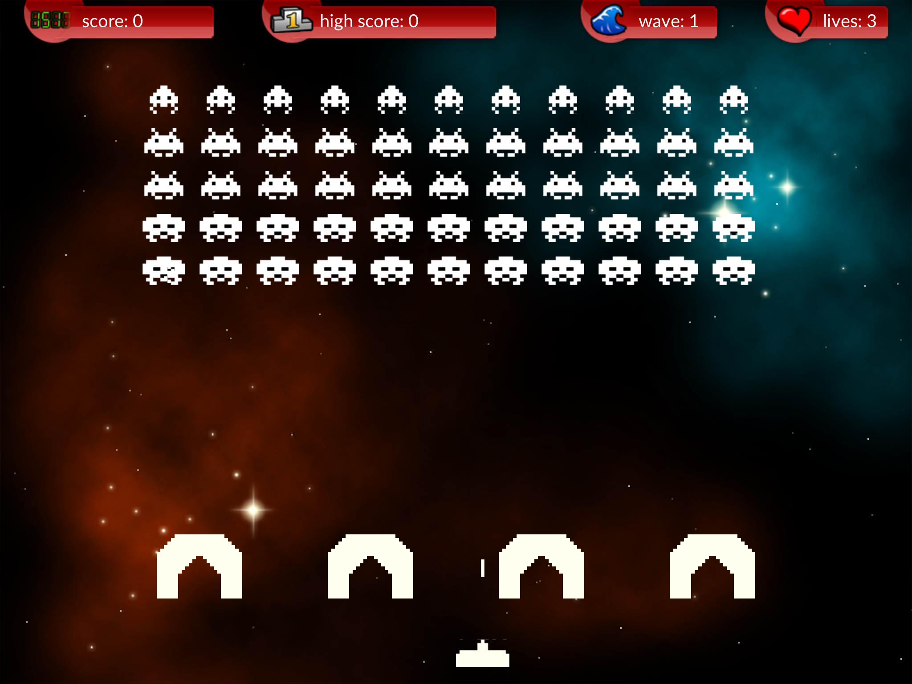
    </a>
    <div class="example-info">
      <p><strong><a href="official/lua_invaders/main.cjs">Lua Invaders</a></strong></p>
      <p>元の Lua 文書と Game テーブルで元のネイティブゲームを動かします。</p>
      <p><code>node packages/sfml.js-rmlui/examples/official.cjs lua-invaders</code></p>
      <p>左右キーで移動、Space で発射、Escape で一時停止メニュー、F8 で Debugger を切り替えます。設定はスコアファイルと同じ場所に保存します。</p>
      <p>先にパッケージをビルドしてください。ゲームモジュールは同じビルドディレクトリで生成され、読み込み時にコンパイラーは不要です。macOS は検証済み、Linux と Windows の実行は未検証です。</p>
      <p><code>--scores-file /absolute/path/scores.txt</code> は既存の親ディレクトリーを指定します。<code>--frames 8 --exercise</code> でフレーム数を制限して開始します。</p>
      <p><a href="official/lua_invaders/native/application.cc">ネイティブ登録</a> · <a href="https://github.com/mikke89/RmlUi/tree/6.3/Samples/lua_invaders">上流アプリとスクリプト</a></p>
    </div>
  </article>

  <article class="example-entry" id="visual-tests">
    <a href="screenshots/clip-mask.png">
      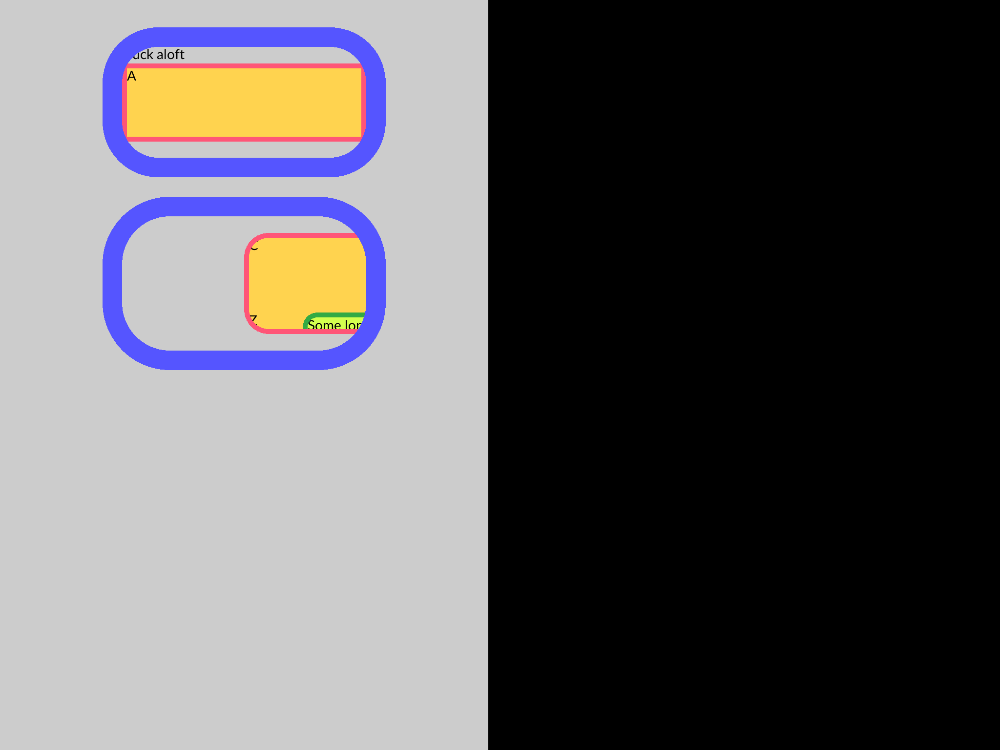
    </a>
    <div class="example-info">
      <p><strong><a href="official.cjs">VisualTests ブラウザー</a></strong></p>
      <p>上流の視覚テスト 113 ページを閲覧</p>
      <p><code>node packages/sfml.js-rmlui/examples/official.cjs visual/clip_mask</code></p>
      <p><strong>操作</strong>：F6 / F7 でページを切り替え、Escape で終了します。</p>
      <p>
        <code>--frames 60</code> を付けると 60 フレーム後に終了します。
        <code>--frames N</code> は正の整数を受け取り、時間を限定したスモーク実行に使えます。
        上流のアサーション機構を含まないプレビューです。
      </p>
      <p>
        <a href="https://github.com/mikke89/RmlUi/tree/6.3/Tests/Data/VisualTests">上流 VisualTests</a> ·
        <a href="../../../docs/rmlui/rendering.ja.md">描画対応範囲</a>
      </p>
    </div>
  </article>
</div>

113 ページの VisualTests アサーション、実際の IME 検証、ゲームの残りのプラットフォーム対応、プロジェクト全体の独立した受け入れ検証は未完了です。描画とモジュールの検証結果は各ガイドに記録されています。画像は実行中のネイティブアプリケーションです。

[全サンプル](../../sfml.js/examples/README.ja.md) · [RmlUi クイックスタート](../../../docs/rmlui/getting-started.ja.md)
