# RmlUi 예제

[English](README.md) · [简体中文](README.zh-CN.md) · [日本語](README.ja.md) · **한국어**

네이티브 SFML 창에서 RmlUi 문서를 실행합니다. 카운터로 시작해 테마, 이동 가능한 창, 템플릿, 시각 테스트 페이지를 살펴보세요.

## 준비 사항

모든 명령은 **monorepo 루트**에서 실행합니다. bootstrap은 의존성을 설치하고 패키지를 빌드합니다. 디스플레이와 OpenGL이 필요하며 macOS 빌드는 Xcode Command Line Tools와 CMake도 필요합니다. [빠른 시작](../../../docs/rmlui/getting-started.ko.md)을 참고하세요.

```sh
node tools/bootstrap.cjs
```

RmlUi TypeScript 소스를 수정한 뒤에는 `npm run build:ts --prefix packages/sfml.js-rmlui`를 실행합니다. 예제는 로컬에서 빌드한 패키지를 사용합니다.

실행기는 패키지의 `third_party/rmlui`에 있는 RmlUi 6.3 기본 리소스를 읽습니다. 전체 항목을 보려면:

```sh
node packages/sfml.js-rmlui/examples/official.cjs --list
```

## 예제 목록

<div class="example-gallery">
  <article class="example-entry" id="demo">
    <a href="screenshots/demo.png">
      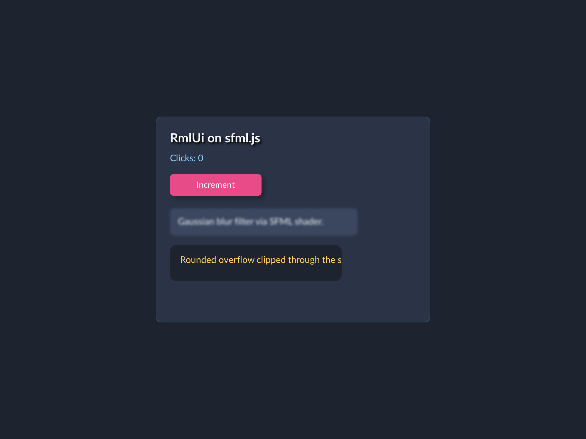
    </a>
    <div class="example-info">
      <p><strong><a href="demo.cjs">카운터</a></strong></p>
      <p>JavaScript 리스너, 외부 RML, 블러, 드롭 섀도, 둥근 클리핑</p>
      <p><code>node packages/sfml.js-rmlui/examples/demo.cjs</code></p>
      <p><strong>조작</strong>: Increment를 클릭해 값을 올립니다. 창을 닫으면 종료합니다.</p>
      <p><a href="assets/tutorial.rml">RML</a> · <a href="assets/tutorial.rcss">RCSS</a></p>
    </div>
  </article>

  <article class="example-entry" id="variables">
    <a href="screenshots/variables.png">
      
    </a>
    <div class="example-info">
      <p><strong><a href="official/basic/variables/main.cjs">테마와 변수</a></strong></p>
      <p>테마 전환, 강조색, 호버 스타일</p>
      <p><code>node packages/sfml.js-rmlui/examples/official.cjs variables</code></p>
      <p>
        <strong>조작</strong>: 1은 어두운 테마, 2는 밝은 테마, 3은 고대비,
        R은 무작위 강조색, C는 강조색 초기화입니다. Escape로 종료합니다.
        미션 버튼은 호버 스타일만 보여 주며 상위 프로젝트에도 클릭 동작이 없습니다.
      </p>
      <p>
        원래 스타일시트는 고정 <code>px</code> 길이를 사용합니다.
        <code>highDpi: false</code>로 Retina에서도 1024 × 768 프레임버퍼를
        유지하여 상위 프로젝트의 창 크기에 맞춥니다.
        F8로 Debugger를 전환하고 Ctrl +/-/0로 Shell 표시 밀도를 조정합니다.
      </p>
      <p><a href="https://github.com/mikke89/RmlUi/blob/6.3/Samples/basic/variables/data/variables.rml">상위 RML</a></p>
    </div>
  </article>

  <article class="example-entry" id="drag">
    <a href="screenshots/drag.png">
      
    </a>
    <div class="example-info">
      <p><strong><a href="official/tutorial/drag/main.cjs">드래그 튜토리얼</a></strong></p>
      <p>이동 및 크기 조절이 가능한 인벤토리 창</p>
      <p><code>node packages/sfml.js-rmlui/examples/official.cjs drag</code></p>
      <p><strong>조작</strong>: 마우스로 두 창을 이동하고 크기를 바꿉니다. Escape로 종료합니다.</p>
      <p>튜토리얼의 창 설정을 이식한 것으로 상위 프로젝트의 <code>basic/drag</code> 앱과는 별개입니다.</p>
      <p><a href="https://github.com/mikke89/RmlUi/blob/6.3/Samples/tutorial/drag/data/inventory.rml">상위 RML</a></p>
    </div>
  </article>

  <article class="example-entry" id="template">
    <a href="screenshots/template.png">
      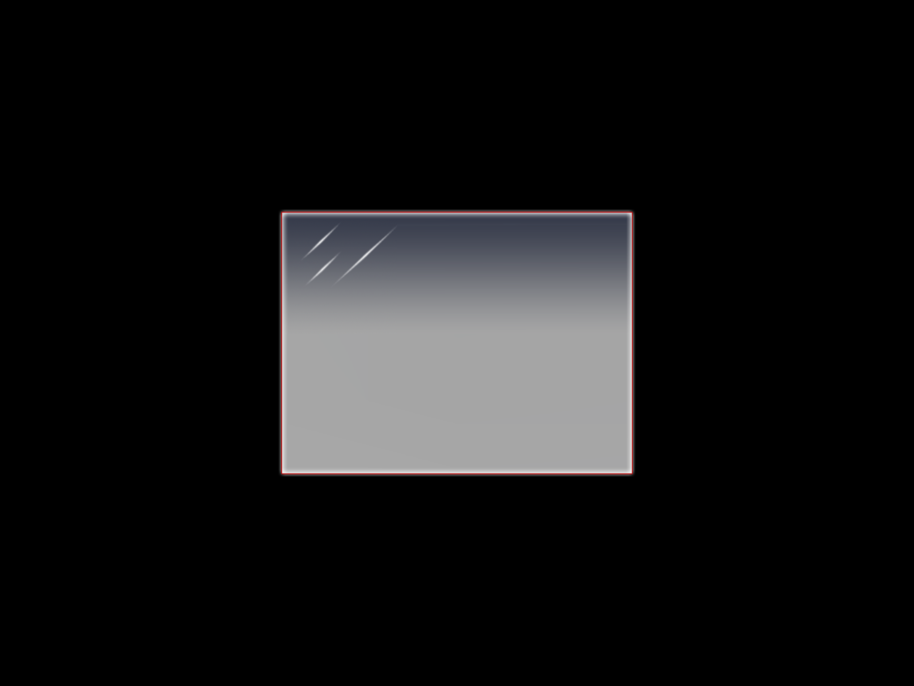
    </a>
    <div class="example-info">
      <p><strong><a href="official/tutorial/template/main.cjs">템플릿 튜토리얼</a></strong></p>
      <p>9분할 텍스처와 외부 템플릿</p>
      <p><code>node packages/sfml.js-rmlui/examples/official.cjs template</code></p>
      <p><strong>조작</strong>: 장식된 창을 살펴봅니다. Escape로 종료합니다.</p>
      <p><a href="https://github.com/mikke89/RmlUi/blob/6.3/Samples/tutorial/template/data/tutorial.rml">상위 RML</a></p>
    </div>
  </article>

  <article class="example-entry" id="load-document">
    <a href="screenshots/load-document.png">
      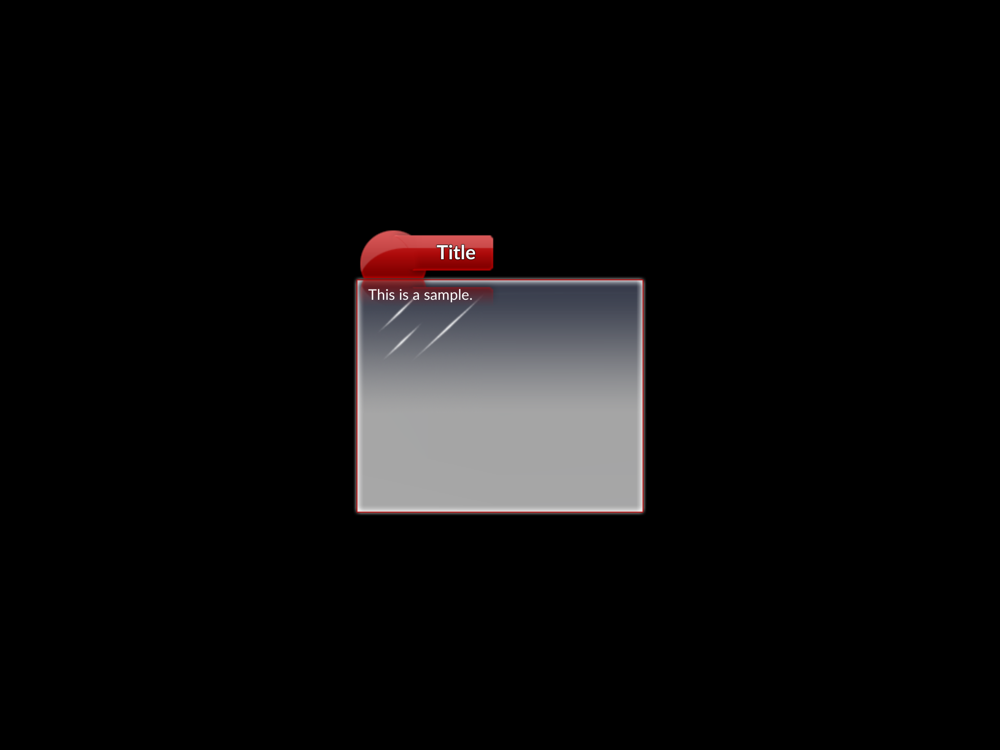
    </a>
    <div class="example-info">
      <p><strong><a href="official/basic/load_document/main.cjs">문서 로드</a></strong></p>
      <p>원본 템플릿, 글꼴, 텍스처와 함께 상위 문서를 로드</p>
      <p><code>node packages/sfml.js-rmlui/examples/official.cjs load-document</code></p>
      <p><strong>조작</strong>: 로드된 문서를 살펴봅니다. Escape로 종료합니다. 다른 상위 데모의 애플리케이션 동작은 연결하지 않았습니다.</p>
      <p><a href="https://github.com/mikke89/RmlUi/blob/6.3/Samples/assets/demo.rml">상위 RML</a></p>
    </div>
  </article>

  <article class="example-entry" id="font-effect">
    <a href="screenshots/font-effect.png">
      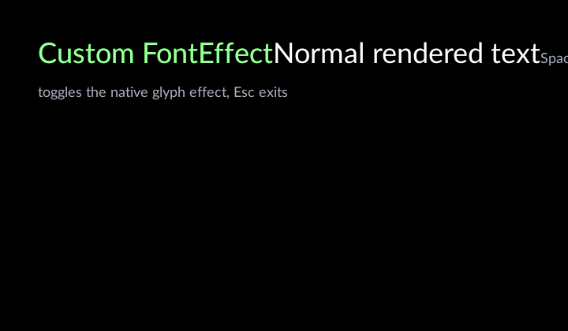
    </a>
    <div class="example-info">
      <p><strong><a href="font-effect.cjs">사용자 정의 글꼴 효과</a></strong></p>
      <p>JavaScript FontEffectInstancer와 네이티브 글리프 텍스처 콜백</p>
      <p><code>node packages/sfml.js-rmlui/examples/font-effect.cjs</code></p>
      <p><strong>조작</strong>: Space로 글로우 효과를 전환하고 Escape로 종료합니다.</p>
      <p>제한된 스모크 실행: <code>--frames N</code>, <code>--screenshot path.png</code>로 마지막 프레임을 캡처합니다.</p>
    </div>
  </article>

  <article class="example-entry" id="streams">
    <a href="screenshots/streams.png">
      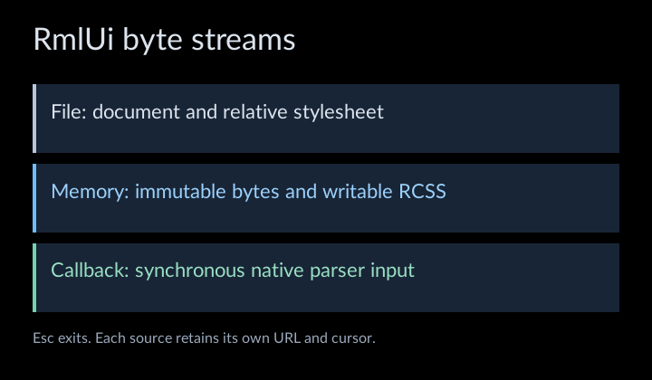
    </a>
    <div class="example-info">
      <p><strong><a href="streams.cjs">바이트 스트림</a></strong></p>
      <p>파일 문서 로드, 네이티브 메모리 사본, 동기 콜백 RCSS 입력</p>
      <p><code>node packages/sfml.js-rmlui/examples/streams.cjs</code></p>
      <p><strong>조작</strong>: Escape로 종료합니다. <code>--frames N --screenshot path.png</code>으로 제한 프레임을 저장합니다.</p>
      <p><a href="../../../docs/rmlui/streams.ko.md">Stream API 및 수명 안내</a></p>
    </div>
  </article>

  <article class="example-entry" id="element-utilities">
    <a href="screenshots/element-utilities.png">
      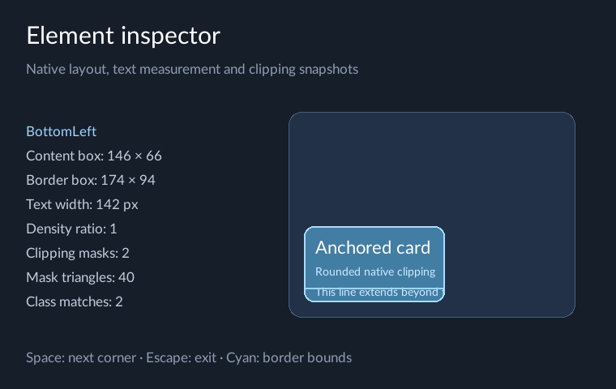
    </a>
    <div class="example-info">
      <p><strong><a href="element-utilities.cjs">요소 검사기</a></strong></p>
      <p>모서리 배치, 텍스트 측정, 투영 경계와 소유 클리핑 지오메트리</p>
      <p><code>node packages/sfml.js-rmlui/examples/element-utilities.cjs</code></p>
      <p><strong>조작</strong>: Space로 다음 모서리, Escape로 종료합니다.</p>
      <p><code>--frames 6 --exercise --screenshot path.png</code>로 네 모서리를 검증하고 촬영합니다.</p>
      <p><a href="../../../docs/rmlui/element-utilities.ko.md">요소 유틸리티와 사본 소유권</a></p>
      <p><a href="../../../docs/rmlui/render-state.ko.md">네이티브 지오메트리 클리핑과 렌더 상태 복원</a></p>
    </div>
  </article>

  <article class="example-entry" id="render-layers">
    <a href="screenshots/render-layers.png">
      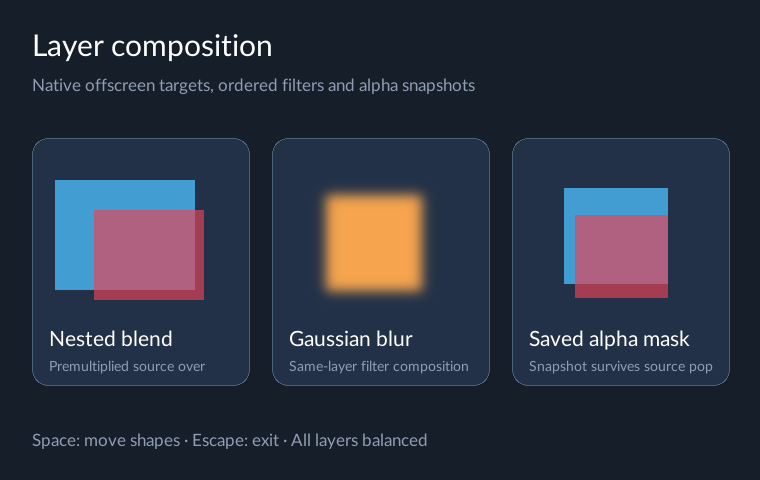
    </a>
    <div class="example-info">
      <p><strong><a href="render-layers.cjs">레이어 합성</a></strong></p>
      <p>균형 있는 네이티브 층, 미리 곱한 알파, 자기 합성 필터와 저장 마스크</p>
      <p><code>node packages/sfml.js-rmlui/examples/render-layers.cjs</code></p>
      <p><strong>조작</strong>: Space로 도형 이동, Escape로 종료합니다.</p>
      <p><code>--frames 6 --exercise --screenshot path.png</code>로 두 위치를 확인하고 마지막 프레임을 캡처합니다.</p>
      <p><a href="../../../docs/rmlui/render-state.ko.md#render-layers">레이어 핸들, 필터 소유권과 마스크</a></p>
    </div>
  </article>

  <article class="example-entry" id="callback-textures">
    <a href="screenshots/callback-textures.png">
      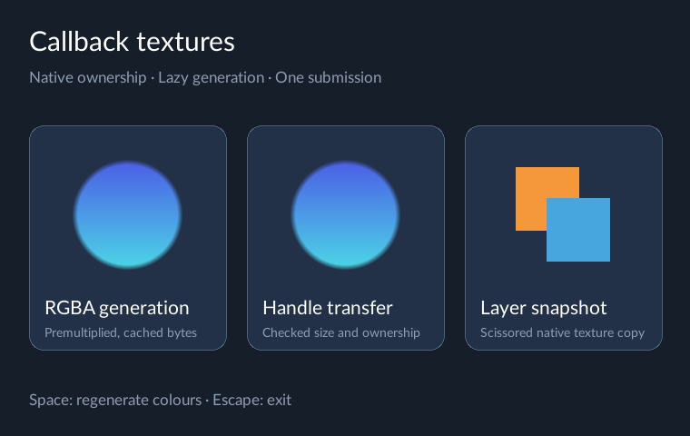
    </a>
    <div class="example-info">
      <p><strong><a href="callback-textures.cjs">콜백 텍스처</a></strong></p>
      <p>지연 사전 곱셈 바이트 생성, 소유 핸들 이전 및 시저 영역 레이어 저장</p>
      <p><code>node packages/sfml.js-rmlui/examples/callback-textures.cjs</code></p>
      <p><strong>조작</strong>: Space로 색상 재생성. Escape로 종료.</p>
      <p><code>--frames 6 --exercise --screenshot path.png</code>로 캐시와 재생성을 검증하고 마지막 프레임을 저장합니다.</p>
      <p><a href="../../../docs/rmlui/render-state.ko.md#callback-textures">제출 방법, 수명 및 소유권</a></p>
    </div>
  </article>

  <article class="example-entry" id="factory-elements">
    <a href="screenshots/factory-elements.png">
      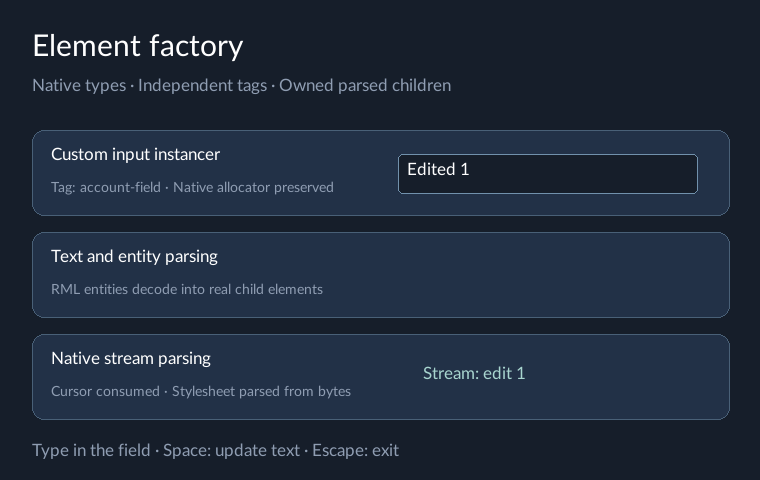
    </a>
    <div class="example-info">
      <p><strong><a href="factory-elements.cjs">요소 팩터리</a></strong></p>
      <p>사용자 컨텍스트와 입력의 생성 및 해제, 소유 문서 스트림, 독립 태그와 Factory 캐시</p>
      <p><code>node packages/sfml.js-rmlui/examples/factory-elements.cjs</code></p>
      <p><strong>조작</strong>: 입력란 편집, Space로 갱신, Escape로 종료합니다.</p>
      <p><code>--frames 6 --exercise --screenshot path.png</code>으로 편집을 검증하고 마지막 프레임을 캡처합니다.</p>
      <p><a href="../../../docs/rmlui/resources.ko.md#factory-parsing-and-caches">Factory 해석과 캐시 안내</a></p>
      <p><a href="../../../docs/rmlui/resources.ko.md#element-instancers">요소 생성기 소유권</a></p>
    </div>
  </article>

  <article class="example-entry" id="data-models">
    <a href="screenshots/data-models.png">
      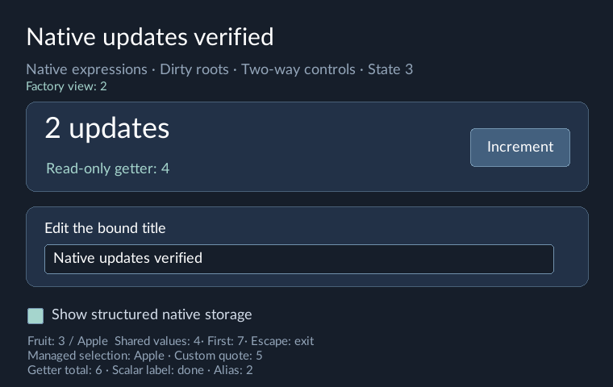
    </a>
    <div class="example-info">
      <p><strong><a href="data-models.cjs">네이티브 데이터 모델</a></strong></p>
      <p>네이티브 스칼라, 재귀 data-for, 공유 배열, 부분 업데이트, getter와 변환, 사용자 정의 Factory 뷰 및 기본 양방향 컨트롤러 위임</p>
      <p><code>node packages/sfml.js-rmlui/examples/data-models.cjs</code></p>
      <p><strong>조작</strong>: Increment로 개수 갱신, 제목 편집, 상세 토글, Escape로 종료합니다.</p>
      <p><code>--frames 6 --exercise --screenshot path.png</code>으로 실제 바인딩을 검증하고 마지막 프레임을 캡처합니다.</p>
      <p><a href="../../../docs/rmlui/data-models.ko.md">데이터 모델 계약과 남은 범위</a></p>
    </div>
  </article>

  <article class="example-entry" id="data-binding">
    <a href="screenshots/data-binding-events.png">
      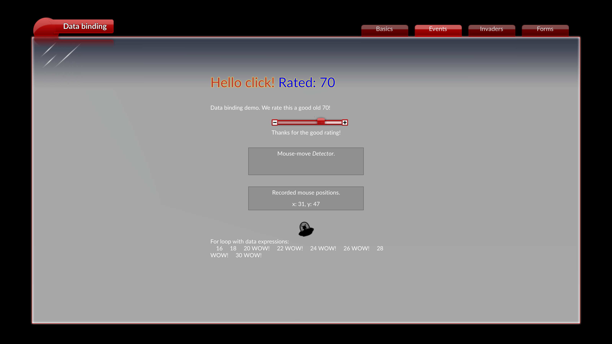
    </a>
    <div class="example-info">
      <p><strong><a href="official/basic/data_binding/main.cjs">공식 데이터 바인딩</a></strong></p>
      <p>Basics, Events, Invaders, Forms 네 모델에서 네이티브 표현식과 동기 배열 변경을 실행</p>
      <p><code>node packages/sfml.js-rmlui/examples/official.cjs data-binding</code></p>
      <p><strong>조작</strong>: 탭 전환, 필드 편집, 마우스 위치 기록과 삭제, 주제 추가와 삭제, 게임 시작과 사격. Escape로 종료합니다.</p>
      <p><code>--frames 45 --exercise --panel invaders --screenshot path.png</code>는 실제 상태를 확인하고 선택한 탭을 캡처합니다.</p>
      <p><a href="screenshots/data-binding-basics.png">Basics</a> · <a href="screenshots/data-binding-invaders.png">Invaders</a> · <a href="screenshots/data-binding-forms.png">Forms</a></p>
      <p><a href="https://github.com/mikke89/RmlUi/blob/6.3/Samples/basic/data_binding/src/main.cpp">상류 애플리케이션</a></p>
    </div>
  </article>

  <article class="example-entry" id="basic-demo">
    <a href="screenshots/basic-demo-sandbox.png">
      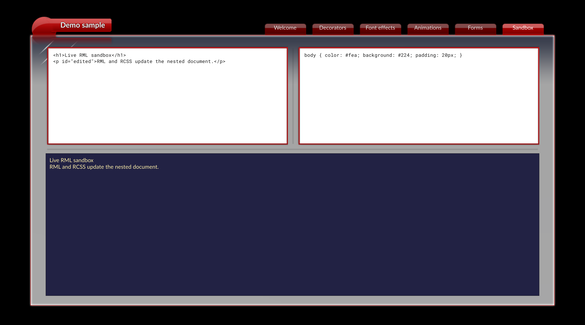
    </a>
    <div class="example-info">
      <p><strong><a href="official/basic/demo/main.cjs">공식 컨트롤과 샌드박스</a></strong></p>
      <p>원본 여섯 탭, 데코레이터와 색상 보간, 폼 컨트롤, 4초 제출 애니메이션, 실시간 RML/RCSS 편집기</p>
      <p><code>node packages/sfml.js-rmlui/examples/official.cjs basic-demo</code></p>
      <p><strong>조작</strong>: 탭 전환, 보간 설정, 폼 제출, 샌드박스 편집. Escape는 열린 주제 선택창을 취소하며 그 외에는 종료합니다. F8로 Debugger를 전환합니다.</p>
      <p><code>--panel sandbox --frames 8 --exercise --screenshot path.png</code>는 양쪽 편집기를 검증하고 샌드박스를 캡처합니다. 패널: welcome, decorators, font-effects, animations, controls, sandbox.</p>
      <p><a href="screenshots/basic-demo-controls.png">폼 컨트롤</a> · <a href="official/basic/demo/DemoWindow.cjs">윈도 로직</a> · <a href="official/basic/demo/DemoEventListener.cjs">이벤트 리스너</a></p>
      <p><a href="https://github.com/mikke89/RmlUi/blob/6.3/Samples/basic/demo/src/main.cpp">상류 애플리케이션</a></p>
    </div>
  </article>

  <article class="example-entry" id="tree-view">
    <a href="screenshots/tree-view.png">
      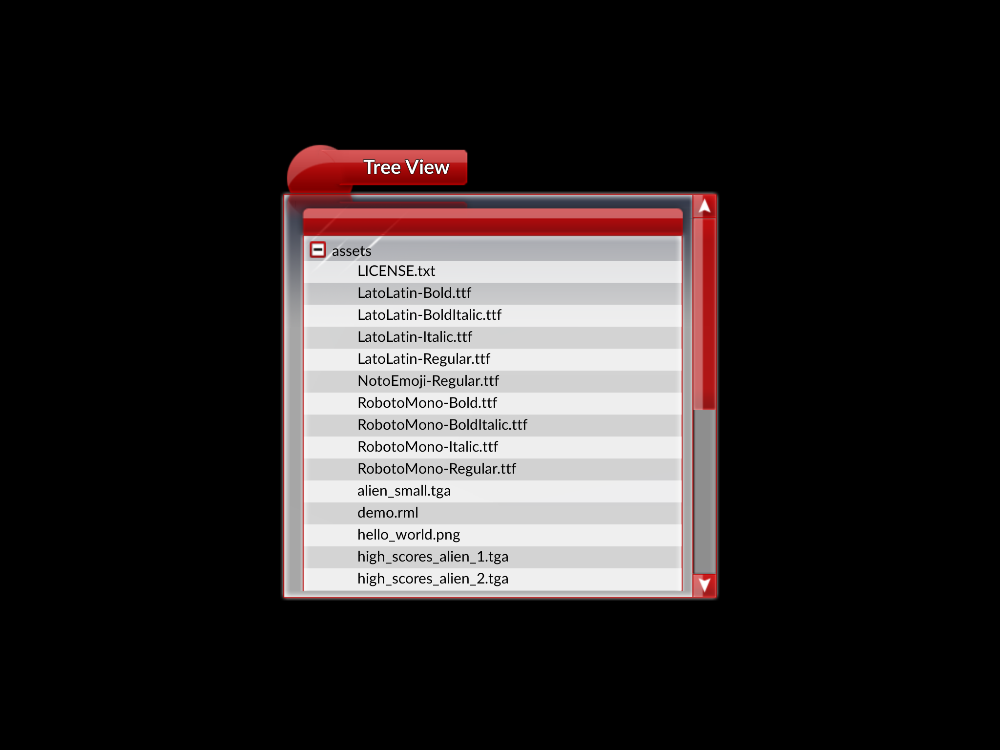
    </a>
    <div class="example-info">
      <p><strong><a href="official/basic/tree_view/main.cjs">공식 트리 뷰</a></strong></p>
      <p>예제 디렉터리를 읽고 FileBrowser 규칙에 따라 하위 항목 표시를 전환</p>
      <p><code>node packages/sfml.js-rmlui/examples/official.cjs tree-view</code></p>
      <p><strong>조작</strong>: 디렉터리 화살표를 클릭해 펼치거나 접습니다. Escape로 종료합니다.</p>
      <p><code>--frames 12 --exercise --screenshot path.png</code>는 실제 디렉터리 전환을 확인합니다.</p>
      <p><a href="https://github.com/mikke89/RmlUi/blob/6.3/Samples/basic/tree_view/src/FileBrowser.cpp">상류 애플리케이션</a></p>
    </div>
  </article>

  <article class="example-entry" id="animation">
    <a href="screenshots/animation.png">
      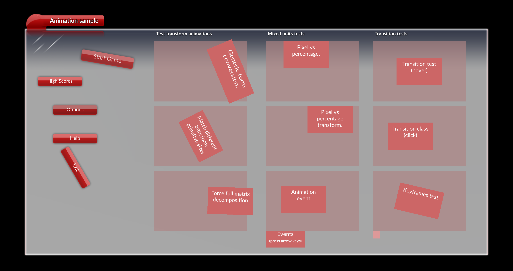
    </a>
    <div class="example-info">
      <p><strong><a href="official/basic/animation/main.cjs">공식 애니메이션</a></strong></p>
      <p>원본 변환 순서, 색상 키, 페이드 주기, 전환과 애니메이션 이벤트</p>
      <p><code>node packages/sfml.js-rmlui/examples/official.cjs animation</code></p>
      <p><strong>조작</strong>: Space로 일시 정지, Return으로 한 번 실행, +/-로 미세 조정, 방향키로 애니메이션, F8로 Debugger 전환, Escape로 종료합니다.</p>
      <p><code>--frames 8 --exercise --screenshot path.png</code>는 정지, 한 번 실행 및 클릭을 확인한 뒤 캡처합니다.</p>
      <p><a href="https://github.com/mikke89/RmlUi/blob/6.3/Samples/basic/animation/src/main.cpp">상류 애플리케이션</a></p>
    </div>
  </article>

  <article class="example-entry" id="benchmark">
    <a href="screenshots/benchmark.png">
      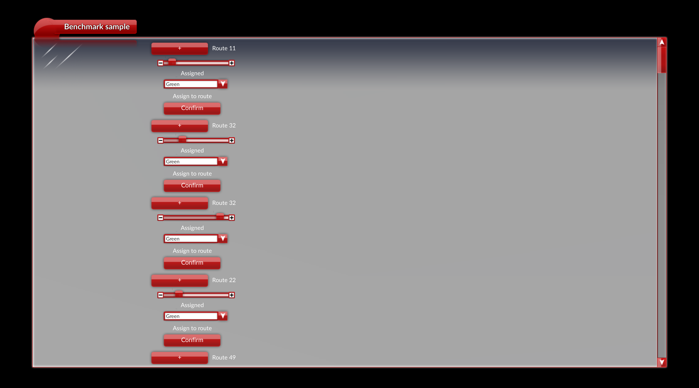
    </a>
    <div class="example-info">
      <p><strong><a href="official/basic/benchmark/main.cjs">공식 벤치마크</a></strong></p>
      <p>업데이트마다 원본 50행을 재생성하며 독립 렌더링과 200항목 FPS 링을 유지합니다.</p>
      <p><code>node packages/sfml.js-rmlui/examples/official.cjs benchmark</code></p>
      <p><strong>조작</strong>: Space로 렌더링 정지, Down으로 한 번 렌더링, Return으로 행 업데이트 정지, Right로 한 번 업데이트, F8로 Debugger 전환, Escape로 종료합니다.</p>
      <p><code>--frames 3 --screenshot path.png</code>로 프레임 수를 제한해 캡처합니다.</p>
      <p><a href="https://github.com/mikke89/RmlUi/blob/6.3/Samples/basic/benchmark/src/main.cpp">상류 애플리케이션</a></p>
    </div>
  </article>

  <article class="example-entry" id="basic-drag">
    <a href="screenshots/basic-drag.png">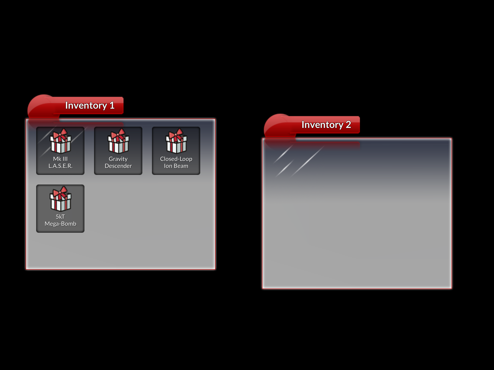</a>
    <div class="example-info">
      <p><strong><a href="official/basic/drag/main.cjs">공식 드래그</a></strong></p>
      <p>네이티브가 소유한 아이콘을 창 사이로 옮기고 순서를 변경합니다.</p>
      <p><code>node packages/sfml.js-rmlui/examples/official.cjs basic-drag</code></p>
      <p>아이콘을 다른 창이나 앞쪽 아이콘으로 드래그합니다. Escape로 종료합니다.</p>
      <p><a href="https://github.com/mikke89/RmlUi/tree/6.3/Samples/basic/drag">업스트림 애플리케이션</a></p>
    </div>
  </article>

  <article class="example-entry" id="effects">
    <a href="screenshots/effects.png">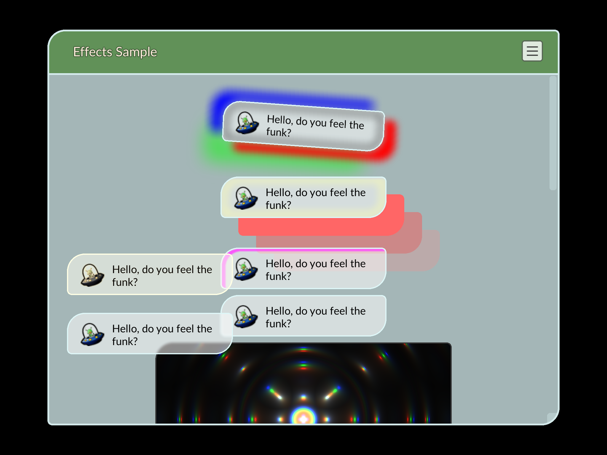</a>
    <div class="example-info">
      <p><strong><a href="official/basic/effects/main.cjs">공식 효과</a></strong></p>
      <p>원본 색상 필터, 흐림, 그림자, 변환 및 불투명도를 조절합니다.</p>
      <p><code>node packages/sfml.js-rmlui/examples/official.cjs effects</code></p>
      <p>메뉴에서 슬라이더를 조절하거나 설정을 초기화합니다. Escape로 종료합니다.</p>
      <p><a href="https://github.com/mikke89/RmlUi/tree/6.3/Samples/basic/effects">업스트림 애플리케이션</a></p>
    </div>
  </article>

  <article class="example-entry" id="transform">
    <a href="screenshots/transform.png">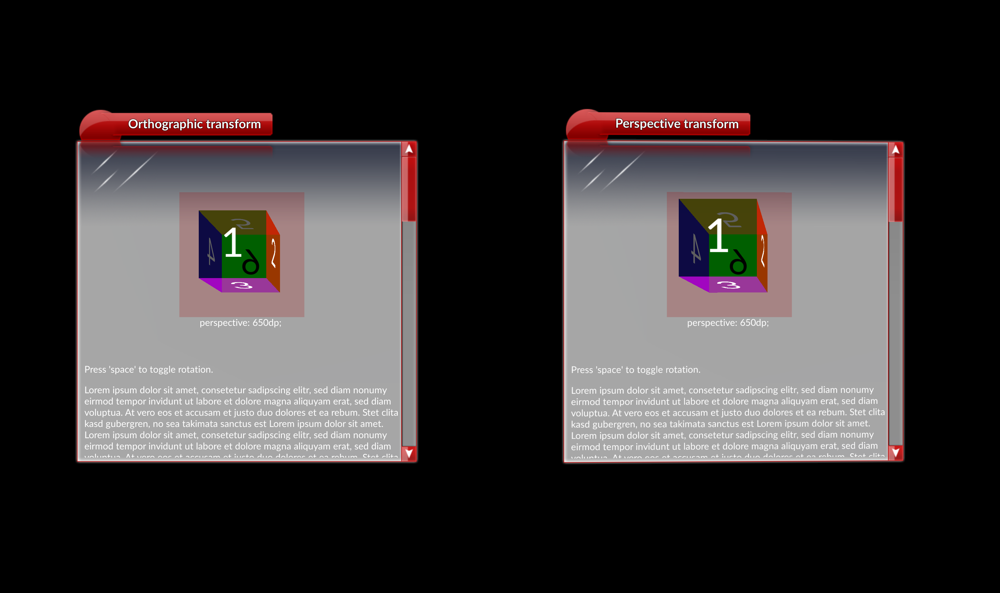</a>
    <div class="example-info">
      <p><strong><a href="official/basic/transform/main.cjs">공식 변환</a></strong></p>
      <p>원본 문서를 직교 투영과 원근 투영으로 회전합니다.</p>
      <p><code>node packages/sfml.js-rmlui/examples/official.cjs transform</code></p>
      <p>Space로 회전을 일시 정지하고 Escape로 종료합니다.</p>
      <p><a href="https://github.com/mikke89/RmlUi/tree/6.3/Samples/basic/transform">업스트림 애플리케이션</a></p>
    </div>
  </article>

  <article class="example-entry" id="svg">
    <a href="screenshots/svg.png">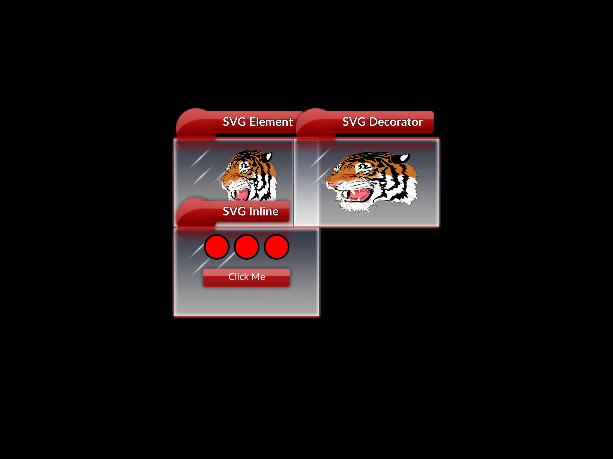</a>
    <div class="example-info">
      <p><strong><a href="official/basic/svg/main.cjs">공식 SVG</a></strong></p>
      <p>원본 SVG 요소, 데코레이터 및 인라인 업데이트를 렌더링합니다.</p>
      <p><code>node packages/sfml.js-rmlui/examples/official.cjs svg</code></p>
      <p>원본 업데이트 컨트롤을 사용합니다. Escape로 종료합니다.</p>
      <p><a href="https://github.com/mikke89/RmlUi/tree/6.3/Samples/basic/svg">업스트림 애플리케이션</a></p>
    </div>
  </article>

  <article class="example-entry" id="lottie">
    <a href="screenshots/lottie.png">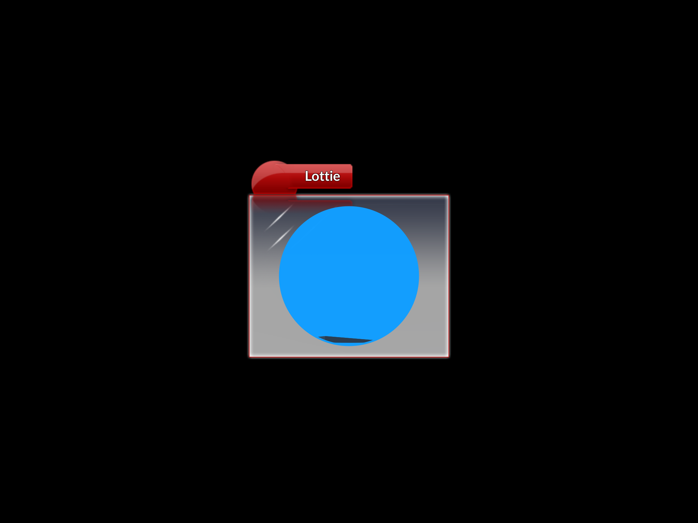</a>
    <div class="example-info">
      <p><strong><a href="official/basic/lottie/main.cjs">공식 Lottie</a></strong></p>
      <p>네이티브 프레임 시간과 래스터화로 원본 산 애니메이션을 재생합니다.</p>
      <p><code>node packages/sfml.js-rmlui/examples/official.cjs lottie</code></p>
      <p>애니메이션이 자동으로 반복됩니다. Escape로 종료합니다.</p>
      <p><a href="https://github.com/mikke89/RmlUi/tree/6.3/Samples/basic/lottie">업스트림 애플리케이션</a></p>
    </div>
  </article>

  <article class="example-entry" id="bitmap-font">
    <a href="screenshots/bitmap-font.png">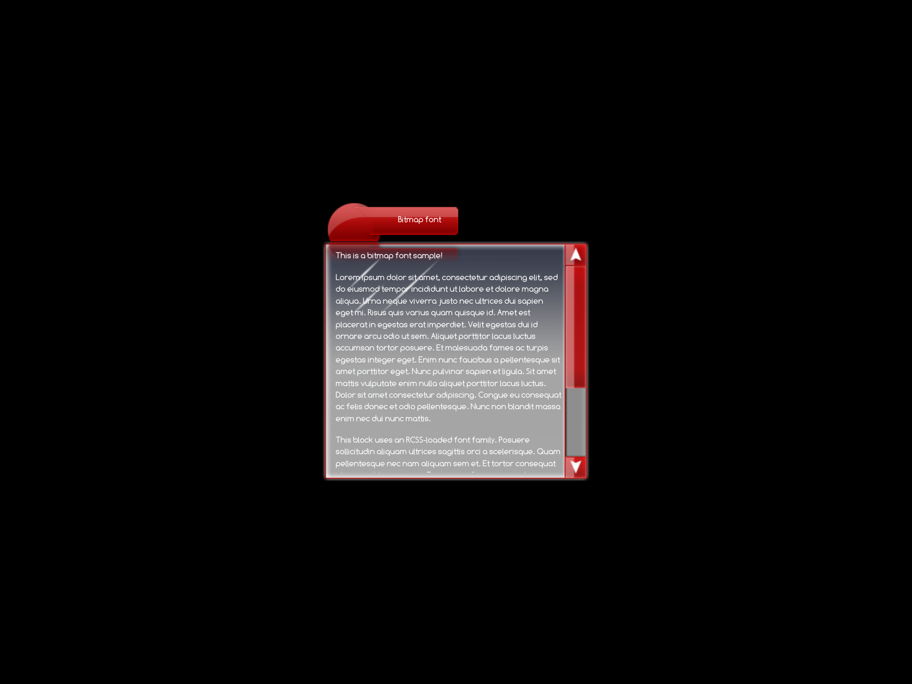</a>
    <div class="example-info">
      <p><strong><a href="official/basic/bitmap_font/main.cjs">공식 비트맵 글꼴</a></strong></p>
      <p>원본 FNT 글리프 이동 폭, 커닝 및 네이티브 아틀라스 텍스처를 사용합니다.</p>
      <p><code>node packages/sfml.js-rmlui/examples/official.cjs bitmap-font</code></p>
      <p>원본 세 문단을 확인합니다. Escape로 종료합니다.</p>
      <p><a href="https://github.com/mikke89/RmlUi/tree/6.3/Samples/basic/bitmap_font">업스트림 애플리케이션</a></p>
    </div>
  </article>

  <article class="example-entry" id="harfbuzz">
    <a href="screenshots/harfbuzz.png">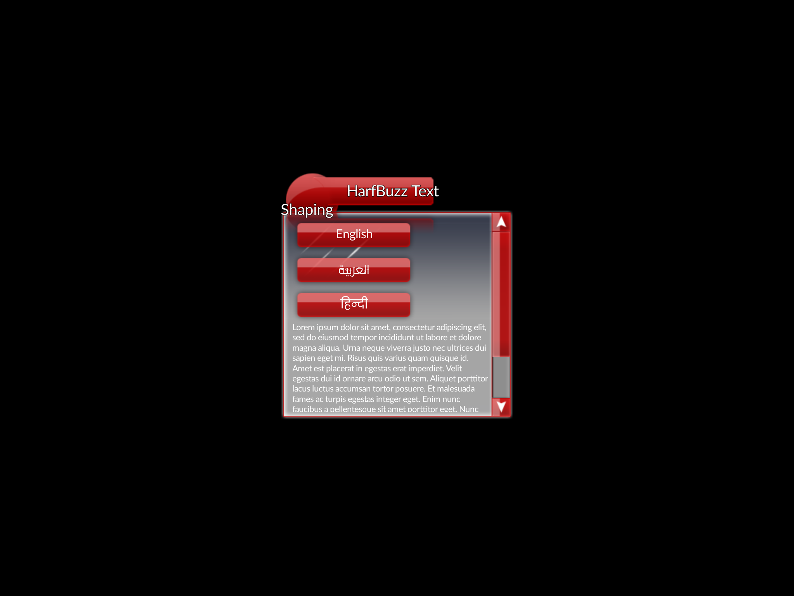</a>
    <div class="example-info">
      <p><strong><a href="official/basic/harfbuzz/main.cjs">공식 HarfBuzz</a></strong></p>
      <p>원본 글꼴로 영어, 아랍어 및 힌디어 문단을 셰이핑합니다.</p>
      <p><code>node packages/sfml.js-rmlui/examples/official.cjs harfbuzz</code></p>
      <p>언어 버튼으로 문단을 전환합니다. Escape로 종료합니다.</p>
      <p><a href="https://github.com/mikke89/RmlUi/tree/6.3/Samples/basic/harfbuzz">업스트림 애플리케이션</a></p>
    </div>
  </article>

  <article class="example-entry" id="custom-log">
    <a href="screenshots/custom-log.png">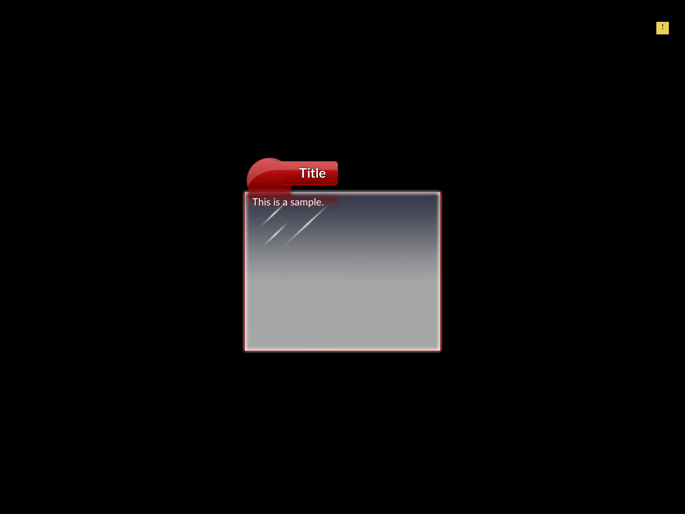</a>
    <div class="example-info">
      <p><strong><a href="official/basic/custom_log/main.cjs">공식 사용자 지정 로그</a></strong></p>
      <p>원본 네이티브 로그 메시지와 등급 접두사를 지정한 파일에 기록합니다.</p>
      <p><code>node packages/sfml.js-rmlui/examples/official.cjs custom-log --log-file /tmp/rmlui-log.txt</code></p>
      <p>기본 로그는 시스템 임시 디렉터리에 저장합니다. Escape로 종료합니다.</p>
      <p><a href="https://github.com/mikke89/RmlUi/tree/6.3/Samples/basic/custom_log">업스트림 애플리케이션</a></p>
    </div>
  </article>

  <article class="example-entry" id="ime">
    <a href="screenshots/ime.png">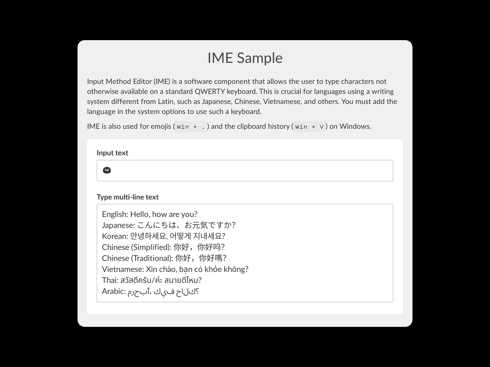</a>
    <div class="example-info">
      <p><strong><a href="official/basic/ime/main.cjs">공식 IME</a></strong></p>
      <p>원본 글꼴 열 개를 로드하고 네이티브 입력 필드와 텍스트 영역을 엽니다.</p>
      <p>처음에 추가 Noto 글꼴 다섯 개를 준비합니다(38 MB, SHA-256 검증): <code>npm run download:ime-fonts --prefix packages/sfml.js-rmlui</code>. 검증된 캐시 파일은 재사용합니다.</p>
      <p><code>node packages/sfml.js-rmlui/examples/official.cjs ime</code></p>
      <p>시스템 입력기를 선택하고 입력 필드에 포커스를 둡니다. Escape로 종료합니다.</p>
      <p><a href="https://github.com/mikke89/RmlUi/tree/6.3/Samples/basic/ime">업스트림 애플리케이션</a></p>
    </div>
  </article>

  <article class="example-entry" id="invaders">
    <a href="screenshots/invaders.png">
      
    </a>
    <div class="example-info">
      <p><strong><a href="official/invaders/main.cjs">Invaders</a></strong></p>
      <p>원본 C++ 게임, 메뉴, 데코레이터와 최고 점수 모델을 실행합니다.</p>
      <p><code>node packages/sfml.js-rmlui/examples/official.cjs invaders</code></p>
      <p>좌우 키로 이동, Space로 발사, Escape로 일시 정지 메뉴, F8로 Debugger를 전환합니다. 원본 메뉴에서 다시 시작하거나 종료합니다.</p>
      <p>먼저 패키지를 빌드하세요. 게임 모듈은 같은 빌드 디렉터리에 생성되며 컴파일러 없는 로드는 macOS, Linux, Windows에서 검증되었습니다. 원본 네이티브 게임과의 비교는 macOS에서 실행하며 Linux와 Windows의 게임 비교는 미검증입니다.</p>
      <p>점수는 앱 데이터 폴더에 저장합니다. <code>--scores-file /absolute/path/scores.txt</code>는 기존 상위 폴더의 파일을 지정합니다. <code>--frames 8 --exercise</code>로 프레임 수를 제한하여 시작합니다.</p>
      <p><a href="official/invaders/native/application.cc">네이티브 등록</a> · <a href="https://github.com/mikke89/RmlUi/tree/6.3/Samples/invaders">상위 프로젝트 앱</a></p>
    </div>
  </article>

  <article class="example-entry" id="lua-invaders">
    <a href="screenshots/lua-invaders.png">
      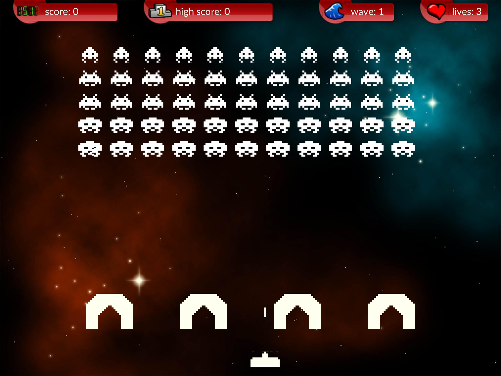
    </a>
    <div class="example-info">
      <p><strong><a href="official/lua_invaders/main.cjs">Lua Invaders</a></strong></p>
      <p>원본 Lua 문서와 Game 테이블로 원본 네이티브 게임을 구동합니다.</p>
      <p><code>node packages/sfml.js-rmlui/examples/official.cjs lua-invaders</code></p>
      <p>좌우 키로 이동, Space로 발사, Escape로 일시 정지 메뉴, F8로 Debugger를 전환합니다. 설정은 점수 파일과 같은 폴더에 저장합니다.</p>
      <p>먼저 패키지를 빌드하세요. 게임 모듈은 같은 빌드 디렉터리에 생성되며 컴파일러 없는 로드는 macOS, Linux, Windows에서 검증되었습니다. 원본 네이티브 게임과의 비교는 macOS에서 실행하며 Linux와 Windows의 게임 비교는 미검증입니다.</p>
      <p><code>--scores-file /absolute/path/scores.txt</code>는 기존 상위 폴더의 파일을 지정합니다. <code>--frames 8 --exercise</code>로 프레임 수를 제한하여 시작합니다.</p>
      <p><a href="official/lua_invaders/native/application.cc">네이티브 등록</a> · <a href="https://github.com/mikke89/RmlUi/tree/6.3/Samples/lua_invaders">상위 프로젝트 앱 및 스크립트</a></p>
    </div>
  </article>

  <article class="example-entry" id="visual-tests">
    <a href="screenshots/clip-mask.png">
      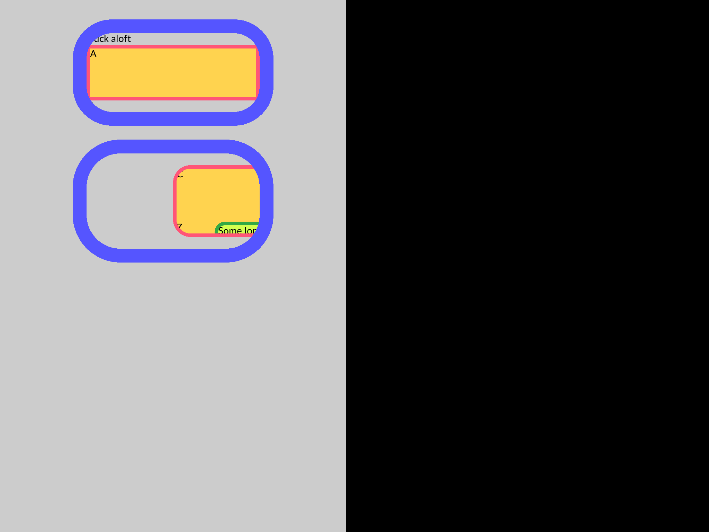
    </a>
    <div class="example-info">
      <p><strong><a href="official.cjs">VisualTests 브라우저</a></strong></p>
      <p>상위 시각 테스트 113개 페이지 탐색</p>
      <p><code>node packages/sfml.js-rmlui/examples/official.cjs visual/clip_mask</code></p>
      <p><strong>조작</strong>: F6 / F7로 페이지를 전환하고 Escape로 종료합니다.</p>
      <p>
        <code>--frames 60</code>을 붙이면 60프레임 뒤 종료합니다.
        <code>--frames N</code>은 양의 정수를 받으므로 제한된 스모크 실행에 유용합니다.
        상위 프로젝트의 검증 하네스를 포함하지 않는 미리보기입니다.
      </p>
      <p>
        <a href="https://github.com/mikke89/RmlUi/tree/6.3/Tests/Data/VisualTests">상위 VisualTests</a> ·
        <a href="../../../docs/rmlui/rendering.ko.md">렌더러 지원 범위</a>
      </p>
    </div>
  </article>
</div>

## 예제 범위와 검증 {#coverage-and-verification}

공식 앱과 튜토리얼 20개 전체, 바인딩 예제 8개, 상위 VisualTests 113페이지를
탐색하는 브라우저를 제공합니다. 각 갤러리 항목에는 실행 명령, 소스 링크,
조작 설명과 네이티브 실행 스크린샷이 있으며 스크린샷 29개가 모두 있습니다.

RmlUi 런타임 테스트는 macOS, Linux, Windows에서 통과했습니다. 네이티브
SFML／GL3 효과 비교와 원본 게임 비교는 macOS에서 실행합니다. VisualTests
런처는 미리보기이며 별도 비교 기록은 정적 페이지 113개와 대화형 페이지
25개를 대상으로 합니다. 내용 검사 4개와 상호작용 검사 2개는 고정 버전의
상위 렌더러에서도 실패합니다. 기록상 바인딩 회귀는 0개지만 전체 VisualTests와
프로젝트 전체의 독립 검증은 아직 완료되지 않았습니다.

macOS 시스템 IME 항목은 기존 승인 결정에 따라 종료되었으며 조합 문자열,
확정, 취소, 캐럿 좌표의 관찰 결과를
[데스크톱 기록](../../../docs/rmlui/audit/6.3/desktop-ime-acceptance.md)에 보존했습니다.
실물 키보드 입력, 새 프로세스의 안정적인 반복 및 후보 창 배치는 미검증입니다.
Linux와 Windows 시스템 IME도 미검증입니다.

[모든 예제](../../sfml.js/examples/README.ko.md) · [RmlUi 빠른 시작](../../../docs/rmlui/getting-started.ko.md)
