# RmlUi examples

**English** · [简体中文](README.zh-CN.md) · [日本語](README.ja.md) · [한국어](README.ko.md)

Run RmlUi documents in native SFML windows. Start with the counter, then explore themes, draggable windows, templates and visual test pages.

## Prerequisites

Run all commands from the **monorepo root**. Bootstrap installs dependencies and builds the packages. A display and OpenGL are required; on macOS the native build also needs Xcode Command Line Tools and CMake. See the [quick start](../../../docs/rmlui/getting-started.md).

```sh
node tools/bootstrap.cjs
```

After editing RmlUi TypeScript sources, run `npm run build:ts --prefix packages/sfml.js-rmlui`. Examples use the locally built package.

The launcher reads RmlUi 6.3's bundled resources under the package's `third_party/rmlui` directory. List all entries:

```sh
node packages/sfml.js-rmlui/examples/official.cjs --list
```

## Examples

<div class="example-gallery">
  <article class="example-entry" id="demo">
    <a href="screenshots/demo.png">
      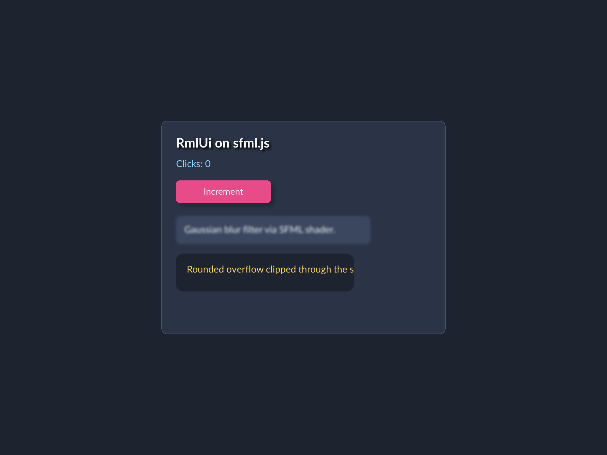
    </a>
    <div class="example-info">
      <p><strong><a href="demo.cjs">Counter</a></strong></p>
      <p>JavaScript event listeners, external RML, blur, drop shadow and rounded clipping</p>
      <p><code>node packages/sfml.js-rmlui/examples/demo.cjs</code></p>
      <p><strong>Controls</strong>: Click Increment to update the counter. Close the window to exit.</p>
      <p><a href="assets/tutorial.rml">RML</a> · <a href="assets/tutorial.rcss">RCSS</a></p>
    </div>
  </article>

  <article class="example-entry" id="variables">
    <a href="screenshots/variables.png">
      
    </a>
    <div class="example-info">
      <p><strong><a href="official/basic/variables/main.cjs">Themes and variables</a></strong></p>
      <p>Theme switching, accent colors and hover styles</p>
      <p><code>node packages/sfml.js-rmlui/examples/official.cjs variables</code></p>
      <p>
        <strong>Controls</strong>: 1 selects dark, 2 light, 3 high contrast,
        R a random accent and C resets the accent. Escape exits.
        Mission buttons demonstrate hover styles only; upstream does not attach click actions.
      </p>
      <p>
        The original stylesheet uses fixed <code>px</code> lengths.
        This sample keeps a 1024 × 768 framebuffer on Retina as well,
        with <code>highDpi: false</code>, matching the upstream window.
        F8 toggles Debugger; Ctrl +/-/0 adjusts the shell's display density.
      </p>
      <p><a href="https://github.com/mikke89/RmlUi/blob/6.3/Samples/basic/variables/data/variables.rml">Upstream RML</a></p>
    </div>
  </article>

  <article class="example-entry" id="drag">
    <a href="screenshots/drag.png">
      
    </a>
    <div class="example-info">
      <p><strong><a href="official/tutorial/drag/main.cjs">Drag tutorial</a></strong></p>
      <p>Movable and resizable inventory windows</p>
      <p><code>node packages/sfml.js-rmlui/examples/official.cjs drag</code></p>
      <p><strong>Controls</strong>: Move and resize both windows with the mouse. Escape exits.</p>
      <p>This ports the tutorial's window setup, separate from the upstream <code>basic/drag</code> application.</p>
      <p><a href="https://github.com/mikke89/RmlUi/blob/6.3/Samples/tutorial/drag/data/inventory.rml">Upstream RML</a></p>
    </div>
  </article>

  <article class="example-entry" id="template">
    <a href="screenshots/template.png">
      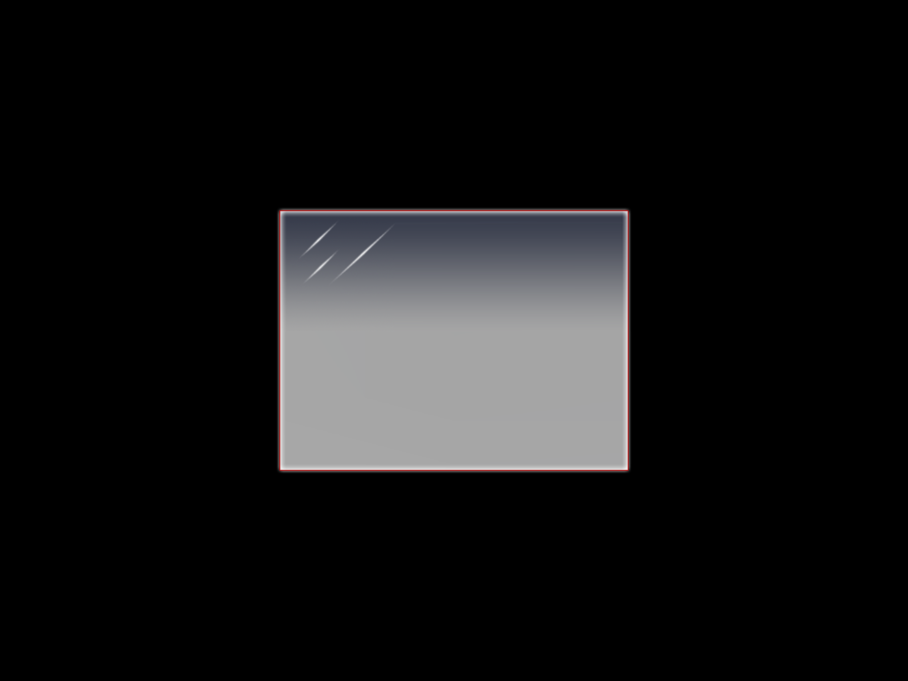
    </a>
    <div class="example-info">
      <p><strong><a href="official/tutorial/template/main.cjs">Template tutorial</a></strong></p>
      <p>Nine-slice textures and external templates</p>
      <p><code>node packages/sfml.js-rmlui/examples/official.cjs template</code></p>
      <p><strong>Controls</strong>: Inspect the decorated window. Escape exits.</p>
      <p><a href="https://github.com/mikke89/RmlUi/blob/6.3/Samples/tutorial/template/data/tutorial.rml">Upstream RML</a></p>
    </div>
  </article>

  <article class="example-entry" id="load-document">
    <a href="screenshots/load-document.png">
      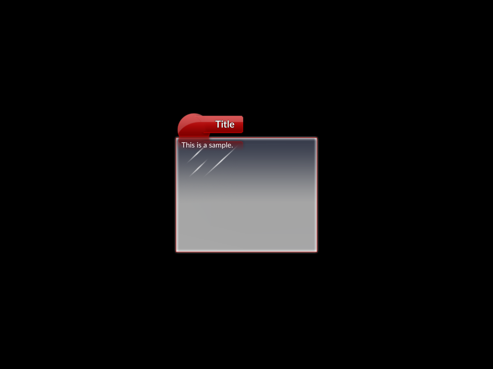
    </a>
    <div class="example-info">
      <p><strong><a href="official/basic/load_document/main.cjs">Document loading</a></strong></p>
      <p>Load an upstream document with its original template, fonts and textures</p>
      <p><code>node packages/sfml.js-rmlui/examples/official.cjs load-document</code></p>
      <p>
        <strong>Controls</strong>: Inspect the loaded document. Escape exits.
        Application actions from other upstream demos are not wired.
      </p>
      <p><a href="https://github.com/mikke89/RmlUi/blob/6.3/Samples/assets/demo.rml">Upstream RML</a></p>
    </div>
  </article>

  <article class="example-entry" id="font-effect">
    <a href="screenshots/font-effect.png">
      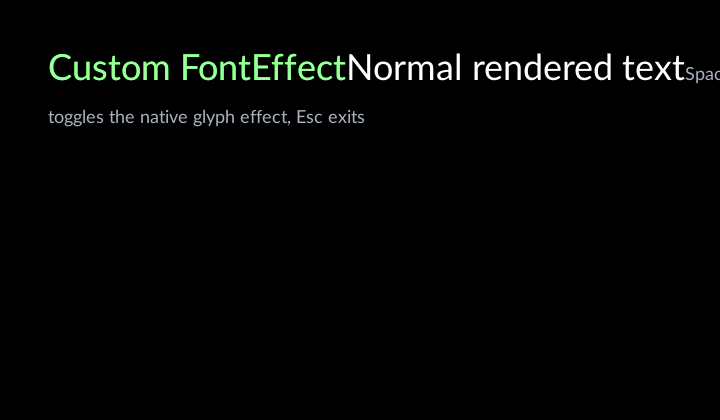
    </a>
    <div class="example-info">
      <p><strong><a href="font-effect.cjs">Custom font effect</a></strong></p>
      <p>JavaScript FontEffectInstancer and native glyph texture callbacks</p>
      <p><code>node packages/sfml.js-rmlui/examples/font-effect.cjs</code></p>
      <p><strong>Controls</strong>: Space toggles the glow effect. Escape exits.</p>
      <p>Bounded smoke run: <code>--frames N</code>; <code>--screenshot path.png</code> captures the last frame.</p>
    </div>
  </article>

  <article class="example-entry" id="streams">
    <a href="screenshots/streams.png">
      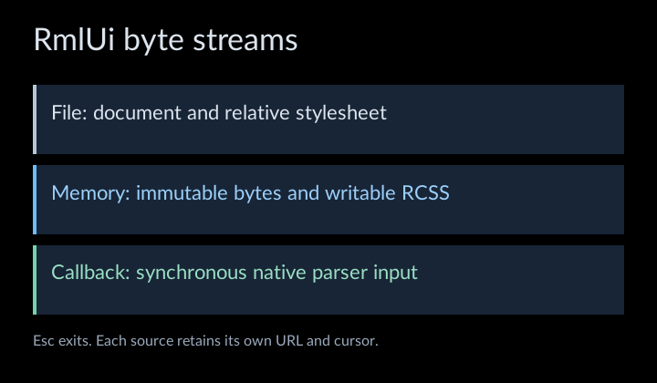
    </a>
    <div class="example-info">
      <p><strong><a href="streams.cjs">Byte streams</a></strong></p>
      <p>File document loading, native memory snapshots and synchronous callback RCSS input</p>
      <p><code>node packages/sfml.js-rmlui/examples/streams.cjs</code></p>
      <p><strong>Controls</strong>: Escape exits. Use <code>--frames N --screenshot path.png</code> for a bounded capture.</p>
      <p><a href="../../../docs/rmlui/streams.md">Stream API and lifetime guide</a></p>
    </div>
  </article>

  <article class="example-entry" id="element-utilities">
    <a href="screenshots/element-utilities.png">
      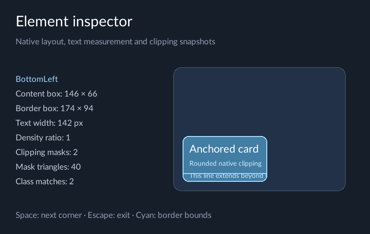
    </a>
    <div class="example-info">
      <p><strong><a href="element-utilities.cjs">Element inspector</a></strong></p>
      <p>Corner anchoring, measured text, projected bounds and owned clipping geometry</p>
      <p><code>node packages/sfml.js-rmlui/examples/element-utilities.cjs</code></p>
      <p><strong>Controls</strong>: Space selects the next corner. Escape exits.</p>
      <p><code>--frames 6 --exercise --screenshot path.png</code> verifies four corners and captures the last frame.</p>
      <p><a href="../../../docs/rmlui/element-utilities.md">Element utilities and snapshot ownership</a></p>
      <p><a href="../../../docs/rmlui/render-state.md">Clipped native geometry and render state restoration</a></p>
    </div>
  </article>

  <article class="example-entry" id="render-layers">
    <a href="screenshots/render-layers.png">
      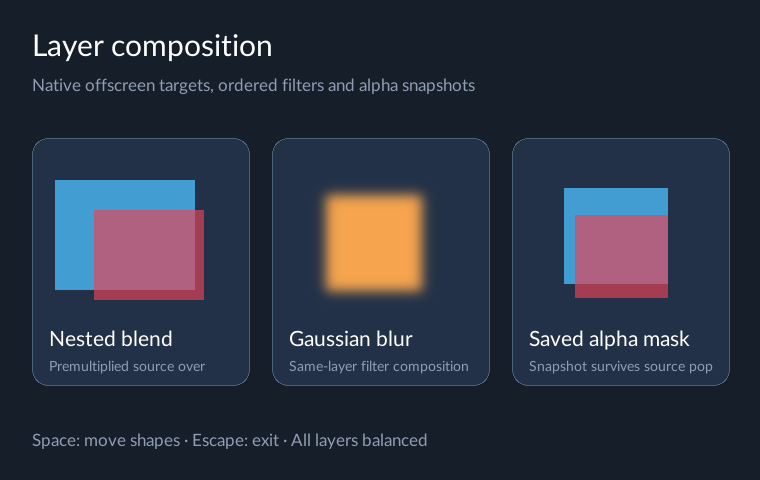
    </a>
    <div class="example-info">
      <p><strong><a href="render-layers.cjs">Layer composition</a></strong></p>
      <p>Balanced native layers, premultiplied blending, self-composite filters and saved mask snapshots</p>
      <p><code>node packages/sfml.js-rmlui/examples/render-layers.cjs</code></p>
      <p><strong>Controls</strong>: Space moves shapes. Escape exits.</p>
      <p><code>--frames 6 --exercise --screenshot path.png</code> exercises both positions and captures the last frame.</p>
      <p><a href="../../../docs/rmlui/render-state.md#render-layers">Layer handles, filter ownership and masks</a></p>
    </div>
  </article>

  <article class="example-entry" id="callback-textures">
    <a href="screenshots/callback-textures.png">
      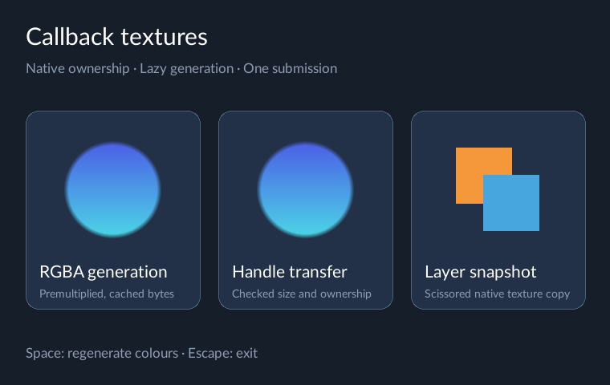
    </a>
    <div class="example-info">
      <p><strong><a href="callback-textures.cjs">Callback textures</a></strong></p>
      <p>Lazy premultiplied byte generation, owned handle transfer and scissored layer snapshots</p>
      <p><code>node packages/sfml.js-rmlui/examples/callback-textures.cjs</code></p>
      <p><strong>Controls</strong>: Space regenerates colours. Escape exits.</p>
      <p><code>--frames 6 --exercise --screenshot path.png</code> verifies caching and regeneration, then captures the last frame.</p>
      <p><a href="../../../docs/rmlui/render-state.md#callback-textures">Submission methods, lifetime and ownership</a></p>
    </div>
  </article>

  <article class="example-entry" id="factory-elements">
    <a href="screenshots/factory-elements.png">
      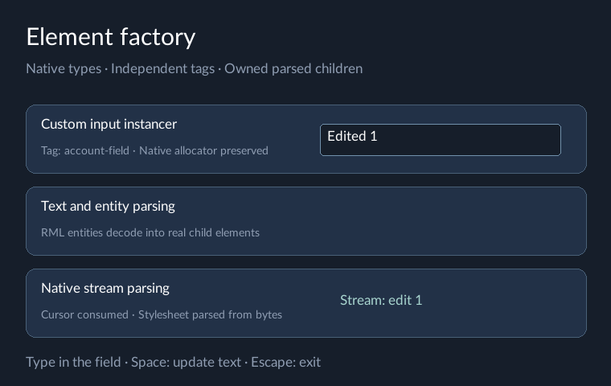
    </a>
    <div class="example-info">
      <p><strong><a href="factory-elements.cjs">Element factory</a></strong></p>
      <p>Custom native context/input allocation and release, owned document streams, independent tags and Factory caches</p>
      <p><code>node packages/sfml.js-rmlui/examples/factory-elements.cjs</code></p>
      <p><strong>Controls</strong>: type in the field, Space updates text, Escape exits.</p>
      <p><code>--frames 6 --exercise --screenshot path.png</code> verifies edits and captures the last frame.</p>
      <p><a href="../../../docs/rmlui/resources.md#factory-parsing-and-caches">Factory parsing and cache guide</a></p>
      <p><a href="../../../docs/rmlui/resources.md#element-instancers">Element instancer ownership</a></p>
    </div>
  </article>

  <article class="example-entry" id="data-models">
    <a href="screenshots/data-models.png">
      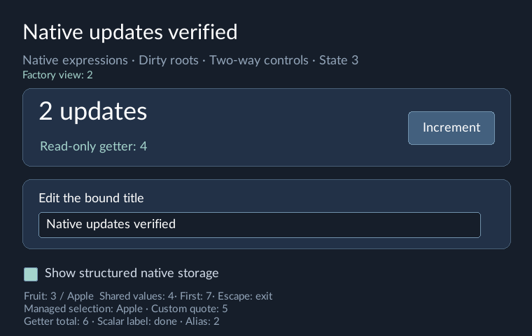
    </a>
    <div class="example-info">
      <p><strong><a href="data-models.cjs">Native data models</a></strong></p>
      <p>Native scalars, recursive data-for, shared arrays, sparse patches, getter/transform evaluation, custom Factory views and delegated two-way controllers</p>
      <p><code>node packages/sfml.js-rmlui/examples/data-models.cjs</code></p>
      <p><strong>Controls</strong>: Increment updates the count, edit the title, toggle details, Escape exits.</p>
      <p><code>--frames 6 --exercise --screenshot path.png</code> verifies actual bindings and captures the last frame.</p>
      <p><a href="../../../docs/rmlui/data-models.md">Data model contracts and remaining scope</a></p>
    </div>
  </article>

  <article class="example-entry" id="data-binding">
    <a href="screenshots/data-binding-events.png">
      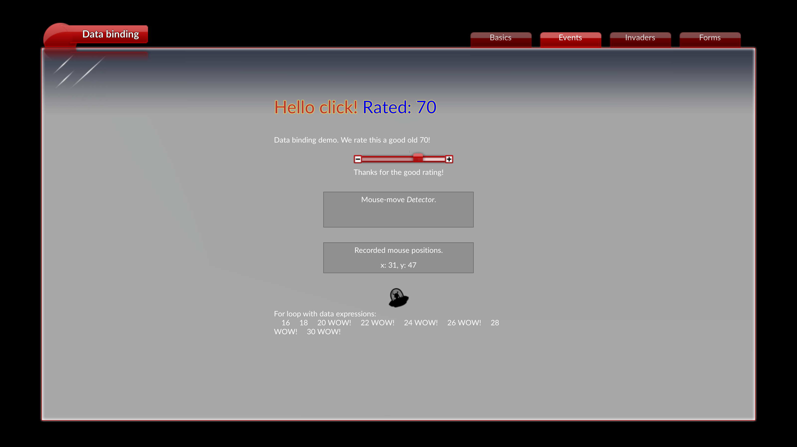
    </a>
    <div class="example-info">
      <p><strong><a href="official/basic/data_binding/main.cjs">Official data binding</a></strong></p>
      <p>All four upstream models: Basics, Events, Invaders and Forms, with native expressions and synchronous array changes</p>
      <p><code>node packages/sfml.js-rmlui/examples/official.cjs data-binding</code></p>
      <p><strong>Controls</strong>: switch tabs, edit fields, record or clear mouse positions, add or remove subjects, start and fire at invaders. Escape exits.</p>
      <p><code>--frames 45 --exercise --panel invaders --screenshot path.png</code> checks real state and captures the selected tab.</p>
      <p><a href="screenshots/data-binding-basics.png">Basics</a> · <a href="screenshots/data-binding-invaders.png">Invaders</a> · <a href="screenshots/data-binding-forms.png">Forms</a></p>
      <p><a href="https://github.com/mikke89/RmlUi/blob/6.3/Samples/basic/data_binding/src/main.cpp">Upstream application</a></p>
    </div>
  </article>

  <article class="example-entry" id="basic-demo">
    <a href="screenshots/basic-demo-sandbox.png">
      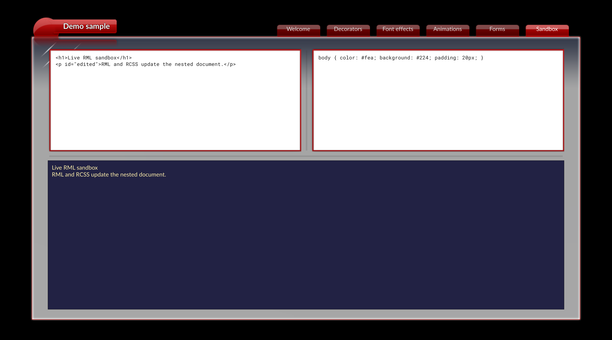
    </a>
    <div class="example-info">
      <p><strong><a href="official/basic/demo/main.cjs">Official controls and sandbox</a></strong></p>
      <p>Six original tabs, decorator and color tweens, form controls, a four-second submission animation, and live RML/RCSS editors</p>
      <p><code>node packages/sfml.js-rmlui/examples/official.cjs basic-demo</code></p>
      <p><strong>Controls</strong>: switch tabs, change tween settings, submit the form, edit the sandbox. Escape cancels an open subject selection; otherwise it exits. F8 toggles Debugger.</p>
      <p><code>--panel sandbox --frames 8 --exercise --screenshot path.png</code> verifies both editors and captures the sandbox. Panels: welcome, decorators, font-effects, animations, controls, sandbox.</p>
      <p><a href="screenshots/basic-demo-controls.png">Form controls</a> · <a href="official/basic/demo/DemoWindow.cjs">Window logic</a> · <a href="official/basic/demo/DemoEventListener.cjs">Event listeners</a></p>
      <p><a href="https://github.com/mikke89/RmlUi/blob/6.3/Samples/basic/demo/src/main.cpp">Upstream application</a></p>
    </div>
  </article>

  <article class="example-entry" id="tree-view">
    <a href="screenshots/tree-view.png">
      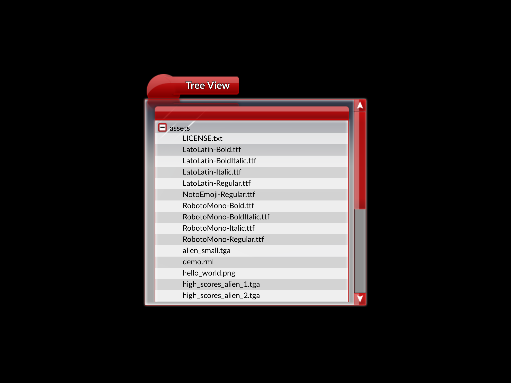
    </a>
    <div class="example-info">
      <p><strong><a href="official/basic/tree_view/main.cjs">Official tree view</a></strong></p>
      <p>Traverse the sample directory and toggle descendant visibility using the upstream FileBrowser rules</p>
      <p><code>node packages/sfml.js-rmlui/examples/official.cjs tree-view</code></p>
      <p><strong>Controls</strong>: click directory arrows to expand or collapse. Escape exits.</p>
      <p><code>--frames 12 --exercise --screenshot path.png</code> verifies an actual directory toggle.</p>
      <p><a href="https://github.com/mikke89/RmlUi/blob/6.3/Samples/basic/tree_view/src/FileBrowser.cpp">Upstream application</a></p>
    </div>
  </article>

  <article class="example-entry" id="animation">
    <a href="screenshots/animation.png">
      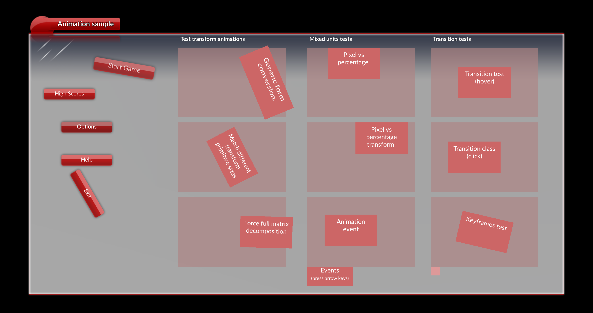
    </a>
    <div class="example-info">
      <p><strong><a href="official/basic/animation/main.cjs">Official animation</a></strong></p>
      <p>Original transform sequences, color keys, fade cycle, transitions and animation events</p>
      <p><code>node packages/sfml.js-rmlui/examples/official.cjs animation</code></p>
      <p><strong>Controls</strong>: Space pauses, Return steps once, +/- nudges, arrows animate, F8 toggles Debugger, Escape exits.</p>
      <p><code>--frames 8 --exercise --screenshot path.png</code> verifies pause, step and click controls before capture.</p>
      <p><a href="https://github.com/mikke89/RmlUi/blob/6.3/Samples/basic/animation/src/main.cpp">Upstream application</a></p>
    </div>
  </article>

  <article class="example-entry" id="benchmark">
    <a href="screenshots/benchmark.png">
      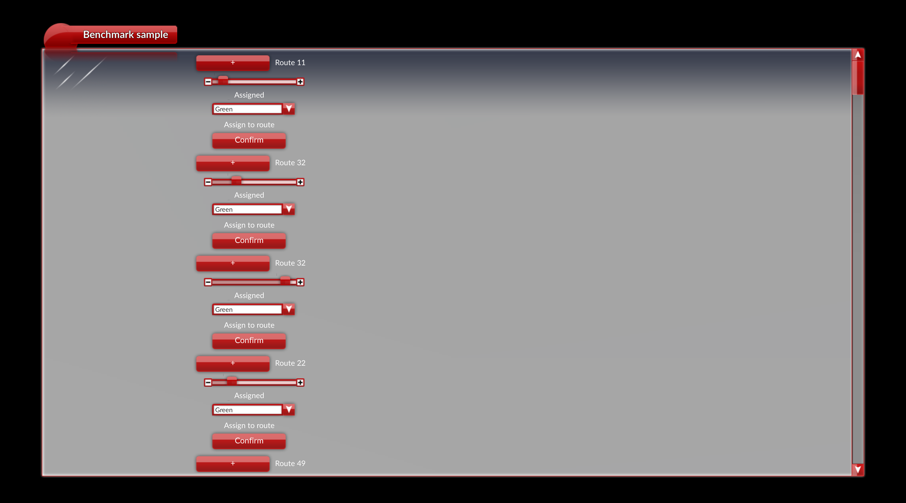
    </a>
    <div class="example-info">
      <p><strong><a href="official/basic/benchmark/main.cjs">Official benchmark</a></strong></p>
      <p>Regenerate 50 original rows per update; retain independent rendering and the 200-entry FPS ring</p>
      <p><code>node packages/sfml.js-rmlui/examples/official.cjs benchmark</code></p>
      <p><strong>Controls</strong>: Space pauses rendering, Down renders once, Return pauses row updates, Right updates once, F8 toggles Debugger, Escape exits.</p>
      <p><code>--frames 3 --screenshot path.png</code> captures a bounded run.</p>
      <p><a href="https://github.com/mikke89/RmlUi/blob/6.3/Samples/basic/benchmark/src/main.cpp">Upstream application</a></p>
    </div>
  </article>

  <article class="example-entry" id="basic-drag">
    <a href="screenshots/basic-drag.png">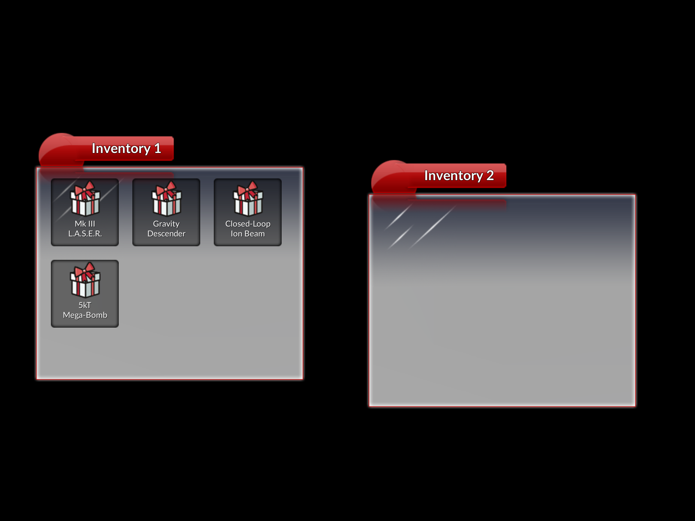</a>
    <div class="example-info">
      <p><strong><a href="official/basic/drag/main.cjs">Official drag</a></strong></p>
      <p>Transfer native-owned icons between windows and change their order.</p>
      <p><code>node packages/sfml.js-rmlui/examples/official.cjs basic-drag</code></p>
      <p>Drag an icon into another window or onto a preceding icon. Escape exits.</p>
      <p><a href="https://github.com/mikke89/RmlUi/tree/6.3/Samples/basic/drag">Upstream application</a></p>
    </div>
  </article>

  <article class="example-entry" id="effects">
    <a href="screenshots/effects.png">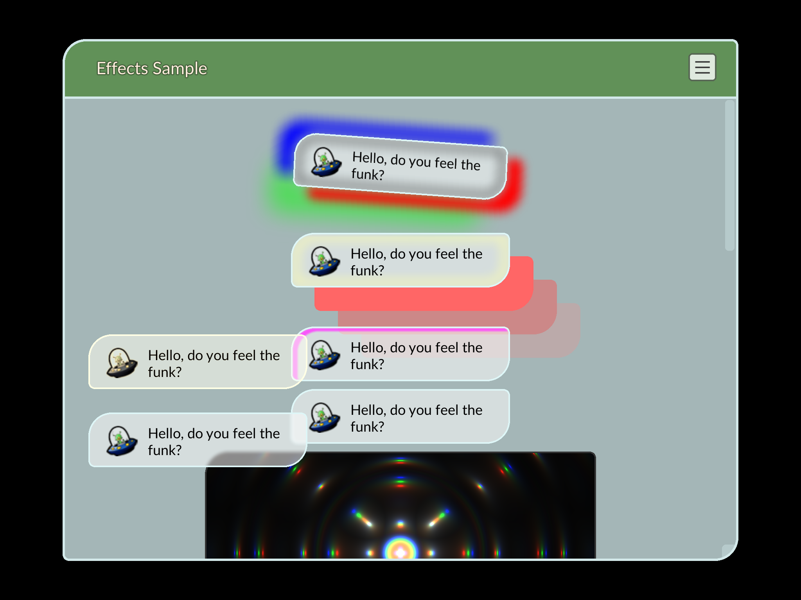</a>
    <div class="example-info">
      <p><strong><a href="official/basic/effects/main.cjs">Official effects</a></strong></p>
      <p>Adjust original color filters, blur, shadows, transforms and opacity.</p>
      <p><code>node packages/sfml.js-rmlui/examples/official.cjs effects</code></p>
      <p>Open the menu, change sliders and reset the settings. Escape exits.</p>
      <p><a href="https://github.com/mikke89/RmlUi/tree/6.3/Samples/basic/effects">Upstream application</a></p>
    </div>
  </article>

  <article class="example-entry" id="transform">
    <a href="screenshots/transform.png">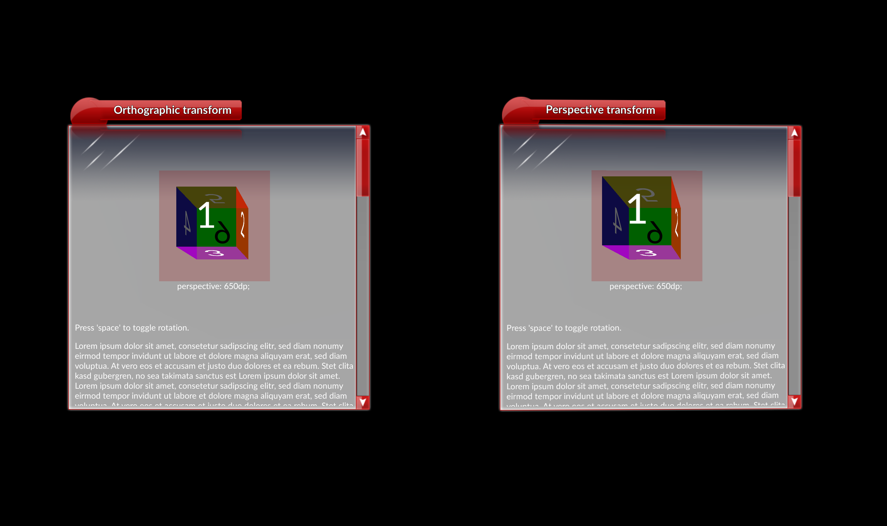</a>
    <div class="example-info">
      <p><strong><a href="official/basic/transform/main.cjs">Official transform</a></strong></p>
      <p>Rotate the original documents with orthographic and perspective projection.</p>
      <p><code>node packages/sfml.js-rmlui/examples/official.cjs transform</code></p>
      <p>Space pauses rotation; Escape exits.</p>
      <p><a href="https://github.com/mikke89/RmlUi/tree/6.3/Samples/basic/transform">Upstream application</a></p>
    </div>
  </article>

  <article class="example-entry" id="svg">
    <a href="screenshots/svg.png">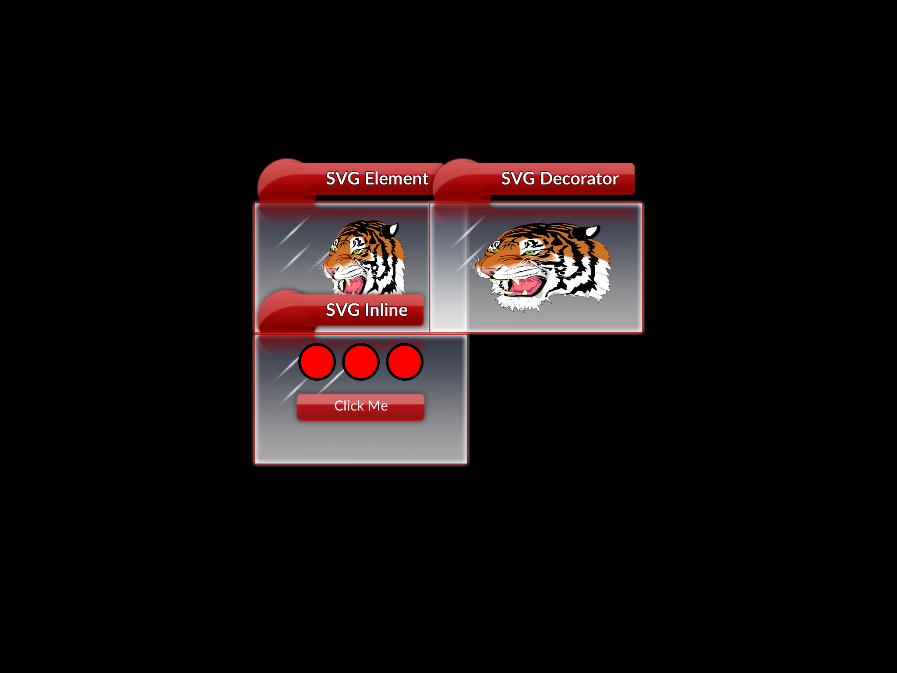</a>
    <div class="example-info">
      <p><strong><a href="official/basic/svg/main.cjs">Official SVG</a></strong></p>
      <p>Render the original SVG element, decorator and inline updates.</p>
      <p><code>node packages/sfml.js-rmlui/examples/official.cjs svg</code></p>
      <p>Use the original update controls; Escape exits.</p>
      <p><a href="https://github.com/mikke89/RmlUi/tree/6.3/Samples/basic/svg">Upstream application</a></p>
    </div>
  </article>

  <article class="example-entry" id="lottie">
    <a href="screenshots/lottie.png">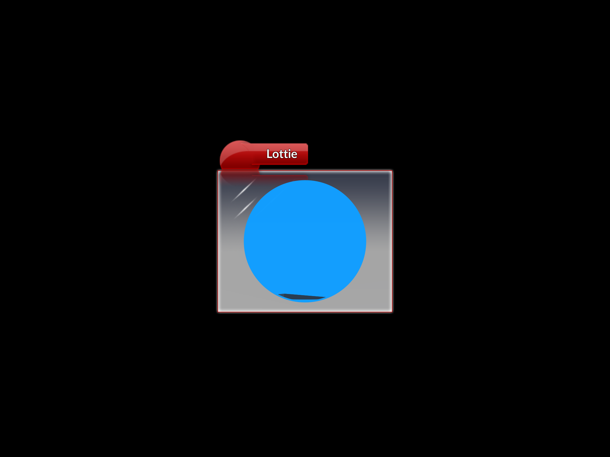</a>
    <div class="example-info">
      <p><strong><a href="official/basic/lottie/main.cjs">Official Lottie</a></strong></p>
      <p>Play the original mountain animation with native frame timing and rasterization.</p>
      <p><code>node packages/sfml.js-rmlui/examples/official.cjs lottie</code></p>
      <p>The animation loops automatically. Escape exits.</p>
      <p><a href="https://github.com/mikke89/RmlUi/tree/6.3/Samples/basic/lottie">Upstream application</a></p>
    </div>
  </article>

  <article class="example-entry" id="bitmap-font">
    <a href="screenshots/bitmap-font.png">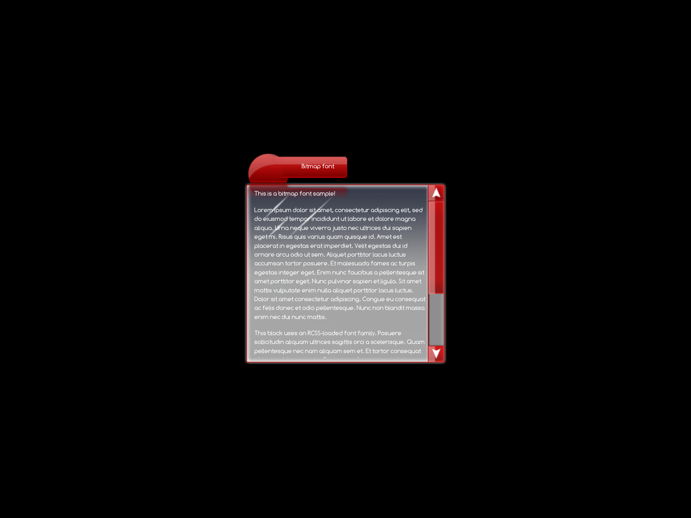</a>
    <div class="example-info">
      <p><strong><a href="official/basic/bitmap_font/main.cjs">Official bitmap font</a></strong></p>
      <p>Use the original FNT glyph advances, kerning and native atlas textures.</p>
      <p><code>node packages/sfml.js-rmlui/examples/official.cjs bitmap-font</code></p>
      <p>Inspect the three original paragraphs. Escape exits.</p>
      <p><a href="https://github.com/mikke89/RmlUi/tree/6.3/Samples/basic/bitmap_font">Upstream application</a></p>
    </div>
  </article>

  <article class="example-entry" id="harfbuzz">
    <a href="screenshots/harfbuzz.png">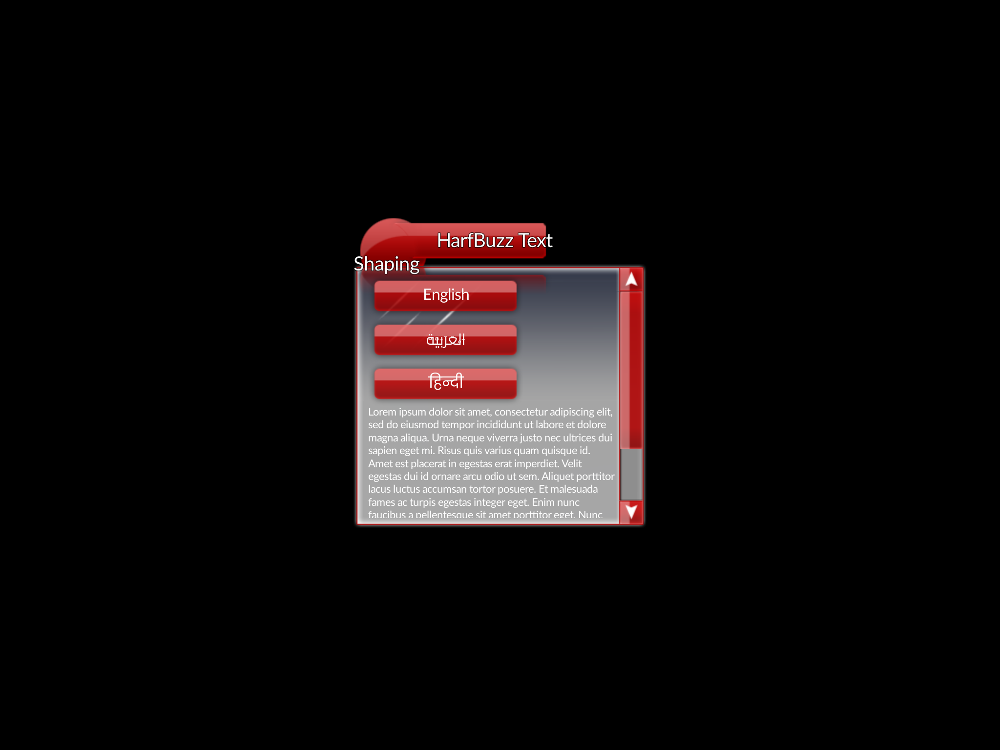</a>
    <div class="example-info">
      <p><strong><a href="official/basic/harfbuzz/main.cjs">Official HarfBuzz</a></strong></p>
      <p>Shape the original English, Arabic and Hindi paragraphs using their original fonts.</p>
      <p><code>node packages/sfml.js-rmlui/examples/official.cjs harfbuzz</code></p>
      <p>Click a language button to switch paragraphs. Escape exits.</p>
      <p><a href="https://github.com/mikke89/RmlUi/tree/6.3/Samples/basic/harfbuzz">Upstream application</a></p>
    </div>
  </article>

  <article class="example-entry" id="custom-log">
    <a href="screenshots/custom-log.png">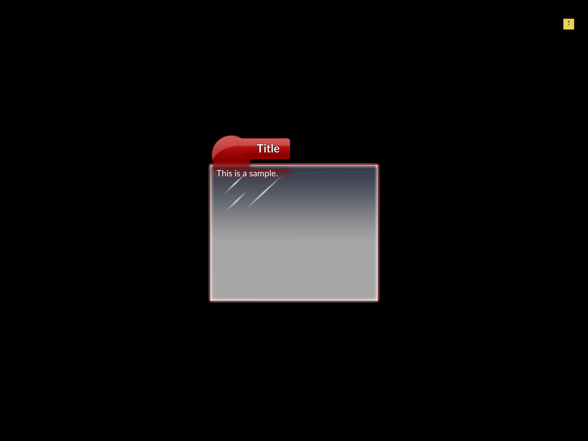</a>
    <div class="example-info">
      <p><strong><a href="official/basic/custom_log/main.cjs">Official custom log</a></strong></p>
      <p>Write original native log messages and severity prefixes to a chosen file.</p>
      <p><code>node packages/sfml.js-rmlui/examples/official.cjs custom-log --log-file /tmp/rmlui-log.txt</code></p>
      <p>The default log uses the system temporary directory. Escape exits.</p>
      <p><a href="https://github.com/mikke89/RmlUi/tree/6.3/Samples/basic/custom_log">Upstream application</a></p>
    </div>
  </article>

  <article class="example-entry" id="ime">
    <a href="screenshots/ime.png">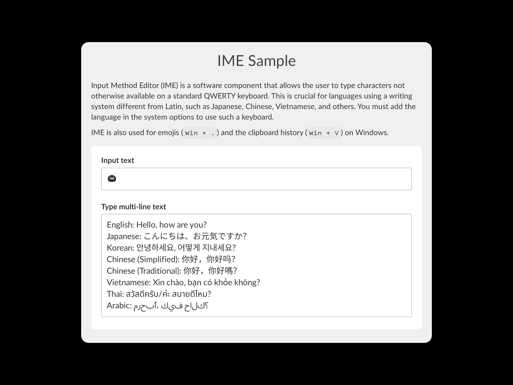</a>
    <div class="example-info">
      <p><strong><a href="official/basic/ime/main.cjs">Official IME</a></strong></p>
      <p>Open the original native input and textarea with all ten original font faces.</p>
      <p>Prepare the five optional Noto fonts once (38 MB, SHA-256 verified): <code>npm run download:ime-fonts --prefix packages/sfml.js-rmlui</code>. Valid cached files are reused.</p>
      <p><code>node packages/sfml.js-rmlui/examples/official.cjs ime</code></p>
      <p>Select a system input method and focus either field. Escape exits.</p>
      <p><a href="https://github.com/mikke89/RmlUi/tree/6.3/Samples/basic/ime">Upstream application</a></p>
    </div>
  </article>

  <article class="example-entry" id="invaders">
    <a href="screenshots/invaders.png">
      
    </a>
    <div class="example-info">
      <p><strong><a href="official/invaders/main.cjs">Invaders</a></strong></p>
      <p>Run the original C++ game, menus, decorators and high-score data model.</p>
      <p><code>node packages/sfml.js-rmlui/examples/official.cjs invaders</code></p>
      <p>Left/Right moves, Space fires, Escape opens the pause menu and F8 toggles Debugger. Use the original menus to restart or exit.</p>
      <p>Build the package first; the game module is produced in the same build directory. Loading needs no compiler and is verified on macOS, Linux and Windows. Comparison with the original native game runs on macOS; Linux and Windows game comparisons remain unverified.</p>
      <p>Scores use application data storage. <code>--scores-file /absolute/path/scores.txt</code> selects an existing parent directory. <code>--frames 8 --exercise</code> starts a bounded game.</p>
      <p><a href="official/invaders/native/application.cc">Native registrations</a> · <a href="https://github.com/mikke89/RmlUi/tree/6.3/Samples/invaders">Upstream application</a></p>
    </div>
  </article>

  <article class="example-entry" id="lua-invaders">
    <a href="screenshots/lua-invaders.png">
      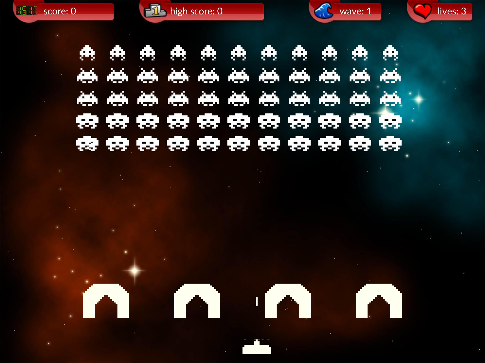
    </a>
    <div class="example-info">
      <p><strong><a href="official/lua_invaders/main.cjs">Lua Invaders</a></strong></p>
      <p>Run the original Lua documents and Game table with the original native game.</p>
      <p><code>node packages/sfml.js-rmlui/examples/official.cjs lua-invaders</code></p>
      <p>Left/Right moves, Space fires, Escape opens the pause menu and F8 toggles Debugger. Options persist beside the selected scores file.</p>
      <p>Build the package first; the game module is produced in the same build directory. Loading needs no compiler and is verified on macOS, Linux and Windows. Comparison with the original native game runs on macOS; Linux and Windows game comparisons remain unverified.</p>
      <p><code>--scores-file /absolute/path/scores.txt</code> selects storage under an existing parent. <code>--frames 8 --exercise</code> starts a bounded game.</p>
      <p><a href="official/lua_invaders/native/application.cc">Native registrations</a> · <a href="https://github.com/mikke89/RmlUi/tree/6.3/Samples/lua_invaders">Upstream application and scripts</a></p>
    </div>
  </article>

  <article class="example-entry" id="visual-tests">
    <a href="screenshots/clip-mask.png">
      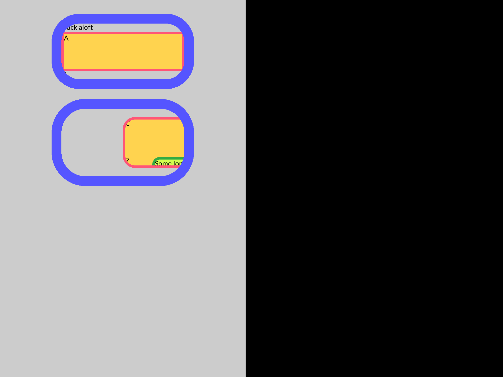
    </a>
    <div class="example-info">
      <p><strong><a href="official.cjs">VisualTests browser</a></strong></p>
      <p>Browse 113 upstream visual test pages</p>
      <p><code>node packages/sfml.js-rmlui/examples/official.cjs visual/clip_mask</code></p>
      <p><strong>Controls</strong>: F6 / F7 switches pages. Escape exits.</p>
      <p>
        Append <code>--frames 60</code> to close after 60 frames.
        <code>--frames N</code> accepts a positive integer for bounded smoke runs.
        These are previews without the upstream assertion harness.
      </p>
      <p>
        <a href="https://github.com/mikke89/RmlUi/tree/6.3/Tests/Data/VisualTests">Upstream VisualTests</a> ·
        <a href="../../../docs/rmlui/rendering.md">Renderer coverage</a>
      </p>
    </div>
  </article>
</div>

## Coverage and verification {#coverage-and-verification}

The gallery includes all 20 official applications and tutorials, eight binding
examples and a browser for all 113 upstream VisualTests pages. Every gallery
entry has a run command, source link, interaction notes and a native screenshot;
all 29 screenshots are present.

The RmlUi runtime suites pass on macOS, Linux and Windows. Native SFML/GL3 effect
comparisons and original-game comparisons run on macOS. The VisualTests launcher
is a preview; separate comparison records cover 113 pages and 25 interactive
pages. Four content checks and two interaction checks also fail in the pinned
upstream renderer. Those records report zero binding regressions, while full
VisualTests and independent whole-project acceptance remain open.

The macOS system IME item is closed under the existing acceptance decision, with
observed preedit, commit, cancellation and caret coordinates retained in the
[desktop record](../../../docs/rmlui/audit/6.3/desktop-ime-acceptance.md).
Hardware keyboard input, reliable fresh-process repeats and candidate-panel
placement were not verified. Linux and Windows system IME remain unverified.

[All examples](../../sfml.js/examples/README.md) · [RmlUi quick start](../../../docs/rmlui/getting-started.md) · [Upstream samples](https://github.com/mikke89/RmlUi/tree/6.3/Samples)
