# RmlUi 示例

[English](README.md) · **简体中文** · [日本語](README.ja.md) · [한국어](README.ko.md)

在原生 SFML 窗口中运行 RmlUi 文档。从计数器开始，再体验主题变量、拖动窗口、模板和视觉测试页面。

## 运行准备

以下命令均在 **monorepo 根目录**执行。首次运行 bootstrap 安装依赖并构建各包。需要显示环境和 OpenGL；macOS 原生构建另需 Xcode Command Line Tools 和 CMake。详见[快速开始](../../../docs/rmlui/getting-started.zh-CN.md)。

```sh
node tools/bootstrap.cjs
```

修改 RmlUi TypeScript 源码后，执行 `npm run build:ts --prefix packages/sfml.js-rmlui`。示例使用本地构建的包。

启动器读取包内 `third_party/rmlui` 下 RmlUi 6.3 的内置资源。列出全部入口：

```sh
node packages/sfml.js-rmlui/examples/official.cjs --list
```

## 示例

<div class="example-gallery">
  <article class="example-entry" id="demo">
    <a href="screenshots/demo.png">
      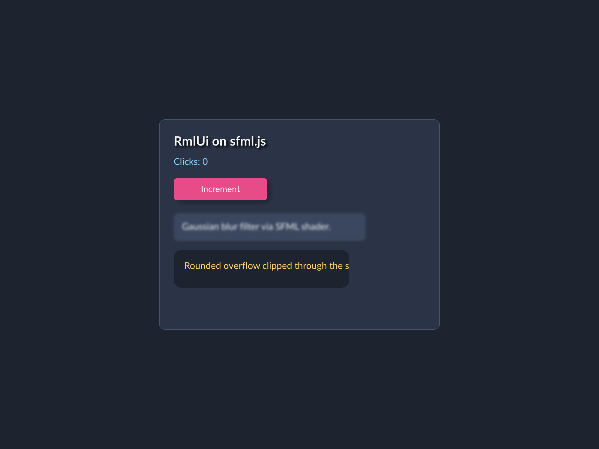
    </a>
    <div class="example-info">
      <p><strong><a href="demo.cjs">计数器</a></strong></p>
      <p>JavaScript 事件监听器、外部 RML、模糊、投影和圆角裁剪</p>
      <p><code>node packages/sfml.js-rmlui/examples/demo.cjs</code></p>
      <p><strong>操作</strong>：点击 Increment 更新计数。关闭窗口退出。</p>
      <p><a href="assets/tutorial.rml">RML</a> · <a href="assets/tutorial.rcss">RCSS</a></p>
    </div>
  </article>

  <article class="example-entry" id="variables">
    <a href="screenshots/variables.png">
      
    </a>
    <div class="example-info">
      <p><strong><a href="official/basic/variables/main.cjs">主题与变量</a></strong></p>
      <p>主题切换、强调色和悬停样式</p>
      <p><code>node packages/sfml.js-rmlui/examples/official.cjs variables</code></p>
      <p>
        <strong>操作</strong>：1 切换深色、2 浅色、3 高对比度，
        R 随机强调色，C 重置强调色，Escape 退出。
        任务按钮只展示悬停样式，上游没有注册点击行为。
      </p>
      <p>
        原始样式表使用固定 <code>px</code> 长度。此示例设置
        <code>highDpi: false</code>，Retina 下也保持 1024 × 768 帧缓冲，
        与上游窗口尺寸一致。
        F8 切换 Debugger；Ctrl +/-/0 是 Shell 的密度快捷键。
      </p>
      <p><a href="https://github.com/mikke89/RmlUi/blob/6.3/Samples/basic/variables/data/variables.rml">上游 RML</a></p>
    </div>
  </article>

  <article class="example-entry" id="drag">
    <a href="screenshots/drag.png">
      
    </a>
    <div class="example-info">
      <p><strong><a href="official/tutorial/drag/main.cjs">拖动教程</a></strong></p>
      <p>可移动和调整大小的物品栏窗口</p>
      <p><code>node packages/sfml.js-rmlui/examples/official.cjs drag</code></p>
      <p><strong>操作</strong>：用鼠标移动两个窗口并调整大小，Escape 退出。</p>
      <p>此处移植的是教程窗口设置，与上游 <code>basic/drag</code> 应用不同。</p>
      <p><a href="https://github.com/mikke89/RmlUi/blob/6.3/Samples/tutorial/drag/data/inventory.rml">上游 RML</a></p>
    </div>
  </article>

  <article class="example-entry" id="template">
    <a href="screenshots/template.png">
      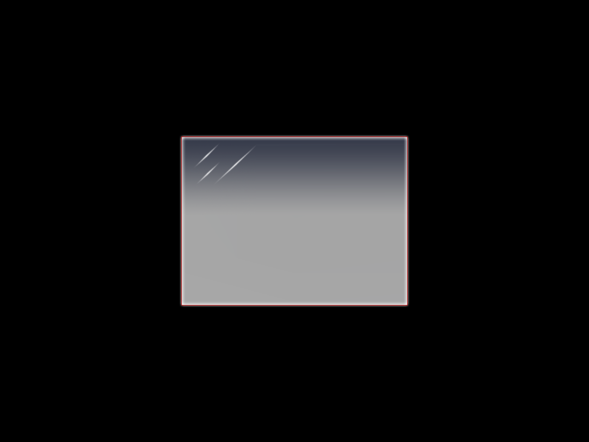
    </a>
    <div class="example-info">
      <p><strong><a href="official/tutorial/template/main.cjs">模板教程</a></strong></p>
      <p>九宫格纹理与外部模板</p>
      <p><code>node packages/sfml.js-rmlui/examples/official.cjs template</code></p>
      <p><strong>操作</strong>：查看使用模板装饰的窗口，Escape 退出。</p>
      <p><a href="https://github.com/mikke89/RmlUi/blob/6.3/Samples/tutorial/template/data/tutorial.rml">上游 RML</a></p>
    </div>
  </article>

  <article class="example-entry" id="load-document">
    <a href="screenshots/load-document.png">
      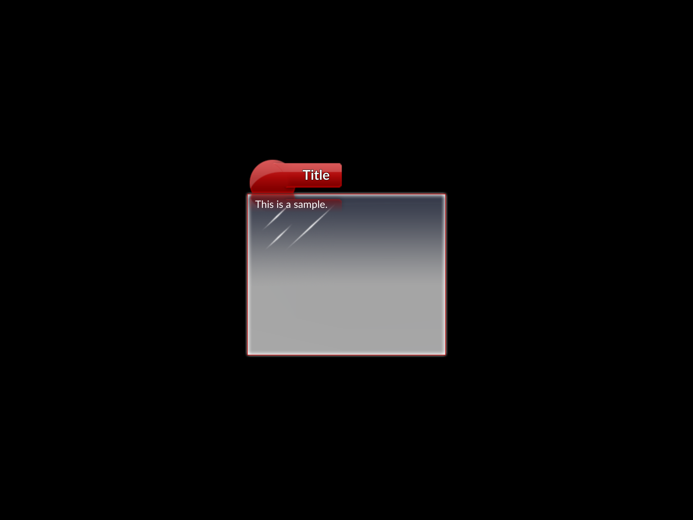
    </a>
    <div class="example-info">
      <p><strong><a href="official/basic/load_document/main.cjs">文档加载</a></strong></p>
      <p>加载上游文档及原始模板、字体和纹理</p>
      <p><code>node packages/sfml.js-rmlui/examples/official.cjs load-document</code></p>
      <p>
        <strong>操作</strong>：查看加载后的文档，Escape 退出。
        此入口未接入其他上游演示的应用动作。
      </p>
      <p><a href="https://github.com/mikke89/RmlUi/blob/6.3/Samples/assets/demo.rml">上游 RML</a></p>
    </div>
  </article>

  <article class="example-entry" id="font-effect">
    <a href="screenshots/font-effect.png">
      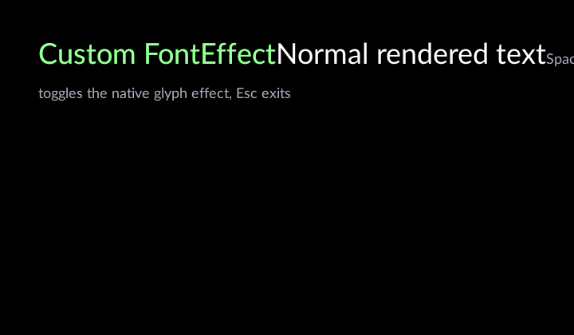
    </a>
    <div class="example-info">
      <p><strong><a href="font-effect.cjs">自定义字体特效</a></strong></p>
      <p>JavaScript FontEffectInstancer 与原生字形纹理回调</p>
      <p><code>node packages/sfml.js-rmlui/examples/font-effect.cjs</code></p>
      <p><strong>操作</strong>：Space 切换发光效果，Escape 退出。</p>
      <p>有限烟测：<code>--frames N</code>；<code>--screenshot path.png</code> 捕获最后一帧。</p>
    </div>
  </article>

  <article class="example-entry" id="streams">
    <a href="screenshots/streams.png">
      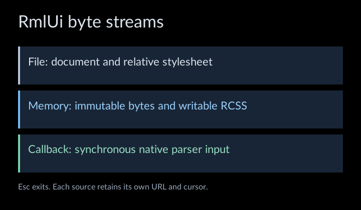
    </a>
    <div class="example-info">
      <p><strong><a href="streams.cjs">字节流</a></strong></p>
      <p>文件文档加载、原生内存快照与同步回调 RCSS 输入</p>
      <p><code>node packages/sfml.js-rmlui/examples/streams.cjs</code></p>
      <p><strong>操作</strong>：Escape 退出。使用 <code>--frames N --screenshot path.png</code> 进行有限帧截图。</p>
      <p><a href="../../../docs/rmlui/streams.zh-CN.md">Stream API 与生命周期指南</a></p>
    </div>
  </article>

  <article class="example-entry" id="element-utilities">
    <a href="screenshots/element-utilities.png">
      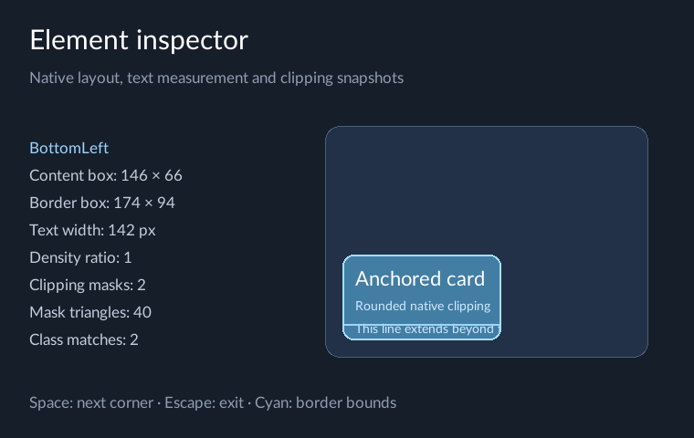
    </a>
    <div class="example-info">
      <p><strong><a href="element-utilities.cjs">元素检查器</a></strong></p>
      <p>四角定位、文本测量、投影边界与自有裁剪几何</p>
      <p><code>node packages/sfml.js-rmlui/examples/element-utilities.cjs</code></p>
      <p><strong>操作</strong>：Space 切换角点，Escape 退出。</p>
      <p><code>--frames 6 --exercise --screenshot path.png</code> 验证四个角点并截图。</p>
      <p><a href="../../../docs/rmlui/element-utilities.zh-CN.md">元素工具与快照所有权</a></p>
      <p><a href="../../../docs/rmlui/render-state.zh-CN.md">原生几何裁剪与渲染状态恢复</a></p>
    </div>
  </article>

  <article class="example-entry" id="render-layers">
    <a href="screenshots/render-layers.png">
      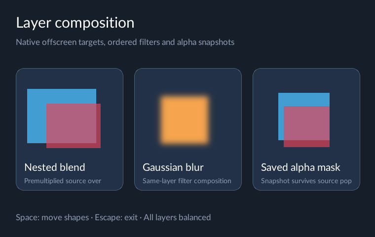
    </a>
    <div class="example-info">
      <p><strong><a href="render-layers.cjs">图层合成</a></strong></p>
      <p>平衡的原生图层、预乘透明度、自合成滤镜与保存的蒙版快照</p>
      <p><code>node packages/sfml.js-rmlui/examples/render-layers.cjs</code></p>
      <p><strong>操作</strong>：空格移动图形，Escape 退出。</p>
      <p><code>--frames 6 --exercise --screenshot path.png</code> 验证两个位置并截取最后一帧。</p>
      <p><a href="../../../docs/rmlui/render-state.zh-CN.md#render-layers">图层句柄、滤镜所有权与蒙版</a></p>
    </div>
  </article>

  <article class="example-entry" id="callback-textures">
    <a href="screenshots/callback-textures.png">
      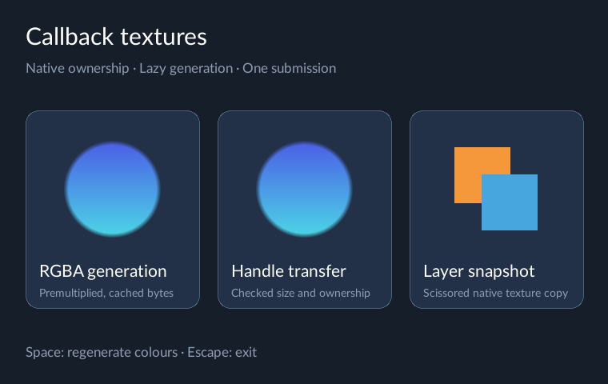
    </a>
    <div class="example-info">
      <p><strong><a href="callback-textures.cjs">回调纹理</a></strong></p>
      <p>延迟预乘字节生成、自有句柄转移与裁剪区域图层快照</p>
      <p><code>node packages/sfml.js-rmlui/examples/callback-textures.cjs</code></p>
      <p><strong>操作</strong>：空格重新生成颜色；Esc 退出。</p>
      <p><code>--frames 6 --exercise --screenshot path.png</code> 验证缓存和重新生成，并截图最后一帧。</p>
      <p><a href="../../../docs/rmlui/render-state.zh-CN.md#callback-textures">提交接口、生命周期与所有权</a></p>
    </div>
  </article>

  <article class="example-entry" id="factory-elements">
    <a href="screenshots/factory-elements.png">
      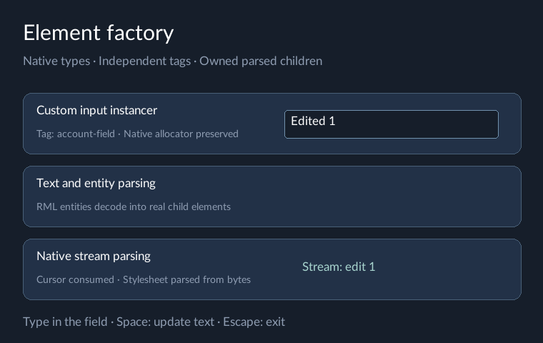
    </a>
    <div class="example-info">
      <p><strong><a href="factory-elements.cjs">元素工厂</a></strong></p>
      <p>自定义原生上下文和输入控件的分配与释放、自有文档流、独立标签及 Factory 缓存</p>
      <p><code>node packages/sfml.js-rmlui/examples/factory-elements.cjs</code></p>
      <p><strong>操作</strong>：输入框编辑，空格更新文本，Escape 退出。</p>
      <p><code>--frames 6 --exercise --screenshot path.png</code> 验证编辑并截图最后一帧。</p>
      <p><a href="../../../docs/rmlui/resources.zh-CN.md#factory-解析与缓存">Factory 解析与缓存说明</a></p>
      <p><a href="../../../docs/rmlui/resources.zh-CN.md#元素实例器">元素实例器所有权</a></p>
    </div>
  </article>

  <article class="example-entry" id="data-models">
    <a href="screenshots/data-models.png">
      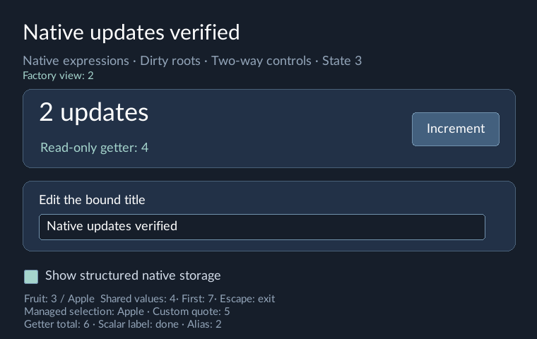
    </a>
    <div class="example-info">
      <p><strong><a href="data-models.cjs">原生数据模型</a></strong></p>
      <p>原生标量、递归 data-for、共享数组、稀疏补丁、getter 与变换求值、自定义 Factory 视图及默认双向控制器委派</p>
      <p><code>node packages/sfml.js-rmlui/examples/data-models.cjs</code></p>
      <p><strong>操作</strong>：Increment 更新计数，编辑标题，切换详情，Escape 退出。</p>
      <p><code>--frames 6 --exercise --screenshot path.png</code> 验证真实绑定并截图最后一帧。</p>
      <p><a href="../../../docs/rmlui/data-models.zh-CN.md">数据模型契约与剩余范围</a></p>
    </div>
  </article>

  <article class="example-entry" id="data-binding">
    <a href="screenshots/data-binding-events.png">
      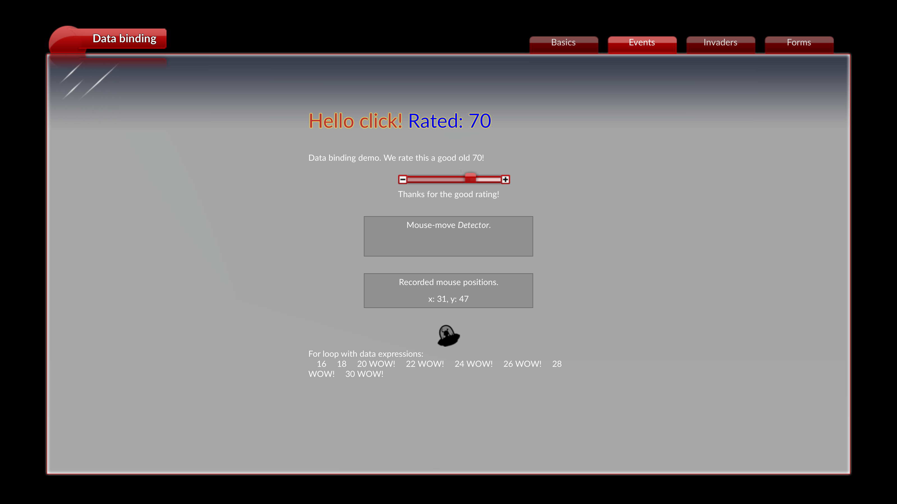
    </a>
    <div class="example-info">
      <p><strong><a href="official/basic/data_binding/main.cjs">官方数据绑定</a></strong></p>
      <p>上游 Basics、Events、Invaders、Forms 四个模型，使用原生表达式和同步数组修改</p>
      <p><code>node packages/sfml.js-rmlui/examples/official.cjs data-binding</code></p>
      <p><strong>操作</strong>：切换标签、编辑字段、记录或清除鼠标位置、增删主题、开始游戏并射击入侵者。Escape 退出。</p>
      <p><code>--frames 45 --exercise --panel invaders --screenshot path.png</code> 校验实际状态并截图指定标签。</p>
      <p><a href="screenshots/data-binding-basics.png">Basics</a> · <a href="screenshots/data-binding-invaders.png">Invaders</a> · <a href="screenshots/data-binding-forms.png">Forms</a></p>
      <p><a href="https://github.com/mikke89/RmlUi/blob/6.3/Samples/basic/data_binding/src/main.cpp">上游应用</a></p>
    </div>
  </article>

  <article class="example-entry" id="basic-demo">
    <a href="screenshots/basic-demo-sandbox.png">
      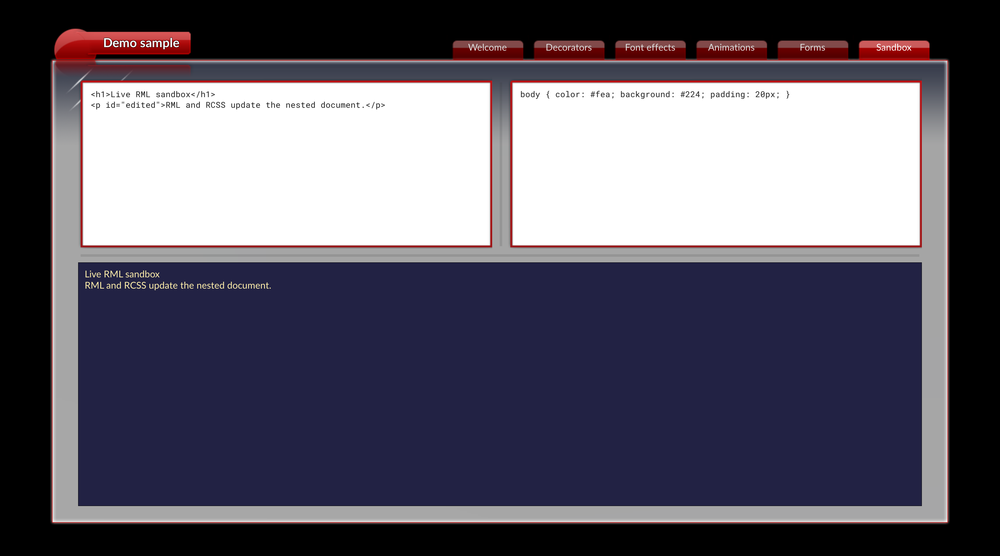
    </a>
    <div class="example-info">
      <p><strong><a href="official/basic/demo/main.cjs">官方控件与沙盒</a></strong></p>
      <p>六个原始标签页、装饰器与颜色补间、表单控件、四秒提交动画，以及实时 RML/RCSS 编辑器</p>
      <p><code>node packages/sfml.js-rmlui/examples/official.cjs basic-demo</code></p>
      <p><strong>操作</strong>：切换标签页，调整补间，提交表单，编辑沙盒。Escape 先取消已打开的主题选择框，否则退出。F8 切换 Debugger。</p>
      <p><code>--panel sandbox --frames 8 --exercise --screenshot path.png</code> 验证两侧编辑器并截图沙盒。面板：welcome、decorators、font-effects、animations、controls、sandbox。</p>
      <p><a href="screenshots/basic-demo-controls.png">表单控件</a> · <a href="official/basic/demo/DemoWindow.cjs">窗口逻辑</a> · <a href="official/basic/demo/DemoEventListener.cjs">事件监听器</a></p>
      <p><a href="https://github.com/mikke89/RmlUi/blob/6.3/Samples/basic/demo/src/main.cpp">上游应用</a></p>
    </div>
  </article>

  <article class="example-entry" id="tree-view">
    <a href="screenshots/tree-view.png">
      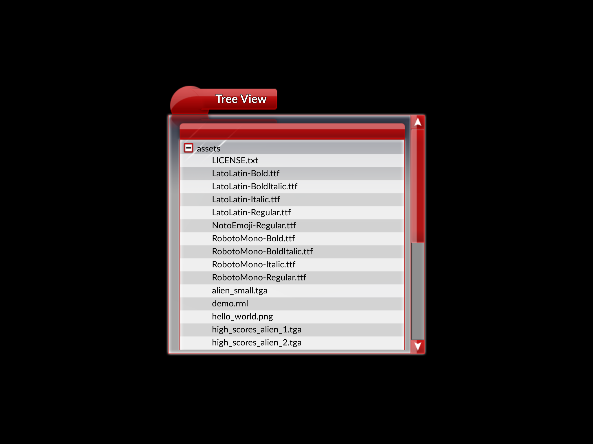
    </a>
    <div class="example-info">
      <p><strong><a href="official/basic/tree_view/main.cjs">官方树视图</a></strong></p>
      <p>遍历示例目录，按上游 FileBrowser 规则切换后代条目的可见性</p>
      <p><code>node packages/sfml.js-rmlui/examples/official.cjs tree-view</code></p>
      <p><strong>操作</strong>：点击目录箭头展开或折叠。Escape 退出。</p>
      <p><code>--frames 12 --exercise --screenshot path.png</code> 校验真实目录的切换。</p>
      <p><a href="https://github.com/mikke89/RmlUi/blob/6.3/Samples/basic/tree_view/src/FileBrowser.cpp">上游应用</a></p>
    </div>
  </article>

  <article class="example-entry" id="animation">
    <a href="screenshots/animation.png">
      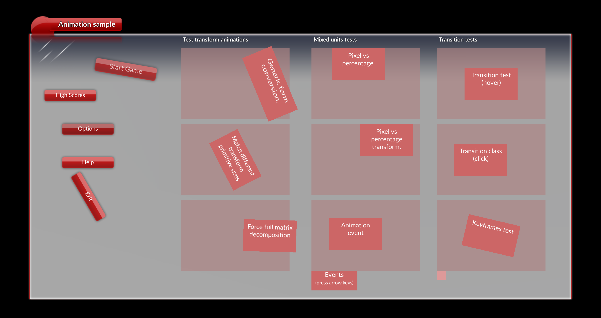
    </a>
    <div class="example-info">
      <p><strong><a href="official/basic/animation/main.cjs">官方动画</a></strong></p>
      <p>原始变换序列、颜色关键帧、淡入淡出循环、过渡及动画事件</p>
      <p><code>node packages/sfml.js-rmlui/examples/official.cjs animation</code></p>
      <p><strong>操作</strong>：Space 暂停，Return 单步，+/- 微调，方向键触发动画，F8 切换 Debugger，Escape 退出。</p>
      <p><code>--frames 8 --exercise --screenshot path.png</code> 在截图前校验暂停、单步和点击控制。</p>
      <p><a href="https://github.com/mikke89/RmlUi/blob/6.3/Samples/basic/animation/src/main.cpp">上游应用</a></p>
    </div>
  </article>

  <article class="example-entry" id="benchmark">
    <a href="screenshots/benchmark.png">
      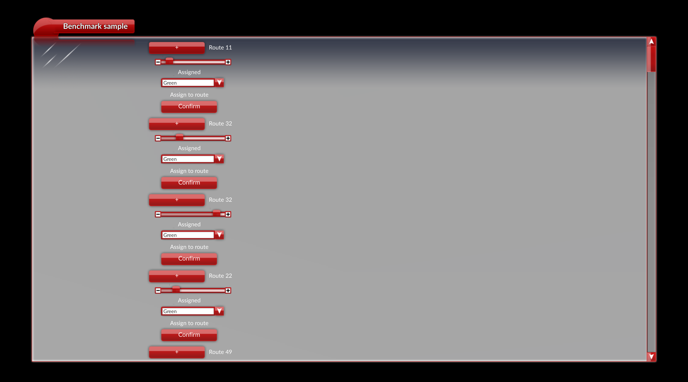
    </a>
    <div class="example-info">
      <p><strong><a href="official/basic/benchmark/main.cjs">官方 benchmark</a></strong></p>
      <p>每次更新重新生成原始 50 行，保留独立渲染和 200 项 FPS 环形缓冲</p>
      <p><code>node packages/sfml.js-rmlui/examples/official.cjs benchmark</code></p>
      <p><strong>操作</strong>：Space 暂停渲染，Down 单步渲染，Return 暂停行更新，Right 单步更新，F8 切换 Debugger，Escape 退出。</p>
      <p><code>--frames 3 --screenshot path.png</code> 限定运行帧数并截图。</p>
      <p><a href="https://github.com/mikke89/RmlUi/blob/6.3/Samples/basic/benchmark/src/main.cpp">上游应用</a></p>
    </div>
  </article>

  <article class="example-entry" id="basic-drag">
    <a href="screenshots/basic-drag.png">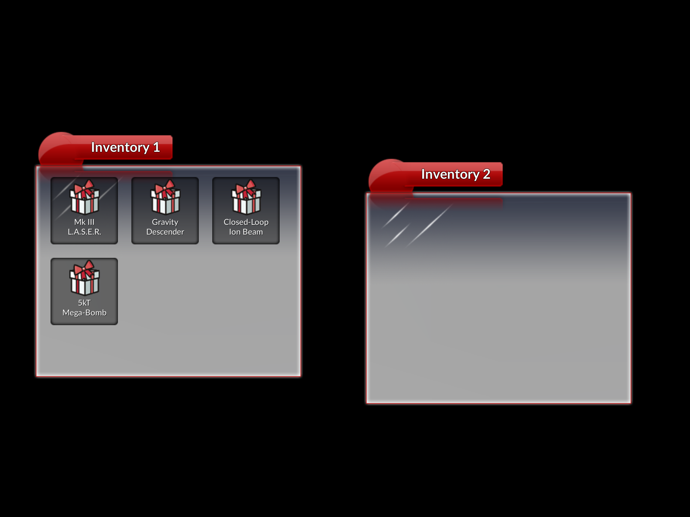</a>
    <div class="example-info">
      <p><strong><a href="official/basic/drag/main.cjs">官方拖动</a></strong></p>
      <p>在窗口间转移原生持有的图标，并调整图标顺序。</p>
      <p><code>node packages/sfml.js-rmlui/examples/official.cjs basic-drag</code></p>
      <p>将图标拖到另一个窗口或前面的图标上。Escape 退出。</p>
      <p><a href="https://github.com/mikke89/RmlUi/tree/6.3/Samples/basic/drag">上游应用</a></p>
    </div>
  </article>

  <article class="example-entry" id="effects">
    <a href="screenshots/effects.png">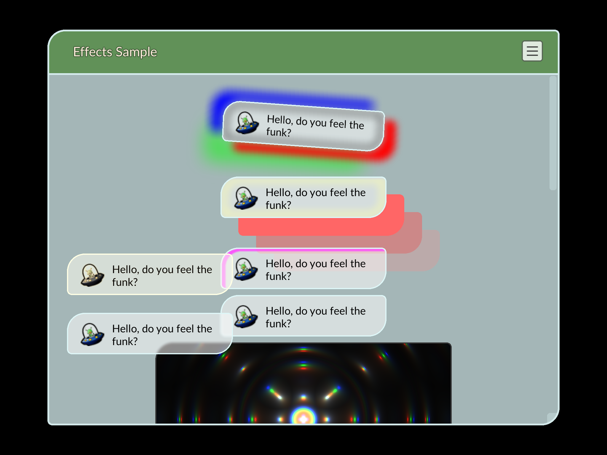</a>
    <div class="example-info">
      <p><strong><a href="official/basic/effects/main.cjs">官方效果</a></strong></p>
      <p>调整原始颜色滤镜、模糊、阴影、变换与不透明度。</p>
      <p><code>node packages/sfml.js-rmlui/examples/official.cjs effects</code></p>
      <p>打开菜单，调整滑块或重置设置。Escape 退出。</p>
      <p><a href="https://github.com/mikke89/RmlUi/tree/6.3/Samples/basic/effects">上游应用</a></p>
    </div>
  </article>

  <article class="example-entry" id="transform">
    <a href="screenshots/transform.png">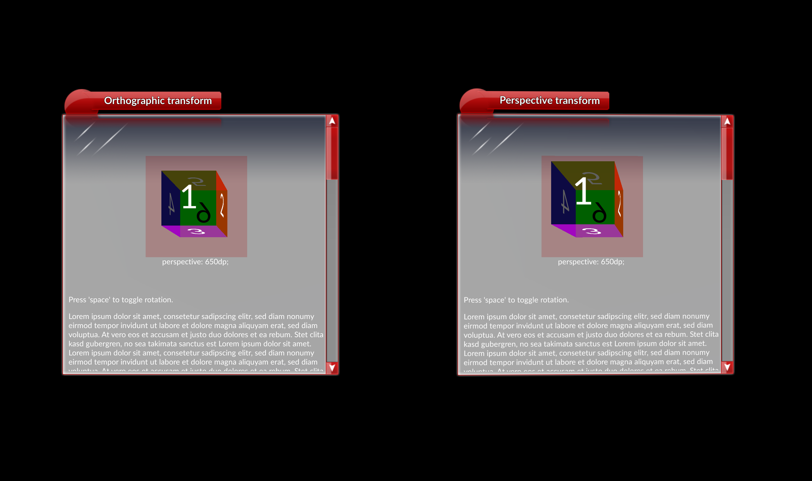</a>
    <div class="example-info">
      <p><strong><a href="official/basic/transform/main.cjs">官方变换</a></strong></p>
      <p>使用正交投影和透视投影旋转原始文档。</p>
      <p><code>node packages/sfml.js-rmlui/examples/official.cjs transform</code></p>
      <p>Space 暂停旋转，Escape 退出。</p>
      <p><a href="https://github.com/mikke89/RmlUi/tree/6.3/Samples/basic/transform">上游应用</a></p>
    </div>
  </article>

  <article class="example-entry" id="svg">
    <a href="screenshots/svg.png">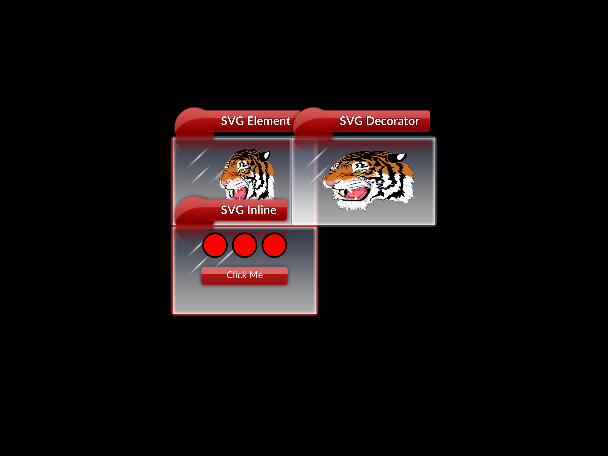</a>
    <div class="example-info">
      <p><strong><a href="official/basic/svg/main.cjs">官方 SVG</a></strong></p>
      <p>渲染原始 SVG 元素、装饰器与内联内容更新。</p>
      <p><code>node packages/sfml.js-rmlui/examples/official.cjs svg</code></p>
      <p>使用原始更新控件。Escape 退出。</p>
      <p><a href="https://github.com/mikke89/RmlUi/tree/6.3/Samples/basic/svg">上游应用</a></p>
    </div>
  </article>

  <article class="example-entry" id="lottie">
    <a href="screenshots/lottie.png">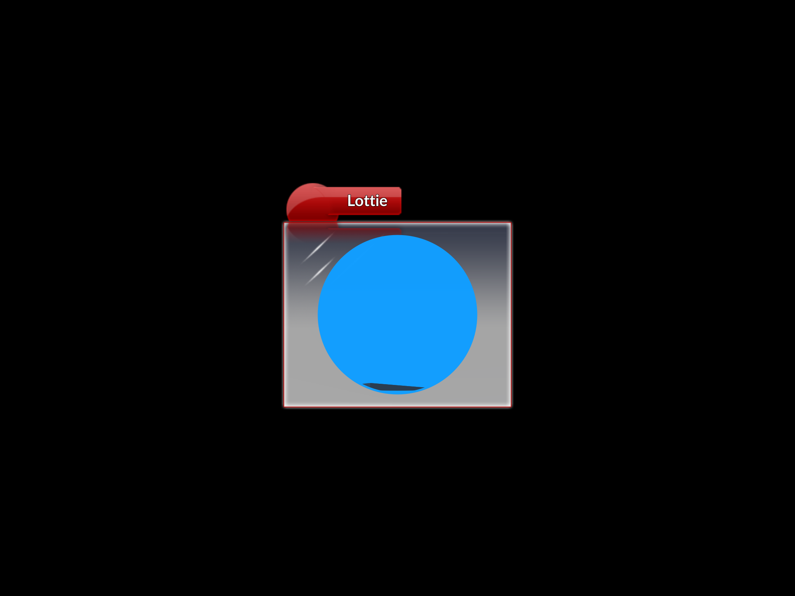</a>
    <div class="example-info">
      <p><strong><a href="official/basic/lottie/main.cjs">官方 Lottie</a></strong></p>
      <p>使用原生帧时序与栅格化播放原始山景动画。</p>
      <p><code>node packages/sfml.js-rmlui/examples/official.cjs lottie</code></p>
      <p>动画自动循环播放。Escape 退出。</p>
      <p><a href="https://github.com/mikke89/RmlUi/tree/6.3/Samples/basic/lottie">上游应用</a></p>
    </div>
  </article>

  <article class="example-entry" id="bitmap-font">
    <a href="screenshots/bitmap-font.png">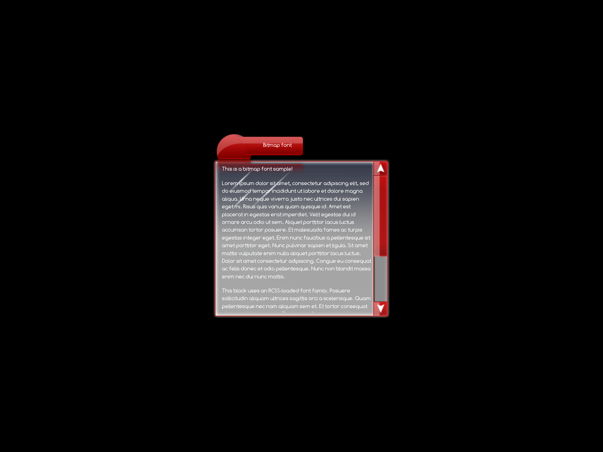</a>
    <div class="example-info">
      <p><strong><a href="official/basic/bitmap_font/main.cjs">官方位图字体</a></strong></p>
      <p>使用原始 FNT 字形步进、字距调整与原生图集纹理。</p>
      <p><code>node packages/sfml.js-rmlui/examples/official.cjs bitmap-font</code></p>
      <p>查看原始的三个文本段落。Escape 退出。</p>
      <p><a href="https://github.com/mikke89/RmlUi/tree/6.3/Samples/basic/bitmap_font">上游应用</a></p>
    </div>
  </article>

  <article class="example-entry" id="harfbuzz">
    <a href="screenshots/harfbuzz.png">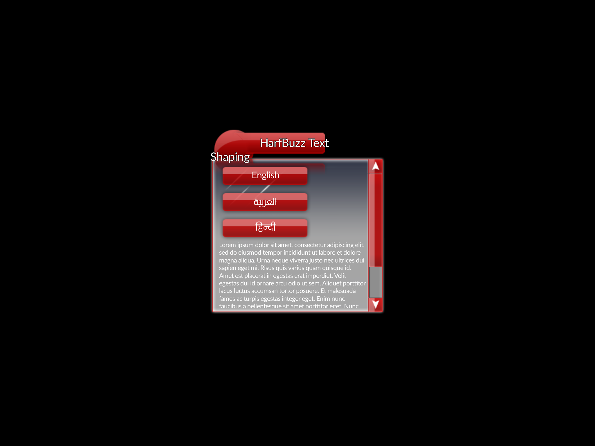</a>
    <div class="example-info">
      <p><strong><a href="official/basic/harfbuzz/main.cjs">官方 HarfBuzz</a></strong></p>
      <p>使用原始字体塑形英文、阿拉伯文与印地文段落。</p>
      <p><code>node packages/sfml.js-rmlui/examples/official.cjs harfbuzz</code></p>
      <p>点击语言按钮切换段落。Escape 退出。</p>
      <p><a href="https://github.com/mikke89/RmlUi/tree/6.3/Samples/basic/harfbuzz">上游应用</a></p>
    </div>
  </article>

  <article class="example-entry" id="custom-log">
    <a href="screenshots/custom-log.png">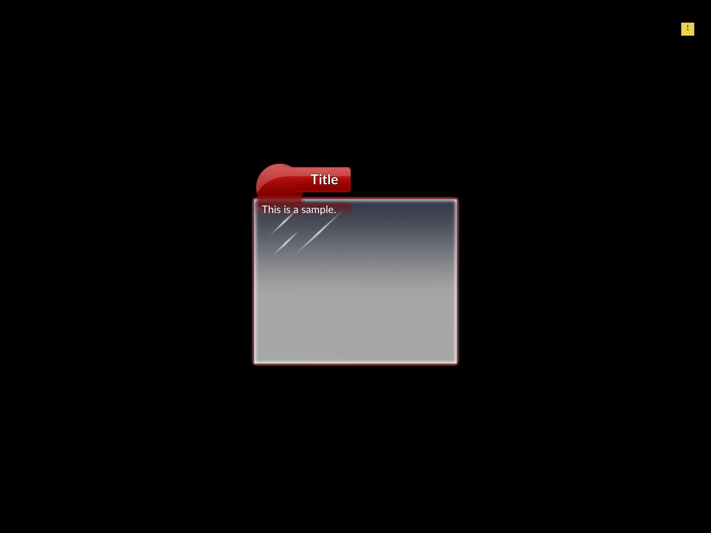</a>
    <div class="example-info">
      <p><strong><a href="official/basic/custom_log/main.cjs">官方自定义日志</a></strong></p>
      <p>将原始原生日志消息及级别前缀写入指定文件。</p>
      <p><code>node packages/sfml.js-rmlui/examples/official.cjs custom-log --log-file /tmp/rmlui-log.txt</code></p>
      <p>默认日志位于系统临时目录。Escape 退出。</p>
      <p><a href="https://github.com/mikke89/RmlUi/tree/6.3/Samples/basic/custom_log">上游应用</a></p>
    </div>
  </article>

  <article class="example-entry" id="ime">
    <a href="screenshots/ime.png">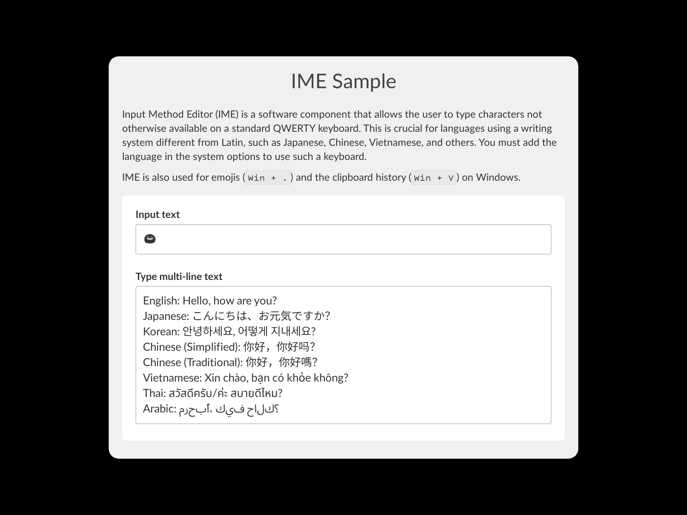</a>
    <div class="example-info">
      <p><strong><a href="official/basic/ime/main.cjs">官方 IME</a></strong></p>
      <p>加载全部十个原始字体，打开原生输入框与多行文本框。</p>
      <p>首次准备五个可选 Noto 字体（38 MB，校验 SHA-256）：<code>npm run download:ime-fonts --prefix packages/sfml.js-rmlui</code>。已校验的缓存直接复用。</p>
      <p><code>node packages/sfml.js-rmlui/examples/official.cjs ime</code></p>
      <p>选择系统输入法，然后聚焦任一输入框。Escape 退出。</p>
      <p><a href="https://github.com/mikke89/RmlUi/tree/6.3/Samples/basic/ime">上游应用</a></p>
    </div>
  </article>

  <article class="example-entry" id="invaders">
    <a href="screenshots/invaders.png">
      
    </a>
    <div class="example-info">
      <p><strong><a href="official/invaders/main.cjs">Invaders</a></strong></p>
      <p>运行原始 C++ 游戏、菜单、装饰器和高分榜数据模型。</p>
      <p><code>node packages/sfml.js-rmlui/examples/official.cjs invaders</code></p>
      <p>左右键移动，空格开火，Escape 打开暂停菜单，F8 切换 Debugger。通过原始菜单重开或退出。</p>
      <p>先构建包；游戏模块在同一个构建目录中生成，加载时无需编译器，已在 macOS、Linux 和 Windows 验证。原始原生游戏对照在 macOS 执行；Linux 和 Windows 的游戏对照仍未验证。</p>
      <p>高分保存到应用数据目录。<code>--scores-file /absolute/path/scores.txt</code> 指定已有父目录中的文件。<code>--frames 8 --exercise</code> 启动限帧游戏。</p>
      <p><a href="official/invaders/native/application.cc">原生注册</a> · <a href="https://github.com/mikke89/RmlUi/tree/6.3/Samples/invaders">上游应用</a></p>
    </div>
  </article>

  <article class="example-entry" id="lua-invaders">
    <a href="screenshots/lua-invaders.png">
      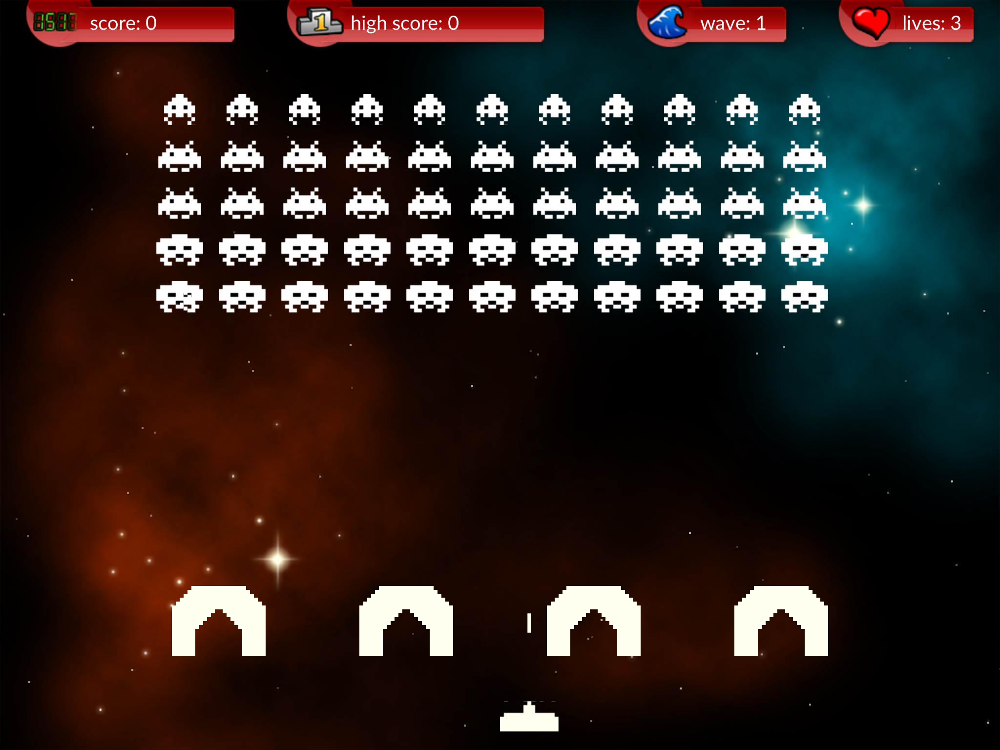
    </a>
    <div class="example-info">
      <p><strong><a href="official/lua_invaders/main.cjs">Lua Invaders</a></strong></p>
      <p>原始 Lua 文档和 Game 表驱动原始原生游戏。</p>
      <p><code>node packages/sfml.js-rmlui/examples/official.cjs lua-invaders</code></p>
      <p>左右键移动，空格开火，Escape 打开暂停菜单，F8 切换 Debugger。设置保存到所选高分文件的同目录。</p>
      <p>先构建包；游戏模块在同一个构建目录中生成，加载时无需编译器，已在 macOS、Linux 和 Windows 验证。原始原生游戏对照在 macOS 执行；Linux 和 Windows 的游戏对照仍未验证。</p>
      <p><code>--scores-file /absolute/path/scores.txt</code> 指定已有父目录中的文件。<code>--frames 8 --exercise</code> 启动限帧游戏。</p>
      <p><a href="official/lua_invaders/native/application.cc">原生注册</a> · <a href="https://github.com/mikke89/RmlUi/tree/6.3/Samples/lua_invaders">上游应用和脚本</a></p>
    </div>
  </article>

  <article class="example-entry" id="visual-tests">
    <a href="screenshots/clip-mask.png">
      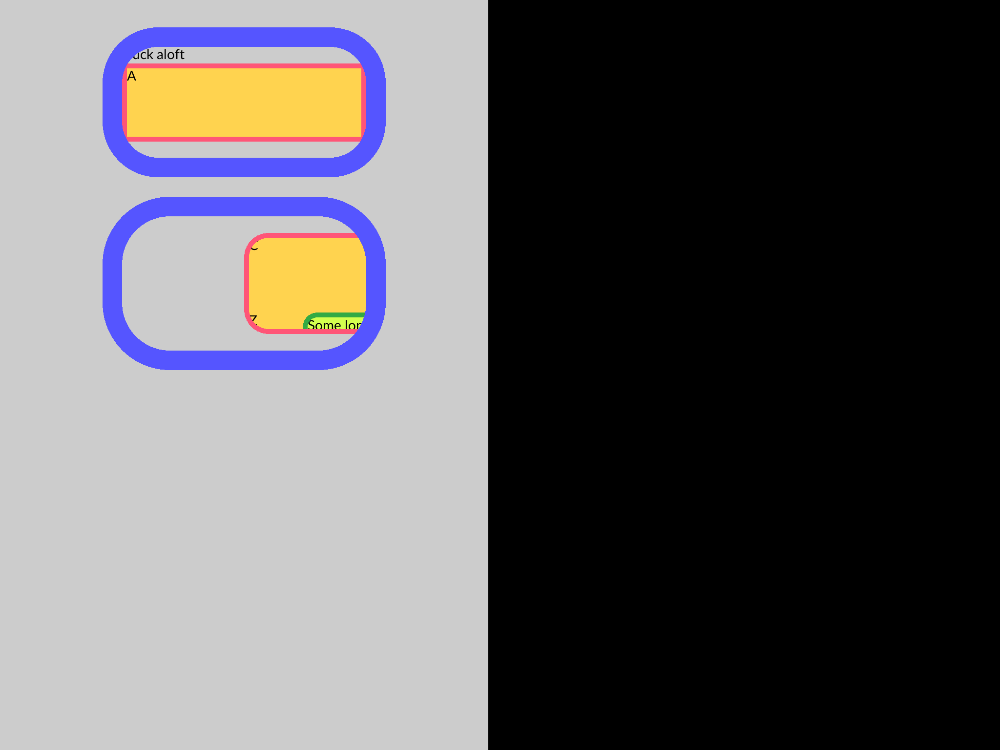
    </a>
    <div class="example-info">
      <p><strong><a href="official.cjs">VisualTests 浏览器</a></strong></p>
      <p>浏览 113 个上游视觉测试页面</p>
      <p><code>node packages/sfml.js-rmlui/examples/official.cjs visual/clip_mask</code></p>
      <p><strong>操作</strong>：F6／F7 切换页面，Escape 退出。</p>
      <p>
        在命令后追加 <code>--frames 60</code> 可在 60 帧后关闭窗口。
        <code>--frames N</code> 接受正整数，便于限定时长的冒烟检查。
        这里提供预览，未接入上游断言框架。
      </p>
      <p>
        <a href="https://github.com/mikke89/RmlUi/tree/6.3/Tests/Data/VisualTests">上游 VisualTests</a> ·
        <a href="../../../docs/rmlui/rendering.zh-CN.md">渲染覆盖范围</a>
      </p>
    </div>
  </article>
</div>

## 示例覆盖与验证 {#coverage-and-verification}

上方列出全部 20 个官方应用与教程、8 个绑定功能示例，以及覆盖 113 页上游
VisualTests 的浏览器。每个展示条目都有运行命令、源码链接、操作说明和原生
运行截图；29 张截图均已提供。

RmlUi 运行测试已在 macOS、Linux 和 Windows 通过。原生 SFML／GL3 效果对照
和原始游戏对照在 macOS 执行。VisualTests 启动器提供预览，独立对照记录覆盖
113 页静态场景和 25 页交互场景。其中 4 项内容检查和 2 项交互检查在固定版本
上游渲染器中也失败；记录中的绑定回归为 0，完整 VisualTests 与全项目独立
验收仍未完成。

macOS 系统 IME 条目已按既有验收决定关闭，预编辑、提交、取消和光标坐标的实测
保留在[桌面记录](../../../docs/rmlui/audit/6.3/desktop-ime-acceptance.md)中。
实体键盘输入、可靠的新进程重复测试和候选窗位置未验证。Linux 和 Windows
系统 IME 仍未验证。

[全部示例](../../sfml.js/examples/README.zh-CN.md) · [RmlUi 快速开始](../../../docs/rmlui/getting-started.zh-CN.md) · [上游示例](https://github.com/mikke89/RmlUi/tree/6.3/Samples)
